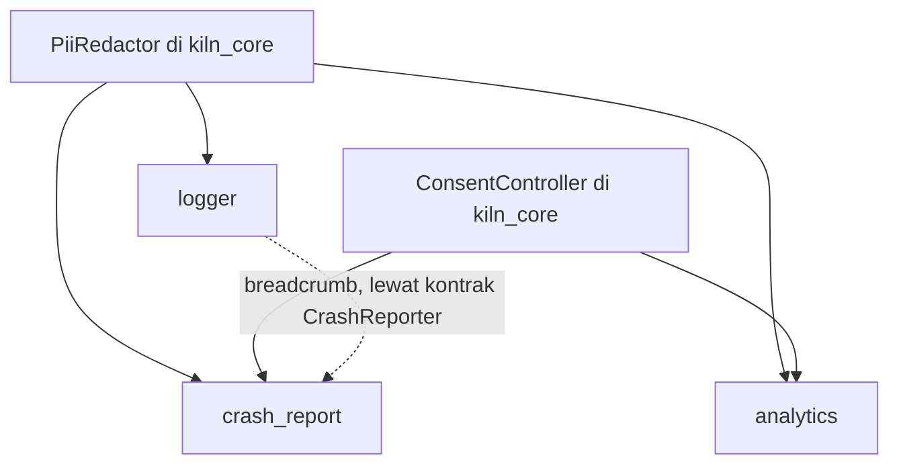

## Extension: tooling

Tujuh extension untuk konfigurasi, observabilitas, dan alur kerja developer.
`env`, `flavors`, dan `ci` terutama merender file proyek; `logger`,
`analytics`, dan `crash_report` adalah satu keluarga yang berbagi
`PiiRedactor` dan `ConsentController` dari `kiln_core`, sehingga data pribadi
disamarkan dan persetujuan user dihormati dengan cara yang sama di ketiganya.



### env

```text
extensions/env/
├─ extension.yaml  # manifest: provides: env · category: config · exclusive · prompts: keys (nama, tipe, wajib atau tidak, rahasia atau tidak)
├─ README.md  # pengantar extension env: tujuan, cara pasang, dan contoh pemakaian
├─ CHANGELOG.md  # riwayat perubahan extension env per versi
├─ docs/  # dokumentasi extension env untuk pengguna
│  ├─ env.md  # panduan utama extension env: key, tipe, dan cara membaca nilai
│  ├─ env-files.md  # menjelaskan --dart-define-from-file dan alasan file asli tidak masuk Git
│  └─ secrets-in-client-apps.md  # mengingatkan nilai --dart-define bisa diekstrak dari binary, jadi jangan simpan rahasia
├─ test/                                    # test tingkat extension, jalan di repo kiln dan bukan di aplikasi user
│  ├─ manifest_test.dart                    # memastikan extension.yaml valid terhadap extension.schema.json
│  ├─ render_test.dart                      # merender brick ke folder temp, hasilnya harus sama dengan golden
│  ├─ analyze_test.dart                     # hasil render harus lolos dart analyze tanpa peringatan
│  └─ goldens/rendered/                     # hasil render acuan untuk render_test, generate lewat kiln ext test --update-goldens
└─ brick/  # brick Mason yang dirender ke proyek user
   ├─ brick.yaml  # metadata brick Mason: nama, versi, dan variabel prompt
   └─ __brick__/  # template yang dirender ke proyek user
      ├─ env/  # file konfigurasi contoh per flavor untuk --dart-define-from-file
      │  ├─ development.example.json  # template flavor development tanpa nilai rahasia, file asli di-ignore Git
      │  ├─ staging.example.json  # template flavor staging tanpa nilai rahasia
      │  └─ production.example.json  # template flavor production tanpa nilai rahasia
      ├─ lib/extensions/env/  # kode Dart extension env di aplikasi user
      │  ├─ env_module.dart  # mendaftarkan implementasi Env ke Registry
      │  ├─ build_env.dart  # implementasi Env yang membaca nilai dari --dart-define saat build
      │  ├─ build_env_values.dart  # generate dari prompt keys, tiap key eksplisit karena String.fromEnvironment butuh konstan
      │  ├─ env_keys.dart  # konstanta key bertipe (EnvKeys.apiBaseUrl), mencegah salah ketik
      │  ├─ env_schema.dart  # mendefinisikan nama, tipe, status wajib, dan status rahasia tiap key
      │  ├─ env_validator.dart  # memeriksa key wajib saat bootstrap, semua kekurangan jadi satu Failure(configuration)
      │  ├─ env_x.dart  # membaca nilai Env sebagai uri(key), duration(key), dan enumValue(key)
      │  ├─ env_describe.dart  # membuat ringkasan Env untuk log dan debug, nilai rahasia disamarkan
      │  └─ widgets/  # widget debug untuk extension env
      │     └─ env_debug_page.dart  # menampilkan halaman debug env hanya untuk flavor non-production
      └─ test/extensions/env/  # test unit dan widget extension env di aplikasi user
         ├─ build_env_test.dart  # menguji bahwa BuildEnv membaca nilai build-time sesuai kontrak Env
         ├─ env_module_test.dart  # menguji bahwa module mendaftarkan Env ke Registry
         ├─ env_schema_test.dart  # menguji bahwa skema memuat nama, tipe, wajib, dan rahasia tiap key
         ├─ env_validator_test.dart  # menguji bahwa key wajib yang kurang dilaporkan sekaligus dalam satu Failure
         ├─ env_x_test.dart  # menguji bahwa uri, duration, dan enumValue mengurai nilai Env dengan benar
         ├─ env_describe_test.dart  # menguji bahwa ringkasan Env menyamarkan nilai rahasia
         ├─ env_debug_page_test.dart  # menguji bahwa halaman debug hanya tampil di flavor non-production
         └─ env_example_files_test.dart  # menguji bahwa setiap key skema ada di semua file contoh
```

### flavors

```text
extensions/flavors/
├─ extension.yaml  # manifest: provides: flavor · category: flavor · exclusive · prompts: flavors (default development, staging, production) · contributes: app.wrappers
├─ README.md  # pengantar extension flavors: tujuan, cara pasang, dan contoh pemakaian
├─ CHANGELOG.md  # riwayat perubahan extension flavors per versi
├─ docs/  # dokumentasi extension flavors untuk pengguna
│  ├─ flavors.md  # panduan utama extension flavors: nilai AppFlavor dan cara memilihnya
│  ├─ run-configurations.md  # menjalankan tiap flavor dari VS Code, IntelliJ, dan terminal
│  └─ native-flavors-not-included.md  # menjelaskan kenapa flavor hanya nilai Dart dan apa yang tidak ditangani
├─ test/                                    # test tingkat extension, jalan di repo kiln dan bukan di aplikasi user
│  ├─ manifest_test.dart                    # memastikan extension.yaml valid terhadap extension.schema.json
│  ├─ render_test.dart                      # merender brick ke folder temp, hasilnya harus sama dengan golden
│  ├─ analyze_test.dart                     # hasil render harus lolos dart analyze tanpa peringatan
│  └─ goldens/rendered/                     # hasil render acuan untuk render_test, generate lewat kiln ext test --update-goldens
└─ brick/  # brick Mason yang dirender ke proyek user
   ├─ brick.yaml  # metadata brick Mason: nama, versi, dan variabel prompt
   └─ __brick__/  # template yang dirender ke proyek user
      ├─ .vscode/  # konfigurasi VS Code untuk menjalankan tiap flavor
      │  └─ launch.json  # satu konfigurasi per flavor (--target, --dart-define-from-file), bentrok diatur collision_policy
      ├─ lib/  # entry point per flavor dan kode extension flavors
      │  ├─ main_development.dart  # entry point yang menjalankan aplikasi dengan flavor development
      │  ├─ main_staging.dart  # entry point yang menjalankan aplikasi dengan flavor staging
      │  ├─ main_production.dart  # entry point yang menjalankan aplikasi dengan flavor production
      │  └─ extensions/flavors/  # kode Dart extension flavors di aplikasi user
      │     ├─ app_flavors.dart  # mendefinisikan daftar flavor aplikasi dari kontrak AppFlavor
      │     ├─ flavors_module.dart  # mendaftarkan FlavorBanner ke slot app.wrappers
      │     ├─ flavor_banner.dart  # menampilkan pita DEV atau STG di pojok layar, tidak di production
      │     ├─ release_guard.dart  # melaporkan build release non-production lewat Logger, assert saat debug
      │     └─ flavor_x.dart  # memilih nilai per flavor lewat flavor.when(development: ..., production: ...)
      └─ test/extensions/flavors/  # test unit dan widget extension flavors di aplikasi user
         ├─ app_flavors_test.dart  # menguji bahwa daftar flavor dan nilainya sesuai kontrak AppFlavor
         ├─ flavors_module_test.dart  # menguji bahwa module mendaftarkan FlavorBanner ke slot app.wrappers
         ├─ flavor_banner_test.dart  # menguji bahwa pita tampil di development dan staging, bukan production
         ├─ release_guard_test.dart  # menguji bahwa build release non-production dilaporkan lewat Logger
         ├─ flavor_x_test.dart  # menguji bahwa flavor.when memilih cabang sesuai flavor
         └─ launch_config_test.dart  # menguji bahwa launch.json valid dan menunjuk file main yang ada
```

### logger

```text
extensions/logger/
├─ extension.yaml  # manifest: provides: logger · category: logging · exclusive · prompts: file_sink, http_logging (bool) · dependency: path_provider (bila file_sink)
├─ README.md  # pengantar extension logger: tujuan, cara pasang, dan contoh pemakaian
├─ CHANGELOG.md  # riwayat perubahan extension logger per versi
├─ docs/  # dokumentasi extension logger untuk pengguna
│  ├─ logging.md  # panduan utama extension logger: level, sink, dan cara memakai AppLogger
│  ├─ sinks.md  # menjelaskan cara menulis sink sendiri dan urutan decorator
│  └─ what-not-to-log.md  # daftar data yang tidak boleh dicatat: token, kata sandi, data pribadi
├─ test/                                    # test tingkat extension, jalan di repo kiln dan bukan di aplikasi user
│  ├─ manifest_test.dart                    # memastikan extension.yaml valid terhadap extension.schema.json
│  ├─ render_test.dart                      # merender brick ke folder temp, hasilnya harus sama dengan golden
│  ├─ analyze_test.dart                     # hasil render harus lolos dart analyze tanpa peringatan
│  └─ goldens/rendered/                     # hasil render acuan untuk render_test, generate lewat kiln ext test --update-goldens
└─ brick/  # brick Mason yang dirender ke proyek user
   ├─ brick.yaml  # metadata brick Mason: nama, versi, dan variabel prompt
   └─ __brick__/  # template yang dirender ke proyek user
      ├─ lib/extensions/logger/  # kode Dart extension logger di aplikasi user
      │  ├─ logger_module.dart  # mendaftarkan AppLogger ke Registry
      │  ├─ console_logger.dart  # mencetak log ke konsol sebagai implementasi AppLogger
      │  ├─ logger_config.dart  # konfigurasi bertipe: level per flavor, sink aktif, redaksi
      │  ├─ log_sink.dart  # kontrak sink dan typedef LogSink
      │  ├─ log_formatter.dart  # memformat LogRecord sebagai teks terbaca manusia atau JSON lines
      │  ├─ sink_pipeline.dart  # mengirim LogRecord ke beberapa sink, satu sink gagal tidak menghentikan yang lain
      │  ├─ redacting_sink.dart  # decorator sink yang menyamarkan data pribadi dengan PiiRedactor dari kiln_core
      │  ├─ memory_log_sink.dart  # buffer cincin berisi N record terakhir, untuk laporan bug dan test
      │  ├─ file_log_sink.dart  # menulis berkas log berputar di folder dokumen aplikasi, tidak untuk web
      │  ├─ breadcrumb_sink.dart  # meneruskan log warning ke atas ke CrashReporter sebagai breadcrumb (readOrNull)
      │  ├─ log_level_controller.dart  # mengubah level log saat berjalan, hanya flavor non-production
      │  ├─ log_exporter.dart  # mengumpulkan memory dan file log yang sudah disamarkan untuk dibagikan
      │  ├─ http_log_middleware.dart  # kontribusi ke http.interceptors (when: [http_pipeline]) yang mencatat metode, URL, status, durasi
      │  └─ widgets/  # widget debug untuk extension logger
      │     └─ debug_log_page.dart  # menampilkan layar log dari MemoryLogSink, hanya flavor non-production
      └─ test/extensions/logger/  # test unit dan widget extension logger di aplikasi user
         ├─ console_logger_test.dart  # menguji bahwa ConsoleLogger mencetak log sesuai level
         ├─ logger_module_test.dart  # menguji bahwa module mendaftarkan AppLogger ke Registry
         ├─ logger_config_test.dart  # menguji bahwa level per flavor, sink aktif, dan redaksi terbaca benar
         ├─ log_formatter_test.dart  # menguji bahwa LogRecord diformat sebagai teks dan JSON lines dengan benar
         ├─ sink_pipeline_test.dart  # menguji bahwa kegagalan satu sink tidak menghentikan sink lain
         ├─ redacting_sink_test.dart  # menguji bahwa data pribadi disamarkan sebelum sampai ke sink
         ├─ memory_log_sink_test.dart  # menguji bahwa buffer hanya menyimpan N record terakhir
         ├─ file_log_sink_test.dart  # menguji bahwa log ditulis ke berkas dan berkas berputar
         ├─ breadcrumb_sink_test.dart  # menguji bahwa warning diteruskan ke CrashReporter sebagai breadcrumb
         ├─ log_level_controller_test.dart  # menguji bahwa level bisa diubah saat berjalan hanya di non-production
         ├─ log_exporter_test.dart  # menguji bahwa log memory dan file diekspor dalam keadaan disamarkan
         ├─ http_log_middleware_test.dart  # menguji bahwa header Authorization disamarkan dan badan tidak dicatat
         ├─ debug_log_page_test.dart  # menguji bahwa halaman menampilkan isi MemoryLogSink di non-production
         └─ logger_contract_test.dart  # menjalankan suite kontrak AppLogger dari kiln_testing ke implementasi ini
```

### analytics

```text
extensions/analytics/
├─ extension.yaml  # manifest: provides: analytics · category: analytics · exclusive · prompts: api_key (secret), host · android: INTERNET
├─ README.md  # pengantar extension analytics: tujuan, cara pasang, dan contoh pemakaian
├─ CHANGELOG.md  # riwayat perubahan extension analytics per versi
├─ docs/  # dokumentasi extension analytics untuk pengguna
│  ├─ analytics.md  # panduan utama extension analytics: konfigurasi dan pemakaian Analytics
│  ├─ event-naming.md  # menjelaskan konvensi nama event dan properti serta event bertipe
│  └─ privacy-and-consent.md  # menjelaskan kapan event dikirim, apa yang disamarkan, dan cara menarik persetujuan
├─ test/                                    # test tingkat extension, jalan di repo kiln dan bukan di aplikasi user
│  ├─ manifest_test.dart                    # memastikan extension.yaml valid terhadap extension.schema.json
│  ├─ render_test.dart                      # merender brick ke folder temp, hasilnya harus sama dengan golden
│  ├─ analyze_test.dart                     # hasil render harus lolos dart analyze tanpa peringatan
│  └─ goldens/rendered/                     # hasil render acuan untuk render_test, generate lewat kiln ext test --update-goldens
└─ brick/  # brick Mason yang dirender ke proyek user
   ├─ brick.yaml  # metadata brick Mason: nama, versi, dan variabel prompt
   └─ __brick__/  # template yang dirender ke proyek user
      ├─ lib/extensions/analytics/  # kode Dart extension analytics di aplikasi user
      │  ├─ analytics_module.dart  # mendaftarkan Analytics ke Registry
      │  ├─ posthog_analytics.dart  # implementasi Analytics yang mengirim event ke PostHog
      │  ├─ analytics_gateway.dart  # membungkus plugin PostHog agar bisa di-fake di test
      │  ├─ analytics_failure_mapper.dart  # mengubah error PostHog menjadi Failure
      │  ├─ analytics_config.dart  # konfigurasi bertipe: api key, host, interval flush, flavor yang mengirim
      │  ├─ analytics_event.dart  # mendefinisikan AnalyticsEvent bertipe (nama + properti) dan Analytics.captureEvent(e)
      │  ├─ property_sanitizer.dart  # mengubah nilai properti ke JSON-like, null dibuang, tak didukung jadi Failure(validation)
      │  ├─ consent_gate_analytics.dart  # decorator yang tidak mengirim apa pun sebelum ConsentController mengizinkan analytics
      │  ├─ pii_scrubbing_analytics.dart  # decorator yang menyamarkan properti dan identitas dengan PiiRedactor
      │  ├─ noop_analytics.dart  # Analytics tanpa aksi, dipakai bila api key kosong atau flavor tidak mengirim
      │  └─ session_identity_listener.dart  # memanggil identify saat masuk dan reset saat keluar, dari SessionController
      └─ test/extensions/analytics/  # test unit dan widget extension analytics di aplikasi user
         ├─ analytics_test.dart  # menguji bahwa implementasi Analytics meneruskan event ke gateway
         ├─ analytics_failure_mapper_test.dart  # menguji bahwa error PostHog diubah menjadi Failure yang tepat
         ├─ analytics_module_test.dart  # menguji bahwa module mendaftarkan Analytics ke Registry
         ├─ analytics_config_test.dart  # menguji bahwa konfigurasi api key, host, dan flush terbaca benar
         ├─ analytics_event_test.dart  # menguji bahwa AnalyticsEvent membawa nama dan properti bertipe
         ├─ property_sanitizer_test.dart  # menguji bahwa null dibuang dan nilai tak didukung menjadi Failure(validation)
         ├─ consent_gate_analytics_test.dart  # menguji bahwa tidak ada event terkirim sebelum persetujuan diberikan
         ├─ pii_scrubbing_analytics_test.dart  # menguji bahwa PiiRedactor menyamarkan properti dan identitas
         ├─ noop_analytics_test.dart  # menguji bahwa Analytics noop tidak mengirim apa pun
         ├─ session_identity_listener_test.dart  # menguji bahwa identify dipanggil saat masuk dan reset saat keluar
         └─ analytics_contract_test.dart  # menjalankan suite kontrak Analytics dari kiln_testing ke implementasi ini
```

