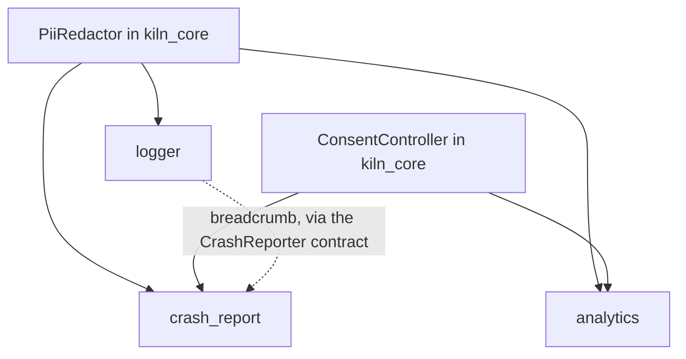

## Extensions: tooling

Seven extensions for configuration, observability, and developer workflow. `env`,
`flavors`, and `ci` mainly render project files; `logger`, `analytics`, and
`crash_report` are one family that shares `PiiRedactor` and `ConsentController` from
`kiln_core`, so personal data is masked and user consent is honored the same way in
all three.



### env

```text
extensions/env/
├─ extension.yaml  # manifest: provides: env · category: config · exclusive · prompts: keys (name, type, required or not, secret or not)
├─ README.md  # introduction to the env extension: purpose, how to install it, and usage examples
├─ CHANGELOG.md  # change history of the env extension per version
├─ docs/  # env extension documentation for users
│  ├─ env.md  # main env extension guide: keys, types, and how to read values
│  ├─ env-files.md  # explains --dart-define-from-file and why the real file is not committed to Git
│  └─ secrets-in-client-apps.md  # reminds that --dart-define values can be extracted from the binary, so do not store secrets
├─ test/                                    # extension-level tests, run in the kiln repo and not in the user app
│  ├─ manifest_test.dart                    # ensures extension.yaml is valid against extension.schema.json
│  ├─ render_test.dart                      # renders the brick to a temp folder, the result must match the golden
│  ├─ analyze_test.dart                     # the rendered result must pass dart analyze without warnings
│  └─ goldens/rendered/                     # reference render output for render_test, generated via kiln ext test --update-goldens
└─ brick/  # Mason brick rendered into the user project
   ├─ brick.yaml  # Mason brick metadata: name, version, and prompt variables
   └─ __brick__/  # templates rendered into the user project
      ├─ env/  # sample configuration files per flavor for --dart-define-from-file
      │  ├─ development.example.json  # development flavor template without secret values, the real file is Git-ignored
      │  ├─ staging.example.json  # staging flavor template without secret values
      │  └─ production.example.json  # production flavor template without secret values
      ├─ lib/extensions/env/  # env extension Dart code in the user app
      │  ├─ env_module.dart  # registers the Env implementation with the Registry
      │  ├─ build_env.dart  # Env implementation that reads values from --dart-define at build time
      │  ├─ build_env_values.dart  # generated from the keys prompt, each key explicit because String.fromEnvironment needs constants
      │  ├─ env_keys.dart  # typed key constants (EnvKeys.apiBaseUrl), preventing typos
      │  ├─ env_schema.dart  # defines each key's name, type, required status, and secret status
      │  ├─ env_validator.dart  # checks required keys at bootstrap, all gaps become a single Failure(configuration)
      │  ├─ env_x.dart  # reads Env values as uri(key), duration(key), and enumValue(key)
      │  ├─ env_describe.dart  # builds an Env summary for logs and debugging, secret values masked
      │  └─ widgets/  # debug widgets for the env extension
      │     └─ env_debug_page.dart  # shows the env debug page only for non-production flavors
      └─ test/extensions/env/  # env extension unit and widget tests in the user app
         ├─ build_env_test.dart  # tests that BuildEnv reads build-time values per the Env contract
         ├─ env_module_test.dart  # tests that the module registers Env with the Registry
         ├─ env_schema_test.dart  # tests that the schema carries each key's name, type, required, and secret flags
         ├─ env_validator_test.dart  # tests that missing required keys are reported together in a single Failure
         ├─ env_x_test.dart  # tests that uri, duration, and enumValue parse Env values correctly
         ├─ env_describe_test.dart  # tests that the Env summary masks secret values
         ├─ env_debug_page_test.dart  # tests that the debug page appears only in non-production flavors
         └─ env_example_files_test.dart  # tests that every schema key exists in all sample files
```

### flavors

```text
extensions/flavors/
├─ extension.yaml  # manifest: provides: flavor · category: flavor · exclusive · prompts: flavors (default development, staging, production) · contributes: app.wrappers
├─ README.md  # introduction to the flavors extension: purpose, how to install it, and usage examples
├─ CHANGELOG.md  # change history of the flavors extension per version
├─ docs/  # flavors extension documentation for users
│  ├─ flavors.md  # main flavors extension guide: AppFlavor values and how to choose them
│  ├─ run-configurations.md  # running each flavor from VS Code, IntelliJ, and the terminal
│  └─ native-flavors-not-included.md  # explains why flavors are Dart values only and what is not handled
├─ test/                                    # extension-level tests, run in the kiln repo and not in the user app
│  ├─ manifest_test.dart                    # ensures extension.yaml is valid against extension.schema.json
│  ├─ render_test.dart                      # renders the brick to a temp folder, the result must match the golden
│  ├─ analyze_test.dart                     # the rendered result must pass dart analyze without warnings
│  └─ goldens/rendered/                     # reference render output for render_test, generated via kiln ext test --update-goldens
└─ brick/  # Mason brick rendered into the user project
   ├─ brick.yaml  # Mason brick metadata: name, version, and prompt variables
   └─ __brick__/  # templates rendered into the user project
      ├─ .vscode/  # VS Code configuration for running each flavor
      │  └─ launch.json  # one configuration per flavor (--target, --dart-define-from-file), conflicts handled by collision_policy
      ├─ lib/  # entry point per flavor and the flavors extension code
      │  ├─ main_development.dart  # entry point that runs the app with the development flavor
      │  ├─ main_staging.dart  # entry point that runs the app with the staging flavor
      │  ├─ main_production.dart  # entry point that runs the app with the production flavor
      │  └─ extensions/flavors/  # flavors extension Dart code in the user app
      │     ├─ app_flavors.dart  # defines the app flavor list from the AppFlavor contract
      │     ├─ flavors_module.dart  # registers FlavorBanner into the app.wrappers slot
      │     ├─ flavor_banner.dart  # shows a DEV or STG ribbon in the screen corner, not in production
      │     ├─ release_guard.dart  # reports non-production release builds through Logger, asserts in debug
      │     └─ flavor_x.dart  # picks a value per flavor via flavor.when(development: ..., production: ...)
      └─ test/extensions/flavors/  # flavors extension unit and widget tests in the user app
         ├─ app_flavors_test.dart  # tests that the flavor list and its values match the AppFlavor contract
         ├─ flavors_module_test.dart  # tests that the module registers FlavorBanner into the app.wrappers slot
         ├─ flavor_banner_test.dart  # tests that the ribbon shows in development and staging, not production
         ├─ release_guard_test.dart  # tests that non-production release builds are reported through Logger
         ├─ flavor_x_test.dart  # tests that flavor.when selects the branch for the flavor
         └─ launch_config_test.dart  # tests that launch.json is valid and points to existing main files
```

### logger

```text
extensions/logger/
├─ extension.yaml  # manifest: provides: logger · category: logging · exclusive · prompts: file_sink, http_logging (bool) · dependency: path_provider (if file_sink)
├─ README.md  # introduction to the logger extension: purpose, how to install it, and usage examples
├─ CHANGELOG.md  # change history of the logger extension per version
├─ docs/  # logger extension documentation for users
│  ├─ logging.md  # main logger extension guide: levels, sinks, and how to use AppLogger
│  ├─ sinks.md  # explains how to write your own sink and the decorator order
│  └─ what-not-to-log.md  # list of data that must not be logged: tokens, passwords, personal data
├─ test/                                    # extension-level tests, run in the kiln repo and not in the user app
│  ├─ manifest_test.dart                    # ensures extension.yaml is valid against extension.schema.json
│  ├─ render_test.dart                      # renders the brick to a temp folder, the result must match the golden
│  ├─ analyze_test.dart                     # the rendered result must pass dart analyze without warnings
│  └─ goldens/rendered/                     # reference render output for render_test, generated via kiln ext test --update-goldens
└─ brick/  # Mason brick rendered into the user project
   ├─ brick.yaml  # Mason brick metadata: name, version, and prompt variables
   └─ __brick__/  # templates rendered into the user project
      ├─ lib/extensions/logger/  # logger extension Dart code in the user app
      │  ├─ logger_module.dart  # registers AppLogger with the Registry
      │  ├─ console_logger.dart  # prints logs to the console as the AppLogger implementation
      │  ├─ logger_config.dart  # typed configuration: level per flavor, active sinks, redaction
      │  ├─ log_sink.dart  # sink contract and the LogSink typedef
      │  ├─ log_formatter.dart  # formats a LogRecord as human-readable text or JSON lines
      │  ├─ sink_pipeline.dart  # sends a LogRecord to several sinks, one failing sink does not stop the others
      │  ├─ redacting_sink.dart  # sink decorator that masks personal data with PiiRedactor from kiln_core
      │  ├─ memory_log_sink.dart  # ring buffer holding the last N records, for bug reports and tests
      │  ├─ file_log_sink.dart  # writes rotating log files in the app documents folder, not for web
      │  ├─ breadcrumb_sink.dart  # forwards warning logs upward to CrashReporter as breadcrumbs (readOrNull)
      │  ├─ log_level_controller.dart  # changes the log level at runtime, non-production flavors only
      │  ├─ log_exporter.dart  # collects the already-masked memory and file logs for sharing
      │  ├─ http_log_middleware.dart  # contributes to http.interceptors (when: [http_pipeline]), logging method, URL, status, and duration
      │  └─ widgets/  # debug widgets for the logger extension
      │     └─ debug_log_page.dart  # shows the log screen from MemoryLogSink, non-production flavors only
      └─ test/extensions/logger/  # logger extension unit and widget tests in the user app
         ├─ console_logger_test.dart  # tests that ConsoleLogger prints logs according to the level
         ├─ logger_module_test.dart  # tests that the module registers AppLogger with the Registry
         ├─ logger_config_test.dart  # tests that the per-flavor level, active sinks, and redaction are read correctly
         ├─ log_formatter_test.dart  # tests that LogRecord is formatted correctly as text and JSON lines
         ├─ sink_pipeline_test.dart  # tests that a failing sink does not stop the other sinks
         ├─ redacting_sink_test.dart  # tests that personal data is masked before reaching the sink
         ├─ memory_log_sink_test.dart  # tests that the buffer keeps only the last N records
         ├─ file_log_sink_test.dart  # tests that logs are written to a file and the file rotates
         ├─ breadcrumb_sink_test.dart  # tests that warnings are forwarded to CrashReporter as breadcrumbs
         ├─ log_level_controller_test.dart  # tests that the level can be changed at runtime only in non-production
         ├─ log_exporter_test.dart  # tests that memory and file logs are exported in masked form
         ├─ http_log_middleware_test.dart  # tests that the Authorization header is masked and the body is not logged
         ├─ debug_log_page_test.dart  # tests that the page shows MemoryLogSink contents in non-production
         └─ logger_contract_test.dart  # runs the AppLogger contract suite from kiln_testing against this implementation
```

### analytics

```text
extensions/analytics/
├─ extension.yaml  # manifest: provides: analytics · category: analytics · exclusive · prompts: api_key (secret), host · android: INTERNET
├─ README.md  # introduction to the analytics extension: purpose, how to install it, and usage examples
├─ CHANGELOG.md  # change history of the analytics extension per version
├─ docs/  # analytics extension documentation for users
│  ├─ analytics.md  # main analytics extension guide: configuration and using Analytics
│  ├─ event-naming.md  # explains the event and property naming conventions and typed events
│  └─ privacy-and-consent.md  # explains when events are sent, what is masked, and how to withdraw consent
├─ test/                                    # extension-level tests, run in the kiln repo and not in the user app
│  ├─ manifest_test.dart                    # ensures extension.yaml is valid against extension.schema.json
│  ├─ render_test.dart                      # renders the brick to a temp folder, the result must match the golden
│  ├─ analyze_test.dart                     # the rendered result must pass dart analyze without warnings
│  └─ goldens/rendered/                     # reference render output for render_test, generated via kiln ext test --update-goldens
└─ brick/  # Mason brick rendered into the user project
   ├─ brick.yaml  # Mason brick metadata: name, version, and prompt variables
   └─ __brick__/  # templates rendered into the user project
      ├─ lib/extensions/analytics/  # analytics extension Dart code in the user app
      │  ├─ analytics_module.dart  # registers Analytics with the Registry
      │  ├─ posthog_analytics.dart  # Analytics implementation that sends events to PostHog
      │  ├─ analytics_gateway.dart  # wraps the PostHog plugin so it can be faked in tests
      │  ├─ analytics_failure_mapper.dart  # maps PostHog errors to Failure
      │  ├─ analytics_config.dart  # typed configuration: api key, host, flush interval, sending flavors
      │  ├─ analytics_event.dart  # defines the typed AnalyticsEvent (name + properties) and Analytics.captureEvent(e)
      │  ├─ property_sanitizer.dart  # converts property values to JSON-like, null dropped, unsupported becomes Failure(validation)
      │  ├─ consent_gate_analytics.dart  # decorator that sends nothing until ConsentController allows analytics
      │  ├─ pii_scrubbing_analytics.dart  # decorator that masks properties and identity with PiiRedactor
      │  ├─ noop_analytics.dart  # no-op Analytics, used when the api key is empty or the flavor does not send
      │  └─ session_identity_listener.dart  # calls identify on sign-in and reset on sign-out, driven by SessionController
      └─ test/extensions/analytics/  # analytics extension unit and widget tests in the user app
         ├─ analytics_test.dart  # tests that the Analytics implementation forwards events to the gateway
         ├─ analytics_failure_mapper_test.dart  # tests that PostHog errors are mapped to the right Failure
         ├─ analytics_module_test.dart  # tests that the module registers Analytics with the Registry
         ├─ analytics_config_test.dart  # tests that the api key, host, and flush configuration are read correctly
         ├─ analytics_event_test.dart  # tests that AnalyticsEvent carries a typed name and properties
         ├─ property_sanitizer_test.dart  # tests that null is dropped and unsupported values become Failure(validation)
         ├─ consent_gate_analytics_test.dart  # tests that no events are sent before consent is given
         ├─ pii_scrubbing_analytics_test.dart  # tests that PiiRedactor masks properties and identity
         ├─ noop_analytics_test.dart  # tests that the noop Analytics sends nothing
         ├─ session_identity_listener_test.dart  # tests that identify is called on sign-in and reset on sign-out
         └─ analytics_contract_test.dart  # runs the Analytics contract suite from kiln_testing against this implementation
```

