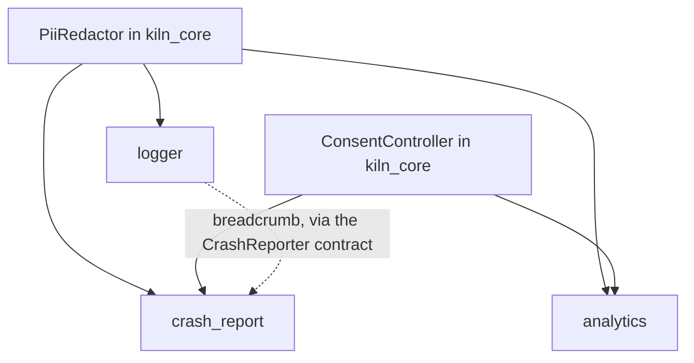
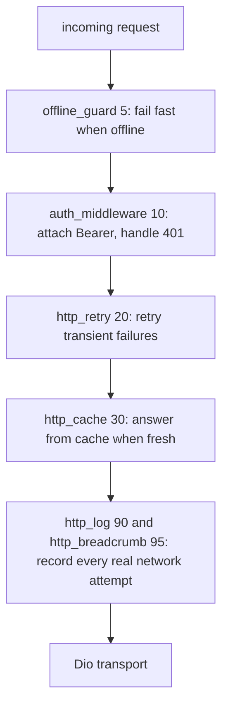

# Complete Kiln Folder Structure

*1 Nov 2026 · @tegar pamungkas*

> This document is the **target design** that expands the Phase 6 plan in
> [`roadmap.md`](roadmap.md), not an implementation status. What already exists in the repo
> today is the files with no `# new` tag. `crash_report`, `codegen`, and
> `kiln_store` are still parked in the roadmap until a new decision is made; here
> all three are drawn so the end shape looks complete. The section
> [Design decisions](#design-decisions-that-emerge-from-this-structure) at the end
> records what has to be decided before implementation.

## Conventions and how to read this

This document opens up the whole Kiln structure down to the file level: 6 packages, 29
extensions, and the generated project. Files already in the tree are not tagged, while
new ones are tagged `# new`.

- **Tags.** `# new` means not yet in the tree, `# generated` means generated
  output and must not be edited. Two extensions (`crash_report`, `codegen`) are
  entirely new folders, so the 27 old folders become 29. Inside those two folders
  files are not tagged one by one.
- **New content in every extension.** `README.md`, `CHANGELOG.md`, `docs/`,
  extension-level `test/`, and `hooks/` (when present) are not in the tree yet. Because
  of that only files inside `__brick__` are tagged `# new`.
- **One naming pattern inside the brick.**
  - `<id>.dart` or the capability name is the static facade with a short API
    (`Http`, `Prefs`, `Biometric`).
  - `<id>_module.dart` registers into the Registry.
  - `<id>_config.dart` holds the typed configuration from prompts.
  - `<id>_failure_mapper.dart` turns third-party errors into `Failure`.
  - `*_gateway.dart` wraps the plugin so it can be faked in tests.
- **Extensions do not import each other.** Relationships between extensions only go
  through contracts in `kiln_core` and slots (`http.interceptors`, `router.routes`, and
  other slots in the [Slot](#slots-who-opens-who-attaches) table).
- **Hooks only when needed.** Hooks run code on the user's machine, so only
  extensions that need validation or an extra step have `hooks/`.
- **Three test layers.** Tests inside the brick (they run in the user's app), extension-level
  tests (render, analyze, golden), and contract tests from
  `kiln_testing` that run against every implementation of the same contract.
- **New subfolders in packages.** In `kiln_core` and `kiln_extension_sdk`, existing
  files are grouped into subfolders. The barrels (`kiln_core.dart`,
  `kiln_extension_sdk.dart`) still export everything, so consumers are not
  affected.

Standard contents of each extension folder (in the tree below, the extension-level `test/`
part is written as one line):

```text
extensions/<id>/
├─ extension.yaml
├─ README.md
├─ CHANGELOG.md
├─ docs/<topic>.md
├─ test/                            # extension-level
│  ├─ manifest_test.dart            # manifest is valid against the schema
│  ├─ render_test.dart              # renders to a temp folder, matches the golden
│  ├─ analyze_test.dart             # render output passes dart analyze
│  └─ goldens/rendered/             # generated
└─ brick/
   ├─ brick.yaml
   ├─ hooks/                        # only when needed
   └─ __brick__/
      ├─ lib/extensions/<id>/
      └─ test/extensions/<id>/
```

## Monorepo root

The root holds everything that is not package code: CI, documentation, YAML schemas,
project templates, examples, the extension registry, and release scripts. The contents of
`extensions/` and `packages/` are described in the following sections.

```text
kiln/
├─ .github/
│  ├─ ISSUE_TEMPLATE/
│  │  ├─ bug_report.yml                      # new
│  │  ├─ extension_request.yml               # new
│  │  └─ config.yml                          # new
│  ├─ workflows/
│  │  ├─ ci.yaml
│  │  ├─ extensions.yaml                     # new: matrix, only the extensions that changed
│  │  ├─ bundles_check.yaml                  # new: fails when bundles have not been regenerated
│  │  ├─ smoke.yaml                          # new: nightly, create + add everything + build apk and ios
│  │  ├─ drift.yaml                          # new: nightly, check the latest third-party package versions
│  │  ├─ docs.yaml                           # new
│  │  └─ release.yaml                        # new: publish to pub.dev + update the registry
│  ├─ CODEOWNERS                             # new
│  ├─ dependabot.yml                         # new
│  └─ PULL_REQUEST_TEMPLATE.md               # new
├─ .vscode/
│  ├─ settings.json                          # new: wire schemas/ into extension.yaml, kiln.yaml, kiln.lock.yaml
│  └─ extensions.json                        # new: recommended Dart and YAML extensions
├─ docs/
│  ├─ architecture.md
│  ├─ extension-manifest.md
│  ├─ roadmap.md
│  ├─ folder-structure.md                    # new: this document
│  ├─ getting-started.md                     # new
│  ├─ concepts/                              # new
│  │  ├─ contracts-and-capabilities.md
│  │  ├─ slots.md
│  │  ├─ lockfile-and-ownership.md
│  │  ├─ transactions-and-rollback.md
│  │  ├─ native-patches.md
│  │  ├─ compatibility.md
│  │  └─ security-model.md
│  ├─ cli/
│  │  └─ reference.md                        # new
│  ├─ extensions/                            # new
│  │  ├─ catalog.md                          # generated from every extension.yaml
│  │  ├─ writing-an-extension.md
│  │  ├─ testing-extensions.md
│  │  ├─ trust-tiers.md
│  │  └─ publishing.md
│  ├─ guides/                                # new
│  │  ├─ swap-backend.md
│  │  ├─ migrate-bloc-to-riverpod.md
│  │  ├─ add-offline-support.md
│  │  └─ setup-flavors-and-env.md
│  └─ adr/                                   # new: architecture decision records
│     ├─ 0001-never-edit-user-code.md
│     ├─ 0002-capabilities-not-ids.md
│     ├─ 0003-hooks-and-trust.md
│     ├─ 0004-transactions-and-journal.md
│     └─ 0005-checksums-and-registry.md
├─ schemas/                                  # new: YAML validation and autocomplete in the IDE
│  ├─ extension.schema.json
│  ├─ kiln.schema.json
│  ├─ kiln-lock.schema.json
│  ├─ migration.schema.json
│  └─ registry-index.schema.json
├─ bricks/
│  ├─ app_basic/
│  │  ├─ brick.yaml
│  │  ├─ hooks/                              # new
│  │  │  ├─ pubspec.yaml
│  │  │  ├─ pre_gen.dart                     # validates the app name, org, and folder collisions
│  │  │  └─ post_gen.dart                    # flutter create, add kiln_core, pub get, format, git init
│  │  └─ __brick__/
│  │     ├─ README.md
│  │     ├─ kiln.yaml                        # new: project configuration
│  │     ├─ analysis_options.yaml            # new
│  │     ├─ .gitignore                       # new: includes .kiln/backups, .kiln/logs, env/*.json
│  │     ├─ lib/
│  │     │  ├─ main.dart
│  │     │  ├─ app/
│  │     │  │  ├─ app.dart
│  │     │  │  ├─ registry_scope.dart
│  │     │  │  ├─ app_shell.dart                # new: MaterialApp, uses theme and locale from modules when present
│  │     │  │  ├─ error_screen.dart             # new: screen for bootstrap failures
│  │     │  │  ├─ app_wrappers.dart             # new: built-in app.wrappers slot, type AppWrapper = Widget Function(BuildContext, Widget)
│  │     │  │  └─ app_route.dart                # new: neutral AppRoute (path, name, builder) for the router.routes slot, no go_router import
│  │     │  └─ core/
│  │     │     ├─ l10n/
│  │     │     │  ├─ app_localizations_config.dart
│  │     │     │  └─ app_strings.dart
│  │     │     ├─ theme/
│  │     │     │  ├─ app_theme_config.dart
│  │     │     │  └─ app_theme.dart
│  │     │     └─ error/                        # new
│  │     │        ├─ global_error_handler.dart  # FlutterError.onError and PlatformDispatcher.onError to Logger, then to CrashReporter when installed (readOrNull)
│  │     │        └─ failure_presenter.dart     # Failure into a user-friendly message; the text comes from FailureMessages in l10n when installed, otherwise the raw Failure message
│  │     └─ test/
│  │        └─ app/
│  │           └─ app_smoke_test.dart         # new
│  └─ extension_template/                    # new: used by `kiln ext new`
│     ├─ brick.yaml                          # variables: id, name, category, provides, requires, with_hooks, with_native_patch
│     └─ __brick__/
│        └─ {{id.snakeCase()}}/
│           ├─ extension.yaml
│           ├─ README.md
│           ├─ CHANGELOG.md
│           ├─ docs/
│           │  └─ {{id.paramCase()}}.md
│           ├─ test/
│           │  ├─ manifest_test.dart
│           │  ├─ render_test.dart
│           │  └─ analyze_test.dart
│           └─ brick/
│              ├─ brick.yaml
│              ├─ hooks/                   # created when with_hooks
│              │  ├─ pubspec.yaml
│              │  ├─ pre_gen.dart
│              │  └─ post_gen.dart
│              └─ __brick__/
│                 ├─ lib/extensions/{{id.snakeCase()}}/
│                 │  ├─ {{id.snakeCase()}}.dart
│                 │  ├─ {{id.snakeCase()}}_module.dart
│                 │  ├─ {{id.snakeCase()}}_config.dart
│                 │  └─ {{id.snakeCase()}}_failure_mapper.dart
│                 └─ test/extensions/{{id.snakeCase()}}/
│                    ├─ {{id.snakeCase()}}_module_test.dart
│                    └─ {{id.snakeCase()}}_failure_mapper_test.dart
├─ extensions/                               # 29 folders, broken down in the Extension section
├─ examples/
│  ├─ minimal/                               # new: output of `kiln create` without extensions
│  │  ├─ kiln.yaml, kiln.lock.yaml, pubspec.yaml
│  │  ├─ lib/
│  │  └─ test/
│  ├─ full_stack/                            # new: bloc, dio, http_retry, rest_auth, secure_storage, go_router, theme, l10n, env, logger
│  │  ├─ kiln.yaml, kiln.lock.yaml, pubspec.yaml
│  │  ├─ lib/
│  │  └─ test/
│  ├─ backend_swap/                          # new: proof the backend can be swapped without changing app code
│  │  ├─ README.md
│  │  ├─ with_appwrite/
│  │  └─ with_supabase/                      # only kiln.yaml and lib/extensions differ
│  └─ custom_extension/                      # new: output of `kiln ext new`, a complete community extension example
├─ registry/                                 # new: produced by tool/build_registry.dart
│  ├─ index.json                             # id, latest version, tier
│  ├─ README.md
│  └─ extensions/
│     ├─ dio/
│     │  ├─ 1.0.0.json                       # archive url, sha256, requires, compatibility
│     │  └─ 1.1.0.json
│     └─ <id>/                               # one folder per extension
├─ tool/
│  ├─ bundle.dart                            # mason bundle for every brick, --check flag for CI
│  ├─ smoke_test.dart
│  ├─ build_registry.dart                    # new
│  ├─ check_drift.dart                       # new: compare extension constraints with the latest versions on pub.dev
│  ├─ lint_extensions.dart                   # new: run `kiln ext validate` against every extension
│  ├─ gen_catalog_docs.dart                  # new: write docs/extensions/catalog.md
│  └─ release.dart                           # new: bump versions, changelog, tag
├─ packages/                                 # broken down per package below
│  ├─ kiln_cli/
│  ├─ kiln_core/
│  ├─ kiln_extension_sdk/
│  ├─ kiln_store/                            # new
│  ├─ kiln_testing/                          # new
│  └─ kiln_lints/                            # new, optional (Phase 6)
├─ CONTRIBUTING.md                           # new
├─ SECURITY.md                               # new
├─ CODE_OF_CONDUCT.md                        # new
├─ LICENSE                                   # new
├─ .gitignore
├─ analysis_options.yaml
├─ pubspec.yaml
├─ pubspec.lock
└─ README.md
```

## kiln_core

`kiln_core` is the only package that application code and every extension are allowed
to know about. It holds the contracts, error models, module runtime, session state, and
privacy utilities, with no dependency on any Flutter plugin.

```text
packages/kiln_core/
├─ lib/
│  ├─ kiln_core.dart                         # barrel, exports everything
│  └─ src/
│     ├─ contracts/                          # contracts the extensions fulfill
│     │  ├─ account_management.dart          # new: PasswordRecovery, EmailVerification, ProfileUpdate, optional contracts alongside AuthRepository
│     │  ├─ analytics.dart
│     │  ├─ app_flavor.dart
│     │  ├─ auth.dart                        # AuthRepository
│     │  ├─ connectivity.dart
│     │  ├─ crash_reporter.dart              # new
│     │  ├─ deep_links.dart
│     │  ├─ env.dart
│     │  ├─ file_storage.dart                # new: upload, download, url, delete (bucket)
│     │  ├─ http_client.dart
│     │  ├─ local_db.dart
│     │  ├─ logger.dart
│     │  ├─ media_picker.dart
│     │  ├─ notifications.dart
│     │  ├─ permissions.dart
│     │  ├─ remote_database.dart             # new: document CRUD, RemoteQuery, watch
│     │  ├─ secure_storage.dart
│     │  ├─ social_auth.dart
│     │  └─ storage.dart                     # key-value
│     ├─ errors/
│     │  ├─ failure.dart
│     │  ├─ failure_codes.dart               # new: stable codes, e.g. network.timeout, auth.invalid_credentials
│     │  └─ result.dart                      # new: Result<T> = Ok | Err(Failure)
│     ├─ runtime/
│     │  ├─ registry.dart
│     │  ├─ get_it_registry.dart
│     │  ├─ kiln_module.dart
│     │  ├─ module_graph.dart                # new: init order from requires, cycle detection
│     │  ├─ lifecycle.dart                   # new: onReady, onPause, onResume, dispose
│     │  ├─ bootstrap.dart                   # new: KilnBootstrap.run (async init, timeout, error handler)
│     │  └─ slot.dart                        # new: OrderedSlot<T> for http.interceptors and router.routes
│     ├─ session/                            # new
│     │  ├─ session.dart                     # AuthSession: userId, expiresAt
│     │  ├─ session_controller.dart          # unknown, authenticated, unauthenticated + stream
│     │  └─ token_provider.dart              # contract to get and refresh tokens
│     ├─ privacy/                            # new
│     │  ├─ consent.dart                     # ConsentController for analytics and crash report
│     │  └─ pii_redactor.dart                # used by logger, analytics, crash_report
│     └─ util/                               # new
│        ├─ clock.dart                       # time that can be faked
│        ├─ debouncer.dart
│        └─ disposable.dart
├─ test/
│  ├─ auth_test.dart
│  ├─ failure_test.dart
│  ├─ http_client_test.dart
│  ├─ registry_test.dart
│  ├─ runtime_contracts_test.dart
│  ├─ result_test.dart, failure_codes_test.dart                                          # new
│  ├─ module_graph_test.dart, slot_test.dart, lifecycle_test.dart, bootstrap_test.dart   # new
│  ├─ session_controller_test.dart, consent_test.dart, pii_redactor_test.dart            # new
│  └─ clock_test.dart, debouncer_test.dart                                               # new
├─ example/
│  └─ main.dart                              # new
├─ analysis_options.yaml
├─ CHANGELOG.md
├─ pubspec.yaml
└─ README.md
```

## kiln_extension_sdk

The SDK is the engine behind `kiln add`: it reads the manifest, computes a plan,
renders the brick, then applies the changes in a transaction that can be undone.
The `installer/` part is the largest, and its three subfolders (`transaction/`,
`ownership/`, `verification/`) make `add` and `remove` safe.

```text
packages/kiln_extension_sdk/
├─ lib/
│  ├─ kiln_extension_sdk.dart
│  ├─ testing.dart                           # new: ExtensionTestHarness for extension authors
│  └─ src/
│     ├─ kiln_exception.dart
│     ├─ manifest/
│     │  ├─ extension_manifest.dart
│     │  ├─ platform_setup.dart
│     │  ├─ slot.dart
│     │  ├─ manifest_validator.dart          # new: id, semver, requires cycles, platform fields
│     │  ├─ prompt_spec.dart                 # new: prompt types (url, int, enum, secret) + validation
│     │  ├─ compatibility.dart               # new: kiln_core, dart, flutter, platform ranges
│     │  └─ contribution.dart                # new: contributes to a slot, with optional when: [capability]
│     ├─ resolver/
│     │  ├─ extension_resolver.dart
│     │  ├─ resolution_plan.dart
│     │  ├─ capability_index.dart            # new: who provides what
│     │  ├─ conflict_report.dart             # new: actionable conflict messages
│     │  ├─ dependency_graph.dart            # new: requires graph for `kiln graph` and `remove`
│     │  └─ upgrade_planner.dart             # new
│     ├─ renderer/
│     │  ├─ brick_renderer.dart
│     │  ├─ template_vars.dart               # new: prompts + kiln.yaml become Mason variables
│     │  ├─ collision_policy.dart            # new: skip, overwrite, ask; detects edited files via hash
│     │  └─ hook_policy.dart                 # new: hooks only run when the brick is trusted
│     ├─ installer/
│     │  ├─ extension_installer.dart
│     │  ├─ extensions_codegen.dart
│     │  ├─ lockfile.dart
│     │  ├─ pubspec_reader.dart
│     │  ├─ pubspec_writer.dart              # new: add and remove dependencies via yaml_edit
│     │  ├─ transaction/                     # new
│     │  │  ├─ transaction.dart              # runs the steps, records them in the journal
│     │  │  ├─ journal.dart
│     │  │  ├─ snapshot.dart                 # backs files up to .kiln/backups
│     │  │  └─ rollback.dart
│     │  ├─ ownership/                       # new
│     │  │  ├─ file_ownership.dart           # hash of every rendered file
│     │  │  └─ patch_journal.dart            # who owns a patch (reference count)
│     │  ├─ native/
│     │  │  ├─ native_setup.dart
│     │  │  ├─ patch.dart                    # new: Patch interface (describe, apply, revert)
│     │  │  ├─ android_gradle.dart
│     │  │  ├─ android_project.dart
│     │  │  ├─ ios_app_delegate.dart
│     │  │  ├─ ios_entitlements.dart
│     │  │  ├─ ios_plist.dart
│     │  │  ├─ ios_podfile.dart              # new: PERMISSION_* flags for permission_handler
│     │  │  ├─ macos_entitlements.dart       # new
│     │  │  └─ web_index_html.dart           # new
│     │  └─ verification/                    # new
│     │     ├─ verifier.dart                 # pub get + dart analyze after apply
│     │     └─ dry_run_reporter.dart         # the diff that would happen
│     └─ migrator/                           # new
│        ├─ migration.dart
│        ├─ migration_actions.dart           # rename_file, delete_file, replace_dependency, update_config, message
│        ├─ migration_loader.dart            # reads extensions/<id>/migrations
│        └─ migration_runner.dart
├─ test/
│  ├─ android_deep_links_test.dart
│  ├─ android_gradle_test.dart
│  ├─ brick_renderer_test.dart
│  ├─ installer_test.dart
│  ├─ ios_entitlements_test.dart
│  ├─ manifest_test.dart
│  ├─ resolver_test.dart
│  ├─ transaction_test.dart, rollback_test.dart, snapshot_test.dart                      # new
│  ├─ file_ownership_test.dart, patch_journal_test.dart                                  # new
│  ├─ pubspec_writer_test.dart, ios_podfile_test.dart                                    # new
│  ├─ macos_entitlements_test.dart, web_index_html_test.dart                             # new
│  ├─ manifest_validator_test.dart, prompt_spec_test.dart                                # new
│  ├─ compatibility_test.dart, contribution_test.dart                                    # new
│  ├─ capability_index_test.dart, conflict_report_test.dart                              # new
│  ├─ dependency_graph_test.dart, upgrade_planner_test.dart                              # new
│  ├─ collision_policy_test.dart, hook_policy_test.dart, template_vars_test.dart         # new
│  ├─ verifier_test.dart, dry_run_reporter_test.dart                                     # new
│  ├─ migration_runner_test.dart, migration_actions_test.dart                            # new
│  └─ fixtures/                                                                          # new
│     ├─ manifests/                          # valid/ and invalid/
│     ├─ projects/                           # fresh_app/, app_with_dio/, app_with_edited_files/, app_with_two_owners/
│     └─ bricks/                             # tiny_brick/, brick_with_hooks/
├─ tool/
│  └─ generate_schemas.dart                  # new: JSON Schema generated from the manifest model
├─ analysis_options.yaml
├─ CHANGELOG.md
├─ pubspec.yaml
└─ README.md
```

## kiln_cli

The CLI only handles interaction: command parsing, prompts, reporting, and exit
codes. All installation logic lives in `kiln_extension_sdk`, so every
command is thin and easy to test.

```text
packages/kiln_cli/
├─ bin/
│  └─ kiln.dart
├─ lib/
│  ├─ kiln_cli.dart
│  └─ src/
│     ├─ command_runner.dart
│     ├─ project_context.dart                # detects a kiln project, reads kiln.yaml and the lockfile
│     ├─ paths.dart
│     ├─ version.dart
│     ├─ commands/
│     │  ├─ create_command.dart
│     │  ├─ add_command.dart
│     │  ├─ remove_command.dart
│     │  ├─ list_command.dart
│     │  ├─ doctor_command.dart
│     │  ├─ version_command.dart
│     │  ├─ command_helpers.dart
│     │  ├─ info_command.dart                # new
│     │  ├─ upgrade_command.dart             # new
│     │  ├─ rollback_command.dart            # new
│     │  ├─ graph_command.dart               # new
│     │  ├─ config_command.dart              # new
│     │  ├─ cache_command.dart               # new
│     │  ├─ store_command.dart               # new
│     │  ├─ completion_command.dart          # new
│     │  └─ ext/                             # new: tooling for extension authors
│     │     ├─ ext_new_command.dart
│     │     ├─ ext_validate_command.dart
│     │     ├─ ext_test_command.dart
│     │     ├─ ext_pack_command.dart
│     │     └─ ext_publish_command.dart
│     ├─ infra/                              # new
│     │  ├─ kiln_logger.dart                 # levels, progress, --verbose, --quiet
│     │  ├─ prompter.dart                    # interactive, --yes, non-TTY detection
│     │  ├─ exit_codes.dart                  # fixed exit codes for CI
│     │  ├─ json_reporter.dart               # --json
│     │  ├─ error_presenter.dart             # KilnException into a message + fix suggestion
│     │  ├─ global_config.dart               # ~/.kiln/config.yaml
│     │  ├─ update_checker.dart              # new CLI version info, non-blocking
│     │  ├─ process_runner.dart              # moved from src/
│     │  └─ file_system.dart                 # abstraction so commands can be tested without disk
│     └─ bundles/                            # generated, do not edit
│        ├─ catalog.g.dart
│        ├─ app_basic_bundle.dart
│        └─ <id>_bundle.dart                 # one per extension, 29 files, named after extensions/<id>
├─ test/
│  ├─ command_runner_test.dart
│  ├─ commands/                           # new: one test per command
│  │  ├─ create_command_test.dart, add_command_test.dart, remove_command_test.dart
│  │  ├─ list_command_test.dart, doctor_command_test.dart, info_command_test.dart
│  │  ├─ upgrade_command_test.dart, rollback_command_test.dart, graph_command_test.dart
│  │  ├─ config_command_test.dart, cache_command_test.dart, store_command_test.dart
│  │  └─ ext_commands_test.dart
│  ├─ infra/                              # new
│  │  ├─ prompter_test.dart, json_reporter_test.dart
│  │  └─ error_presenter_test.dart, exit_codes_test.dart
│  ├─ fixtures/                           # new: a small project per scenario
│  │  ├─ fresh_app/, app_with_dio/, app_with_edited_files/
│  │  └─ app_with_flavors/, app_without_lock/
│  └─ goldens/                            # new: output that must stay stable
│     ├─ add_dry_run.txt, add_dry_run.json
│     └─ doctor_report.txt, list.json, info_dio.txt
├─ analysis_options.yaml
├─ CHANGELOG.md
├─ pubspec.yaml
└─ README.md
```

### Command list

| Command | Purpose | Important flags |
| --- | --- | --- |
| `create` | create a project from `app_basic`, pick the state management | `--state`, `--org`, `--platforms`, `--with` |
| `add` | install an extension transactionally | `--dry-run`, `--yes`, `--no-verify`, `--from` |
| `remove` | remove an extension, deleting only files that have not been edited | `--dry-run`, `--force` |
| `upgrade` | bump the extension version then run migrations | `--dry-run`, `--all` |
| `rollback` | undo the last operation from the journal | `--list` |
| `list` | installed or available extensions | `--installed`, `--available`, `--json` |
| `info` | provides, requires, platform, and changelog of one extension | `--json` |
| `graph` | requires and capability graph | `--format text` or `mermaid` |
| `doctor` | check project health | `--fix`, `--json` |
| `config` | set the registry, mirror, and offline mode | `--global` |
| `cache` | view or clear the registry cache | `clean` |
| `store` | search and inspect extensions in the registry | `search`, `info` |
| `completion` | shell autocomplete script | `bash`, `zsh`, `fish` |
| `ext` | extension author tooling: `new`, `validate`, `test`, `pack`, `publish` | `--update-goldens`, `--tier` |
| `version` | CLI and `kiln_core` versions | none |

### What doctor checks

- The hashes of rendered files in the lockfile compared with the actual state,
  so files the user edited are caught.
- Missing or duplicate native patches (permission, entitlement,
  intent-filter).
- `extensions.g.dart` that is out of sync with the lockfile.
- Unfinished manual steps, for example `flutterfire configure` for
  Firebase.
- Extensions that do not support the project platforms, for example `biometric` on web.
- The Dart, Flutter, and `kiln_core` versions against each
  extension's `compatibility` range.
- Extensions that have a new version or pending migrations.
- Leftover journals from operations that stopped halfway.

## kiln_store, kiln_testing, kiln_lints

Three new packages that close the trust and quality gaps: the store downloads
extensions with verification, testing proves that every contract implementation
can replace one another, and lints keep the app depending on
contracts.

### kiln_store

```text
packages/kiln_store/                          # new
├─ lib/
│  ├─ kiln_store.dart
│  └─ src/
│     ├─ registry_client.dart                # fetches index.json from Git
│     ├─ registry_index.dart                 # index and version models
│     ├─ registry_config.dart                # URL, mirror, ref (branch or tag)
│     ├─ version_resolver.dart               # picks the version that matches the project's kiln_core
│     ├─ search_index.dart                   # local search over the cache
│     ├─ checksum_verifier.dart              # sha256 of the archive
│     ├─ trust_policy.dart                   # official, verified, community; confirmation before hooks run
│     ├─ archive_packer.dart                 # builds .tgz
│     ├─ archive_unpacker.dart               # rejects path traversal (zip-slip)
│     ├─ publisher.dart                      # validate then publish
│     ├─ local_cache.dart
│     └─ offline_mode.dart
├─ test/
│  ├─ registry_client_test.dart, registry_index_test.dart, version_resolver_test.dart
│  ├─ search_index_test.dart, checksum_verifier_test.dart, trust_policy_test.dart
│  ├─ archive_packer_test.dart, archive_unpacker_test.dart
│  ├─ publisher_test.dart, local_cache_test.dart, offline_mode_test.dart
│  └─ fixtures/registry/                  # sample index.json and archives, including malicious ones
├─ analysis_options.yaml
├─ CHANGELOG.md
├─ pubspec.yaml
└─ README.md
```

### kiln_testing

Used as a `dev_dependency` in generated apps and in every
extension. The `contracts/` suite runs against every implementation: Appwrite,
Firebase, Supabase, and `rest_auth` must all pass the same `auth_repository_contract`,
and that is the proof that the backend can be swapped.

```text
packages/kiln_testing/                        # new
├─ lib/
│  ├─ kiln_testing.dart
│  └─ src/
│     ├─ fakes/
│     │  ├─ fake_http_client.dart
│     │  ├─ in_memory_storage.dart
│     │  ├─ in_memory_secure_storage.dart
│     │  ├─ fake_auth_repository.dart
│     │  ├─ fake_account_management.dart
│     │  ├─ fake_social_auth.dart
│     │  ├─ fake_connectivity.dart
│     │  ├─ fake_permissions.dart
│     │  ├─ fake_notifications.dart
│     │  ├─ fake_deep_links.dart
│     │  ├─ fake_media_picker.dart
│     │  ├─ fake_local_database.dart
│     │  ├─ fake_remote_database.dart
│     │  ├─ fake_file_storage.dart
│     │  ├─ fake_analytics.dart
│     │  ├─ fake_crash_reporter.dart
│     │  ├─ fake_env.dart
│     │  ├─ fake_clock.dart
│     │  └─ recording_logger.dart
│     ├─ contracts/                       # test suite for EVERY contract implementation
│     │  ├─ http_client_contract.dart
│     │  ├─ storage_contract.dart
│     │  ├─ secure_storage_contract.dart
│     │  ├─ auth_repository_contract.dart
│     │  ├─ account_management_contract.dart
│     │  ├─ social_auth_contract.dart
│     │  ├─ local_database_contract.dart
│     │  ├─ remote_database_contract.dart
│     │  ├─ file_storage_contract.dart
│     │  ├─ connectivity_contract.dart
│     │  ├─ permissions_contract.dart
│     │  ├─ notifications_contract.dart
│     │  ├─ deep_links_contract.dart
│     │  ├─ media_picker_contract.dart
│     │  ├─ analytics_contract.dart
│     │  ├─ crash_reporter_contract.dart
│     │  └─ logger_contract.dart
│     └─ harness/
│        ├─ test_registry.dart               # ready-made Registry for tests
│        ├─ pump_app.dart                    # widget test helper
│        ├─ matchers.dart                    # isFailure, isOk, hasCode
│        ├─ async_helpers.dart               # pumpUntil, expectEmitsInOrder
│        └─ golden_helpers.dart
├─ test/
│  └─ fakes_satisfy_contracts_test.dart      # every fake must pass its own contract suite
├─ analysis_options.yaml
├─ CHANGELOG.md
├─ pubspec.yaml
└─ README.md
```

### kiln_lints

```text
packages/kiln_lints/                          # new, optional (Phase 6)
├─ lib/
│  ├─ kiln_lints.dart                     # custom_lint plugin
│  └─ src/rules/
│     ├─ no_cross_extension_import.dart       # extensions must not import other extensions
│     ├─ prefer_contract_over_impl.dart       # app code uses contracts, not DioClient
│     ├─ no_plugin_in_features.dart           # features/ must not import plugins directly
│     ├─ no_edit_generated_files.dart         # warn when extensions.g.dart is modified
│     └─ require_failure_handling.dart        # Result must be handled
├─ test/
│  └─ rules_test.dart
├─ example/
├─ analysis_options.yaml
├─ CHANGELOG.md
├─ pubspec.yaml
└─ README.md
```

## Extensions: state and networking

These five extensions form the foundation of the app: one state management adapter
(exclusive) and the HTTP stack assembled from `dio`, `http_retry`, and
`http_cache` through the `http.interceptors` slot.

### bloc

```text
extensions/bloc/
├─ extension.yaml                           # category: state · exclusive · provides: state_bloc (riverpod is rejected through the exclusive rule)
├─ README.md
├─ CHANGELOG.md
├─ docs/
│  ├─ state-with-bloc.md
│  └─ bloc-to-riverpod.md
├─ test/                                    # manifest_test, render_test, analyze_test, goldens/rendered/
└─ brick/
   ├─ brick.yaml
   └─ __brick__/
      ├─ lib/
      │  ├─ bootstrap.dart
      │  ├─ app/
      │  │  └─ bloc_providers.dart            # new: MultiBlocProvider for global blocs
      │  ├─ core/bloc/                        # new
      │  │  ├─ app_bloc_observer.dart         # logs transitions and errors to Logger, PII redacted
      │  │  ├─ base_cubit.dart                # safeEmit (checks isClosed), runGuarded turns into Failure
      │  │  ├─ async_state.dart               # sealed: initial, loading, data, failure
      │  │  ├─ async_cubit.dart               # load, refresh, retry
      │  │  ├─ bloc_transformers.dart         # debounce, throttle, droppable, restartable
      │  │  └─ session_cubit.dart             # wraps SessionController from kiln_core
      │  └─ features/
      │     └─ counter/
      │        ├─ counter_cubit.dart
      │        └─ counter_page.dart
      └─ test/
         ├─ bootstrap_test.dart
         ├─ counter_cubit_test.dart
         ├─ counter_page_test.dart
         └─ core/bloc/                        # new
            ├─ app_bloc_observer_test.dart, base_cubit_test.dart, async_state_test.dart
            └─ async_cubit_test.dart, bloc_transformers_test.dart, session_cubit_test.dart
```

### riverpod

```text
extensions/riverpod/
├─ extension.yaml                           # category: state · exclusive · provides: state_riverpod (bloc is rejected through the exclusive rule)
├─ README.md
├─ CHANGELOG.md
├─ docs/
│  ├─ state-with-riverpod.md
│  └─ riverpod-to-bloc.md
├─ test/                                    # manifest_test, render_test, analyze_test, goldens/rendered/
└─ brick/
   ├─ brick.yaml
   └─ __brick__/
      ├─ lib/
      │  ├─ bootstrap.dart
      │  ├─ app/
      │  │  └─ provider_root.dart             # new: ProviderScope with a Registry override
      │  ├─ core/riverpod/                    # new
      │  │  ├─ kiln_providers.dart            # registryProvider and kilnProvider<T>() for every contract
      │  │  ├─ app_provider_observer.dart     # logs provider errors, PII redacted
      │  │  ├─ async_value_x.dart             # AsyncValue.guard into Failure, when helper
      │  │  ├─ provider_overrides.dart        # ready-made overrides for tests
      │  │  └─ session_notifier.dart          # wraps SessionController from kiln_core
      │  └─ features/
      │     └─ counter/
      │        ├─ counter_page.dart
      │        └─ counter_provider.dart
      └─ test/
         ├─ bootstrap_test.dart
         ├─ counter_page_test.dart
         ├─ counter_provider_test.dart
         └─ core/riverpod/                    # new
            ├─ kiln_providers_test.dart, app_provider_observer_test.dart
            └─ async_value_x_test.dart, provider_overrides_test.dart, session_notifier_test.dart
```

### dio

```text
extensions/dio/
├─ extension.yaml                           # provides: http_client, http_pipeline · slot: http.interceptors (new) · android: INTERNET · macos: network.client (new)
├─ README.md
├─ CHANGELOG.md
├─ docs/
│  ├─ http-client.md
│  └─ interceptors.md                       # how other extensions attach to the slot
├─ test/                                    # manifest_test, render_test, analyze_test, goldens/rendered/
└─ brick/
   ├─ brick.yaml
   ├─ hooks/
   │  ├─ pubspec.yaml
   │  └─ pre_gen.dart                       # validates base_url and connect_timeout
   └─ __brick__/
      ├─ lib/extensions/dio/
      │  ├─ http.dart                       # new: static facade Http.get, post, put, patch, delete
      │  ├─ dio_module.dart
      │  ├─ dio_client.dart
      │  ├─ dio_config.dart                 # new: base_url, timeout, default headers
      │  ├─ dio_failure_mapper.dart         # new: DioException into Failure (timeout, offline, 401, 5xx)
      │  ├─ cancellation.dart               # new: cancel the request when the widget is disposed
      │  ├─ multipart_helper.dart           # new: upload files with progress
      │  ├─ download_helper.dart            # new: download files with progress
      │  ├─ dio_test_adapter.dart           # new: fake adapter for tests
      │  └─ interceptors/                   # new
      │     ├─ interceptor_slot.dart        # entry point for contributes from other extensions
      │     ├─ request_id_interceptor.dart  # X-Request-Id header for log correlation
      │     └─ user_agent_interceptor.dart  # app version and platform
      └─ test/extensions/dio/
         ├─ dio_client_test.dart
         ├─ dio_module_test.dart, dio_failure_mapper_test.dart, cancellation_test.dart           # new
         ├─ multipart_helper_test.dart, download_helper_test.dart                                # new
         ├─ interceptor_slot_test.dart, request_id_interceptor_test.dart, user_agent_interceptor_test.dart   # new
         └─ http_client_contract_test.dart                                                       # new: suite from kiln_testing
```

### http_retry

```text
extensions/http_retry/
├─ extension.yaml                           # requires: http_client, http_pipeline · contributes: http.interceptors, priority 20 (currently via HttpPipeline.use)
├─ README.md
├─ CHANGELOG.md
├─ docs/
│  └─ retry-policy.md
├─ test/                                    # manifest_test, render_test, analyze_test, goldens/rendered/
└─ brick/
   ├─ brick.yaml
   └─ __brick__/
      ├─ lib/extensions/http_retry/
      │  ├─ http_retry_module.dart
      │  ├─ retry_middleware.dart
      │  ├─ retry_policy.dart
      │  ├─ retry_settings.dart
      │  ├─ backoff.dart                    # new: exponential with jitter
      │  ├─ retry_budget.dart               # new: cap on total retries per time window, prevents retry storms
      │  ├─ retry_after_parser.dart         # new: Retry-After header (seconds or HTTP date)
      │  ├─ idempotency.dart                # new: retry only idempotent methods or those with an Idempotency-Key
      │  └─ retry_events.dart               # new: callback and log for each retry attempt
      └─ test/extensions/http_retry/
         ├─ http_retry_test.dart
         └─ backoff_test.dart, retry_budget_test.dart, retry_after_parser_test.dart, idempotency_test.dart   # new
```

### http_cache

```text
extensions/http_cache/
├─ extension.yaml                           # requires: http_client, http_pipeline · storage optional (when: [storage]) · contributes: http.interceptors
├─ README.md
├─ CHANGELOG.md
├─ docs/
│  └─ caching-strategies.md
├─ test/                                    # manifest_test, render_test, analyze_test, goldens/rendered/
└─ brick/
   ├─ brick.yaml
   └─ __brick__/
      ├─ lib/extensions/http_cache/
      │  ├─ http_cache_module.dart
      │  ├─ cache_policy.dart
      │  ├─ cache_settings.dart
      │  ├─ memory_http_cache.dart
      │  ├─ cache_store.dart                # new: cache storage interface
      │  ├─ storage_http_cache.dart         # new: persistent via the Storage contract
      │  ├─ cache_interceptor.dart          # new: attaches to the http.interceptors slot
      │  ├─ cache_key.dart                  # new: URL, query, and Vary headers
      │  ├─ cache_control_parser.dart       # new: max-age, no-store, no-cache, stale-while-revalidate
      │  ├─ etag_validator.dart             # new: If-None-Match and 304 responses
      │  ├─ stale_while_revalidate.dart     # new: serve from cache then refresh behind the scenes
      │  └─ cache_invalidation.dart         # new: clear by prefix or tag after a mutation request
      └─ test/extensions/http_cache/
         ├─ http_cache_test.dart
         ├─ cache_key_test.dart, cache_control_parser_test.dart, etag_validator_test.dart                  # new
         └─ stale_while_revalidate_test.dart, cache_invalidation_test.dart, storage_http_cache_test.dart   # new
```

## Extensions: storage and data

Three local storage extensions, from the simplest (key-value) to the encrypted
one and the document-shaped one. None of them imports the others:
`http_cache` and `rest_auth` use `Storage` and `SecureStorage` through
contracts in `kiln_core`.

### storage

```text
extensions/storage/
├─ extension.yaml                           # provides: storage · category: storage
├─ README.md
├─ CHANGELOG.md
├─ docs/
│  ├─ key-value-storage.md
│  └─ typed-keys-and-migration.md             # how to name keys and migrate old values
├─ test/                                    # manifest_test, render_test, analyze_test, goldens/rendered/
└─ brick/
   ├─ brick.yaml
   └─ __brick__/
      ├─ lib/extensions/storage/
      │  ├─ prefs.dart                       # new: static facade Prefs.read, write, delete (not Storage, so it does not clash with the contract)
      │  ├─ storage_module.dart
      │  ├─ shared_preferences_storage.dart
      │  ├─ storage_config.dart              # new: key prefix per app and flavor
      │  ├─ storage_failure_mapper.dart      # new: plugin errors and bad casts into Failure(storage)
      │  ├─ storage_gateway.dart             # new: wraps SharedPreferencesAsync so it can be faked
      │  ├─ typed_key.dart                   # new: StorageKey<T> with name, type, default, and serializer
      │  ├─ json_codec.dart                  # new: store objects via jsonEncode and jsonDecode
      │  ├─ namespaced_storage.dart          # new: Storage with a prefix, used by http_cache without overwriting other keys
      │  ├─ ttl_storage.dart                 # new: values with an expiry, using Clock from kiln_core
      │  └─ storage_migrator.dart            # new: key schema version, runs migration steps at startup
      └─ test/extensions/storage/
         ├─ shared_preferences_storage_test.dart
         ├─ storage_module_test.dart, storage_failure_mapper_test.dart, typed_key_test.dart          # new
         ├─ json_codec_test.dart, namespaced_storage_test.dart, ttl_storage_test.dart               # new
         ├─ storage_migrator_test.dart                                                               # new
         └─ storage_contract_test.dart                                                               # new: suite from kiln_testing
```

### secure_storage

```text
extensions/secure_storage/
├─ extension.yaml                           # provides: secure_storage · ios: keychain_sharing · android: allowBackup=false (new)
├─ README.md
├─ CHANGELOG.md
├─ docs/
│  ├─ secure-storage.md
│  └─ keystore-and-keychain-notes.md          # data loss on reinstall, backup, and platform differences
├─ test/                                    # manifest_test, render_test, analyze_test, goldens/rendered/
└─ brick/
   ├─ brick.yaml
   └─ __brick__/
      ├─ lib/extensions/secure_storage/
      │  ├─ vault.dart                       # new: static facade Vault.read, write, delete
      │  ├─ secure_storage_module.dart
      │  ├─ keystore_secure_storage.dart
      │  ├─ secure_storage_config.dart       # new: Android (encrypted prefs), iOS (accessibility), web options
      │  ├─ secure_storage_failure_mapper.dart  # new: plugin errors into Failure(secure_storage)
      │  ├─ secure_storage_gateway.dart      # new: wraps FlutterSecureStorage
      │  ├─ secure_token_store.dart          # new: TokenProvider implementation from kiln_core, used by rest_auth
      │  ├─ namespaced_secure_storage.dart   # new: prefix per extension, readAll and clear leave other owners alone
      │  ├─ first_run_wipe.dart              # new: clears Keychain leftovers from an old install on the first iOS start
      │  └─ secure_storage_health_check.dart # new: write-read-delete probe, reported to doctor and Logger
      └─ test/extensions/secure_storage/
         ├─ secure_storage_test.dart
         ├─ secure_storage_module_test.dart, secure_storage_failure_mapper_test.dart                 # new
         ├─ secure_token_store_test.dart, namespaced_secure_storage_test.dart                        # new
         ├─ first_run_wipe_test.dart, secure_storage_health_check_test.dart                          # new
         └─ secure_storage_contract_test.dart                                                        # new: suite from kiln_testing
```

### local_db

```text
extensions/local_db/
├─ extension.yaml                           # provides: local_db · category: database · exclusive
├─ README.md
├─ CHANGELOG.md
├─ docs/
│  ├─ local-database.md
│  ├─ schema-versioning.md                    # how to use document migrations
│  └─ offline-first-pattern.md                # used by guides/add-offline-support.md
├─ test/                                    # manifest_test, render_test, analyze_test, goldens/rendered/
└─ brick/
   ├─ brick.yaml
   └─ __brick__/
      ├─ lib/extensions/local_db/
      │  ├─ local_db_module.dart
      │  ├─ sembast_local_database.dart
      │  ├─ local_database_opener.dart
      │  ├─ local_database_opener_io.dart
      │  ├─ local_database_opener_web.dart
      │  ├─ local_db_config.dart             # new: database file name, schema version, path override
      │  ├─ local_db_failure_mapper.dart     # new: Sembast errors into Failure(database)
      │  ├─ collection_watcher.dart          # new: Stream<List<LocalRecord>> updated when the collection changes
      │  ├─ transaction_runner.dart          # new: several operations in one atomic transaction
      │  ├─ typed_collection.dart            # new: LocalCollection with fromJson and toJson
      │  ├─ query_builder.dart               # new: where, orderBy, limit into LocalQuery
      │  ├─ schema_migrator.dart             # new: schema version and migration steps on open
      │  ├─ database_encryption.dart         # new: Sembast codec encryption option, key from SecureStorage when available
      │  ├─ backup_export.dart               # new: export and import the whole database as JSON
      │  └─ sync_queue.dart                  # new: queue of local changes to sync to RemoteDatabase
      └─ test/extensions/local_db/
         ├─ local_database_test.dart
         ├─ local_db_module_test.dart, local_db_failure_mapper_test.dart                             # new
         ├─ collection_watcher_test.dart, transaction_runner_test.dart, typed_collection_test.dart   # new
         ├─ query_builder_test.dart, schema_migrator_test.dart, database_encryption_test.dart        # new
         ├─ backup_export_test.dart, sync_queue_test.dart                                            # new
         └─ local_database_contract_test.dart                                                        # new: suite from kiln_testing
```

## Extensions: backend and auth

Six extensions for identity and remote data. The three backends (`appwrite`,
`firebase`, `supabase`) fulfill three contracts at once: `AuthRepository`,
`RemoteDatabase`, and `FileStorage`. `rest_auth` fulfills `AuthRepository`
only, on top of `http_client`. `social_login` and `biometric` add sign-in paths
without changing the auth contract.

Backends deliberately have **no** static facade. Application code reads the contract from
the Registry, and the `prefer_contract_over_impl` lint rule rejects direct imports of
backend classes.

Every backend uses the same gateway pattern, so session logic and error mapping
can be tested without real accounts:

```text
kiln_core contract  ←  <backend>_auth_repository / _remote_database / _file_storage
                              ↓ uses
                       <backend>_*_gateway (interface)  ←  Sdk*Gateway (plugin) | Fake (test)
```

### appwrite

```text
extensions/appwrite/
├─ extension.yaml                           # provides: auth, remote_database, file_storage · category: auth · exclusive · prompts: endpoint, project_id, database_id, bucket_id
├─ README.md
├─ CHANGELOG.md
├─ docs/
│  ├─ appwrite-setup.md                       # create the project, platform, database, and bucket
│  ├─ collections-and-permissions.md          # document permissions and supported RemoteQuery
│  └─ backend-swap-notes.md                   # behavioral differences from firebase and supabase
├─ test/                                    # manifest_test, render_test, analyze_test, goldens/rendered/
└─ brick/
   ├─ brick.yaml
   └─ __brick__/
      ├─ lib/extensions/appwrite/
      │  ├─ appwrite_module.dart
      │  ├─ appwrite_auth.dart
      │  ├─ appwrite_account.dart
      │  ├─ appwrite_config.dart             # new: endpoint, projectId, databaseId, bucketId
      │  ├─ appwrite_client_factory.dart     # new: Client with setSelfSigned only in the development flavor
      │  ├─ appwrite_failure_mapper.dart     # new: AppwriteException into Failure (401, 404, 409, 429, network)
      │  ├─ appwrite_account_management.dart # new: password reset, email verification, profile update
      │  ├─ appwrite_session_bridge.dart     # new: fills SessionController and TokenProvider from kiln_core
      │  ├─ appwrite_database_gateway.dart   # new: interface + SdkAppwriteDatabaseGateway
      │  ├─ appwrite_remote_database.dart    # new: RemoteDatabase implementation
      │  ├─ appwrite_query_mapper.dart       # new: RemoteQuery into an Appwrite Query
      │  ├─ appwrite_realtime_gateway.dart   # new: watch() via a Realtime subscription, closed on dispose
      │  ├─ appwrite_storage_gateway.dart    # new: interface + SdkAppwriteStorageGateway
      │  └─ appwrite_file_storage.dart       # new: FileStorage implementation (upload, download, url, delete)
      └─ test/extensions/appwrite/
         ├─ appwrite_auth_test.dart
         ├─ appwrite_module_test.dart, appwrite_config_test.dart, appwrite_failure_mapper_test.dart  # new
         ├─ appwrite_account_management_test.dart, appwrite_session_bridge_test.dart                 # new
         ├─ appwrite_remote_database_test.dart, appwrite_query_mapper_test.dart                      # new
         ├─ appwrite_realtime_gateway_test.dart, appwrite_file_storage_test.dart                     # new
         └─ appwrite_contract_test.dart                                                              # new: auth, remote_database, file_storage from kiln_testing
```

### firebase

```text
extensions/firebase/
├─ extension.yaml                           # provides: auth, social_auth, remote_database, file_storage · category: auth · exclusive · manual_steps: flutterfire configure (new)
├─ README.md
├─ CHANGELOG.md
├─ docs/
│  ├─ firebase-setup.md
│  ├─ flutterfire-configure.md                # manual step tracked by doctor
│  ├─ emulators.md                            # the development flavor uses the Firebase Emulator Suite
│  └─ security-rules.md                       # sample Firestore and Storage rules that match RemoteQuery
├─ test/                                    # manifest_test, render_test, analyze_test, goldens/rendered/
└─ brick/
   ├─ brick.yaml
   ├─ hooks/                               # new
   │  ├─ pubspec.yaml
   │  └─ pre_gen.dart                      # checks the flutterfire CLI and firebase_options.dart, only warns
   └─ __brick__/
      ├─ lib/extensions/firebase/
      │  ├─ firebase_module.dart
      │  ├─ firebase_app.dart
      │  ├─ firebase_auth_repository.dart
      │  ├─ firebase_gateway.dart
      │  ├─ firebase_failures.dart           # existing error mapping, name unchanged (see Design decisions)
      │  ├─ firebase_config.dart             # new: options source, emulator host, emulator flag
      │  ├─ firebase_emulator.dart           # new: point auth, firestore, and storage at the emulator in the development flavor
      │  ├─ firebase_account_management.dart # new: password reset, email verification, profile update
      │  ├─ firebase_id_token_provider.dart  # new: TokenProvider from getIdToken, automatic refresh
      │  ├─ firebase_session_bridge.dart     # new: authStateChanges into SessionController
      │  ├─ firestore_gateway.dart           # new: interface + SdkFirestoreGateway
      │  ├─ firestore_remote_database.dart   # new: RemoteDatabase implementation
      │  ├─ firestore_query_mapper.dart      # new: RemoteQuery into a Firestore query, rejects combinations without an index
      │  ├─ firebase_storage_gateway.dart    # new: interface + SdkFirebaseStorageGateway
      │  └─ firebase_file_storage.dart       # new: FileStorage implementation with upload progress
      └─ test/extensions/firebase/
         ├─ firebase_auth_test.dart
         ├─ firebase_failures_test.dart
         ├─ firebase_module_test.dart, firebase_config_test.dart, firebase_emulator_test.dart        # new
         ├─ firebase_account_management_test.dart, firebase_id_token_provider_test.dart             # new
         ├─ firebase_session_bridge_test.dart, firestore_remote_database_test.dart                  # new
         ├─ firestore_query_mapper_test.dart, firebase_file_storage_test.dart                       # new
         └─ firebase_contract_test.dart                                                             # new: auth, social_auth, remote_database, file_storage
```

### supabase

```text
extensions/supabase/
├─ extension.yaml                           # provides: auth, social_auth, remote_database, file_storage · category: auth · exclusive · prompts: url, anon_key (secret), schema · android: url_schemes
├─ README.md
├─ CHANGELOG.md
├─ docs/
│  ├─ supabase-setup.md
│  ├─ row-level-security.md                   # sample policies for the tables used by RemoteDatabase
│  └─ email-confirmation-and-redirects.md     # callback via the DeepLinks contract when deep_link is installed
├─ test/                                    # manifest_test, render_test, analyze_test, goldens/rendered/
└─ brick/
   ├─ brick.yaml
   └─ __brick__/
      ├─ lib/extensions/supabase/
      │  ├─ supabase_module.dart
      │  ├─ supabase_auth_repository.dart
      │  ├─ supabase_client.dart
      │  ├─ supabase_gateway.dart
      │  ├─ supabase_failures.dart           # existing error mapping, name unchanged (see Design decisions)
      │  ├─ supabase_config.dart             # new: url, anon key, schema, PKCE flow
      │  ├─ supabase_account_management.dart # new: password reset, email verification, profile update
      │  ├─ supabase_token_provider.dart     # new: TokenProvider from the session access token
      │  ├─ supabase_session_bridge.dart     # new: onAuthStateChange into SessionController
      │  ├─ supabase_link_handler.dart       # new: receives the email confirmation callback via DeepLinks (readOrNull)
      │  ├─ postgrest_gateway.dart           # new: interface + SdkPostgrestGateway
      │  ├─ supabase_remote_database.dart    # new: RemoteDatabase implementation
      │  ├─ supabase_query_mapper.dart       # new: RemoteQuery into a PostgREST filter
      │  ├─ supabase_realtime_gateway.dart   # new: watch() via the realtime channel
      │  ├─ supabase_storage_gateway.dart    # new: interface + SdkSupabaseStorageGateway
      │  └─ supabase_file_storage.dart       # new: FileStorage implementation with signed URLs
      └─ test/extensions/supabase/
         ├─ supabase_auth_test.dart
         ├─ supabase_failures_test.dart
         ├─ supabase_module_test.dart, supabase_config_test.dart, supabase_account_management_test.dart   # new
         ├─ supabase_token_provider_test.dart, supabase_session_bridge_test.dart                          # new
         ├─ supabase_link_handler_test.dart, supabase_remote_database_test.dart                           # new
         ├─ supabase_query_mapper_test.dart, supabase_file_storage_test.dart                              # new
         └─ supabase_contract_test.dart                                                                   # new: auth, social_auth, remote_database, file_storage
```

### rest_auth

```text
extensions/rest_auth/
├─ extension.yaml                           # provides: auth · requires: http_client, secure_storage · category: auth · exclusive · prompts: base_url, login, register, refresh, logout, me paths
├─ README.md
├─ CHANGELOG.md
├─ docs/
│  ├─ rest-auth.md
│  ├─ server-contract.md                      # JSON shape of login, register, refresh, logout, me
│  └─ token-refresh.md                        # single-flight refresh flow and when a session is considered over
├─ test/                                    # manifest_test, render_test, analyze_test, goldens/rendered/
└─ brick/
   ├─ brick.yaml
   └─ __brick__/
      ├─ lib/extensions/rest_auth/
      │  ├─ rest_auth_module.dart
      │  ├─ rest_auth.dart
      │  ├─ rest_auth_config.dart
      │  ├─ rest_auth_failure_mapper.dart    # new: HTTP status and error body into Failure
      │  ├─ rest_token_store.dart            # new: stores access and refresh tokens via SecureStorage
      │  ├─ token_refresher.dart             # new: single-flight refresh, parallel requests wait on one result
      │  ├─ jwt_expiry.dart                  # new: reads exp without verification, refreshes before expiry
      │  ├─ auth_response_parser.dart        # new: accepts camelCase and snake_case, varying token shapes
      │  ├─ auth_middleware.dart             # new: Bearer header, contributes: http.interceptors (priority 10)
      │  ├─ unauthorized_handler.dart        # new: 401, refresh, retry once, failure means signOut
      │  ├─ rest_account_management.dart     # new: password reset and email verification via optional endpoints
      │  └─ rest_session_bridge.dart         # new: fills SessionController and TokenProvider
      └─ test/extensions/rest_auth/
         ├─ rest_auth_test.dart
         ├─ rest_auth_module_test.dart, rest_auth_failure_mapper_test.dart, rest_token_store_test.dart   # new
         ├─ token_refresher_test.dart, jwt_expiry_test.dart, auth_response_parser_test.dart              # new
         ├─ auth_middleware_test.dart, unauthorized_handler_test.dart                                    # new
         ├─ rest_account_management_test.dart, rest_session_bridge_test.dart                            # new
         └─ rest_auth_contract_test.dart                                                                 # new: auth_repository_contract from kiln_testing
```

### social_login

```text
extensions/social_login/
├─ extension.yaml                           # requires: social_auth · category: social · prompts: google_server_client_id, google_ios_client_id, apple_service_id · ios: apple_sign_in
├─ README.md
├─ CHANGELOG.md
├─ docs/
│  ├─ social-login.md
│  ├─ google-setup.md                         # Android, iOS, and server client ids; SHA-1
│  └─ apple-setup.md                          # capability, service id, and Apple on Android or web
├─ test/                                    # manifest_test, render_test, analyze_test, goldens/rendered/
└─ brick/
   ├─ brick.yaml
   └─ __brick__/
      ├─ lib/extensions/social_login/
      │  ├─ social_login_module.dart
      │  ├─ social_login.dart
      │  ├─ social_credentials.dart
      │  ├─ social_failures.dart             # existing error mapping, name unchanged (see Design decisions)
      │  ├─ social_login_config.dart         # new: client ids, enabled providers
      │  ├─ nonce_generator.dart             # new: secure random nonce and SHA-256 hash for Apple
      │  ├─ social_availability.dart         # new: which providers are available on this platform
      │  ├─ google_credential_gateway.dart   # new: interface + SdkGoogleCredentialGateway (google_sign_in)
      │  ├─ apple_credential_gateway.dart    # new: interface + SdkAppleCredentialGateway (sign_in_with_apple)
      │  ├─ social_sign_out_listener.dart    # new: signs out of Google when AuthRepository.signOut runs
      │  └─ widgets/                         # new
      │     ├─ social_login_buttons.dart     # Google and Apple buttons per brand guidelines, following availability
      │     └─ social_login_panel.dart       # ready-made panel with loading state and Failure messages
      └─ test/extensions/social_login/
         ├─ social_login_test.dart
         ├─ social_failures_test.dart
         ├─ social_login_module_test.dart, social_login_config_test.dart, nonce_generator_test.dart   # new
         ├─ social_availability_test.dart, social_sign_out_listener_test.dart                         # new
         ├─ social_login_buttons_test.dart, social_login_panel_test.dart                              # new
         └─ social_auth_contract_test.dart                                                            # new: suite from kiln_testing
```

### biometric

```text
extensions/biometric/
├─ extension.yaml                           # provides: biometric · category: security · android: USE_BIOMETRIC, FlutterFragmentActivity · ios: NSFaceIDUsageDescription · platforms: android, ios, macos (not web)
├─ README.md
├─ CHANGELOG.md
├─ docs/
│  ├─ biometric.md
│  ├─ app-lock.md                             # lock after the app goes to the background
│  └─ platform-requirements.md                # AppCompat theme on Android 8 and below, and web limits
├─ test/                                    # manifest_test, render_test, analyze_test, goldens/rendered/
└─ brick/
   ├─ brick.yaml
   └─ __brick__/
      ├─ lib/extensions/biometric/
      │  ├─ biometric.dart                   # the existing Biometric facade
      │  ├─ biometric_module.dart
      │  ├─ biometric_config.dart            # new: default reason, grace period, biometricOnly
      │  ├─ biometric_failure_mapper.dart    # new: code and message table moved out of biometric.dart
      │  ├─ biometric_gateway.dart           # new: interface + SdkBiometricGateway (LocalAuthentication)
      │  ├─ biometric_availability.dart      # new: available, notEnrolled, noHardware, unsupportedPlatform
      │  ├─ biometric_gate.dart              # new: guard(action), authenticates first with a grace period using Clock
      │  ├─ app_lock.dart                    # new: locks when onPause lasts longer than the limit, unlocks via biometrics
      │  ├─ app_lock_scope.dart              # new: widget that covers the screen while locked, contributes: app.wrappers
      │  └─ biometric_protected_storage.dart # new: SecureStorage that requires authentication before read (readOrNull)
      └─ test/extensions/biometric/
         ├─ biometric_test.dart
         ├─ biometric_module_test.dart, biometric_config_test.dart, biometric_failure_mapper_test.dart   # new
         ├─ biometric_availability_test.dart, biometric_gate_test.dart, app_lock_test.dart               # new
         └─ app_lock_scope_test.dart, biometric_protected_storage_test.dart                              # new
```

## Extensions: navigation and UI

Four extensions that change what the user sees and moves through. All of them
attach to seams that already exist in `app_basic` (`AppThemeConfig`,
`AppLocalizationsConfig`, `RouterConfig`) through the Registry, so `app.dart` does not
need to be edited.

### go_router

```text
extensions/go_router/
├─ extension.yaml                           # provides: navigation · category: navigation · exclusive · slot: router.routes (new)
├─ README.md
├─ CHANGELOG.md
├─ docs/
│  ├─ navigation.md
│  ├─ route-guards.md                         # redirect based on the session, guard order
│  └─ deep-links-and-routing.md               # how a link from deep_link becomes a route location
├─ test/                                    # manifest_test, render_test, analyze_test, goldens/rendered/
└─ brick/
   ├─ brick.yaml
   └─ __brick__/
      ├─ lib/extensions/go_router/
      │  ├─ go_router_module.dart
      │  ├─ app_router.dart
      │  ├─ app_routes.dart                  # new: path and route name constants
      │  ├─ router_config.dart               # new: initialLocation, diagnostic logging, errorBuilder
      │  ├─ route_slot.dart                  # new: entry point for router.routes contributes; AppRoute from the slot becomes a GoRoute
      │  ├─ route_guard.dart                 # new: RouteGuard interface, guards are composed in order
      │  ├─ auth_redirect.dart               # new: signed out goes to /sign-in, signed in is steered away from /sign-in
      │  ├─ session_refresh_listenable.dart  # new: SessionController.changes into refreshListenable
      │  ├─ deep_link_route_mapper.dart      # new: Uri from the DeepLinks contract into a route location (readOrNull)
      │  ├─ notification_route_mapper.dart   # new: NotificationTap payload into a route location (readOrNull)
      │  ├─ navigation_observer.dart         # new: log to AppLogger and send screens to Analytics (readOrNull)
      │  ├─ not_found_page.dart              # new: page for unknown routes
      │  ├─ shell_scaffold.dart              # new: ShellRoute with bottom navigation, sample tabs
      │  └─ route_transitions.dart           # new: page transitions per platform
      └─ test/extensions/go_router/
         ├─ app_router_test.dart
         ├─ go_router_module_test.dart, app_routes_test.dart, route_slot_test.dart                   # new
         ├─ route_guard_test.dart, auth_redirect_test.dart, session_refresh_listenable_test.dart     # new
         ├─ deep_link_route_mapper_test.dart, notification_route_mapper_test.dart                    # new
         └─ navigation_observer_test.dart, not_found_page_test.dart, shell_scaffold_test.dart        # new
```

### deep_link

```text
extensions/deep_link/
├─ extension.yaml                           # provides: deep_links · prompts: scheme, hosts (optional) · android: url_schemes, app_links (new) · ios: url_schemes, associated_domains (new)
├─ README.md
├─ CHANGELOG.md
├─ docs/
│  ├─ deep-links.md
│  ├─ universal-links.md                      # assetlinks.json and apple-app-site-association
│  └─ testing-links.md                        # adb shell am start and xcrun simctl openurl
├─ test/                                    # manifest_test, render_test, analyze_test, goldens/rendered/
└─ brick/
   ├─ brick.yaml
   └─ __brick__/
      ├─ lib/extensions/deep_link/
      │  ├─ deep_link_module.dart
      │  ├─ device_deep_links.dart
      │  ├─ deep_link_gateway.dart
      │  ├─ app_links_gateway.dart
      │  ├─ deep_link_config.dart            # new: scheme, allowed hosts, list of allowed paths
      │  ├─ deep_link_failure_mapper.dart    # new: plugin errors into Failure(deep_link)
      │  ├─ link_allowlist.dart              # new: rejects unknown schemes and hosts before they reach the router
      │  ├─ link_normalizer.dart             # new: lowercase, strip tracking parameters, tidy the path
      │  ├─ link_deduplicator.dart           # new: identical links within a short window are ignored, using Clock
      │  ├─ pending_link_buffer.dart         # new: holds links that arrive before the listener is ready, replays them once
      │  └─ app_link_builder.dart            # new: builds outgoing links (share, email) with the project scheme
      └─ test/extensions/deep_link/
         ├─ device_deep_links_test.dart
         ├─ deep_link_module_test.dart, deep_link_config_test.dart, deep_link_failure_mapper_test.dart   # new
         ├─ link_allowlist_test.dart, link_normalizer_test.dart, link_deduplicator_test.dart             # new
         ├─ pending_link_buffer_test.dart, app_link_builder_test.dart                                    # new
         └─ deep_links_contract_test.dart                                                                # new: suite from kiln_testing
```

### theme

```text
extensions/theme/
├─ extension.yaml                           # provides: theme · category: theme · exclusive · prompts: seed_color, font_family, corner_radius
├─ README.md
├─ CHANGELOG.md
├─ docs/
│  ├─ theme.md
│  ├─ design-tokens.md                        # color, spacing, radius, typography
│  └─ rebranding.md                           # changing the seed color without touching features
├─ test/                                    # manifest_test, render_test, analyze_test, goldens/rendered/
└─ brick/
   ├─ brick.yaml
   └─ __brick__/
      ├─ lib/extensions/theme/
      │  ├─ theme_module.dart
      │  ├─ brand_theme.dart
      │  ├─ theme_config.dart                # new: seed color, font, radius, density
      │  ├─ color_schemes.dart               # new: light and dark ColorScheme from the seed, including high contrast
      │  ├─ text_styles.dart                 # new: typography scale
      │  ├─ component_themes.dart            # new: AppBar, buttons, inputs, cards, dialogs, SnackBar, NavigationBar
      │  ├─ design_tokens.dart               # new: AppSpacing and AppRadius as ThemeExtension
      │  ├─ semantic_colors.dart             # new: success, warning, info as ThemeExtension
      │  ├─ system_ui_style.dart             # new: status bar and navigation bar style following brightness
      │  ├─ theme_mode_controller.dart       # new: changeable ThemeMode, notifies AppShell
      │  ├─ theme_mode_store.dart            # new: stores the choice via Storage (readOrNull)
      │  ├─ theme_context_x.dart             # new: context.colors, context.spacing, context.semantic
      │  └─ widgets/
      │     └─ theme_mode_switcher.dart      # new: System, Light, Dark options
      └─ test/extensions/theme/
         ├─ brand_theme_test.dart
         ├─ theme_module_test.dart, theme_config_test.dart, color_schemes_test.dart                  # new
         ├─ component_themes_test.dart, design_tokens_test.dart, semantic_colors_test.dart           # new
         ├─ theme_mode_controller_test.dart, theme_mode_store_test.dart                              # new
         ├─ theme_mode_switcher_test.dart, contrast_test.dart                                        # new: contrast_test checks the contrast ratio of text against the background
         └─ theme_golden_test.dart                                                                   # new: light and dark color swatches
```

### l10n

```text
extensions/l10n/
├─ extension.yaml                           # provides: l10n · category: l10n · exclusive · prompts: locales, fallback_locale · dependency: flutter_localizations (sdk), intl
├─ README.md
├─ CHANGELOG.md
├─ docs/
│  ├─ l10n.md
│  ├─ adding-a-language.md
│  └─ formatting.md                           # dates, numbers, currencies, and plurals
├─ test/                                    # manifest_test, render_test, analyze_test, goldens/rendered/
└─ brick/
   ├─ brick.yaml
   └─ __brick__/
      ├─ lib/extensions/l10n/
      │  ├─ l10n_module.dart
      │  ├─ l10n_delegate.dart
      │  ├─ l10n_strings.dart
      │  ├─ l10n_config.dart                 # new: supported locales, fallback locale
      │  ├─ locale_resolution.dart           # new: device locale into a supported locale (id_ID becomes id)
      │  ├─ locale_controller.dart           # new: changeable locale, null means follow the system
      │  ├─ locale_store.dart                # new: stores the choice via Storage (readOrNull)
      │  ├─ message_formatter.dart           # new: named placeholders, escaped braces
      │  ├─ plural_rules.dart                # new: one and other for English, a single form for Indonesian
      │  ├─ locale_formatters.dart           # new: dates, numbers, and currencies per locale
      │  ├─ failure_messages.dart            # new: friendly message per FailureCode, used by failure_presenter in app_basic
      │  └─ widgets/
      │     └─ language_switcher.dart        # new: language picker
      └─ test/extensions/l10n/
         ├─ l10n_test.dart
         ├─ l10n_module_test.dart, l10n_config_test.dart, locale_resolution_test.dart                # new
         ├─ locale_controller_test.dart, locale_store_test.dart, message_formatter_test.dart         # new
         ├─ plural_rules_test.dart, locale_formatters_test.dart, failure_messages_test.dart          # new
         ├─ language_switcher_test.dart                                                              # new
         └─ l10n_coverage_test.dart                                                                  # new: every key in the main language exists in all other languages
```

## Extensions: platform

Four extensions that wrap device capabilities. Almost all of them have
`*_gateway.dart`: platform plugins are hard to test, so the logic (status mapping,
streams, scheduling) is separated from plugin calls and tested with fakes.

`permission` touches the most native files (the Android manifest, the iOS
plist, Podfile flags), so it gets a `kinds` prompt so that only the selected
permissions are added to the project.

### permission

```text
extensions/permission/
├─ extension.yaml                           # provides: permission · category: platform · exclusive · prompts: kinds (multi-select) · per-kind patch: android, plist, podfile PERMISSION_*
├─ README.md
├─ CHANGELOG.md
├─ docs/
│  ├─ permissions.md
│  ├─ permission-flow.md                      # status, rationale, request, open settings
│  └─ store-review-notes.md                   # why only the selected permissions are added (App Store and Play)
├─ test/                                    # manifest_test, render_test, analyze_test, goldens/rendered/
└─ brick/
   ├─ brick.yaml
   └─ __brick__/
      ├─ lib/extensions/permission/
      │  ├─ permission_module.dart
      │  ├─ device_permissions.dart
      │  ├─ permission_config.dart           # new: active kinds, default rationale text
      │  ├─ permission_gateway.dart          # new: interface + SdkPermissionGateway (permission_handler)
      │  ├─ permission_failure_mapper.dart   # new: plugin errors into Failure(permission or unavailable)
      │  ├─ permission_kind_guard.dart       # new: a kind that is not enabled yields Failure(configuration), not a native crash
      │  ├─ permission_flow.dart             # new: ensure(kind): status, rationale, request, send to settings when permanently denied
      │  ├─ permission_group.dart            # new: request several kinds at once, e.g. camera and microphone for video
      │  ├─ permission_status_cache.dart     # new: reduces repeated platform calls, invalidated on onResume
      │  ├─ permission_resume_observer.dart  # new: re-checks status after the user returns from settings (Lifecycle)
      │  └─ widgets/                         # new
      │     ├─ permission_gate.dart          # shows the child only when granted, otherwise the fallback
      │     ├─ permission_rationale_dialog.dart
      │     └─ open_settings_dialog.dart
      └─ test/extensions/permission/
         ├─ device_permissions_test.dart
         ├─ permission_module_test.dart, permission_config_test.dart, permission_failure_mapper_test.dart   # new
         ├─ permission_kind_guard_test.dart, permission_flow_test.dart, permission_group_test.dart          # new
         ├─ permission_status_cache_test.dart, permission_resume_observer_test.dart                         # new
         ├─ permission_gate_test.dart, permission_dialogs_test.dart                                        # new
         └─ permissions_contract_test.dart                                                                 # new: suite from kiln_testing
```

### connectivity

```text
extensions/connectivity/
├─ extension.yaml                           # provides: connectivity · category: connectivity · exclusive · prompts: probe_url (optional), probe_interval
├─ README.md
├─ CHANGELOG.md
├─ docs/
│  ├─ connectivity.md
│  └─ offline-handling.md                     # online on the network vs. a reachable server; when to use the probe
├─ test/                                    # manifest_test, render_test, analyze_test, goldens/rendered/
└─ brick/
   ├─ brick.yaml
   └─ __brick__/
      ├─ lib/extensions/connectivity/
      │  ├─ connectivity_module.dart
      │  ├─ device_network_monitor.dart
      │  ├─ connectivity_config.dart         # new: probe URL, interval, timeout, debounce window
      │  ├─ connectivity_gateway.dart        # new: interface + SdkConnectivityGateway (connectivity_plus)
      │  ├─ connectivity_failure_mapper.dart # new: plugin errors into Failure(unavailable)
      │  ├─ reachability_probe.dart          # new: HEAD to the probe URL via the HttpClient contract (readOrNull), optional
      │  ├─ status_stabilizer.dart           # new: damps Wi-Fi flapping, using Debouncer from kiln_core
      │  ├─ reconnect_trigger.dart           # new: runs pending actions when the status changes to online
      │  ├─ offline_guard_middleware.dart    # new: contributes: http.interceptors (when: [http_pipeline]), fails fast with Failure(network) while offline
      │  └─ widgets/                         # new
      │     ├─ offline_banner.dart           # banner while offline, hidden while the status is still unknown
      │     └─ network_status_builder.dart   # builder based on NetworkStatus
      └─ test/extensions/connectivity/
         ├─ device_network_monitor_test.dart
         ├─ connectivity_module_test.dart, connectivity_config_test.dart, connectivity_failure_mapper_test.dart   # new
         ├─ reachability_probe_test.dart, status_stabilizer_test.dart, reconnect_trigger_test.dart                # new
         ├─ offline_guard_middleware_test.dart, offline_banner_test.dart, network_status_builder_test.dart        # new
         └─ connectivity_contract_test.dart                                                                       # new: suite from kiln_testing
```

### notifications

```text
extensions/notifications/
├─ extension.yaml                           # provides: notifications · category: notifications · exclusive · prompts: default_channel, small_icon, exact_alarms (bool) · android: receivers, desugaring · ios: notification_delegate
├─ README.md
├─ CHANGELOG.md
├─ docs/
│  ├─ notifications.md
│  ├─ android-channels.md
│  ├─ scheduling-and-timezones.md             # device time zone, DST, and scheduling limits
│  └─ troubleshooting-delivery.md             # Android battery optimization, iOS delegate, web limits
├─ test/                                    # manifest_test, render_test, analyze_test, goldens/rendered/
└─ brick/
   ├─ brick.yaml
   └─ __brick__/
      ├─ lib/extensions/notifications/
      │  ├─ notifications_module.dart
      │  ├─ device_notifications.dart
      │  ├─ notification_gateway.dart
      │  ├─ plugin_notification_gateway.dart
      │  ├─ notifications_config.dart        # new: default channel, small icon, sound, exact alarm policy
      │  ├─ notification_failure_mapper.dart # new: plugin errors into Failure(notifications, permission, or unavailable)
      │  ├─ notification_channels.dart       # new: Android channel definitions created at startup
      │  ├─ timezone_resolver.dart           # new: tz.local from the device zone, not UTC
      │  ├─ notification_payload.dart        # new: typed JSON payload (route, arguments) with a size limit
      │  ├─ notification_id_allocator.dart   # new: stable id from a string key, prevents id collisions
      │  ├─ notification_tap_hub.dart        # new: merges foreground taps, background taps, and launchTap
      │  ├─ background_tap_handler.dart      # new: top-level @pragma('vm:entry-point') function required by the plugin
      │  ├─ notification_permission_flow.dart # new: asks for permission at the right moment via the Permissions contract (readOrNull)
      │  └─ reminder_scheduler.dart          # new: idempotent rescheduling per key, safe to call on every start
      └─ test/extensions/notifications/
         ├─ device_notifications_test.dart
         ├─ notifications_module_test.dart, notifications_config_test.dart, notification_failure_mapper_test.dart   # new
         ├─ notification_channels_test.dart, timezone_resolver_test.dart, notification_payload_test.dart             # new
         ├─ notification_id_allocator_test.dart, notification_tap_hub_test.dart                                      # new
         ├─ notification_permission_flow_test.dart, reminder_scheduler_test.dart                                     # new
         └─ notifications_contract_test.dart                                                                         # new: suite from kiln_testing
```

### image_picker

```text
extensions/image_picker/
├─ extension.yaml                           # provides: media · category: media · exclusive · prompts: max_bytes, allowed_types · ios: plist · macos: device.camera (new)
├─ README.md
├─ CHANGELOG.md
├─ docs/
│  ├─ image-picker.md
│  ├─ upload-flow.md                          # from PickedImage to FileStorage without importing a backend
│  └─ platform-notes.md                       # activity destroyed on Android, HEIC on iOS, web limits
├─ test/                                    # manifest_test, render_test, analyze_test, goldens/rendered/
└─ brick/
   ├─ brick.yaml
   └─ __brick__/
      ├─ lib/extensions/image_picker/
      │  ├─ image_picker_module.dart
      │  ├─ device_media_picker.dart
      │  ├─ image_picker_gateway.dart
      │  ├─ media_picker_config.dart         # new: default dimensions and quality, maximum size, allowed types
      │  ├─ media_failure_mapper.dart        # new: PlatformException into Failure(permission, unavailable, or cancelled)
      │  ├─ mime_sniffer.dart                # new: type from the leading bytes (jpeg, png, webp, heic, gif), the plugin's mimeType is not always right
      │  ├─ image_validator.dart             # new: size and type, failures become Failure(validation)
      │  ├─ camera_permission_precheck.dart  # new: checks the Permissions contract first (readOrNull) so a denial is clear
      │  ├─ lost_data_recovery.dart          # new: recovers the picked result when the Android activity is destroyed
      │  ├─ picked_image_x.dart              # new: toImageProvider, readable size ("1.2 MB")
      │  ├─ picked_image_upload_adapter.dart # new: PickedImage into FileStorage input, both types from kiln_core
      │  └─ widgets/                         # new
      │     ├─ image_source_sheet.dart       # camera or gallery bottom sheet
      │     └─ avatar_picker.dart            # round avatar that can be replaced, shows failures gracefully
      └─ test/extensions/image_picker/
         ├─ device_media_picker_test.dart
         ├─ image_picker_module_test.dart, media_picker_config_test.dart, media_failure_mapper_test.dart   # new
         ├─ mime_sniffer_test.dart, image_validator_test.dart, camera_permission_precheck_test.dart        # new
         ├─ lost_data_recovery_test.dart, picked_image_x_test.dart, picked_image_upload_adapter_test.dart  # new
         ├─ image_source_sheet_test.dart, avatar_picker_test.dart                                          # new
         └─ media_picker_contract_test.dart                                                                # new: suite from kiln_testing
```

## Extensions: tooling

Seven extensions for configuration, observability, and developer workflow.
`env`, `flavors`, and `ci` mainly render project files; `logger`,
`analytics`, and `crash_report` are one family that shares
`PiiRedactor` and `ConsentController` from `kiln_core`, so personal data is
redacted and user consent is respected the same way in all three.



### env

```text
extensions/env/
├─ extension.yaml                           # provides: env · category: config · exclusive · prompts: keys (list of name, type, required or not, secret or not)
├─ README.md
├─ CHANGELOG.md
├─ docs/
│  ├─ env.md
│  ├─ env-files.md                            # --dart-define-from-file, why the real file stays out of Git
│  └─ secrets-in-client-apps.md               # values in --dart-define can still be extracted from the binary; what must not go here
├─ test/                                    # manifest_test, render_test, analyze_test, goldens/rendered/
└─ brick/
   ├─ brick.yaml
   └─ __brick__/
      ├─ env/                                # new
      │  ├─ development.example.json         # template without secret values; the real file is Git-ignored
      │  ├─ staging.example.json
      │  └─ production.example.json
      ├─ lib/extensions/env/
      │  ├─ env_module.dart
      │  ├─ build_env.dart
      │  ├─ build_env_values.dart            # generated from the keys prompt: String.fromEnvironment needs constant names, so every key is written explicitly
      │  ├─ env_keys.dart                    # new: typed key constants (EnvKeys.apiBaseUrl), prevents typos
      │  ├─ env_schema.dart                  # new: name, type, required, secret per key
      │  ├─ env_validator.dart               # new: checks every required key at bootstrap, reports all missing ones in a single Failure(configuration)
      │  ├─ env_x.dart                       # new: uri(key), duration(key), enumValue(key) on top of the Env contract
      │  ├─ env_describe.dart                # new: summary for logs and debugging, secret values redacted
      │  └─ widgets/
      │     └─ env_debug_page.dart           # new: debug page only for non-production flavors
      └─ test/extensions/env/
         ├─ build_env_test.dart
         ├─ env_module_test.dart, env_schema_test.dart, env_validator_test.dart                       # new
         ├─ env_x_test.dart, env_describe_test.dart, env_debug_page_test.dart                         # new
         └─ env_example_files_test.dart                                                               # new: every schema key exists in all example files
```

### flavors

```text
extensions/flavors/
├─ extension.yaml                           # provides: flavor · category: flavor · exclusive · prompts: flavors (default development, staging, production) · contributes: app.wrappers (FlavorBanner)
├─ README.md
├─ CHANGELOG.md
├─ docs/
│  ├─ flavors.md
│  ├─ run-configurations.md                   # running each flavor from VS Code, IntelliJ, and the terminal
│  └─ native-flavors-not-included.md          # why flavors here are Dart values only, and what is not handled
├─ test/                                    # manifest_test, render_test, analyze_test, goldens/rendered/
└─ brick/
   ├─ brick.yaml
   └─ __brick__/
      ├─ .vscode/
      │  └─ launch.json                      # new: one configuration per flavor (--target, --dart-define-from-file); clashes with user files are resolved by collision_policy
      ├─ lib/
      │  ├─ main_development.dart
      │  ├─ main_staging.dart
      │  ├─ main_production.dart
      │  └─ extensions/flavors/
      │     ├─ app_flavors.dart
      │     ├─ flavors_module.dart           # new: registers FlavorBanner into the app.wrappers slot (this brick previously had no module)
      │     ├─ flavor_banner.dart            # new: DEV or STG ribbon in the screen corner, hidden in production
      │     ├─ release_guard.dart            # new: release builds with a non-production flavor are reported via Logger, and asserted in debug
      │     └─ flavor_x.dart                 # new: flavor.when(development: ..., production: ...)
      └─ test/extensions/flavors/
         ├─ app_flavors_test.dart
         ├─ flavors_module_test.dart, flavor_banner_test.dart, release_guard_test.dart, flavor_x_test.dart   # new
         └─ launch_config_test.dart                                                                          # new: launch.json is valid and points at existing main files
```

### logger

```text
extensions/logger/
├─ extension.yaml                           # provides: logger · category: logging · exclusive · prompts: file_sink (bool), http_logging (bool) · dependency: path_provider (when file_sink)
├─ README.md
├─ CHANGELOG.md
├─ docs/
│  ├─ logging.md
│  ├─ sinks.md                                # writing your own sink, decorator order
│  └─ what-not-to-log.md                      # tokens, passwords, and personal data
├─ test/                                    # manifest_test, render_test, analyze_test, goldens/rendered/
└─ brick/
   ├─ brick.yaml
   └─ __brick__/
      ├─ lib/extensions/logger/
      │  ├─ logger_module.dart
      │  ├─ console_logger.dart
      │  ├─ logger_config.dart               # new: level per flavor, active sinks, redaction
      │  ├─ log_sink.dart                    # new: LogSink typedef moved out of console_logger.dart along with the sink interface
      │  ├─ log_formatter.dart               # new: human-readable format and JSON lines format
      │  ├─ sink_pipeline.dart               # new: one LogRecord to several sinks, a failing sink does not stop the others
      │  ├─ redacting_sink.dart              # new: decorator using PiiRedactor from kiln_core
      │  ├─ memory_log_sink.dart             # new: ring buffer of the last N records, for bug reports and tests
      │  ├─ file_log_sink.dart               # new: rotating log file in the app documents folder (not for web)
      │  ├─ breadcrumb_sink.dart             # new: forwards warnings and above to CrashReporter as breadcrumbs (readOrNull)
      │  ├─ log_level_controller.dart        # new: change the level at runtime, non-production flavors only
      │  ├─ log_exporter.dart                # new: collects memory and file logs that are already redacted for sharing
      │  ├─ http_log_middleware.dart         # new: contributes: http.interceptors (when: [http_pipeline]), method, URL, status, duration; Authorization headers redacted, bodies not logged
      │  └─ widgets/
      │     └─ debug_log_page.dart           # new: log screen from MemoryLogSink, non-production flavors only
      └─ test/extensions/logger/
         ├─ console_logger_test.dart
         ├─ logger_module_test.dart, logger_config_test.dart, log_formatter_test.dart                 # new
         ├─ sink_pipeline_test.dart, redacting_sink_test.dart, memory_log_sink_test.dart              # new
         ├─ file_log_sink_test.dart, breadcrumb_sink_test.dart, log_level_controller_test.dart        # new
         ├─ log_exporter_test.dart, http_log_middleware_test.dart, debug_log_page_test.dart           # new
         └─ logger_contract_test.dart                                                                 # new: suite from kiln_testing
```

### analytics

```text
extensions/analytics/
├─ extension.yaml                           # provides: analytics · category: analytics · exclusive · prompts: api_key (secret), host · android: INTERNET
├─ README.md
├─ CHANGELOG.md
├─ docs/
│  ├─ analytics.md
│  ├─ event-naming.md                         # event and property naming conventions, typed events
│  └─ privacy-and-consent.md                  # when events are sent, what is redacted, how the user withdraws consent
├─ test/                                    # manifest_test, render_test, analyze_test, goldens/rendered/
└─ brick/
   ├─ brick.yaml
   └─ __brick__/
      ├─ lib/extensions/analytics/
      │  ├─ analytics_module.dart
      │  ├─ posthog_analytics.dart
      │  ├─ analytics_gateway.dart
      │  ├─ analytics_failures.dart          # existing error mapping, name unchanged (see Design decisions)
      │  ├─ analytics_config.dart            # new: api key, host, flush interval, flavors that send
      │  ├─ analytics_event.dart             # new: typed AnalyticsEvent (name + properties) and Analytics.captureEvent(e)
      │  ├─ property_sanitizer.dart          # new: values become JSON-like, null is dropped, unsupported values become Failure(validation)
      │  ├─ consent_gate_analytics.dart      # new: decorator, sends nothing until ConsentController allows analytics
      │  ├─ pii_scrubbing_analytics.dart     # new: decorator using PiiRedactor on properties and identity
      │  ├─ noop_analytics.dart              # new: used when the api key is empty or the flavor does not send
      │  └─ session_identity_listener.dart   # new: identify on sign-in, reset on sign-out, from SessionController
      └─ test/extensions/analytics/
         ├─ analytics_test.dart
         ├─ analytics_failures_test.dart
         ├─ analytics_module_test.dart, analytics_config_test.dart, analytics_event_test.dart         # new
         ├─ property_sanitizer_test.dart, consent_gate_analytics_test.dart                            # new
         ├─ pii_scrubbing_analytics_test.dart, noop_analytics_test.dart                               # new
         ├─ session_identity_listener_test.dart                                                       # new
         └─ analytics_contract_test.dart                                                              # new: suite from kiln_testing
```

### crash_report

New extension. The roadmap still parks it because no vendor has been chosen, so
this drawing uses **Sentry as an example** behind `crash_report_gateway.dart`.
Swapping the vendor means swapping one gateway, not the layers above it.

```text
extensions/crash_report/                     # new, the whole folder
├─ extension.yaml                           # provides: crash_reporter · category: crash_reporting · exclusive · prompts: dsn (secret), sample_rate · android: INTERNET
├─ README.md
├─ CHANGELOG.md
├─ docs/
│  ├─ crash-reporting.md
│  ├─ choosing-a-vendor.md                    # criteria and how to swap the gateway
│  ├─ symbols-and-obfuscation.md              # upload symbols in CI, --split-debug-info
│  └─ privacy-and-consent.md
├─ test/                                    # manifest_test, render_test, analyze_test, goldens/rendered/
└─ brick/
   ├─ brick.yaml
   └─ __brick__/
      ├─ lib/extensions/crash_report/
      │  ├─ crash_report_module.dart
      │  ├─ crash_report_config.dart         # dsn, environment from AppFlavor, release, sample rate
      │  ├─ crash_report_gateway.dart        # vendor interface: captureError, addBreadcrumb, setUser, setContext
      │  ├─ sentry_crash_gateway.dart        # example SdkCrashGateway (sentry_flutter)
      │  ├─ crash_report_failure_mapper.dart # vendor init errors become Failure(unavailable), never prevent the app from starting
      │  ├─ safe_crash_reporter.dart         # decorator: never throws, gateway failures are logged once to Logger
      │  ├─ consent_gate_crash_reporter.dart # decorator: waits for ConsentController, reports before consent are dropped or held per configuration
      │  ├─ pii_scrubbing_crash_reporter.dart # decorator: PiiRedactor on messages, breadcrumbs, context, and user identity
      │  ├─ failure_classifier.dart          # expected Failures (network, cancelled, validation) are not reported as crashes
      │  ├─ error_deduplicator.dart          # repeated identical errors are rate limited, using Clock
      │  ├─ release_info.dart                # version and build number to group reports
      │  ├─ breadcrumb_recorder.dart         # navigation, connectivity changes, and sessions as breadcrumbs (all through contracts, readOrNull)
      │  ├─ http_breadcrumb_middleware.dart  # contributes: http.interceptors (when: [http_pipeline]), no bodies or sensitive headers
      │  └─ crash_test_trigger.dart          # test crash button, non-production flavors only
      └─ test/extensions/crash_report/
         ├─ crash_report_module_test.dart, crash_report_config_test.dart, crash_report_failure_mapper_test.dart
         ├─ safe_crash_reporter_test.dart, consent_gate_crash_reporter_test.dart, pii_scrubbing_crash_reporter_test.dart
         ├─ failure_classifier_test.dart, error_deduplicator_test.dart, release_info_test.dart
         ├─ breadcrumb_recorder_test.dart, http_breadcrumb_middleware_test.dart, crash_test_trigger_test.dart
         └─ crash_reporter_contract_test.dart       # suite from kiln_testing
```

### ci

```text
extensions/ci/
├─ extension.yaml                           # provides: ci · category: ci · exclusive · prompts: flutter_version (default stable), build_artifacts (bool), coverage_threshold
├─ README.md
├─ CHANGELOG.md
├─ docs/
│  ├─ ci.md
│  ├─ required-secrets.md                     # secret names the workflows need and how to create them
│  └─ symbols-and-release-notes.md            # crash_report symbol upload steps when installed, and the limits of this extension
├─ test/                                    # manifest_test, render_test, analyze_test, goldens/rendered/
└─ brick/
   ├─ brick.yaml
   └─ __brick__/
      ├─ .github/
      │  ├─ workflows/
      │  │  ├─ ci.yaml                    # format, analyze, test with a coverage threshold
      │  │  ├─ build.yaml                 # new: apk and web as artifacts, ios --no-codesign on the macOS runner
      │  │  └─ kiln_doctor.yaml           # new: kiln doctor --json, fails when hashes, lockfile, or registration are out of sync
      │  ├─ dependabot.yml                # new: pub and github-actions, weekly
      │  └─ PULL_REQUEST_TEMPLATE.md      # new
      └─ test/extensions/ci/
         ├─ ci_workflow_test.dart
         ├─ build_workflow_test.dart, kiln_doctor_workflow_test.dart                                 # new
         └─ dependabot_config_test.dart                                                              # new
```

### codegen

A new extension and the only one that needs a hook as a core part of its flow
(running `build_runner`). The roadmap parks it until the code generation
contract is clear; this drawing proposes `json_serializable` and `freezed`
as the initial choices.

```text
extensions/codegen/                          # new, the whole folder
├─ extension.yaml                           # provides: codegen · category: codegen · exclusive · prompts: generators (multi-select) · dependencies: json_annotation, freezed_annotation · dev_dependencies: build_runner, json_serializable, freezed (new fields)
├─ README.md
├─ CHANGELOG.md
├─ docs/
│  ├─ codegen.md
│  ├─ build-runner-workflow.md                # build once, watch, and what gets committed
│  ├─ json-models.md
│  └─ troubleshooting.md                      # output conflicts, analyzer versions
├─ test/                                    # manifest_test, render_test, analyze_test, goldens/rendered/
└─ brick/
   ├─ brick.yaml
   ├─ hooks/
   │  ├─ pubspec.yaml
   │  ├─ pre_gen.dart                      # checks for an existing build.yaml owned by the user
   │  └─ post_gen.dart                     # dart run build_runner build --delete-conflicting-outputs; failure only warns
   └─ __brick__/
      ├─ build.yaml                          # json_serializable options (explicit_to_json, field_rename snake)
      ├─ lib/extensions/codegen/
      │  ├─ json_converters.dart             # DateTime epoch, Uri, and Duration converters for @JsonKey
      │  └─ example/
      │     ├─ example_model.dart            # sample model with @freezed and @JsonSerializable
      │     ├─ example_model.g.dart          # generated
      │     └─ example_model.freezed.dart    # generated
      └─ test/extensions/codegen/
         ├─ json_converters_test.dart
         └─ example_model_test.dart            # JSON round trip
```

## Slots: who opens, who attaches

Slots are the only way an extension influences another extension without importing it.
The slot opener defines the **item type** and the order; attachers only
contribute items through `contributes`. A smaller priority number runs first,
and in `HttpPipeline` the first middleware receives the first request and the
last response.

| Slot | Opened by | Item type | Attachers (priority) |
| --- | --- | --- | --- |
| `registry` | built into the SDK | `KilnModule` | every extension that has a `*_module.dart` |
| `http.interceptors` | `dio` | `HttpMiddleware` from `kiln_core` | `connectivity` offline_guard (5), `rest_auth` auth_middleware (10), `http_retry` (20), `http_cache` (30), `logger` http_log (90), `crash_report` http_breadcrumb (95) |
| `router.routes` | `go_router` | neutral `AppRoute` from `app_basic` | no built-in attachers yet; open to community extensions |
| `app.wrappers` | built into `app_basic` | `AppWrapper` from `app_basic` | `flavors` FlavorBanner, `biometric` AppLockScope |

The order in `http.interceptors` is chosen for these reasons:



- `offline_guard` is outermost so that no retry, cache, or log is wasted
  when it is clearly offline.
- `auth_middleware` sits outside `http_retry`, so retries use an
  already refreshed token and do not duplicate the refresh logic.
- `http_cache` sits inside `http_retry`: cache hits are never retried, and retries
  only happen for misses that actually reach the network.
- Logging is innermost, so each retry is recorded as one
  line with its own duration. As a consequence, cache hits do not show up as
  network requests.

## Generated project

The structure of `my_app` after `kiln create my_app --state bloc` and `kiln add` for
the same set as `examples/full_stack`: `dio`, `http_retry`, `rest_auth`,
`secure_storage`, `go_router`, `theme`, `l10n`, `env`, `logger`. The folder
`lib/extensions/<id>/` holds exactly the contents of `brick/__brick__/lib/extensions/<id>/`
in the related extension, so it is not repeated here.

```text
my_app/
├─ .github/                                  # only when the ci extension is installed
├─ .kiln/                                    # Git-ignored
│  ├─ backups/                               # copies of files before every operation, used by rollback
│  ├─ journal/                               # operations in progress; anything here means an operation stopped
│  └─ logs/
├─ android/                                  # modified by kiln through native patches (INTERNET, and so on)
├─ ios/
├─ web/
├─ env/                                      # from the env extension
│  ├─ development.example.json               # committed to Git
│  ├─ staging.example.json
│  ├─ production.example.json
│  └─ development.json                       # created by the user, Git-ignored
├─ lib/
│  ├─ main.dart
│  ├─ bootstrap.dart                         # from bloc: runKilnApp, KilnBootstrap, error handler
│  ├─ app/
│  │  ├─ app.dart
│  │  ├─ registry_scope.dart
│  │  ├─ app_shell.dart
│  │  ├─ error_screen.dart
│  │  ├─ app_wrappers.dart
│  │  ├─ app_route.dart
│  │  └─ bloc_providers.dart                 # from bloc
│  ├─ core/
│  │  ├─ l10n/                               # built-in app_basic seam, filled by l10n
│  │  ├─ theme/                              # built-in app_basic seam, filled by theme
│  │  ├─ error/                              # global_error_handler, failure_presenter
│  │  └─ bloc/                               # from bloc: observer, base_cubit, async_state, async_cubit, transformers, session_cubit
│  ├─ features/
│  │  └─ counter/                            # example from bloc; replace with your own feature
│  └─ extensions/
│     ├─ extensions.g.dart                   # generated, the only app file owned by kiln
│     ├─ dio/
│     ├─ http_retry/
│     ├─ rest_auth/
│     ├─ secure_storage/
│     ├─ go_router/
│     ├─ theme/
│     ├─ l10n/
│     ├─ env/
│     └─ logger/
├─ test/
│  ├─ app/
│  │  └─ app_smoke_test.dart
│  ├─ core/bloc/                             # tests from bloc
│  ├─ features/counter/
│  └─ extensions/                            # one folder per installed extension, including *_contract_test.dart
├─ .gitignore                                # .kiln/backups, .kiln/journal, .kiln/logs, env/*.json (except *.example.json)
├─ analysis_options.yaml
├─ kiln.yaml                                 # project configuration and prompt answers; may be edited
├─ kiln.lock.yaml                            # kiln's record; do not edit
├─ pubspec.yaml                              # extension dependencies added and removed by kiln via yaml_edit
└─ README.md
```

### Sample `kiln.yaml`

This schema is still a draft and will be pinned down by `schemas/kiln.schema.json`.
Prompt answers of type `secret` are **not** written here because this file goes into
Git; only the key names in `env/` are recorded.

```yaml
# Kiln project configuration. Safe to edit; kiln does not overwrite it.
kiln: ">=0.2.0 <0.3.0"          # CLI range that matches this project
core: ^0.1.0
project:
  name: my_app
  org: com.example
  platforms: [android, ios, web]
state: bloc
extensions:                        # prompt answers per extension
  dio:
    base_url: https://api.example.com/v1
    connect_timeout: 15            # seconds
  rest_auth:
    base_url: https://api.example.com/v1
    login_path: /auth/login
  env:
    keys:
      - {name: API_BASE_URL, type: url, required: true}
      - {name: ENABLE_LOGGING, type: bool, required: false}
  analytics:                       # sample secret prompt when analytics is installed
    api_key: env:POSTHOG_API_KEY   # reference only, the value lives in env/*.json
verify:
  after_add: [pub_get, analyze]    # controls what the Verifier runs after add
registry:
  offline: false
```

### Sample `kiln.lock.yaml`

This shape changes the current lockfile (a list of paths) into a map of path to
hash, plus patches and manual steps. See decision 5 below.

```yaml
# Generated by kiln. Do not edit by hand.
lock_version: 2
core: 0.1.0
extensions:
  dio:
    version: 0.2.0
    source: bundled                 # bundled or store
    dependencies: [dio]
    files:
      lib/extensions/dio/dio_module.dart: sha256:3f2a9c0e…
      lib/extensions/dio/dio_client.dart: sha256:9b71d4a2…
    patches:
      - android.permission.INTERNET
    manual_steps: []
  rest_auth:
    version: 0.2.0
    source: bundled
    dependencies: []
    files:
      lib/extensions/rest_auth/rest_auth.dart: sha256:c4e810b7…
    patches: []
    manual_steps: []
```

## Design decisions that emerge from this structure

This document combines the Phase 6 plan with the per-extension handler list.
Some things in it are not decided yet, and some others I changed from the
original draft. This section records both so they are not carried into the
implementation unnoticed.

### A. To be decided before implementation

1. **`http.interceptors` versus the current `HttpPipeline.use`.** Today
   `HttpRetryModule` and `HttpCacheModule` call
   `registry.read<HttpPipeline>().use(...)` from `register()`. Will the slot
   replace that or complement it? Suggestion: the slot carries `HttpMiddleware` from
   `kiln_core`, not Dio's `Interceptor`, because otherwise `http_retry`
   and `http_cache` are locked to Dio and the claim that "the transport can be swapped" falls apart.
   That is why the name `interceptors` is a bit misleading; `http.middleware` is more honest.
   The `dio/interceptors/` folder should also hold `HttpMiddleware`.
2. **One exclusive `auth` category for backends that now provide
   three capabilities.** `appwrite`, `firebase`, and `supabase` now
   provide `auth`, `remote_database`, and `file_storage` at once. As a result
   Firebase for auth together with Supabase for the database is impossible, and
   `rest_auth` (auth only) cannot be paired with any backend database.
   First-stage suggestion: leave it as one whole package, simple and matching the
   `backend_swap` example; record the limitation. Splitting
   (`kiln add supabase --only remote_database`) needs exclusive rules per capability and
   should wait until there is a real need.
3. **Static facades against a principle that is already written down.** The comment in
   `app/app.dart` states that the registry is passed explicitly "so features never reach
   for a global dependency container". `Http.get(...)`, `Prefs.read(...)`, and
   `Vault.read(...)` can only be static if they keep a global registry. Options:
   (a) the facade takes a `Registry` or a `BuildContext`; (b) one global
   `Kiln.registry` filled in by bootstrap, documented as a convenience for
   non-widget code; (c) drop the facades and use contracts. Suggestion: (a) or (c). Until
   that is decided, the facades in this drawing are a proposal, not a required pattern.
4. **New contracts and seams outside the initial list.** I added
   `account_management.dart` to `kiln_core` because every backend has handlers for
   password reset and email verification; without a contract, that feature could only be
   used through concrete types and would break backend swapping. Two seams in
   `app_basic` (`app_wrappers.dart`, `app_route.dart`) were added so that
   `flavors`, `biometric`, and route contributors do not need to edit `app.dart`
   and do not need to import `go_router`. The `FailureMessages` seam owned by `l10n`
   is used by `failure_presenter.dart`.
5. **Lockfile format changes.** The lockfile currently stores `files` as a list of
   paths; this design needs a map from path to hash. That requires `lock_version`, a reader
   that accepts both shapes, and a migration. Be careful with
   `kiln doctor --fix`: computing hashes from the files that exist now makes the
   current state the baseline, so user edits made before the migration are no
   longer detected. The migration should mark files without an original hash as
   "origin unknown" and `remove` should treat them as already edited.
6. **Manifest fields this drawing uses that are not yet in
   `docs/extension-manifest.md`.** All of them must land in `extension.schema.json`,
   `manifest_validator.dart`, and the docs before they are used:

   | Field | Used by | Notes |
   | --- | --- | --- |
   | `prompts` with type `url`, `int`, `enum`, `secret`, `bool`, **multi-select** | almost all | the multi-select type is not in `prompt_spec.dart` yet (used by `permission`, `codegen`, `env`) |
   | `dev_dependencies` | `codegen` | currently only `dependencies` |
   | `manual_steps` | `firebase` | tracked by `doctor`, completed by the user |
   | `platforms` | `biometric`, `permission` | platform restrictions; `doctor` flags web |
   | `android.app_links`, `ios.associated_domains` | `deep_link` | universal links; needs a new entitlement patch |
   | `ios.podfile_permissions` | `permission` | `PERMISSION_*` flags, via `ios_podfile.dart` |
   | `macos.*` | `dio`, `image_picker` | via `macos_entitlements.dart` |
   | `android.allow_backup` | `secure_storage` | optional, only if decided |
   | `contributes[].when` | `connectivity`, `logger`, `crash_report` | the middleware is only active when `http_pipeline` is present |
   | `slots` of new types (`app.wrappers`, `router.routes`) | `flavors`, `biometric`, `go_router` | item types need checking rules |

7. **Hooks versus declarative validation.** `dio/hooks/pre_gen.dart` validates
   `base_url` and `connect_timeout`, but `prompt_spec.dart` already validates the
   `url` and `int` types without running any code. Of the three extension hooks
   in this drawing (`dio`, `firebase`, `codegen`), only `codegen` cannot be
   replaced declaratively: it has to run `build_runner`.
   The `firebase` hook only checks that `flutterfire` exists, which could be a
   `manual_steps` entry plus a `doctor` check. Suggestion: keep a hook only in
   `codegen`, and drop the other two to shrink the trust surface.
8. **Double naming for error mapping.** The `<id>_failure_mapper.dart` pattern clashes
   with existing files: `firebase_failures.dart`, `supabase_failures.dart`,
   `social_failures.dart`, and `analytics_failures.dart`. I did not rename the
   old files, because lockfiles of existing projects record their paths.
   The options: change the document pattern to `*_failures.dart`, or rename
   those four files via a `rename_file` migration in the next release. The second option
   also becomes the first use case for `migration_actions.dart`.
9. **`Result<T>` and thrown `Failure`.** Every existing contract
   documents `throws Failure`. Adding `Result<T>` together with the
   `require_failure_handling` lint creates two error handling styles. Suggestion:
   contracts keep throwing `Failure`; `Result<T>` is only a helper for feature code
   (`Result.guard(...)`) and is used by `runGuarded` in `base_cubit` and
   `AsyncValue.guard`. The lint should check for unconsumed `Result`
   values, not for uncaught `Failure`s.
10. **Privacy defaults.** `ConsentController` needs a clear initial state:
    opt-in (nothing is sent until the user agrees) or opt-out. Suggestion:
    opt-in. For `crash_report`, crashes that happen before consent must be
    dropped or held in memory; pick one of them as the default.
11. **`secret` prompts.** Keys such as `api_key` or `dsn` must not land in
    `kiln.yaml` (which goes into Git) or in the source. Proposal: the value is read via
    `String.fromEnvironment` in `<id>_config.dart`, and the key name is added to
    `env/*.example.json`. Note that `--dart-define` values can still be
    extracted from the app binary, so this is not secure secret storage
    for server keys.

### B. My changes from the initial text

To make review easy, this is everything I changed from the tree and comments you
wrote, besides adding per-extension content:

- The storage facade `Storage` becomes `Prefs`, and `secure_storage` uses
  `Vault`, because `Storage` and `SecureStorage` are already contract names in
  `kiln_core` (see A3).
- The `bloc` and `riverpod` comments: `category: state_management` and
  `conflicts: riverpod/bloc` are replaced to match the real manifest (`category: state`,
  `exclusive: true`, `provides: state_bloc` or `state_riverpod`).
- `dio` provides `http_client, http_pipeline`; `http_retry` and `http_cache`
  require `http_client, http_pipeline`, matching the existing manifests.
- `http_cache`: `requires: storage` becomes optional (`when: [storage]`).
  Forcing `storage` would mean every project with a cache also pulls in
  `shared_preferences`, even though `memory_http_cache.dart` does not need it.
  Put it back to `requires` if you really want the cache to always be persistent.
- The backends (`appwrite`, `firebase`, `supabase`) now provide
  `remote_database` and `file_storage` so the two new contracts in `kiln_core`
  have real implementations.
- Added: the [Slot](#slots-who-opens-who-attaches) section, the
  `account_management` contract, the `app_wrappers` and `app_route` seams, and the note at
  the top that this document is the target design.
- `flavors` now has `flavors_module.dart` so it can attach to
  `app.wrappers`; previously that brick only rendered files.
- `app_basic/app_shell.dart` (new) overlaps with the existing `app.dart`, which already
  builds the `MaterialApp`. Separate the responsibilities: `app.dart` for `KilnApp`
  and `RegistryScope`, `app_shell.dart` for `MaterialApp`.
- The `.gitignore` in `app_basic` only mentions `.kiln/backups` and `.kiln/logs`;
  the roadmap also mentions `journal/`, and I added it in the project example.

### C. Still parked in the roadmap

This drawing shows the end shape, not a decision. The following three things are still
marked "do not start without a new decision" in `roadmap.md`:

- **`crash_report`**: no vendor chosen yet. Sentry is used only as an example
  behind the gateway.
- **`codegen`**: its code generation contract is not concrete yet. `json_serializable` and
  `freezed` are the initial proposal.
- **`kiln_store`** and `registry/`: they need published packages, and the
  distribution model (Git URL, registry, or both) is not decided. The number
  "29 extensions" depends on those first two extensions being opened up.

### D. Suggested order of work

Not every handler in this document has to exist at once. Following the Phase 6
order in the roadmap:

1. `kiln_core`: `Clock`, `Result`, `slot`, `session`, `privacy`, new contracts.
2. `kiln_extension_sdk`: transactions, `FileOwnership`, `PatchJournal`, `Verifier`.
3. `kiln_testing` with contract suites for `http_client`, `storage`,
   `auth_repository`; run them against `dio`, `appwrite`, `firebase`, `supabase`.
4. Per-extension scaffolding (README, CHANGELOG, `test/`) via
   `extension_template`, starting with `dio`.
5. Per-extension handlers, starting with the most used ones: `dio`,
   `rest_auth`, `bloc`/`riverpod`, then the rest.
6. The parked items, after new decisions.

CI cost needs to be considered from the start: `analyze_test` per extension needs a
Flutter project and `pub get`. Use one shared fixture project with a pub cache,
and let the nightly `smoke.yaml` cover combinations between extensions.
