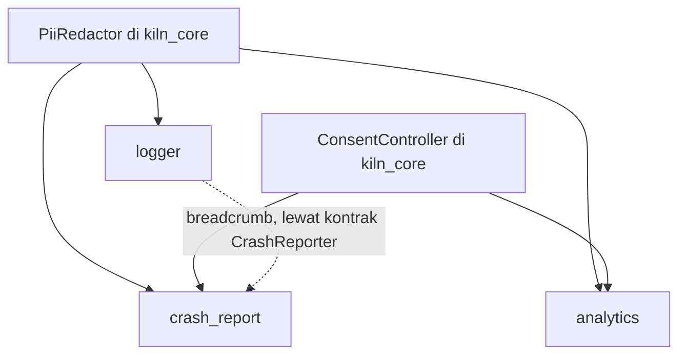
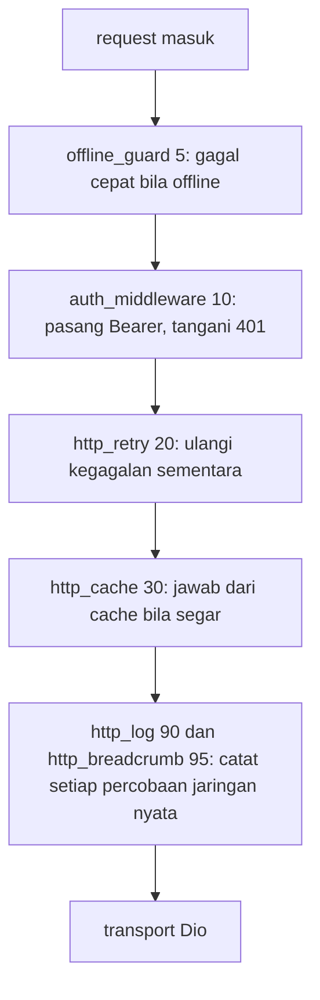

# Struktur Folder Lengkap Kiln

*1 Nov 2026 · @tegar pamungkas*

> Dokumen ini adalah **desain target** yang memperluas rencana Phase 6 di
> [`roadmap.md`](roadmap.md), bukan status implementasi. Yang sudah ada di repo
> hari ini adalah file tanpa tanda `# baru`. `crash_report`, `codegen`, dan
> `kiln_store` masih di-parkir di roadmap sampai ada keputusan baru; di sini
> ketiganya digambar supaya bentuk akhirnya terlihat utuh. Bagian
> [Keputusan desain](#keputusan-desain-yang-muncul-dari-struktur-ini) di akhir
> mencatat hal yang harus diputuskan sebelum implementasi.

## Konvensi dan cara membaca

Dokumen ini membuka seluruh struktur Kiln sampai tingkat file: 6 package, 29
extension, dan proyek hasil generate. File yang sudah ada di tree tidak diberi
tanda, sedangkan yang baru diberi `# baru`.

- **Tanda.** `# baru` berarti belum ada di tree, `# generate` berarti hasil
  generate dan tidak boleh diedit. Dua extension (`crash_report`, `codegen`)
  seluruh foldernya baru, jadi 27 folder lama menjadi 29. Di dalam dua folder
  itu file tidak ditandai satu per satu.
- **Isi baru di semua extension.** `README.md`, `CHANGELOG.md`, `docs/`,
  `test/` tingkat extension, dan `hooks/` (bila ada) belum ada di tree. Karena
  itu hanya file di dalam `__brick__` yang ditandai `# baru`.
- **Satu pola nama di dalam brick.**
  - `<id>.dart` atau nama kapabilitasnya adalah fasad statis dengan API pendek
    (`Http`, `Prefs`, `Biometric`).
  - `<id>_module.dart` mendaftarkan ke Registry.
  - `<id>_config.dart` berisi konfigurasi bertipe dari prompt.
  - `<id>_failure_mapper.dart` mengubah error pihak ketiga menjadi `Failure`.
  - `*_gateway.dart` membungkus plugin supaya bisa di-fake di test.
- **Extension tidak saling mengimpor.** Hubungan antar extension hanya lewat
  kontrak di `kiln_core` dan slot (`http.interceptors`, `router.routes`, dan
  slot lain di tabel [Slot](#slot-siapa-membuka-siapa-menempel)).
- **Hooks hanya bila perlu.** Hook menjalankan kode di mesin user, jadi hanya
  extension yang butuh validasi atau langkah ekstra yang punya `hooks/`.
- **Tiga lapis test.** Test di dalam brick (jalan di aplikasi user), test
  tingkat extension (render, analyze, golden), dan contract test dari
  `kiln_testing` yang dijalankan ke setiap implementasi kontrak yang sama.
- **Subfolder baru di package.** Di `kiln_core` dan `kiln_extension_sdk`, file
  lama dikelompokkan ke subfolder. Barrel (`kiln_core.dart`,
  `kiln_extension_sdk.dart`) tetap meng-export semuanya, jadi pemakai tidak
  terdampak.

Isi standar tiap folder extension (di pohon bawah, bagian `test/` tingkat
extension ditulis satu baris):

```text
extensions/<id>/
├─ extension.yaml
├─ README.md
├─ CHANGELOG.md
├─ docs/<topik>.md
├─ test/                            # tingkat extension
│  ├─ manifest_test.dart            # manifest valid terhadap schema
│  ├─ render_test.dart              # render ke folder temp, cocok dengan golden
│  ├─ analyze_test.dart             # hasil render lolos dart analyze
│  └─ goldens/rendered/             # generate
└─ brick/
   ├─ brick.yaml
   ├─ hooks/                        # hanya jika perlu
   └─ __brick__/
      ├─ lib/extensions/<id>/
      └─ test/extensions/<id>/
```

## Root monorepo

Root memuat semua yang bukan kode package: CI, dokumentasi, schema YAML,
template proyek, contoh, registry extension, dan skrip rilis. Isi `extensions/`
dan `packages/` diuraikan di bagian berikutnya.

```text
kiln/
├─ .github/
│  ├─ ISSUE_TEMPLATE/
│  │  ├─ bug_report.yml                      # baru
│  │  ├─ extension_request.yml               # baru
│  │  └─ config.yml                          # baru
│  ├─ workflows/
│  │  ├─ ci.yaml
│  │  ├─ extensions.yaml                     # baru: matrix, hanya extension yang berubah
│  │  ├─ bundles_check.yaml                  # baru: gagal bila bundles belum di-generate ulang
│  │  ├─ smoke.yaml                          # baru: nightly, create + add semua + build apk dan ios
│  │  ├─ drift.yaml                          # baru: nightly, cek versi package pihak ketiga terbaru
│  │  ├─ docs.yaml                           # baru
│  │  └─ release.yaml                        # baru: publish pub.dev + update registry
│  ├─ CODEOWNERS                             # baru
│  ├─ dependabot.yml                         # baru
│  └─ PULL_REQUEST_TEMPLATE.md               # baru
├─ .vscode/
│  ├─ settings.json                          # baru: pasang schemas/ ke extension.yaml, kiln.yaml, kiln.lock.yaml
│  └─ extensions.json                        # baru: rekomendasi ekstensi Dart dan YAML
├─ docs/
│  ├─ architecture.md
│  ├─ extension-manifest.md
│  ├─ roadmap.md
│  ├─ folder-structure.md                    # baru: dokumen ini
│  ├─ getting-started.md                     # baru
│  ├─ concepts/                              # baru
│  │  ├─ contracts-and-capabilities.md
│  │  ├─ slots.md
│  │  ├─ lockfile-and-ownership.md
│  │  ├─ transactions-and-rollback.md
│  │  ├─ native-patches.md
│  │  ├─ compatibility.md
│  │  └─ security-model.md
│  ├─ cli/
│  │  └─ reference.md                        # baru
│  ├─ extensions/                            # baru
│  │  ├─ catalog.md                          # generate dari semua extension.yaml
│  │  ├─ writing-an-extension.md
│  │  ├─ testing-extensions.md
│  │  ├─ trust-tiers.md
│  │  └─ publishing.md
│  ├─ guides/                                # baru
│  │  ├─ swap-backend.md
│  │  ├─ migrate-bloc-to-riverpod.md
│  │  ├─ add-offline-support.md
│  │  └─ setup-flavors-and-env.md
│  └─ adr/                                   # baru: catatan keputusan arsitektur
│     ├─ 0001-never-edit-user-code.md
│     ├─ 0002-capabilities-not-ids.md
│     ├─ 0003-hooks-and-trust.md
│     ├─ 0004-transactions-and-journal.md
│     └─ 0005-checksums-and-registry.md
├─ schemas/                                  # baru: validasi dan autocomplete YAML di IDE
│  ├─ extension.schema.json
│  ├─ kiln.schema.json
│  ├─ kiln-lock.schema.json
│  ├─ migration.schema.json
│  └─ registry-index.schema.json
├─ bricks/
│  ├─ app_basic/
│  │  ├─ brick.yaml
│  │  ├─ hooks/                              # baru
│  │  │  ├─ pubspec.yaml
│  │  │  ├─ pre_gen.dart                     # validasi nama app, org, dan bentrok folder
│  │  │  └─ post_gen.dart                    # flutter create, tambah kiln_core, pub get, format, git init
│  │  └─ __brick__/
│  │     ├─ README.md
│  │     ├─ kiln.yaml                        # baru: konfigurasi proyek
│  │     ├─ analysis_options.yaml            # baru
│  │     ├─ .gitignore                       # baru: termasuk .kiln/backups, .kiln/logs, env/*.json
│  │     ├─ lib/
│  │     │  ├─ main.dart
│  │     │  ├─ app/
│  │     │  │  ├─ app.dart
│  │     │  │  ├─ registry_scope.dart
│  │     │  │  ├─ app_shell.dart                # baru: MaterialApp, memakai theme dan locale dari modul bila ada
│  │     │  │  ├─ error_screen.dart             # baru: layar untuk kegagalan bootstrap
│  │     │  │  ├─ app_wrappers.dart             # baru: slot bawaan app.wrappers, tipe AppWrapper = Widget Function(BuildContext, Widget)
│  │     │  │  └─ app_route.dart                # baru: AppRoute netral (path, name, builder) untuk slot router.routes, tanpa impor go_router
│  │     │  └─ core/
│  │     │     ├─ l10n/
│  │     │     │  ├─ app_localizations_config.dart
│  │     │     │  └─ app_strings.dart
│  │     │     ├─ theme/
│  │     │     │  ├─ app_theme_config.dart
│  │     │     │  └─ app_theme.dart
│  │     │     └─ error/                        # baru
│  │     │        ├─ global_error_handler.dart  # FlutterError.onError dan PlatformDispatcher.onError ke Logger, lalu ke CrashReporter bila terpasang (readOrNull)
│  │     │        └─ failure_presenter.dart     # Failure menjadi pesan yang ramah user; teksnya dari FailureMessages milik l10n bila terpasang, selain itu pesan Failure apa adanya
│  │     └─ test/
│  │        └─ app/
│  │           └─ app_smoke_test.dart         # baru
│  └─ extension_template/                    # baru: dipakai `kiln ext new`
│     ├─ brick.yaml                          # variabel: id, name, category, provides, requires, with_hooks, with_native_patch
│     └─ __brick__/
│        └─ {{id.snakeCase()}}/
│           ├─ extension.yaml
│           ├─ README.md
│           ├─ CHANGELOG.md
│           ├─ docs/
│           │  └─ {{id.paramCase()}}.md
│           ├─ test/
│           │  ├─ manifest_test.dart
│           │  ├─ render_test.dart
│           │  └─ analyze_test.dart
│           └─ brick/
│              ├─ brick.yaml
│              ├─ hooks/                   # dibuat bila with_hooks
│              │  ├─ pubspec.yaml
│              │  ├─ pre_gen.dart
│              │  └─ post_gen.dart
│              └─ __brick__/
│                 ├─ lib/extensions/{{id.snakeCase()}}/
│                 │  ├─ {{id.snakeCase()}}.dart
│                 │  ├─ {{id.snakeCase()}}_module.dart
│                 │  ├─ {{id.snakeCase()}}_config.dart
│                 │  └─ {{id.snakeCase()}}_failure_mapper.dart
│                 └─ test/extensions/{{id.snakeCase()}}/
│                    ├─ {{id.snakeCase()}}_module_test.dart
│                    └─ {{id.snakeCase()}}_failure_mapper_test.dart
├─ extensions/                               # 29 folder, diuraikan di bagian Extension
├─ examples/
│  ├─ minimal/                               # baru: hasil `kiln create` tanpa extension
│  │  ├─ kiln.yaml, kiln.lock.yaml, pubspec.yaml
│  │  ├─ lib/
│  │  └─ test/
│  ├─ full_stack/                            # baru: bloc, dio, http_retry, rest_auth, secure_storage, go_router, theme, l10n, env, logger
│  │  ├─ kiln.yaml, kiln.lock.yaml, pubspec.yaml
│  │  ├─ lib/
│  │  └─ test/
│  ├─ backend_swap/                          # baru: bukti backend bisa diganti tanpa mengubah kode app
│  │  ├─ README.md
│  │  ├─ with_appwrite/
│  │  └─ with_supabase/                      # hanya kiln.yaml dan lib/extensions yang berbeda
│  └─ custom_extension/                      # baru: hasil `kiln ext new`, contoh extension komunitas lengkap
├─ registry/                                 # baru: dihasilkan tool/build_registry.dart
│  ├─ index.json                             # id, versi terbaru, tier
│  ├─ README.md
│  └─ extensions/
│     ├─ dio/
│     │  ├─ 1.0.0.json                       # url arsip, sha256, requires, compatibility
│     │  └─ 1.1.0.json
│     └─ <id>/                               # satu folder per extension
├─ tool/
│  ├─ bundle.dart                            # mason bundle semua brick, flag --check untuk CI
│  ├─ smoke_test.dart
│  ├─ build_registry.dart                    # baru
│  ├─ check_drift.dart                       # baru: bandingkan constraint extension dengan versi terbaru di pub.dev
│  ├─ lint_extensions.dart                   # baru: jalankan `kiln ext validate` ke semua extension
│  ├─ gen_catalog_docs.dart                  # baru: tulis docs/extensions/catalog.md
│  └─ release.dart                           # baru: naikkan versi, changelog, tag
├─ packages/                                 # diuraikan per package di bawah
│  ├─ kiln_cli/
│  ├─ kiln_core/
│  ├─ kiln_extension_sdk/
│  ├─ kiln_store/                            # baru
│  ├─ kiln_testing/                          # baru
│  └─ kiln_lints/                            # baru, opsional (Fase 6)
├─ CONTRIBUTING.md                           # baru
├─ SECURITY.md                               # baru
├─ CODE_OF_CONDUCT.md                        # baru
├─ LICENSE                                   # baru
├─ .gitignore
├─ analysis_options.yaml
├─ pubspec.yaml
├─ pubspec.lock
└─ README.md
```

## kiln_core

`kiln_core` adalah satu-satunya package yang boleh dikenal kode aplikasi dan
semua extension. Ia memuat kontrak, model error, runtime modul, state sesi, dan
utilitas privasi, tanpa dependensi ke plugin Flutter apa pun.

```text
packages/kiln_core/
├─ lib/
│  ├─ kiln_core.dart                         # barrel, meng-export semuanya
│  └─ src/
│     ├─ contracts/                          # kontrak yang dipenuhi extension
│     │  ├─ account_management.dart          # baru: PasswordRecovery, EmailVerification, ProfileUpdate, kontrak opsional di samping AuthRepository
│     │  ├─ analytics.dart
│     │  ├─ app_flavor.dart
│     │  ├─ auth.dart                        # AuthRepository
│     │  ├─ connectivity.dart
│     │  ├─ crash_reporter.dart              # baru
│     │  ├─ deep_links.dart
│     │  ├─ env.dart
│     │  ├─ file_storage.dart                # baru: upload, download, url, hapus (bucket)
│     │  ├─ http_client.dart
│     │  ├─ local_db.dart
│     │  ├─ logger.dart
│     │  ├─ media_picker.dart
│     │  ├─ notifications.dart
│     │  ├─ permissions.dart
│     │  ├─ remote_database.dart             # baru: CRUD dokumen, RemoteQuery, watch
│     │  ├─ secure_storage.dart
│     │  ├─ social_auth.dart
│     │  └─ storage.dart                     # key-value
│     ├─ errors/
│     │  ├─ failure.dart
│     │  ├─ failure_codes.dart               # baru: kode stabil, mis. network.timeout, auth.invalid_credentials
│     │  └─ result.dart                      # baru: Result<T> = Ok | Err(Failure)
│     ├─ runtime/
│     │  ├─ registry.dart
│     │  ├─ get_it_registry.dart
│     │  ├─ kiln_module.dart
│     │  ├─ module_graph.dart                # baru: urutan init dari requires, deteksi siklus
│     │  ├─ lifecycle.dart                   # baru: onReady, onPause, onResume, dispose
│     │  ├─ bootstrap.dart                   # baru: KilnBootstrap.run (init async, timeout, error handler)
│     │  └─ slot.dart                        # baru: OrderedSlot<T> untuk http.interceptors dan router.routes
│     ├─ session/                            # baru
│     │  ├─ session.dart                     # AuthSession: userId, expiresAt
│     │  ├─ session_controller.dart          # unknown, authenticated, unauthenticated + stream
│     │  └─ token_provider.dart              # kontrak ambil dan refresh token
│     ├─ privacy/                            # baru
│     │  ├─ consent.dart                     # ConsentController untuk analytics dan crash report
│     │  └─ pii_redactor.dart                # dipakai logger, analytics, crash_report
│     └─ util/                               # baru
│        ├─ clock.dart                       # waktu yang bisa di-fake
│        ├─ debouncer.dart
│        └─ disposable.dart
├─ test/
│  ├─ auth_test.dart
│  ├─ failure_test.dart
│  ├─ http_client_test.dart
│  ├─ registry_test.dart
│  ├─ runtime_contracts_test.dart
│  ├─ result_test.dart, failure_codes_test.dart                                          # baru
│  ├─ module_graph_test.dart, slot_test.dart, lifecycle_test.dart, bootstrap_test.dart   # baru
│  ├─ session_controller_test.dart, consent_test.dart, pii_redactor_test.dart            # baru
│  └─ clock_test.dart, debouncer_test.dart                                               # baru
├─ example/
│  └─ main.dart                              # baru
├─ analysis_options.yaml
├─ CHANGELOG.md
├─ pubspec.yaml
└─ README.md
```

## kiln_extension_sdk

SDK adalah mesin di balik `kiln add`: membaca manifest, menghitung rencana,
merender brick, lalu menerapkan perubahan dalam transaksi yang bisa dibalik.
Bagian `installer/` paling besar, dan tiga subfoldernya (`transaction/`,
`ownership/`, `verification/`) membuat `add` dan `remove` aman.

```text
packages/kiln_extension_sdk/
├─ lib/
│  ├─ kiln_extension_sdk.dart
│  ├─ testing.dart                           # baru: ExtensionTestHarness untuk penulis extension
│  └─ src/
│     ├─ kiln_exception.dart
│     ├─ manifest/
│     │  ├─ extension_manifest.dart
│     │  ├─ platform_setup.dart
│     │  ├─ slot.dart
│     │  ├─ manifest_validator.dart          # baru: id, semver, siklus requires, field platform
│     │  ├─ prompt_spec.dart                 # baru: tipe prompt (url, int, enum, secret) + validasi
│     │  ├─ compatibility.dart               # baru: rentang kiln_core, dart, flutter, platform
│     │  └─ contribution.dart                # baru: contributes ke slot, dengan when: [capability] opsional
│     ├─ resolver/
│     │  ├─ extension_resolver.dart
│     │  ├─ resolution_plan.dart
│     │  ├─ capability_index.dart            # baru: siapa menyediakan apa
│     │  ├─ conflict_report.dart             # baru: pesan konflik yang bisa ditindaklanjuti
│     │  ├─ dependency_graph.dart            # baru: graf requires untuk `kiln graph` dan `remove`
│     │  └─ upgrade_planner.dart             # baru
│     ├─ renderer/
│     │  ├─ brick_renderer.dart
│     │  ├─ template_vars.dart               # baru: prompt + kiln.yaml menjadi variabel Mason
│     │  ├─ collision_policy.dart            # baru: skip, overwrite, tanya; deteksi file diedit lewat hash
│     │  └─ hook_policy.dart                 # baru: hooks hanya jalan bila brick tepercaya
│     ├─ installer/
│     │  ├─ extension_installer.dart
│     │  ├─ extensions_codegen.dart
│     │  ├─ lockfile.dart
│     │  ├─ pubspec_reader.dart
│     │  ├─ pubspec_writer.dart              # baru: tambah dan hapus dependency lewat yaml_edit
│     │  ├─ transaction/                     # baru
│     │  │  ├─ transaction.dart              # jalankan langkah, catat ke jurnal
│     │  │  ├─ journal.dart
│     │  │  ├─ snapshot.dart                 # backup file ke .kiln/backups
│     │  │  └─ rollback.dart
│     │  ├─ ownership/                       # baru
│     │  │  ├─ file_ownership.dart           # hash tiap file hasil render
│     │  │  └─ patch_journal.dart            # patch dimiliki siapa (reference count)
│     │  ├─ native/
│     │  │  ├─ native_setup.dart
│     │  │  ├─ patch.dart                    # baru: interface Patch (describe, apply, revert)
│     │  │  ├─ android_gradle.dart
│     │  │  ├─ android_project.dart
│     │  │  ├─ ios_app_delegate.dart
│     │  │  ├─ ios_entitlements.dart
│     │  │  ├─ ios_plist.dart
│     │  │  ├─ ios_podfile.dart              # baru: flag PERMISSION_* untuk permission_handler
│     │  │  ├─ macos_entitlements.dart       # baru
│     │  │  └─ web_index_html.dart           # baru
│     │  └─ verification/                    # baru
│     │     ├─ verifier.dart                 # pub get + dart analyze setelah apply
│     │     └─ dry_run_reporter.dart         # diff yang akan terjadi
│     └─ migrator/                           # baru
│        ├─ migration.dart
│        ├─ migration_actions.dart           # rename_file, delete_file, replace_dependency, update_config, message
│        ├─ migration_loader.dart            # baca extensions/<id>/migrations
│        └─ migration_runner.dart
├─ test/
│  ├─ android_deep_links_test.dart
│  ├─ android_gradle_test.dart
│  ├─ brick_renderer_test.dart
│  ├─ installer_test.dart
│  ├─ ios_entitlements_test.dart
│  ├─ manifest_test.dart
│  ├─ resolver_test.dart
│  ├─ transaction_test.dart, rollback_test.dart, snapshot_test.dart                      # baru
│  ├─ file_ownership_test.dart, patch_journal_test.dart                                  # baru
│  ├─ pubspec_writer_test.dart, ios_podfile_test.dart                                    # baru
│  ├─ macos_entitlements_test.dart, web_index_html_test.dart                             # baru
│  ├─ manifest_validator_test.dart, prompt_spec_test.dart                                # baru
│  ├─ compatibility_test.dart, contribution_test.dart                                    # baru
│  ├─ capability_index_test.dart, conflict_report_test.dart                              # baru
│  ├─ dependency_graph_test.dart, upgrade_planner_test.dart                              # baru
│  ├─ collision_policy_test.dart, hook_policy_test.dart, template_vars_test.dart         # baru
│  ├─ verifier_test.dart, dry_run_reporter_test.dart                                     # baru
│  ├─ migration_runner_test.dart, migration_actions_test.dart                            # baru
│  └─ fixtures/                                                                          # baru
│     ├─ manifests/                          # valid/ dan invalid/
│     ├─ projects/                           # fresh_app/, app_with_dio/, app_with_edited_files/, app_with_two_owners/
│     └─ bricks/                             # tiny_brick/, brick_with_hooks/
├─ tool/
│  └─ generate_schemas.dart                  # baru: JSON Schema dihasilkan dari model manifest
├─ analysis_options.yaml
├─ CHANGELOG.md
├─ pubspec.yaml
└─ README.md
```

## kiln_cli

CLI hanya mengurus interaksi: parsing perintah, prompt, laporan, dan kode
keluar. Semua logika pemasangan ada di `kiln_extension_sdk`, sehingga setiap
command tipis dan mudah dites.

```text
packages/kiln_cli/
├─ bin/
│  └─ kiln.dart
├─ lib/
│  ├─ kiln_cli.dart
│  └─ src/
│     ├─ command_runner.dart
│     ├─ project_context.dart                # deteksi proyek kiln, baca kiln.yaml dan lockfile
│     ├─ paths.dart
│     ├─ version.dart
│     ├─ commands/
│     │  ├─ create_command.dart
│     │  ├─ add_command.dart
│     │  ├─ remove_command.dart
│     │  ├─ list_command.dart
│     │  ├─ doctor_command.dart
│     │  ├─ version_command.dart
│     │  ├─ command_helpers.dart
│     │  ├─ info_command.dart                # baru
│     │  ├─ upgrade_command.dart             # baru
│     │  ├─ rollback_command.dart            # baru
│     │  ├─ graph_command.dart               # baru
│     │  ├─ config_command.dart              # baru
│     │  ├─ cache_command.dart               # baru
│     │  ├─ store_command.dart               # baru
│     │  ├─ completion_command.dart          # baru
│     │  └─ ext/                             # baru: alat untuk penulis extension
│     │     ├─ ext_new_command.dart
│     │     ├─ ext_validate_command.dart
│     │     ├─ ext_test_command.dart
│     │     ├─ ext_pack_command.dart
│     │     └─ ext_publish_command.dart
│     ├─ infra/                              # baru
│     │  ├─ kiln_logger.dart                 # level, progress, --verbose, --quiet
│     │  ├─ prompter.dart                    # interaktif, --yes, deteksi non-TTY
│     │  ├─ exit_codes.dart                  # kode keluar tetap untuk CI
│     │  ├─ json_reporter.dart               # --json
│     │  ├─ error_presenter.dart             # KilnException menjadi pesan + saran perbaikan
│     │  ├─ global_config.dart               # ~/.kiln/config.yaml
│     │  ├─ update_checker.dart              # info versi CLI baru, tidak memblokir
│     │  ├─ process_runner.dart              # dipindah dari src/
│     │  └─ file_system.dart                 # abstraksi supaya command bisa dites tanpa disk
│     └─ bundles/                            # generate, jangan diedit
│        ├─ catalog.g.dart
│        ├─ app_basic_bundle.dart
│        └─ <id>_bundle.dart                 # satu per extension, 29 file, nama sama dengan extensions/<id>
├─ test/
│  ├─ command_runner_test.dart
│  ├─ commands/                           # baru: satu test per command
│  │  ├─ create_command_test.dart, add_command_test.dart, remove_command_test.dart
│  │  ├─ list_command_test.dart, doctor_command_test.dart, info_command_test.dart
│  │  ├─ upgrade_command_test.dart, rollback_command_test.dart, graph_command_test.dart
│  │  ├─ config_command_test.dart, cache_command_test.dart, store_command_test.dart
│  │  └─ ext_commands_test.dart
│  ├─ infra/                              # baru
│  │  ├─ prompter_test.dart, json_reporter_test.dart
│  │  └─ error_presenter_test.dart, exit_codes_test.dart
│  ├─ fixtures/                           # baru: proyek kecil per skenario
│  │  ├─ fresh_app/, app_with_dio/, app_with_edited_files/
│  │  └─ app_with_flavors/, app_without_lock/
│  └─ goldens/                            # baru: output yang harus tetap
│     ├─ add_dry_run.txt, add_dry_run.json
│     └─ doctor_report.txt, list.json, info_dio.txt
├─ analysis_options.yaml
├─ CHANGELOG.md
├─ pubspec.yaml
└─ README.md
```

### Daftar perintah

| Perintah | Fungsi | Flag penting |
| --- | --- | --- |
| `create` | buat proyek dari `app_basic`, pilih state management | `--state`, `--org`, `--platforms`, `--with` |
| `add` | pasang extension secara transaksional | `--dry-run`, `--yes`, `--no-verify`, `--from` |
| `remove` | lepas extension, hanya hapus file yang belum diedit | `--dry-run`, `--force` |
| `upgrade` | naikkan versi extension lalu jalankan migration | `--dry-run`, `--all` |
| `rollback` | balikkan operasi terakhir dari jurnal | `--list` |
| `list` | extension terpasang atau tersedia | `--installed`, `--available`, `--json` |
| `info` | provides, requires, platform, dan changelog satu extension | `--json` |
| `graph` | graf requires dan capability | `--format text` atau `mermaid` |
| `doctor` | periksa kesehatan proyek | `--fix`, `--json` |
| `config` | atur registry, mirror, dan mode offline | `--global` |
| `cache` | lihat atau bersihkan cache registry | `clean` |
| `store` | cari dan lihat extension di registry | `search`, `info` |
| `completion` | skrip autocomplete shell | `bash`, `zsh`, `fish` |
| `ext` | alat penulis extension: `new`, `validate`, `test`, `pack`, `publish` | `--update-goldens`, `--tier` |
| `version` | versi CLI dan `kiln_core` | tidak ada |

### Yang diperiksa doctor

- Hash file hasil render di lockfile dibandingkan dengan kondisi sebenarnya,
  supaya file yang diedit user ketahuan.
- Patch native yang hilang atau ganda (permission, entitlement,
  intent-filter).
- `extensions.g.dart` yang tidak sinkron dengan lockfile.
- Langkah manual yang belum selesai, misalnya `flutterfire configure` untuk
  Firebase.
- Extension yang tidak mendukung platform proyek, misalnya `biometric` di web.
- Versi Dart, Flutter, dan `kiln_core` terhadap rentang `compatibility` tiap
  extension.
- Extension yang punya versi baru atau migration yang belum dijalankan.
- Sisa jurnal dari operasi yang terhenti di tengah jalan.

## kiln_store, kiln_testing, kiln_lints

Tiga package baru yang menutup celah kepercayaan dan kualitas: store mengunduh
extension dengan verifikasi, testing membuktikan setiap implementasi kontrak
bisa saling menggantikan, dan lints menjaga aplikasi tetap bergantung pada
kontrak.

### kiln_store

```text
packages/kiln_store/                          # baru
├─ lib/
│  ├─ kiln_store.dart
│  └─ src/
│     ├─ registry_client.dart                # ambil index.json dari Git
│     ├─ registry_index.dart                 # model index dan versi
│     ├─ registry_config.dart                # URL, mirror, ref (branch atau tag)
│     ├─ version_resolver.dart               # pilih versi yang cocok dengan kiln_core proyek
│     ├─ search_index.dart                   # pencarian lokal dari cache
│     ├─ checksum_verifier.dart              # sha256 arsip
│     ├─ trust_policy.dart                   # official, verified, community; konfirmasi sebelum hook jalan
│     ├─ archive_packer.dart                 # buat .tgz
│     ├─ archive_unpacker.dart               # tolak path traversal (zip-slip)
│     ├─ publisher.dart                      # validasi lalu publish
│     ├─ local_cache.dart
│     └─ offline_mode.dart
├─ test/
│  ├─ registry_client_test.dart, registry_index_test.dart, version_resolver_test.dart
│  ├─ search_index_test.dart, checksum_verifier_test.dart, trust_policy_test.dart
│  ├─ archive_packer_test.dart, archive_unpacker_test.dart
│  ├─ publisher_test.dart, local_cache_test.dart, offline_mode_test.dart
│  └─ fixtures/registry/                  # index.json dan arsip contoh, termasuk arsip berbahaya
├─ analysis_options.yaml
├─ CHANGELOG.md
├─ pubspec.yaml
└─ README.md
```

### kiln_testing

Dipakai sebagai `dev_dependency` di aplikasi hasil generate dan di tiap
extension. Suite `contracts/` dijalankan ke setiap implementasi: Appwrite,
Firebase, Supabase, dan `rest_auth` harus lolos `auth_repository_contract`
yang sama, dan itulah bukti bahwa backend bisa diganti.

```text
packages/kiln_testing/                        # baru
├─ lib/
│  ├─ kiln_testing.dart
│  └─ src/
│     ├─ fakes/
│     │  ├─ fake_http_client.dart
│     │  ├─ in_memory_storage.dart
│     │  ├─ in_memory_secure_storage.dart
│     │  ├─ fake_auth_repository.dart
│     │  ├─ fake_account_management.dart
│     │  ├─ fake_social_auth.dart
│     │  ├─ fake_connectivity.dart
│     │  ├─ fake_permissions.dart
│     │  ├─ fake_notifications.dart
│     │  ├─ fake_deep_links.dart
│     │  ├─ fake_media_picker.dart
│     │  ├─ fake_local_database.dart
│     │  ├─ fake_remote_database.dart
│     │  ├─ fake_file_storage.dart
│     │  ├─ fake_analytics.dart
│     │  ├─ fake_crash_reporter.dart
│     │  ├─ fake_env.dart
│     │  ├─ fake_clock.dart
│     │  └─ recording_logger.dart
│     ├─ contracts/                       # suite test untuk SETIAP implementasi kontrak
│     │  ├─ http_client_contract.dart
│     │  ├─ storage_contract.dart
│     │  ├─ secure_storage_contract.dart
│     │  ├─ auth_repository_contract.dart
│     │  ├─ account_management_contract.dart
│     │  ├─ social_auth_contract.dart
│     │  ├─ local_database_contract.dart
│     │  ├─ remote_database_contract.dart
│     │  ├─ file_storage_contract.dart
│     │  ├─ connectivity_contract.dart
│     │  ├─ permissions_contract.dart
│     │  ├─ notifications_contract.dart
│     │  ├─ deep_links_contract.dart
│     │  ├─ media_picker_contract.dart
│     │  ├─ analytics_contract.dart
│     │  ├─ crash_reporter_contract.dart
│     │  └─ logger_contract.dart
│     └─ harness/
│        ├─ test_registry.dart               # Registry siap pakai untuk test
│        ├─ pump_app.dart                    # helper widget test
│        ├─ matchers.dart                    # isFailure, isOk, hasCode
│        ├─ async_helpers.dart               # pumpUntil, expectEmitsInOrder
│        └─ golden_helpers.dart
├─ test/
│  └─ fakes_satisfy_contracts_test.dart      # setiap fake harus lolos suite kontraknya sendiri
├─ analysis_options.yaml
├─ CHANGELOG.md
├─ pubspec.yaml
└─ README.md
```

### kiln_lints

```text
packages/kiln_lints/                          # baru, opsional (Fase 6)
├─ lib/
│  ├─ kiln_lints.dart                     # plugin custom_lint
│  └─ src/rules/
│     ├─ no_cross_extension_import.dart       # extension tidak boleh mengimpor extension lain
│     ├─ prefer_contract_over_impl.dart       # kode app memakai kontrak, bukan DioClient
│     ├─ no_plugin_in_features.dart           # features/ tidak boleh mengimpor plugin langsung
│     ├─ no_edit_generated_files.dart         # peringatan bila extensions.g.dart diubah
│     └─ require_failure_handling.dart        # Result harus ditangani
├─ test/
│  └─ rules_test.dart
├─ example/
├─ analysis_options.yaml
├─ CHANGELOG.md
├─ pubspec.yaml
└─ README.md
```

## Extension: state dan jaringan

Lima extension ini membentuk fondasi aplikasi: satu adapter state management
(eksklusif) dan tumpukan HTTP yang dirakit dari `dio`, `http_retry`, dan
`http_cache` lewat slot `http.interceptors`.

### bloc

```text
extensions/bloc/
├─ extension.yaml                           # category: state · exclusive · provides: state_bloc (riverpod ditolak lewat aturan exclusive)
├─ README.md
├─ CHANGELOG.md
├─ docs/
│  ├─ state-with-bloc.md
│  └─ bloc-to-riverpod.md
├─ test/                                    # manifest_test, render_test, analyze_test, goldens/rendered/
└─ brick/
   ├─ brick.yaml
   └─ __brick__/
      ├─ lib/
      │  ├─ bootstrap.dart
      │  ├─ app/
      │  │  └─ bloc_providers.dart            # baru: MultiBlocProvider untuk bloc global
      │  ├─ core/bloc/                        # baru
      │  │  ├─ app_bloc_observer.dart         # log transisi dan error ke Logger, PII disamarkan
      │  │  ├─ base_cubit.dart                # safeEmit (cek isClosed), runGuarded menjadi Failure
      │  │  ├─ async_state.dart               # sealed: initial, loading, data, failure
      │  │  ├─ async_cubit.dart               # load, refresh, retry
      │  │  ├─ bloc_transformers.dart         # debounce, throttle, droppable, restartable
      │  │  └─ session_cubit.dart             # membungkus SessionController dari kiln_core
      │  └─ features/
      │     └─ counter/
      │        ├─ counter_cubit.dart
      │        └─ counter_page.dart
      └─ test/
         ├─ bootstrap_test.dart
         ├─ counter_cubit_test.dart
         ├─ counter_page_test.dart
         └─ core/bloc/                        # baru
            ├─ app_bloc_observer_test.dart, base_cubit_test.dart, async_state_test.dart
            └─ async_cubit_test.dart, bloc_transformers_test.dart, session_cubit_test.dart
```

### riverpod

```text
extensions/riverpod/
├─ extension.yaml                           # category: state · exclusive · provides: state_riverpod (bloc ditolak lewat aturan exclusive)
├─ README.md
├─ CHANGELOG.md
├─ docs/
│  ├─ state-with-riverpod.md
│  └─ riverpod-to-bloc.md
├─ test/                                    # manifest_test, render_test, analyze_test, goldens/rendered/
└─ brick/
   ├─ brick.yaml
   └─ __brick__/
      ├─ lib/
      │  ├─ bootstrap.dart
      │  ├─ app/
      │  │  └─ provider_root.dart             # baru: ProviderScope dengan override Registry
      │  ├─ core/riverpod/                    # baru
      │  │  ├─ kiln_providers.dart            # registryProvider dan kilnProvider<T>() untuk setiap kontrak
      │  │  ├─ app_provider_observer.dart     # log error provider, PII disamarkan
      │  │  ├─ async_value_x.dart             # AsyncValue.guard menjadi Failure, helper when
      │  │  ├─ provider_overrides.dart        # override siap pakai untuk test
      │  │  └─ session_notifier.dart          # membungkus SessionController dari kiln_core
      │  └─ features/
      │     └─ counter/
      │        ├─ counter_page.dart
      │        └─ counter_provider.dart
      └─ test/
         ├─ bootstrap_test.dart
         ├─ counter_page_test.dart
         ├─ counter_provider_test.dart
         └─ core/riverpod/                    # baru
            ├─ kiln_providers_test.dart, app_provider_observer_test.dart
            └─ async_value_x_test.dart, provider_overrides_test.dart, session_notifier_test.dart
```

### dio

```text
extensions/dio/
├─ extension.yaml                           # provides: http_client, http_pipeline · slot: http.interceptors (baru) · android: INTERNET · macos: network.client (baru)
├─ README.md
├─ CHANGELOG.md
├─ docs/
│  ├─ http-client.md
│  └─ interceptors.md                       # cara extension lain menempel ke slot
├─ test/                                    # manifest_test, render_test, analyze_test, goldens/rendered/
└─ brick/
   ├─ brick.yaml
   ├─ hooks/
   │  ├─ pubspec.yaml
   │  └─ pre_gen.dart                       # validasi base_url dan connect_timeout
   └─ __brick__/
      ├─ lib/extensions/dio/
      │  ├─ http.dart                       # baru: fasad statis Http.get, post, put, patch, delete
      │  ├─ dio_module.dart
      │  ├─ dio_client.dart
      │  ├─ dio_config.dart                 # baru: base_url, timeout, header default
      │  ├─ dio_failure_mapper.dart         # baru: DioException menjadi Failure (timeout, offline, 401, 5xx)
      │  ├─ cancellation.dart               # baru: batalkan request saat widget dispose
      │  ├─ multipart_helper.dart           # baru: upload file dengan progress
      │  ├─ download_helper.dart            # baru: unduh file dengan progress
      │  ├─ dio_test_adapter.dart           # baru: adapter palsu untuk test
      │  └─ interceptors/                   # baru
      │     ├─ interceptor_slot.dart        # pintu masuk contributes dari extension lain
      │     ├─ request_id_interceptor.dart  # header X-Request-Id untuk korelasi log
      │     └─ user_agent_interceptor.dart  # versi app dan platform
      └─ test/extensions/dio/
         ├─ dio_client_test.dart
         ├─ dio_module_test.dart, dio_failure_mapper_test.dart, cancellation_test.dart           # baru
         ├─ multipart_helper_test.dart, download_helper_test.dart                                # baru
         ├─ interceptor_slot_test.dart, request_id_interceptor_test.dart, user_agent_interceptor_test.dart   # baru
         └─ http_client_contract_test.dart                                                       # baru: suite dari kiln_testing
```

### http_retry

```text
extensions/http_retry/
├─ extension.yaml                           # requires: http_client, http_pipeline · contributes: http.interceptors, priority 20 (sekarang lewat HttpPipeline.use)
├─ README.md
├─ CHANGELOG.md
├─ docs/
│  └─ retry-policy.md
├─ test/                                    # manifest_test, render_test, analyze_test, goldens/rendered/
└─ brick/
   ├─ brick.yaml
   └─ __brick__/
      ├─ lib/extensions/http_retry/
      │  ├─ http_retry_module.dart
      │  ├─ retry_middleware.dart
      │  ├─ retry_policy.dart
      │  ├─ retry_settings.dart
      │  ├─ backoff.dart                    # baru: eksponensial dengan jitter
      │  ├─ retry_budget.dart               # baru: batas total retry per jendela waktu, mencegah retry storm
      │  ├─ retry_after_parser.dart         # baru: header Retry-After (detik atau tanggal HTTP)
      │  ├─ idempotency.dart                # baru: hanya retry method idempoten atau yang punya Idempotency-Key
      │  └─ retry_events.dart               # baru: callback dan log tiap percobaan ulang
      └─ test/extensions/http_retry/
         ├─ http_retry_test.dart
         └─ backoff_test.dart, retry_budget_test.dart, retry_after_parser_test.dart, idempotency_test.dart   # baru
```

### http_cache

```text
extensions/http_cache/
├─ extension.yaml                           # requires: http_client, http_pipeline · storage opsional (when: [storage]) · contributes: http.interceptors
├─ README.md
├─ CHANGELOG.md
├─ docs/
│  └─ caching-strategies.md
├─ test/                                    # manifest_test, render_test, analyze_test, goldens/rendered/
└─ brick/
   ├─ brick.yaml
   └─ __brick__/
      ├─ lib/extensions/http_cache/
      │  ├─ http_cache_module.dart
      │  ├─ cache_policy.dart
      │  ├─ cache_settings.dart
      │  ├─ memory_http_cache.dart
      │  ├─ cache_store.dart                # baru: interface penyimpanan cache
      │  ├─ storage_http_cache.dart         # baru: persisten lewat kontrak Storage
      │  ├─ cache_interceptor.dart          # baru: menempel ke slot http.interceptors
      │  ├─ cache_key.dart                  # baru: URL, query, dan header Vary
      │  ├─ cache_control_parser.dart       # baru: max-age, no-store, no-cache, stale-while-revalidate
      │  ├─ etag_validator.dart             # baru: If-None-Match dan respons 304
      │  ├─ stale_while_revalidate.dart     # baru: sajikan cache lalu perbarui di belakang
      │  └─ cache_invalidation.dart         # baru: hapus per prefix atau tag setelah request mutasi
      └─ test/extensions/http_cache/
         ├─ http_cache_test.dart
         ├─ cache_key_test.dart, cache_control_parser_test.dart, etag_validator_test.dart                  # baru
         └─ stale_while_revalidate_test.dart, cache_invalidation_test.dart, storage_http_cache_test.dart   # baru
```

## Extension: storage dan data

Tiga extension penyimpanan lokal, dari yang paling sederhana (key-value) sampai
yang terenkripsi dan yang berbentuk dokumen. Ketiganya tidak saling mengimpor:
`http_cache` dan `rest_auth` memakai `Storage` dan `SecureStorage` lewat
kontrak di `kiln_core`.

### storage

```text
extensions/storage/
├─ extension.yaml                           # provides: storage · category: storage
├─ README.md
├─ CHANGELOG.md
├─ docs/
│  ├─ key-value-storage.md
│  └─ typed-keys-and-migration.md             # cara memberi nama key dan memigrasi nilai lama
├─ test/                                    # manifest_test, render_test, analyze_test, goldens/rendered/
└─ brick/
   ├─ brick.yaml
   └─ __brick__/
      ├─ lib/extensions/storage/
      │  ├─ prefs.dart                       # baru: fasad statis Prefs.read, write, delete (bukan Storage, supaya tidak bentrok dengan kontrak)
      │  ├─ storage_module.dart
      │  ├─ shared_preferences_storage.dart
      │  ├─ storage_config.dart              # baru: prefix key per app dan flavor
      │  ├─ storage_failure_mapper.dart      # baru: error plugin dan cast salah menjadi Failure(storage)
      │  ├─ storage_gateway.dart             # baru: membungkus SharedPreferencesAsync supaya bisa di-fake
      │  ├─ typed_key.dart                   # baru: StorageKey<T> dengan nama, tipe, default, dan serializer
      │  ├─ json_codec.dart                  # baru: simpan objek lewat jsonEncode dan jsonDecode
      │  ├─ namespaced_storage.dart          # baru: Storage dengan prefix, dipakai http_cache tanpa menimpa key lain
      │  ├─ ttl_storage.dart                 # baru: nilai dengan kedaluwarsa, memakai Clock dari kiln_core
      │  └─ storage_migrator.dart            # baru: versi skema key, jalankan langkah migrasi saat start
      └─ test/extensions/storage/
         ├─ shared_preferences_storage_test.dart
         ├─ storage_module_test.dart, storage_failure_mapper_test.dart, typed_key_test.dart          # baru
         ├─ json_codec_test.dart, namespaced_storage_test.dart, ttl_storage_test.dart               # baru
         ├─ storage_migrator_test.dart                                                               # baru
         └─ storage_contract_test.dart                                                               # baru: suite dari kiln_testing
```

### secure_storage

```text
extensions/secure_storage/
├─ extension.yaml                           # provides: secure_storage · ios: keychain_sharing · android: allowBackup=false (baru)
├─ README.md
├─ CHANGELOG.md
├─ docs/
│  ├─ secure-storage.md
│  └─ keystore-and-keychain-notes.md          # kehilangan data saat reinstall, backup, dan perbedaan platform
├─ test/                                    # manifest_test, render_test, analyze_test, goldens/rendered/
└─ brick/
   ├─ brick.yaml
   └─ __brick__/
      ├─ lib/extensions/secure_storage/
      │  ├─ vault.dart                       # baru: fasad statis Vault.read, write, delete
      │  ├─ secure_storage_module.dart
      │  ├─ keystore_secure_storage.dart
      │  ├─ secure_storage_config.dart       # baru: opsi Android (encrypted prefs), iOS (accessibility), web
      │  ├─ secure_storage_failure_mapper.dart  # baru: error plugin menjadi Failure(secure_storage)
      │  ├─ secure_storage_gateway.dart      # baru: membungkus FlutterSecureStorage
      │  ├─ secure_token_store.dart          # baru: implementasi TokenProvider dari kiln_core, dipakai rest_auth
      │  ├─ namespaced_secure_storage.dart   # baru: prefix per extension, readAll dan clear tidak menyentuh milik lain
      │  ├─ first_run_wipe.dart              # baru: hapus Keychain sisa instalasi lama pada start pertama iOS
      │  └─ secure_storage_health_check.dart # baru: tulis-baca-hapus probe, laporkan ke doctor dan Logger
      └─ test/extensions/secure_storage/
         ├─ secure_storage_test.dart
         ├─ secure_storage_module_test.dart, secure_storage_failure_mapper_test.dart                 # baru
         ├─ secure_token_store_test.dart, namespaced_secure_storage_test.dart                        # baru
         ├─ first_run_wipe_test.dart, secure_storage_health_check_test.dart                          # baru
         └─ secure_storage_contract_test.dart                                                        # baru: suite dari kiln_testing
```

### local_db

```text
extensions/local_db/
├─ extension.yaml                           # provides: local_db · category: database · exclusive
├─ README.md
├─ CHANGELOG.md
├─ docs/
│  ├─ local-database.md
│  ├─ schema-versioning.md                    # cara memakai migrasi dokumen
│  └─ offline-first-pattern.md                # dipakai guides/add-offline-support.md
├─ test/                                    # manifest_test, render_test, analyze_test, goldens/rendered/
└─ brick/
   ├─ brick.yaml
   └─ __brick__/
      ├─ lib/extensions/local_db/
      │  ├─ local_db_module.dart
      │  ├─ sembast_local_database.dart
      │  ├─ local_database_opener.dart
      │  ├─ local_database_opener_io.dart
      │  ├─ local_database_opener_web.dart
      │  ├─ local_db_config.dart             # baru: nama file database, versi skema, path override
      │  ├─ local_db_failure_mapper.dart     # baru: error Sembast menjadi Failure(database)
      │  ├─ collection_watcher.dart          # baru: Stream<List<LocalRecord>> yang diperbarui saat koleksi berubah
      │  ├─ transaction_runner.dart          # baru: beberapa operasi dalam satu transaksi, atomik
      │  ├─ typed_collection.dart            # baru: LocalCollection dengan fromJson dan toJson
      │  ├─ query_builder.dart               # baru: where, orderBy, limit menjadi LocalQuery
      │  ├─ schema_migrator.dart             # baru: versi skema dan langkah migrasi saat open
      │  ├─ database_encryption.dart         # baru: opsi enkripsi kodek Sembast, kunci dari SecureStorage bila ada
      │  ├─ backup_export.dart               # baru: ekspor dan impor seluruh database sebagai JSON
      │  └─ sync_queue.dart                  # baru: antrean perubahan lokal untuk disinkronkan ke RemoteDatabase
      └─ test/extensions/local_db/
         ├─ local_database_test.dart
         ├─ local_db_module_test.dart, local_db_failure_mapper_test.dart                             # baru
         ├─ collection_watcher_test.dart, transaction_runner_test.dart, typed_collection_test.dart   # baru
         ├─ query_builder_test.dart, schema_migrator_test.dart, database_encryption_test.dart        # baru
         ├─ backup_export_test.dart, sync_queue_test.dart                                            # baru
         └─ local_database_contract_test.dart                                                        # baru: suite dari kiln_testing
```

## Extension: backend dan auth

Enam extension untuk identitas dan data jarak jauh. Tiga backend (`appwrite`,
`firebase`, `supabase`) memenuhi tiga kontrak sekaligus: `AuthRepository`,
`RemoteDatabase`, dan `FileStorage`. `rest_auth` memenuhi `AuthRepository`
saja, di atas `http_client`. `social_login` dan `biometric` menambah jalur
masuk tanpa mengubah kontrak auth.

Backend sengaja **tidak** punya fasad statis. Kode aplikasi membaca kontrak dari
Registry, dan aturan lint `prefer_contract_over_impl` menolak impor langsung ke
kelas backend.

Tiap backend memakai pola gateway yang sama, supaya logika sesi dan pemetaan
error bisa dites tanpa akun sungguhan:

```text
kontrak kiln_core  ←  <backend>_auth_repository / _remote_database / _file_storage
                              ↓ memakai
                       <backend>_*_gateway (interface)  ←  Sdk*Gateway (plugin) | Fake (test)
```

### appwrite

```text
extensions/appwrite/
├─ extension.yaml                           # provides: auth, remote_database, file_storage · category: auth · exclusive · prompts: endpoint, project_id, database_id, bucket_id
├─ README.md
├─ CHANGELOG.md
├─ docs/
│  ├─ appwrite-setup.md                       # buat project, platform, database, dan bucket
│  ├─ collections-and-permissions.md          # izin dokumen dan RemoteQuery yang didukung
│  └─ backend-swap-notes.md                   # beda perilaku dibanding firebase dan supabase
├─ test/                                    # manifest_test, render_test, analyze_test, goldens/rendered/
└─ brick/
   ├─ brick.yaml
   └─ __brick__/
      ├─ lib/extensions/appwrite/
      │  ├─ appwrite_module.dart
      │  ├─ appwrite_auth.dart
      │  ├─ appwrite_account.dart
      │  ├─ appwrite_config.dart             # baru: endpoint, projectId, databaseId, bucketId
      │  ├─ appwrite_client_factory.dart     # baru: Client dengan setSelfSigned hanya di flavor development
      │  ├─ appwrite_failure_mapper.dart     # baru: AppwriteException menjadi Failure (401, 404, 409, 429, jaringan)
      │  ├─ appwrite_account_management.dart # baru: reset password, verifikasi email, ubah profil
      │  ├─ appwrite_session_bridge.dart     # baru: mengisi SessionController dan TokenProvider dari kiln_core
      │  ├─ appwrite_database_gateway.dart   # baru: interface + SdkAppwriteDatabaseGateway
      │  ├─ appwrite_remote_database.dart    # baru: implementasi RemoteDatabase
      │  ├─ appwrite_query_mapper.dart       # baru: RemoteQuery menjadi Query Appwrite
      │  ├─ appwrite_realtime_gateway.dart   # baru: watch() lewat langganan Realtime, tutup saat dispose
      │  ├─ appwrite_storage_gateway.dart    # baru: interface + SdkAppwriteStorageGateway
      │  └─ appwrite_file_storage.dart       # baru: implementasi FileStorage (upload, download, url, hapus)
      └─ test/extensions/appwrite/
         ├─ appwrite_auth_test.dart
         ├─ appwrite_module_test.dart, appwrite_config_test.dart, appwrite_failure_mapper_test.dart  # baru
         ├─ appwrite_account_management_test.dart, appwrite_session_bridge_test.dart                 # baru
         ├─ appwrite_remote_database_test.dart, appwrite_query_mapper_test.dart                      # baru
         ├─ appwrite_realtime_gateway_test.dart, appwrite_file_storage_test.dart                     # baru
         └─ appwrite_contract_test.dart                                                              # baru: auth, remote_database, file_storage dari kiln_testing
```

### firebase

```text
extensions/firebase/
├─ extension.yaml                           # provides: auth, social_auth, remote_database, file_storage · category: auth · exclusive · manual_steps: flutterfire configure (baru)
├─ README.md
├─ CHANGELOG.md
├─ docs/
│  ├─ firebase-setup.md
│  ├─ flutterfire-configure.md                # langkah manual yang dilacak doctor
│  ├─ emulators.md                            # flavor development memakai Firebase Emulator Suite
│  └─ security-rules.md                       # contoh aturan Firestore dan Storage yang cocok dengan RemoteQuery
├─ test/                                    # manifest_test, render_test, analyze_test, goldens/rendered/
└─ brick/
   ├─ brick.yaml
   ├─ hooks/                               # baru
   │  ├─ pubspec.yaml
   │  └─ pre_gen.dart                      # periksa flutterfire CLI dan firebase_options.dart, hanya memberi peringatan
   └─ __brick__/
      ├─ lib/extensions/firebase/
      │  ├─ firebase_module.dart
      │  ├─ firebase_app.dart
      │  ├─ firebase_auth_repository.dart
      │  ├─ firebase_gateway.dart
      │  ├─ firebase_failures.dart           # pemeta error yang sudah ada, namanya tidak diubah (lihat Keputusan desain)
      │  ├─ firebase_config.dart             # baru: sumber options, host emulator, flag emulator
      │  ├─ firebase_emulator.dart           # baru: arahkan auth, firestore, dan storage ke emulator di flavor development
      │  ├─ firebase_account_management.dart # baru: reset password, verifikasi email, ubah profil
      │  ├─ firebase_id_token_provider.dart  # baru: TokenProvider dari getIdToken, refresh otomatis
      │  ├─ firebase_session_bridge.dart     # baru: authStateChanges ke SessionController
      │  ├─ firestore_gateway.dart           # baru: interface + SdkFirestoreGateway
      │  ├─ firestore_remote_database.dart   # baru: implementasi RemoteDatabase
      │  ├─ firestore_query_mapper.dart      # baru: RemoteQuery menjadi query Firestore, tolak kombinasi tanpa indeks
      │  ├─ firebase_storage_gateway.dart    # baru: interface + SdkFirebaseStorageGateway
      │  └─ firebase_file_storage.dart       # baru: implementasi FileStorage dengan progress upload
      └─ test/extensions/firebase/
         ├─ firebase_auth_test.dart
         ├─ firebase_failures_test.dart
         ├─ firebase_module_test.dart, firebase_config_test.dart, firebase_emulator_test.dart        # baru
         ├─ firebase_account_management_test.dart, firebase_id_token_provider_test.dart             # baru
         ├─ firebase_session_bridge_test.dart, firestore_remote_database_test.dart                  # baru
         ├─ firestore_query_mapper_test.dart, firebase_file_storage_test.dart                       # baru
         └─ firebase_contract_test.dart                                                             # baru: auth, social_auth, remote_database, file_storage
```

### supabase

```text
extensions/supabase/
├─ extension.yaml                           # provides: auth, social_auth, remote_database, file_storage · category: auth · exclusive · prompts: url, anon_key (secret), schema · android: url_schemes
├─ README.md
├─ CHANGELOG.md
├─ docs/
│  ├─ supabase-setup.md
│  ├─ row-level-security.md                   # contoh policy untuk tabel yang dipakai RemoteDatabase
│  └─ email-confirmation-and-redirects.md     # callback lewat kontrak DeepLinks bila deep_link terpasang
├─ test/                                    # manifest_test, render_test, analyze_test, goldens/rendered/
└─ brick/
   ├─ brick.yaml
   └─ __brick__/
      ├─ lib/extensions/supabase/
      │  ├─ supabase_module.dart
      │  ├─ supabase_auth_repository.dart
      │  ├─ supabase_client.dart
      │  ├─ supabase_gateway.dart
      │  ├─ supabase_failures.dart           # pemeta error yang sudah ada, namanya tidak diubah (lihat Keputusan desain)
      │  ├─ supabase_config.dart             # baru: url, anon key, schema, alur PKCE
      │  ├─ supabase_account_management.dart # baru: reset password, verifikasi email, ubah profil
      │  ├─ supabase_token_provider.dart     # baru: TokenProvider dari access token sesi
      │  ├─ supabase_session_bridge.dart     # baru: onAuthStateChange ke SessionController
      │  ├─ supabase_link_handler.dart       # baru: terima callback konfirmasi email lewat DeepLinks (readOrNull)
      │  ├─ postgrest_gateway.dart           # baru: interface + SdkPostgrestGateway
      │  ├─ supabase_remote_database.dart    # baru: implementasi RemoteDatabase
      │  ├─ supabase_query_mapper.dart       # baru: RemoteQuery menjadi filter PostgREST
      │  ├─ supabase_realtime_gateway.dart   # baru: watch() lewat saluran realtime
      │  ├─ supabase_storage_gateway.dart    # baru: interface + SdkSupabaseStorageGateway
      │  └─ supabase_file_storage.dart       # baru: implementasi FileStorage dengan signed URL
      └─ test/extensions/supabase/
         ├─ supabase_auth_test.dart
         ├─ supabase_failures_test.dart
         ├─ supabase_module_test.dart, supabase_config_test.dart, supabase_account_management_test.dart   # baru
         ├─ supabase_token_provider_test.dart, supabase_session_bridge_test.dart                          # baru
         ├─ supabase_link_handler_test.dart, supabase_remote_database_test.dart                           # baru
         ├─ supabase_query_mapper_test.dart, supabase_file_storage_test.dart                              # baru
         └─ supabase_contract_test.dart                                                                   # baru: auth, social_auth, remote_database, file_storage
```

### rest_auth

```text
extensions/rest_auth/
├─ extension.yaml                           # provides: auth · requires: http_client, secure_storage · category: auth · exclusive · prompts: base_url, path login, register, refresh, logout, me
├─ README.md
├─ CHANGELOG.md
├─ docs/
│  ├─ rest-auth.md
│  ├─ server-contract.md                      # bentuk JSON login, register, refresh, logout, me
│  └─ token-refresh.md                        # alur refresh single-flight dan kapan sesi dianggap berakhir
├─ test/                                    # manifest_test, render_test, analyze_test, goldens/rendered/
└─ brick/
   ├─ brick.yaml
   └─ __brick__/
      ├─ lib/extensions/rest_auth/
      │  ├─ rest_auth_module.dart
      │  ├─ rest_auth.dart
      │  ├─ rest_auth_config.dart
      │  ├─ rest_auth_failure_mapper.dart    # baru: status HTTP dan badan error menjadi Failure
      │  ├─ rest_token_store.dart            # baru: simpan access dan refresh token lewat SecureStorage
      │  ├─ token_refresher.dart             # baru: refresh single-flight, request paralel menunggu satu hasil
      │  ├─ jwt_expiry.dart                  # baru: baca exp tanpa verifikasi, refresh sebelum kedaluwarsa
      │  ├─ auth_response_parser.dart        # baru: terima camelCase dan snake_case, bentuk token yang bervariasi
      │  ├─ auth_middleware.dart             # baru: header Bearer, contributes: http.interceptors (priority 10)
      │  ├─ unauthorized_handler.dart        # baru: 401, refresh, ulang sekali, gagal berarti signOut
      │  ├─ rest_account_management.dart     # baru: reset password dan verifikasi email lewat endpoint opsional
      │  └─ rest_session_bridge.dart         # baru: mengisi SessionController dan TokenProvider
      └─ test/extensions/rest_auth/
         ├─ rest_auth_test.dart
         ├─ rest_auth_module_test.dart, rest_auth_failure_mapper_test.dart, rest_token_store_test.dart   # baru
         ├─ token_refresher_test.dart, jwt_expiry_test.dart, auth_response_parser_test.dart              # baru
         ├─ auth_middleware_test.dart, unauthorized_handler_test.dart                                    # baru
         ├─ rest_account_management_test.dart, rest_session_bridge_test.dart                            # baru
         └─ rest_auth_contract_test.dart                                                                 # baru: auth_repository_contract dari kiln_testing
```

### social_login

```text
extensions/social_login/
├─ extension.yaml                           # requires: social_auth · category: social · prompts: google_server_client_id, google_ios_client_id, apple_service_id · ios: apple_sign_in
├─ README.md
├─ CHANGELOG.md
├─ docs/
│  ├─ social-login.md
│  ├─ google-setup.md                         # client id Android, iOS, dan server; SHA-1
│  └─ apple-setup.md                          # capability, service id, dan Apple di Android atau web
├─ test/                                    # manifest_test, render_test, analyze_test, goldens/rendered/
└─ brick/
   ├─ brick.yaml
   └─ __brick__/
      ├─ lib/extensions/social_login/
      │  ├─ social_login_module.dart
      │  ├─ social_login.dart
      │  ├─ social_credentials.dart
      │  ├─ social_failures.dart             # pemeta error yang sudah ada, namanya tidak diubah (lihat Keputusan desain)
      │  ├─ social_login_config.dart         # baru: client id, provider yang diaktifkan
      │  ├─ nonce_generator.dart             # baru: nonce acak aman dan hash SHA-256 untuk Apple
      │  ├─ social_availability.dart         # baru: provider mana yang tersedia di platform ini
      │  ├─ google_credential_gateway.dart   # baru: interface + SdkGoogleCredentialGateway (google_sign_in)
      │  ├─ apple_credential_gateway.dart    # baru: interface + SdkAppleCredentialGateway (sign_in_with_apple)
      │  ├─ social_sign_out_listener.dart    # baru: keluar dari Google saat AuthRepository.signOut
      │  └─ widgets/                         # baru
      │     ├─ social_login_buttons.dart     # tombol Google dan Apple sesuai pedoman merek, mengikuti ketersediaan
      │     └─ social_login_panel.dart       # panel siap pakai dengan state loading dan pesan Failure
      └─ test/extensions/social_login/
         ├─ social_login_test.dart
         ├─ social_failures_test.dart
         ├─ social_login_module_test.dart, social_login_config_test.dart, nonce_generator_test.dart   # baru
         ├─ social_availability_test.dart, social_sign_out_listener_test.dart                         # baru
         ├─ social_login_buttons_test.dart, social_login_panel_test.dart                              # baru
         └─ social_auth_contract_test.dart                                                            # baru: suite dari kiln_testing
```

### biometric

```text
extensions/biometric/
├─ extension.yaml                           # provides: biometric · category: security · android: USE_BIOMETRIC, FlutterFragmentActivity · ios: NSFaceIDUsageDescription · platforms: android, ios, macos (bukan web)
├─ README.md
├─ CHANGELOG.md
├─ docs/
│  ├─ biometric.md
│  ├─ app-lock.md                             # kunci setelah app di latar belakang
│  └─ platform-requirements.md                # tema AppCompat Android 8 ke bawah, dan batas web
├─ test/                                    # manifest_test, render_test, analyze_test, goldens/rendered/
└─ brick/
   ├─ brick.yaml
   └─ __brick__/
      ├─ lib/extensions/biometric/
      │  ├─ biometric.dart                   # fasad Biometric yang sudah ada
      │  ├─ biometric_module.dart
      │  ├─ biometric_config.dart            # baru: alasan bawaan, masa tenggang, biometricOnly
      │  ├─ biometric_failure_mapper.dart    # baru: tabel kode dan pesan dipindah dari biometric.dart
      │  ├─ biometric_gateway.dart           # baru: interface + SdkBiometricGateway (LocalAuthentication)
      │  ├─ biometric_availability.dart      # baru: available, notEnrolled, noHardware, unsupportedPlatform
      │  ├─ biometric_gate.dart              # baru: guard(action), autentikasi dulu dengan masa tenggang memakai Clock
      │  ├─ app_lock.dart                    # baru: kunci saat onPause lebih lama dari batas, buka lewat biometrik
      │  ├─ app_lock_scope.dart              # baru: widget penutup layar saat terkunci, contributes: app.wrappers
      │  └─ biometric_protected_storage.dart # baru: SecureStorage yang menuntut autentikasi sebelum read (readOrNull)
      └─ test/extensions/biometric/
         ├─ biometric_test.dart
         ├─ biometric_module_test.dart, biometric_config_test.dart, biometric_failure_mapper_test.dart   # baru
         ├─ biometric_availability_test.dart, biometric_gate_test.dart, app_lock_test.dart               # baru
         └─ app_lock_scope_test.dart, biometric_protected_storage_test.dart                              # baru
```

## Extension: navigasi dan UI

Empat extension yang mengubah apa yang dilihat dan dilalui user. Semuanya
menempel ke seam yang sudah ada di `app_basic` (`AppThemeConfig`,
`AppLocalizationsConfig`, `RouterConfig`) lewat Registry, jadi `app.dart` tidak
perlu diedit.

### go_router

```text
extensions/go_router/
├─ extension.yaml                           # provides: navigation · category: navigation · exclusive · slot: router.routes (baru)
├─ README.md
├─ CHANGELOG.md
├─ docs/
│  ├─ navigation.md
│  ├─ route-guards.md                         # redirect berdasarkan sesi, urutan guard
│  └─ deep-links-and-routing.md               # cara tautan dari deep_link menjadi lokasi route
├─ test/                                    # manifest_test, render_test, analyze_test, goldens/rendered/
└─ brick/
   ├─ brick.yaml
   └─ __brick__/
      ├─ lib/extensions/go_router/
      │  ├─ go_router_module.dart
      │  ├─ app_router.dart
      │  ├─ app_routes.dart                  # baru: konstanta path dan nama route
      │  ├─ router_config.dart               # baru: initialLocation, log diagnostik, errorBuilder
      │  ├─ route_slot.dart                  # baru: pintu masuk contributes router.routes; AppRoute dari slot diubah menjadi GoRoute
      │  ├─ route_guard.dart                 # baru: interface RouteGuard, guard disusun berurutan
      │  ├─ auth_redirect.dart               # baru: belum masuk menuju /sign-in, sudah masuk menjauh dari /sign-in
      │  ├─ session_refresh_listenable.dart  # baru: SessionController.changes menjadi refreshListenable
      │  ├─ deep_link_route_mapper.dart      # baru: Uri dari kontrak DeepLinks menjadi lokasi route (readOrNull)
      │  ├─ notification_route_mapper.dart   # baru: payload NotificationTap menjadi lokasi route (readOrNull)
      │  ├─ navigation_observer.dart         # baru: catat ke AppLogger dan kirim screen ke Analytics (readOrNull)
      │  ├─ not_found_page.dart              # baru: halaman untuk route tidak dikenal
      │  ├─ shell_scaffold.dart              # baru: ShellRoute dengan navigasi bawah, contoh tab
      │  └─ route_transitions.dart           # baru: transisi halaman per platform
      └─ test/extensions/go_router/
         ├─ app_router_test.dart
         ├─ go_router_module_test.dart, app_routes_test.dart, route_slot_test.dart                   # baru
         ├─ route_guard_test.dart, auth_redirect_test.dart, session_refresh_listenable_test.dart     # baru
         ├─ deep_link_route_mapper_test.dart, notification_route_mapper_test.dart                    # baru
         └─ navigation_observer_test.dart, not_found_page_test.dart, shell_scaffold_test.dart        # baru
```

### deep_link

```text
extensions/deep_link/
├─ extension.yaml                           # provides: deep_links · prompts: scheme, hosts (opsional) · android: url_schemes, app_links (baru) · ios: url_schemes, associated_domains (baru)
├─ README.md
├─ CHANGELOG.md
├─ docs/
│  ├─ deep-links.md
│  ├─ universal-links.md                      # assetlinks.json dan apple-app-site-association
│  └─ testing-links.md                        # adb shell am start dan xcrun simctl openurl
├─ test/                                    # manifest_test, render_test, analyze_test, goldens/rendered/
└─ brick/
   ├─ brick.yaml
   └─ __brick__/
      ├─ lib/extensions/deep_link/
      │  ├─ deep_link_module.dart
      │  ├─ device_deep_links.dart
      │  ├─ deep_link_gateway.dart
      │  ├─ app_links_gateway.dart
      │  ├─ deep_link_config.dart            # baru: scheme, host yang diizinkan, daftar path yang boleh
      │  ├─ deep_link_failure_mapper.dart    # baru: error plugin menjadi Failure(deep_link)
      │  ├─ link_allowlist.dart              # baru: tolak scheme dan host yang tidak dikenal sebelum sampai ke router
      │  ├─ link_normalizer.dart             # baru: huruf kecil, buang parameter pelacak, rapikan path
      │  ├─ link_deduplicator.dart           # baru: tautan sama dalam jendela singkat diabaikan, memakai Clock
      │  ├─ pending_link_buffer.dart         # baru: simpan tautan yang tiba sebelum listener siap, putar ulang sekali
      │  └─ app_link_builder.dart            # baru: bangun tautan keluar (share, email) dengan scheme proyek
      └─ test/extensions/deep_link/
         ├─ device_deep_links_test.dart
         ├─ deep_link_module_test.dart, deep_link_config_test.dart, deep_link_failure_mapper_test.dart   # baru
         ├─ link_allowlist_test.dart, link_normalizer_test.dart, link_deduplicator_test.dart             # baru
         ├─ pending_link_buffer_test.dart, app_link_builder_test.dart                                    # baru
         └─ deep_links_contract_test.dart                                                                # baru: suite dari kiln_testing
```

### theme

```text
extensions/theme/
├─ extension.yaml                           # provides: theme · category: theme · exclusive · prompts: seed_color, font_family, corner_radius
├─ README.md
├─ CHANGELOG.md
├─ docs/
│  ├─ theme.md
│  ├─ design-tokens.md                        # warna, spasi, radius, tipografi
│  └─ rebranding.md                           # mengganti seed color tanpa menyentuh fitur
├─ test/                                    # manifest_test, render_test, analyze_test, goldens/rendered/
└─ brick/
   ├─ brick.yaml
   └─ __brick__/
      ├─ lib/extensions/theme/
      │  ├─ theme_module.dart
      │  ├─ brand_theme.dart
      │  ├─ theme_config.dart                # baru: seed color, font, radius, kepadatan
      │  ├─ color_schemes.dart               # baru: ColorScheme light dan dark dari seed, termasuk kontras tinggi
      │  ├─ text_styles.dart                 # baru: skala tipografi
      │  ├─ component_themes.dart            # baru: AppBar, tombol, input, kartu, dialog, SnackBar, NavigationBar
      │  ├─ design_tokens.dart               # baru: AppSpacing dan AppRadius sebagai ThemeExtension
      │  ├─ semantic_colors.dart             # baru: success, warning, info sebagai ThemeExtension
      │  ├─ system_ui_style.dart             # baru: gaya status bar dan navigation bar mengikuti brightness
      │  ├─ theme_mode_controller.dart       # baru: ThemeMode yang dapat diubah, memberi tahu AppShell
      │  ├─ theme_mode_store.dart            # baru: simpan pilihan lewat Storage (readOrNull)
      │  ├─ theme_context_x.dart             # baru: context.colors, context.spacing, context.semantic
      │  └─ widgets/
      │     └─ theme_mode_switcher.dart      # baru: pilihan Sistem, Terang, Gelap
      └─ test/extensions/theme/
         ├─ brand_theme_test.dart
         ├─ theme_module_test.dart, theme_config_test.dart, color_schemes_test.dart                  # baru
         ├─ component_themes_test.dart, design_tokens_test.dart, semantic_colors_test.dart           # baru
         ├─ theme_mode_controller_test.dart, theme_mode_store_test.dart                              # baru
         ├─ theme_mode_switcher_test.dart, contrast_test.dart                                        # baru: contrast_test memeriksa rasio kontras teks terhadap latar
         └─ theme_golden_test.dart                                                                   # baru: swatch warna light dan dark
```

### l10n

```text
extensions/l10n/
├─ extension.yaml                           # provides: l10n · category: l10n · exclusive · prompts: locales, fallback_locale · dependency: flutter_localizations (sdk), intl
├─ README.md
├─ CHANGELOG.md
├─ docs/
│  ├─ l10n.md
│  ├─ adding-a-language.md
│  └─ formatting.md                           # tanggal, angka, mata uang, dan plural
├─ test/                                    # manifest_test, render_test, analyze_test, goldens/rendered/
└─ brick/
   ├─ brick.yaml
   └─ __brick__/
      ├─ lib/extensions/l10n/
      │  ├─ l10n_module.dart
      │  ├─ l10n_delegate.dart
      │  ├─ l10n_strings.dart
      │  ├─ l10n_config.dart                 # baru: locale yang didukung, locale cadangan
      │  ├─ locale_resolution.dart           # baru: locale perangkat menjadi locale yang didukung (id_ID menjadi id)
      │  ├─ locale_controller.dart           # baru: locale yang dapat diubah, null berarti ikut sistem
      │  ├─ locale_store.dart                # baru: simpan pilihan lewat Storage (readOrNull)
      │  ├─ message_formatter.dart           # baru: placeholder bernama, escape kurung kurawal
      │  ├─ plural_rules.dart                # baru: one dan other untuk Inggris, satu bentuk untuk Indonesia
      │  ├─ locale_formatters.dart           # baru: tanggal, angka, dan mata uang menurut locale
      │  ├─ failure_messages.dart            # baru: pesan ramah per FailureCode, dipakai failure_presenter di app_basic
      │  └─ widgets/
      │     └─ language_switcher.dart        # baru: pilihan bahasa
      └─ test/extensions/l10n/
         ├─ l10n_test.dart
         ├─ l10n_module_test.dart, l10n_config_test.dart, locale_resolution_test.dart                # baru
         ├─ locale_controller_test.dart, locale_store_test.dart, message_formatter_test.dart         # baru
         ├─ plural_rules_test.dart, locale_formatters_test.dart, failure_messages_test.dart          # baru
         ├─ language_switcher_test.dart                                                              # baru
         └─ l10n_coverage_test.dart                                                                  # baru: setiap key bahasa utama ada di semua bahasa lain
```

## Extension: platform

Empat extension yang membungkus kemampuan perangkat. Hampir semuanya punya
`*_gateway.dart`: plugin platform sulit dites, jadi logika (pemetaan status,
stream, penjadwalan) dipisah dari panggilan plugin dan dites dengan fake.

`permission` adalah yang paling banyak menyentuh file native (manifest
Android, plist iOS, flag Podfile), jadi ia mendapat prompt `kinds` supaya hanya
izin yang dipilih yang ditambahkan ke proyek.

### permission

```text
extensions/permission/
├─ extension.yaml                           # provides: permission · category: platform · exclusive · prompts: kinds (multi-pilih) · patch per kind: android, plist, podfile PERMISSION_*
├─ README.md
├─ CHANGELOG.md
├─ docs/
│  ├─ permissions.md
│  ├─ permission-flow.md                      # status, rationale, request, buka settings
│  └─ store-review-notes.md                   # kenapa hanya izin terpilih yang ditambahkan (App Store dan Play)
├─ test/                                    # manifest_test, render_test, analyze_test, goldens/rendered/
└─ brick/
   ├─ brick.yaml
   └─ __brick__/
      ├─ lib/extensions/permission/
      │  ├─ permission_module.dart
      │  ├─ device_permissions.dart
      │  ├─ permission_config.dart           # baru: kind yang aktif, teks rationale bawaan
      │  ├─ permission_gateway.dart          # baru: interface + SdkPermissionGateway (permission_handler)
      │  ├─ permission_failure_mapper.dart   # baru: error plugin menjadi Failure(permission atau unavailable)
      │  ├─ permission_kind_guard.dart       # baru: kind yang tidak diaktifkan menghasilkan Failure(configuration), bukan crash native
      │  ├─ permission_flow.dart             # baru: ensure(kind): status, rationale, request, arahkan ke settings bila permanen
      │  ├─ permission_group.dart            # baru: minta beberapa kind sekaligus, mis. kamera dan mikrofon untuk video
      │  ├─ permission_status_cache.dart     # baru: kurangi panggilan platform berulang, dibatalkan saat onResume
      │  ├─ permission_resume_observer.dart  # baru: cek ulang status setelah user kembali dari settings (Lifecycle)
      │  └─ widgets/                         # baru
      │     ├─ permission_gate.dart          # tampilkan child hanya bila granted, selain itu fallback
      │     ├─ permission_rationale_dialog.dart
      │     └─ open_settings_dialog.dart
      └─ test/extensions/permission/
         ├─ device_permissions_test.dart
         ├─ permission_module_test.dart, permission_config_test.dart, permission_failure_mapper_test.dart   # baru
         ├─ permission_kind_guard_test.dart, permission_flow_test.dart, permission_group_test.dart          # baru
         ├─ permission_status_cache_test.dart, permission_resume_observer_test.dart                         # baru
         ├─ permission_gate_test.dart, permission_dialogs_test.dart                                        # baru
         └─ permissions_contract_test.dart                                                                 # baru: suite dari kiln_testing
```

### connectivity

```text
extensions/connectivity/
├─ extension.yaml                           # provides: connectivity · category: connectivity · exclusive · prompts: probe_url (opsional), probe_interval
├─ README.md
├─ CHANGELOG.md
├─ docs/
│  ├─ connectivity.md
│  └─ offline-handling.md                     # beda online di jaringan dan server terjangkau; kapan memakai probe
├─ test/                                    # manifest_test, render_test, analyze_test, goldens/rendered/
└─ brick/
   ├─ brick.yaml
   └─ __brick__/
      ├─ lib/extensions/connectivity/
      │  ├─ connectivity_module.dart
      │  ├─ device_network_monitor.dart
      │  ├─ connectivity_config.dart         # baru: URL probe, interval, timeout, jendela debounce
      │  ├─ connectivity_gateway.dart        # baru: interface + SdkConnectivityGateway (connectivity_plus)
      │  ├─ connectivity_failure_mapper.dart # baru: error plugin menjadi Failure(unavailable)
      │  ├─ reachability_probe.dart          # baru: HEAD ke URL probe lewat kontrak HttpClient (readOrNull), opsional
      │  ├─ status_stabilizer.dart           # baru: redam Wi-Fi yang naik turun, memakai Debouncer dari kiln_core
      │  ├─ reconnect_trigger.dart           # baru: jalankan aksi tertunda saat status berubah ke online
      │  ├─ offline_guard_middleware.dart    # baru: contributes: http.interceptors (when: [http_pipeline]), gagal cepat Failure(network) saat offline
      │  └─ widgets/                         # baru
      │     ├─ offline_banner.dart           # spanduk saat offline, tidak muncul selama status masih unknown
      │     └─ network_status_builder.dart   # builder berdasarkan NetworkStatus
      └─ test/extensions/connectivity/
         ├─ device_network_monitor_test.dart
         ├─ connectivity_module_test.dart, connectivity_config_test.dart, connectivity_failure_mapper_test.dart   # baru
         ├─ reachability_probe_test.dart, status_stabilizer_test.dart, reconnect_trigger_test.dart                # baru
         ├─ offline_guard_middleware_test.dart, offline_banner_test.dart, network_status_builder_test.dart        # baru
         └─ connectivity_contract_test.dart                                                                       # baru: suite dari kiln_testing
```

### notifications

```text
extensions/notifications/
├─ extension.yaml                           # provides: notifications · category: notifications · exclusive · prompts: default_channel, small_icon, exact_alarms (bool) · android: receivers, desugaring · ios: notification_delegate
├─ README.md
├─ CHANGELOG.md
├─ docs/
│  ├─ notifications.md
│  ├─ android-channels.md
│  ├─ scheduling-and-timezones.md             # zona waktu perangkat, DST, dan batas penjadwalan
│  └─ troubleshooting-delivery.md             # optimasi baterai Android, delegate iOS, batas web
├─ test/                                    # manifest_test, render_test, analyze_test, goldens/rendered/
└─ brick/
   ├─ brick.yaml
   └─ __brick__/
      ├─ lib/extensions/notifications/
      │  ├─ notifications_module.dart
      │  ├─ device_notifications.dart
      │  ├─ notification_gateway.dart
      │  ├─ plugin_notification_gateway.dart
      │  ├─ notifications_config.dart        # baru: channel bawaan, ikon kecil, suara, kebijakan alarm eksak
      │  ├─ notification_failure_mapper.dart # baru: error plugin menjadi Failure(notifications, permission, atau unavailable)
      │  ├─ notification_channels.dart       # baru: definisi channel Android dibuat saat start
      │  ├─ timezone_resolver.dart           # baru: tz.local dari zona perangkat, bukan UTC
      │  ├─ notification_payload.dart        # baru: payload JSON bertipe (route, argumen) dengan batas ukuran
      │  ├─ notification_id_allocator.dart   # baru: id stabil dari kunci string, mencegah tabrakan id
      │  ├─ notification_tap_hub.dart        # baru: gabungkan tap foreground, tap latar belakang, dan launchTap
      │  ├─ background_tap_handler.dart      # baru: fungsi top-level @pragma('vm:entry-point') yang diwajibkan plugin
      │  ├─ notification_permission_flow.dart # baru: minta izin pada momen yang tepat lewat kontrak Permissions (readOrNull)
      │  └─ reminder_scheduler.dart          # baru: jadwalkan ulang idempoten per kunci, aman dipanggil setiap start
      └─ test/extensions/notifications/
         ├─ device_notifications_test.dart
         ├─ notifications_module_test.dart, notifications_config_test.dart, notification_failure_mapper_test.dart   # baru
         ├─ notification_channels_test.dart, timezone_resolver_test.dart, notification_payload_test.dart             # baru
         ├─ notification_id_allocator_test.dart, notification_tap_hub_test.dart                                      # baru
         ├─ notification_permission_flow_test.dart, reminder_scheduler_test.dart                                     # baru
         └─ notifications_contract_test.dart                                                                         # baru: suite dari kiln_testing
```

### image_picker

```text
extensions/image_picker/
├─ extension.yaml                           # provides: media · category: media · exclusive · prompts: max_bytes, allowed_types · ios: plist · macos: device.camera (baru)
├─ README.md
├─ CHANGELOG.md
├─ docs/
│  ├─ image-picker.md
│  ├─ upload-flow.md                          # dari PickedImage ke FileStorage tanpa mengimpor backend
│  └─ platform-notes.md                       # activity dihancurkan di Android, HEIC di iOS, batas web
├─ test/                                    # manifest_test, render_test, analyze_test, goldens/rendered/
└─ brick/
   ├─ brick.yaml
   └─ __brick__/
      ├─ lib/extensions/image_picker/
      │  ├─ image_picker_module.dart
      │  ├─ device_media_picker.dart
      │  ├─ image_picker_gateway.dart
      │  ├─ media_picker_config.dart         # baru: dimensi dan kualitas bawaan, ukuran maksimum, tipe yang boleh
      │  ├─ media_failure_mapper.dart        # baru: PlatformException menjadi Failure(permission, unavailable, atau cancelled)
      │  ├─ mime_sniffer.dart                # baru: tipe dari byte awal (jpeg, png, webp, heic, gif), mimeType plugin tidak selalu benar
      │  ├─ image_validator.dart             # baru: ukuran dan tipe, gagal menjadi Failure(validation)
      │  ├─ camera_permission_precheck.dart  # baru: cek kontrak Permissions dulu (readOrNull) supaya penolakan jelas
      │  ├─ lost_data_recovery.dart          # baru: pulihkan hasil pilihan saat activity Android dihancurkan
      │  ├─ picked_image_x.dart              # baru: toImageProvider, ukuran terbaca ("1,2 MB")
      │  ├─ picked_image_upload_adapter.dart # baru: PickedImage menjadi masukan FileStorage, keduanya tipe dari kiln_core
      │  └─ widgets/                         # baru
      │     ├─ image_source_sheet.dart       # bottom sheet kamera atau galeri
      │     └─ avatar_picker.dart            # avatar bulat yang bisa diganti, menampilkan Failure dengan ramah
      └─ test/extensions/image_picker/
         ├─ device_media_picker_test.dart
         ├─ image_picker_module_test.dart, media_picker_config_test.dart, media_failure_mapper_test.dart   # baru
         ├─ mime_sniffer_test.dart, image_validator_test.dart, camera_permission_precheck_test.dart        # baru
         ├─ lost_data_recovery_test.dart, picked_image_x_test.dart, picked_image_upload_adapter_test.dart  # baru
         ├─ image_source_sheet_test.dart, avatar_picker_test.dart                                          # baru
         └─ media_picker_contract_test.dart                                                                # baru: suite dari kiln_testing
```

## Extension: tooling

Tujuh extension untuk konfigurasi, observabilitas, dan alur kerja developer.
`env`, `flavors`, dan `ci` terutama merender file proyek; `logger`,
`analytics`, dan `crash_report` adalah satu keluarga yang berbagi
`PiiRedactor` dan `ConsentController` dari `kiln_core`, sehingga data pribadi
disamarkan dan persetujuan user dihormati dengan cara yang sama di ketiganya.



### env

```text
extensions/env/
├─ extension.yaml                           # provides: env · category: config · exclusive · prompts: keys (daftar nama, tipe, wajib atau tidak, rahasia atau tidak)
├─ README.md
├─ CHANGELOG.md
├─ docs/
│  ├─ env.md
│  ├─ env-files.md                            # --dart-define-from-file, kenapa file asli tidak masuk Git
│  └─ secrets-in-client-apps.md               # nilai di --dart-define tetap bisa diekstrak dari binary; apa yang tidak boleh ditaruh di sini
├─ test/                                    # manifest_test, render_test, analyze_test, goldens/rendered/
└─ brick/
   ├─ brick.yaml
   └─ __brick__/
      ├─ env/                                # baru
      │  ├─ development.example.json         # template tanpa nilai rahasia; file asli di-ignore Git
      │  ├─ staging.example.json
      │  └─ production.example.json
      ├─ lib/extensions/env/
      │  ├─ env_module.dart
      │  ├─ build_env.dart
      │  ├─ build_env_values.dart            # generate dari prompt keys: String.fromEnvironment butuh nama konstan, jadi tiap key ditulis eksplisit
      │  ├─ env_keys.dart                    # baru: konstanta key bertipe (EnvKeys.apiBaseUrl), mencegah salah ketik
      │  ├─ env_schema.dart                  # baru: nama, tipe, wajib, rahasia per key
      │  ├─ env_validator.dart               # baru: periksa semua key wajib saat bootstrap, laporkan seluruh yang kurang dalam satu Failure(configuration)
      │  ├─ env_x.dart                       # baru: uri(key), duration(key), enumValue(key) di atas kontrak Env
      │  ├─ env_describe.dart                # baru: ringkasan untuk log dan debug, nilai rahasia disamarkan
      │  └─ widgets/
      │     └─ env_debug_page.dart           # baru: halaman debug hanya untuk flavor non-production
      └─ test/extensions/env/
         ├─ build_env_test.dart
         ├─ env_module_test.dart, env_schema_test.dart, env_validator_test.dart                       # baru
         ├─ env_x_test.dart, env_describe_test.dart, env_debug_page_test.dart                         # baru
         └─ env_example_files_test.dart                                                               # baru: setiap key skema ada di semua file contoh
```

### flavors

```text
extensions/flavors/
├─ extension.yaml                           # provides: flavor · category: flavor · exclusive · prompts: flavors (default development, staging, production) · contributes: app.wrappers (FlavorBanner)
├─ README.md
├─ CHANGELOG.md
├─ docs/
│  ├─ flavors.md
│  ├─ run-configurations.md                   # menjalankan tiap flavor dari VS Code, IntelliJ, dan terminal
│  └─ native-flavors-not-included.md          # kenapa flavor di sini hanya nilai Dart, dan apa yang tidak ditangani
├─ test/                                    # manifest_test, render_test, analyze_test, goldens/rendered/
└─ brick/
   ├─ brick.yaml
   └─ __brick__/
      ├─ .vscode/
      │  └─ launch.json                      # baru: satu konfigurasi per flavor (--target, --dart-define-from-file); bentrok dengan file user diselesaikan collision_policy
      ├─ lib/
      │  ├─ main_development.dart
      │  ├─ main_staging.dart
      │  ├─ main_production.dart
      │  └─ extensions/flavors/
      │     ├─ app_flavors.dart
      │     ├─ flavors_module.dart           # baru: mendaftarkan FlavorBanner ke slot app.wrappers (brick ini sebelumnya tidak punya module)
      │     ├─ flavor_banner.dart            # baru: pita DEV atau STG di pojok layar, tidak tampil di production
      │     ├─ release_guard.dart            # baru: build release dengan flavor non-production dilaporkan lewat Logger, dan assert di debug
      │     └─ flavor_x.dart                 # baru: flavor.when(development: ..., production: ...)
      └─ test/extensions/flavors/
         ├─ app_flavors_test.dart
         ├─ flavors_module_test.dart, flavor_banner_test.dart, release_guard_test.dart, flavor_x_test.dart   # baru
         └─ launch_config_test.dart                                                                          # baru: launch.json valid dan menunjuk file main yang ada
```

### logger

```text
extensions/logger/
├─ extension.yaml                           # provides: logger · category: logging · exclusive · prompts: file_sink (bool), http_logging (bool) · dependency: path_provider (bila file_sink)
├─ README.md
├─ CHANGELOG.md
├─ docs/
│  ├─ logging.md
│  ├─ sinks.md                                # menulis sink sendiri, urutan decorator
│  └─ what-not-to-log.md                      # token, kata sandi, dan data pribadi
├─ test/                                    # manifest_test, render_test, analyze_test, goldens/rendered/
└─ brick/
   ├─ brick.yaml
   └─ __brick__/
      ├─ lib/extensions/logger/
      │  ├─ logger_module.dart
      │  ├─ console_logger.dart
      │  ├─ logger_config.dart               # baru: level per flavor, sink aktif, redaksi
      │  ├─ log_sink.dart                    # baru: typedef LogSink dipindah dari console_logger.dart bersama interface sink
      │  ├─ log_formatter.dart               # baru: format terbaca manusia dan format JSON lines
      │  ├─ sink_pipeline.dart               # baru: satu LogRecord ke beberapa sink, kegagalan satu sink tidak menghentikan yang lain
      │  ├─ redacting_sink.dart              # baru: decorator memakai PiiRedactor dari kiln_core
      │  ├─ memory_log_sink.dart             # baru: buffer cincin N record terakhir, untuk laporan bug dan test
      │  ├─ file_log_sink.dart               # baru: berkas log berputar di folder dokumen aplikasi (tidak untuk web)
      │  ├─ breadcrumb_sink.dart             # baru: teruskan warning ke atas ke CrashReporter sebagai breadcrumb (readOrNull)
      │  ├─ log_level_controller.dart        # baru: ubah level saat berjalan, hanya flavor non-production
      │  ├─ log_exporter.dart                # baru: kumpulkan memory dan file log yang sudah disamarkan untuk dibagikan
      │  ├─ http_log_middleware.dart         # baru: contributes: http.interceptors (when: [http_pipeline]), metode, URL, status, durasi; header Authorization disamarkan, badan tidak dicatat
      │  └─ widgets/
      │     └─ debug_log_page.dart           # baru: layar log dari MemoryLogSink, hanya flavor non-production
      └─ test/extensions/logger/
         ├─ console_logger_test.dart
         ├─ logger_module_test.dart, logger_config_test.dart, log_formatter_test.dart                 # baru
         ├─ sink_pipeline_test.dart, redacting_sink_test.dart, memory_log_sink_test.dart              # baru
         ├─ file_log_sink_test.dart, breadcrumb_sink_test.dart, log_level_controller_test.dart        # baru
         ├─ log_exporter_test.dart, http_log_middleware_test.dart, debug_log_page_test.dart           # baru
         └─ logger_contract_test.dart                                                                 # baru: suite dari kiln_testing
```

### analytics

```text
extensions/analytics/
├─ extension.yaml                           # provides: analytics · category: analytics · exclusive · prompts: api_key (secret), host · android: INTERNET
├─ README.md
├─ CHANGELOG.md
├─ docs/
│  ├─ analytics.md
│  ├─ event-naming.md                         # konvensi nama event dan properti, event bertipe
│  └─ privacy-and-consent.md                  # kapan event dikirim, apa yang disamarkan, bagaimana user menarik persetujuan
├─ test/                                    # manifest_test, render_test, analyze_test, goldens/rendered/
└─ brick/
   ├─ brick.yaml
   └─ __brick__/
      ├─ lib/extensions/analytics/
      │  ├─ analytics_module.dart
      │  ├─ posthog_analytics.dart
      │  ├─ analytics_gateway.dart
      │  ├─ analytics_failures.dart          # pemeta error yang sudah ada, namanya tidak diubah (lihat Keputusan desain)
      │  ├─ analytics_config.dart            # baru: api key, host, interval flush, flavor yang mengirim
      │  ├─ analytics_event.dart             # baru: AnalyticsEvent bertipe (nama + properti) dan Analytics.captureEvent(e)
      │  ├─ property_sanitizer.dart          # baru: nilai menjadi JSON-like, null dibuang, nilai tak didukung menjadi Failure(validation)
      │  ├─ consent_gate_analytics.dart      # baru: decorator, tidak mengirim apa pun sebelum ConsentController mengizinkan analytics
      │  ├─ pii_scrubbing_analytics.dart     # baru: decorator memakai PiiRedactor pada properti dan identitas
      │  ├─ noop_analytics.dart              # baru: dipakai bila api key kosong atau flavor tidak mengirim
      │  └─ session_identity_listener.dart   # baru: identify saat masuk, reset saat keluar, dari SessionController
      └─ test/extensions/analytics/
         ├─ analytics_test.dart
         ├─ analytics_failures_test.dart
         ├─ analytics_module_test.dart, analytics_config_test.dart, analytics_event_test.dart         # baru
         ├─ property_sanitizer_test.dart, consent_gate_analytics_test.dart                            # baru
         ├─ pii_scrubbing_analytics_test.dart, noop_analytics_test.dart                               # baru
         ├─ session_identity_listener_test.dart                                                       # baru
         └─ analytics_contract_test.dart                                                              # baru: suite dari kiln_testing
```

### crash_report

Extension baru. Roadmap masih mem-parkirnya karena vendor belum dipilih, jadi
gambar ini memakai **Sentry sebagai contoh** di balik `crash_report_gateway.dart`.
Mengganti vendor berarti mengganti satu gateway, bukan lapisan di atasnya.

```text
extensions/crash_report/                     # baru, seluruh folder
├─ extension.yaml                           # provides: crash_reporter · category: crash_reporting · exclusive · prompts: dsn (secret), sample_rate · android: INTERNET
├─ README.md
├─ CHANGELOG.md
├─ docs/
│  ├─ crash-reporting.md
│  ├─ choosing-a-vendor.md                    # kriteria dan cara mengganti gateway
│  ├─ symbols-and-obfuscation.md              # unggah simbol di CI, --split-debug-info
│  └─ privacy-and-consent.md
├─ test/                                    # manifest_test, render_test, analyze_test, goldens/rendered/
└─ brick/
   ├─ brick.yaml
   └─ __brick__/
      ├─ lib/extensions/crash_report/
      │  ├─ crash_report_module.dart
      │  ├─ crash_report_config.dart         # dsn, environment dari AppFlavor, release, sample rate
      │  ├─ crash_report_gateway.dart        # interface vendor: captureError, addBreadcrumb, setUser, setContext
      │  ├─ sentry_crash_gateway.dart        # SdkCrashGateway contoh (sentry_flutter)
      │  ├─ crash_report_failure_mapper.dart # error inisialisasi vendor menjadi Failure(unavailable), tidak pernah membuat app gagal start
      │  ├─ safe_crash_reporter.dart         # decorator: tidak pernah melempar, kegagalan gateway dicatat sekali ke Logger
      │  ├─ consent_gate_crash_reporter.dart # decorator: menunggu ConsentController, laporan sebelum izin dibuang atau ditahan sesuai konfigurasi
      │  ├─ pii_scrubbing_crash_reporter.dart # decorator: PiiRedactor pada pesan, breadcrumb, konteks, dan identitas user
      │  ├─ failure_classifier.dart          # Failure yang diharapkan (network, cancelled, validation) tidak dilaporkan sebagai crash
      │  ├─ error_deduplicator.dart          # error identik berulang dibatasi lajunya, memakai Clock
      │  ├─ release_info.dart                # versi dan build number untuk mengelompokkan laporan
      │  ├─ breadcrumb_recorder.dart         # navigasi, perubahan konektivitas, dan sesi sebagai breadcrumb (semua lewat kontrak, readOrNull)
      │  ├─ http_breadcrumb_middleware.dart  # contributes: http.interceptors (when: [http_pipeline]), tanpa badan dan header sensitif
      │  └─ crash_test_trigger.dart          # tombol uji kirim crash, hanya flavor non-production
      └─ test/extensions/crash_report/
         ├─ crash_report_module_test.dart, crash_report_config_test.dart, crash_report_failure_mapper_test.dart
         ├─ safe_crash_reporter_test.dart, consent_gate_crash_reporter_test.dart, pii_scrubbing_crash_reporter_test.dart
         ├─ failure_classifier_test.dart, error_deduplicator_test.dart, release_info_test.dart
         ├─ breadcrumb_recorder_test.dart, http_breadcrumb_middleware_test.dart, crash_test_trigger_test.dart
         └─ crash_reporter_contract_test.dart       # suite dari kiln_testing
```

### ci

```text
extensions/ci/
├─ extension.yaml                           # provides: ci · category: ci · exclusive · prompts: flutter_version (default stable), build_artifacts (bool), coverage_threshold
├─ README.md
├─ CHANGELOG.md
├─ docs/
│  ├─ ci.md
│  ├─ required-secrets.md                     # nama secret yang dibutuhkan workflow dan cara membuatnya
│  └─ symbols-and-release-notes.md            # langkah unggah simbol crash_report bila dipasang, dan batas extension ini
├─ test/                                    # manifest_test, render_test, analyze_test, goldens/rendered/
└─ brick/
   ├─ brick.yaml
   └─ __brick__/
      ├─ .github/
      │  ├─ workflows/
      │  │  ├─ ci.yaml                    # format, analyze, test dengan batas coverage
      │  │  ├─ build.yaml                 # baru: apk dan web sebagai artifact, ios --no-codesign di runner macOS
      │  │  └─ kiln_doctor.yaml           # baru: kiln doctor --json, gagal bila hash, lockfile, atau registrasi tidak sinkron
      │  ├─ dependabot.yml                # baru: pub dan github-actions, mingguan
      │  └─ PULL_REQUEST_TEMPLATE.md      # baru
      └─ test/extensions/ci/
         ├─ ci_workflow_test.dart
         ├─ build_workflow_test.dart, kiln_doctor_workflow_test.dart                                 # baru
         └─ dependabot_config_test.dart                                                              # baru
```

### codegen

Extension baru dan satu-satunya yang butuh hook sebagai bagian inti alurnya
(menjalankan `build_runner`). Roadmap mem-parkirnya sampai kontrak kode
generate-nya jelas; gambar ini mengusulkan `json_serializable` dan `freezed`
sebagai pilihan awal.

```text
extensions/codegen/                          # baru, seluruh folder
├─ extension.yaml                           # provides: codegen · category: codegen · exclusive · prompts: generators (multi-pilih) · dependencies: json_annotation, freezed_annotation · dev_dependencies: build_runner, json_serializable, freezed (field baru)
├─ README.md
├─ CHANGELOG.md
├─ docs/
│  ├─ codegen.md
│  ├─ build-runner-workflow.md                # build sekali, watch, dan apa yang di-commit
│  ├─ json-models.md
│  └─ troubleshooting.md                      # konflik output, versi analyzer
├─ test/                                    # manifest_test, render_test, analyze_test, goldens/rendered/
└─ brick/
   ├─ brick.yaml
   ├─ hooks/
   │  ├─ pubspec.yaml
   │  ├─ pre_gen.dart                      # periksa build.yaml yang sudah ada milik user
   │  └─ post_gen.dart                     # dart run build_runner build --delete-conflicting-outputs; gagal hanya memberi peringatan
   └─ __brick__/
      ├─ build.yaml                          # opsi json_serializable (explicit_to_json, field_rename snake)
      ├─ lib/extensions/codegen/
      │  ├─ json_converters.dart             # converter DateTime epoch, Uri, dan Duration untuk @JsonKey
      │  └─ example/
      │     ├─ example_model.dart            # model contoh dengan @freezed dan @JsonSerializable
      │     ├─ example_model.g.dart          # generate
      │     └─ example_model.freezed.dart    # generate
      └─ test/extensions/codegen/
         ├─ json_converters_test.dart
         └─ example_model_test.dart            # round trip JSON
```

## Slot: siapa membuka, siapa menempel

Slot adalah satu-satunya jalan extension memengaruhi extension lain tanpa saling
mengimpor. Pembuka slot menentukan **tipe item** dan urutannya; penempel hanya
menyumbang item lewat `contributes`. Angka priority lebih kecil berjalan lebih
dulu, dan di `HttpPipeline` middleware pertama menerima request pertama dan
response terakhir.

| Slot | Dibuka oleh | Tipe item | Penempel (priority) |
| --- | --- | --- | --- |
| `registry` | bawaan SDK | `KilnModule` | semua extension yang punya `*_module.dart` |
| `http.interceptors` | `dio` | `HttpMiddleware` dari `kiln_core` | `connectivity` offline_guard (5), `rest_auth` auth_middleware (10), `http_retry` (20), `http_cache` (30), `logger` http_log (90), `crash_report` http_breadcrumb (95) |
| `router.routes` | `go_router` | `AppRoute` netral dari `app_basic` | belum ada penempel bawaan; terbuka untuk extension komunitas |
| `app.wrappers` | bawaan `app_basic` | `AppWrapper` dari `app_basic` | `flavors` FlavorBanner, `biometric` AppLockScope |

Urutan di `http.interceptors` dipilih dengan alasan berikut:



- `offline_guard` paling luar supaya tidak ada retry, cache, atau log yang
  terbuang saat jelas offline.
- `auth_middleware` di luar `http_retry`, sehingga retry memakai token yang
  sudah diperbarui dan tidak menggandakan logika refresh.
- `http_cache` di dalam `http_retry`: hit cache tidak pernah di-retry, dan retry
  hanya terjadi untuk miss yang benar-benar mencapai jaringan.
- Logging paling dalam, jadi tiap percobaan ulang tercatat sebagai satu
  baris dengan durasinya sendiri. Konsekuensinya, hit cache tidak muncul sebagai
  request jaringan.

## Proyek hasil generate

Struktur `my_app` setelah `kiln create my_app --state bloc` dan `kiln add` untuk
set yang sama dengan `examples/full_stack`: `dio`, `http_retry`, `rest_auth`,
`secure_storage`, `go_router`, `theme`, `l10n`, `env`, `logger`. Folder
`lib/extensions/<id>/` berisi persis isi `brick/__brick__/lib/extensions/<id>/`
di extension terkait, jadi tidak diulang di sini.

```text
my_app/
├─ .github/                                  # hanya bila extension ci dipasang
├─ .kiln/                                    # di-ignore Git
│  ├─ backups/                               # salinan file sebelum setiap operasi, dipakai rollback
│  ├─ journal/                               # operasi yang sedang berjalan; ada isi berarti operasi terhenti
│  └─ logs/
├─ android/                                  # diubah kiln lewat patch native (INTERNET, dan seterusnya)
├─ ios/
├─ web/
├─ env/                                      # dari extension env
│  ├─ development.example.json               # masuk Git
│  ├─ staging.example.json
│  ├─ production.example.json
│  └─ development.json                       # dibuat user, di-ignore Git
├─ lib/
│  ├─ main.dart
│  ├─ bootstrap.dart                         # dari bloc: runKilnApp, KilnBootstrap, error handler
│  ├─ app/
│  │  ├─ app.dart
│  │  ├─ registry_scope.dart
│  │  ├─ app_shell.dart
│  │  ├─ error_screen.dart
│  │  ├─ app_wrappers.dart
│  │  ├─ app_route.dart
│  │  └─ bloc_providers.dart                 # dari bloc
│  ├─ core/
│  │  ├─ l10n/                               # seam bawaan app_basic, diisi l10n
│  │  ├─ theme/                              # seam bawaan app_basic, diisi theme
│  │  ├─ error/                              # global_error_handler, failure_presenter
│  │  └─ bloc/                               # dari bloc: observer, base_cubit, async_state, async_cubit, transformers, session_cubit
│  ├─ features/
│  │  └─ counter/                            # contoh dari bloc; ganti dengan fitur milikmu
│  └─ extensions/
│     ├─ extensions.g.dart                   # generate, satu-satunya file aplikasi yang dimiliki kiln
│     ├─ dio/
│     ├─ http_retry/
│     ├─ rest_auth/
│     ├─ secure_storage/
│     ├─ go_router/
│     ├─ theme/
│     ├─ l10n/
│     ├─ env/
│     └─ logger/
├─ test/
│  ├─ app/
│  │  └─ app_smoke_test.dart
│  ├─ core/bloc/                             # test dari bloc
│  ├─ features/counter/
│  └─ extensions/                            # satu folder per extension terpasang, termasuk *_contract_test.dart
├─ .gitignore                                # .kiln/backups, .kiln/journal, .kiln/logs, env/*.json (kecuali *.example.json)
├─ analysis_options.yaml
├─ kiln.yaml                                 # konfigurasi proyek dan jawaban prompt; boleh diedit
├─ kiln.lock.yaml                            # catatan kiln; jangan diedit
├─ pubspec.yaml                              # dependency extension ditambah dan dihapus kiln lewat yaml_edit
└─ README.md
```

### Contoh `kiln.yaml`

Skema ini masih draf dan akan ditetapkan oleh `schemas/kiln.schema.json`.
Jawaban prompt bertipe `secret` **tidak** ditulis di sini karena file ini masuk
Git; yang tercatat hanya nama key di `env/`.

```yaml
# Konfigurasi proyek kiln. Boleh diedit; kiln tidak menimpanya.
kiln: ">=0.2.0 <0.3.0"          # rentang CLI yang cocok dengan proyek ini
core: ^0.1.0
project:
  name: my_app
  org: com.example
  platforms: [android, ios, web]
state: bloc
extensions:                        # jawaban prompt per extension
  dio:
    base_url: https://api.example.com/v1
    connect_timeout: 15            # detik
  rest_auth:
    base_url: https://api.example.com/v1
    login_path: /auth/login
  env:
    keys:
      - {name: API_BASE_URL, type: url, required: true}
      - {name: ENABLE_LOGGING, type: bool, required: false}
  analytics:                       # contoh prompt secret bila analytics dipasang
    api_key: env:POSTHOG_API_KEY   # hanya referensi, nilainya ada di env/*.json
verify:
  after_add: [pub_get, analyze]    # mengatur apa yang dijalankan Verifier setelah add
registry:
  offline: false
```

### Contoh `kiln.lock.yaml`

Bentuk ini mengubah lockfile yang sekarang (daftar path) menjadi peta path ke
hash, ditambah patch dan langkah manual. Lihat keputusan 5 di bawah.

```yaml
# Generated by kiln. Do not edit by hand.
lock_version: 2
core: 0.1.0
extensions:
  dio:
    version: 0.2.0
    source: bundled                 # bundled atau store
    dependencies: [dio]
    files:
      lib/extensions/dio/dio_module.dart: sha256:3f2a9c0e…
      lib/extensions/dio/dio_client.dart: sha256:9b71d4a2…
    patches:
      - android.permission.INTERNET
    manual_steps: []
  rest_auth:
    version: 0.2.0
    source: bundled
    dependencies: []
    files:
      lib/extensions/rest_auth/rest_auth.dart: sha256:c4e810b7…
    patches: []
    manual_steps: []
```

## Keputusan desain yang muncul dari struktur ini

Dokumen ini menggabungkan rencana Phase 6 dengan daftar handler per extension.
Beberapa hal di dalamnya belum diputuskan, dan beberapa lagi saya ubah dari
rancangan awal. Bagian ini mencatat keduanya supaya tidak terbawa diam-diam ke
implementasi.

### A. Perlu diputuskan sebelum implementasi

1. **`http.interceptors` versus `HttpPipeline.use` yang sekarang.** Hari ini
   `HttpRetryModule` dan `HttpCacheModule` memanggil
   `registry.read<HttpPipeline>().use(...)` dari `register()`. Slot akan
   menggantikan atau melengkapi itu? Saran: slot membawa `HttpMiddleware` dari
   `kiln_core`, bukan `Interceptor` milik Dio, karena kalau tidak `http_retry`
   dan `http_cache` terkunci ke Dio dan klaim "transport bisa diganti" gugur.
   Karena itu nama `interceptors` agak menyesatkan; `http.middleware` lebih jujur.
   Folder `dio/interceptors/` juga sebaiknya berisi `HttpMiddleware`.
2. **Satu category `auth` yang eksklusif untuk backend yang kini menyediakan
   tiga kapabilitas.** `appwrite`, `firebase`, dan `supabase` sekarang
   menyediakan `auth`, `remote_database`, dan `file_storage` sekaligus. Akibatnya
   Firebase untuk auth dengan Supabase untuk database tidak mungkin, dan
   `rest_auth` (auth saja) tidak bisa dipasangkan dengan database backend mana pun.
   Saran tahap pertama: biarkan sebagai paket utuh, sederhana, dan sesuai contoh
   `backend_swap`; catat batasannya. Pemisahan (`kiln add supabase --only
   remote_database`) butuh aturan exclusive per kapabilitas dan sebaiknya
   menunggu ada kebutuhan nyata.
3. **Fasad statis melawan prinsip yang sudah tertulis.** Komentar di
   `app/app.dart` menyatakan registry dioper eksplisit "so features never reach
   for a global dependency container". `Http.get(...)`, `Prefs.read(...)`, dan
   `Vault.read(...)` hanya bisa statis bila menyimpan registry global. Pilihan:
   (a) fasad menerima `Registry` atau `BuildContext`; (b) satu `Kiln.registry`
   global yang diisi bootstrap, terdokumentasi sebagai kenyamanan untuk kode
   non-widget; (c) hapus fasad dan pakai kontrak. Saran: (a) atau (c). Sampai
   diputuskan, fasad di gambar ini adalah usulan, bukan kewajiban pola.
4. **Kontrak dan seam baru di luar daftar awal.** Saya menambahkan
   `account_management.dart` ke `kiln_core` karena semua backend punya handler
   reset password dan verifikasi email; tanpa kontrak, fitur itu hanya bisa
   dipakai lewat tipe konkret dan merusak penggantian backend. Dua seam di
   `app_basic` (`app_wrappers.dart`, `app_route.dart`) ditambahkan supaya
   `flavors`, `biometric`, dan penyumbang route tidak perlu mengedit `app.dart`
   dan tidak perlu mengimpor `go_router`. Seam `FailureMessages` milik `l10n`
   dipakai `failure_presenter.dart`.
5. **Format lockfile berubah.** Lockfile sekarang menyimpan `files` sebagai
   daftar path; desain ini butuh peta path ke hash. Perlu `lock_version`, pembaca
   yang menerima kedua bentuk, dan migrasi. Hati-hati dengan
   `kiln doctor --fix`: menghitung hash dari file yang ada sekarang menjadikan
   kondisi saat ini sebagai baseline, sehingga edit user sebelum migrasi tidak
   lagi terdeteksi. Migrasi sebaiknya menandai file tanpa hash asli sebagai
   "asal tidak diketahui" dan `remove` memperlakukannya sebagai sudah diedit.
6. **Field manifest yang dipakai gambar ini tetapi belum ada di
   `docs/extension-manifest.md`.** Semua harus masuk `extension.schema.json`,
   `manifest_validator.dart`, dan dokumen sebelum dipakai:

   | Field | Dipakai oleh | Catatan |
   | --- | --- | --- |
   | `prompts` dengan tipe `url`, `int`, `enum`, `secret`, `bool`, **multi-pilih** | hampir semua | tipe multi-pilih belum ada di `prompt_spec.dart` (dipakai `permission`, `codegen`, `env`) |
   | `dev_dependencies` | `codegen` | sekarang hanya `dependencies` |
   | `manual_steps` | `firebase` | dilacak `doctor`, diselesaikan user |
   | `platforms` | `biometric`, `permission` | batasan platform; `doctor` menandai web |
   | `android.app_links`, `ios.associated_domains` | `deep_link` | universal link; butuh patch entitlement baru |
   | `ios.podfile_permissions` | `permission` | flag `PERMISSION_*`, lewat `ios_podfile.dart` |
   | `macos.*` | `dio`, `image_picker` | lewat `macos_entitlements.dart` |
   | `android.allow_backup` | `secure_storage` | opsional, hanya bila diputuskan |
   | `contributes[].when` | `connectivity`, `logger`, `crash_report` | middleware hanya aktif bila `http_pipeline` ada |
   | `slots` tipe baru (`app.wrappers`, `router.routes`) | `flavors`, `biometric`, `go_router` | tipe item perlu aturan pemeriksaan |

7. **Hook versus validasi deklaratif.** `dio/hooks/pre_gen.dart` memvalidasi
   `base_url` dan `connect_timeout`, tetapi `prompt_spec.dart` sudah memvalidasi
   tipe `url` dan `int` tanpa menjalankan kode apa pun. Dari tiga hook
   extension di gambar ini (`dio`, `firebase`, `codegen`), hanya `codegen` yang
   tidak bisa digantikan secara deklaratif: ia harus menjalankan `build_runner`.
   Hook `firebase` hanya memeriksa keberadaan `flutterfire`, yang bisa menjadi
   `manual_steps` plus pemeriksaan `doctor`. Saran: pertahankan hook hanya di
   `codegen`, dan hapus dua lainnya untuk memperkecil permukaan kepercayaan.
8. **Nama dobel untuk pemeta error.** Pola `<id>_failure_mapper.dart` bentrok
   dengan file yang sudah ada: `firebase_failures.dart`, `supabase_failures.dart`,
   `social_failures.dart`, dan `analytics_failures.dart`. Saya tidak mengganti
   nama file lama, karena lockfile proyek yang sudah ada mencatat path-nya.
   Pilihannya: ubah pola dokumen menjadi `*_failures.dart`, atau ganti nama
   keempat file lewat migration `rename_file` pada rilis berikutnya. Opsi kedua
   sekaligus menjadi kasus pakai pertama untuk `migration_actions.dart`.
9. **`Result<T>` dan `Failure` yang dilempar.** Seluruh kontrak yang ada
   mendokumentasikan `throws Failure`. Menambah `Result<T>` bersama lint
   `require_failure_handling` menimbulkan dua gaya penanganan error. Saran:
   kontrak tetap melempar `Failure`; `Result<T>` hanya pembantu untuk kode
   fitur (`Result.guard(...)`) dan dipakai `runGuarded` di `base_cubit` serta
   `AsyncValue.guard`. Lint sebaiknya memeriksa `Result` yang tidak dikonsumsi,
   bukan `Failure` yang tidak ditangkap.
10. **Privasi bawaan.** `ConsentController` perlu status awal yang jelas:
    opt-in (tidak ada yang dikirim sampai user setuju) atau opt-out. Saran:
    opt-in. Untuk `crash_report`, crash yang terjadi sebelum persetujuan harus
    dibuang atau ditahan di memori; tentukan salah satunya sebagai bawaan.
11. **Prompt `secret`.** Kunci seperti `api_key` atau `dsn` tidak boleh masuk
    `kiln.yaml` (masuk Git) maupun source. Usulan: nilai dibaca lewat
    `String.fromEnvironment` di `<id>_config.dart`, dan nama key ditambahkan ke
    `env/*.example.json`. Perlu dicatat bahwa nilai `--dart-define` tetap bisa
    diekstrak dari binary aplikasi, jadi ini bukan penyimpanan rahasia yang aman
    untuk kunci server.

### B. Perubahan saya dari teks awal

Supaya mudah ditinjau, ini semua yang saya ubah dari tree dan komentar yang kamu
tulis, selain menambah isi per extension:

- Fasad penyimpanan `Storage` menjadi `Prefs`, dan `secure_storage` memakai
  `Vault`, karena `Storage` dan `SecureStorage` sudah menjadi nama kontrak di
  `kiln_core` (lihat A3).
- Komentar `bloc` dan `riverpod`: `category: state_management` dan
  `conflicts: riverpod/bloc` diganti sesuai manifest asli (`category: state`,
  `exclusive: true`, `provides: state_bloc` atau `state_riverpod`).
- `dio` provides `http_client, http_pipeline`; `http_retry` dan `http_cache`
  requires `http_client, http_pipeline`, sesuai manifest yang ada.
- `http_cache`: `requires: storage` menjadi opsional (`when: [storage]`).
  Memaksa `storage` berarti setiap proyek dengan cache ikut menarik
  `shared_preferences`, padahal `memory_http_cache.dart` tidak membutuhkannya.
  Kembalikan menjadi `requires` bila kamu memang ingin cache selalu persisten.
- Backend (`appwrite`, `firebase`, `supabase`) kini menyediakan
  `remote_database` dan `file_storage` agar dua kontrak baru di `kiln_core`
  punya implementasi nyata.
- Ditambahkan: bagian [Slot](#slot-siapa-membuka-siapa-menempel), kontrak
  `account_management`, seam `app_wrappers` dan `app_route`, dan catatan di
  bagian atas bahwa dokumen ini adalah desain target.
- `flavors` kini punya `flavors_module.dart` supaya bisa menempel ke
  `app.wrappers`; sebelumnya brick itu hanya merender file.
- `app_basic/app_shell.dart` (baru) tumpang tindih dengan `app.dart` yang sudah
  membangun `MaterialApp`. Pisahkan tanggung jawabnya: `app.dart` untuk `KilnApp`
  dan `RegistryScope`, `app_shell.dart` untuk `MaterialApp`.
- `.gitignore` di `app_basic` hanya menyebut `.kiln/backups` dan `.kiln/logs`;
  roadmap juga menyebut `journal/`, dan saya menambahkannya di contoh proyek.

### C. Masih diparkir di roadmap

Gambar ini menunjukkan bentuk akhir, bukan keputusan. Tiga hal berikut masih
ditandai "jangan mulai tanpa keputusan baru" di `roadmap.md`:

- **`crash_report`**: vendor belum dipilih. Sentry dipakai hanya sebagai contoh
  di balik gateway.
- **`codegen`**: kontrak kode generate-nya belum konkret. `json_serializable` dan
  `freezed` adalah usulan awal.
- **`kiln_store`** dan `registry/`: butuh paket yang sudah dipublikasikan, dan
  model distribusi (URL Git, registry, atau keduanya) belum diputuskan. Angka
  "29 extension" bergantung pada dua extension pertama ikut dibuka.

### D. Urutan pengerjaan yang disarankan

Tidak semua handler di dokumen ini perlu hadir sekaligus. Mengikuti urutan
Phase 6 di roadmap:

1. `kiln_core`: `Clock`, `Result`, `slot`, `session`, `privacy`, kontrak baru.
2. `kiln_extension_sdk`: transaksi, `FileOwnership`, `PatchJournal`, `Verifier`.
3. `kiln_testing` dengan suite kontrak untuk `http_client`, `storage`,
   `auth_repository`; jalankan ke `dio`, `appwrite`, `firebase`, `supabase`.
4. Scaffold per extension (README, CHANGELOG, `test/`) lewat
   `extension_template`, dimulai dari `dio`.
5. Handler per extension, mulai dari yang dipakai paling banyak: `dio`,
   `rest_auth`, `bloc`/`riverpod`, lalu sisanya.
6. Item yang diparkir, setelah keputusan baru.

Biaya CI perlu dipertimbangkan sejak awal: `analyze_test` per extension butuh
proyek Flutter dan `pub get`. Pakai satu proyek fixture bersama dengan cache
pub, dan biarkan `smoke.yaml` nightly menutup kombinasi antar extension.
