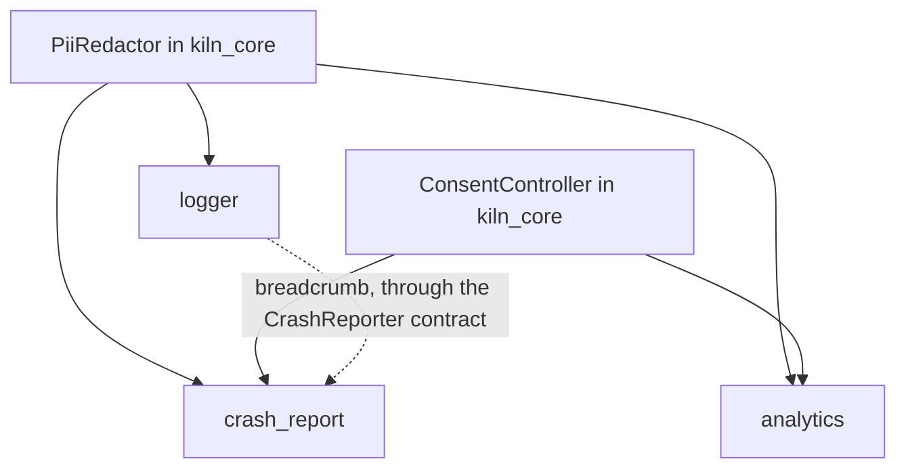
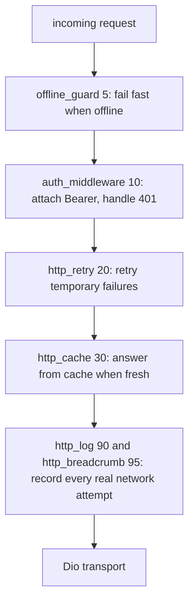

# Complete Kiln Folder Structure

Target blueprint for the Kiln monorepo: packages, extensions, bricks, schemas, and generated projects. This document is the structural reference as features are added phase by phase.

## Root monorepo

The root holds everything that is not package code: CI, documentation, YAML schemas,
project templates, examples, the extension registry, and release scripts. The contents
of `extensions/` and `packages/` are described in the following sections.

```text
kiln/
├─ .github/                                  # GitHub configuration: CI workflows, issue and PR templates, code owners
│  ├─ ISSUE_TEMPLATE/                        # issue forms contributors can choose on GitHub
│  │  ├─ bug_report.yml                      # form for reporting bugs in Kiln
│  │  ├─ extension_request.yml               # form for proposing an extension to the Kiln catalog
│  │  └─ config.yml                          # configures the issue form choices and contact links
│  ├─ workflows/                             # GitHub Actions workflows for CI, releases, and scheduled checks
│  │  ├─ ci.yaml                             # main CI pipeline: analyze and test on every push and PR
│  │  ├─ extensions.yaml                     # CI matrix that only tests changed extensions
│  │  ├─ bundles_check.yaml                  # fails the build when bundles have not been regenerated
│  │  ├─ smoke.yaml                          # nightly: create, add all extensions, then build apk and ios
│  │  ├─ drift.yaml                          # nightly: checks the latest versions of third-party packages used by extensions
│  │  ├─ docs.yaml                           # builds the documentation from the docs/ folder
│  │  └─ release.yaml                        # publish to pub.dev and update the registry
│  ├─ CODEOWNERS                             # list of code owners automatically asked to review PRs
│  ├─ dependabot.yml                         # schedule for automatic dependency updates by Dependabot
│  └─ PULL_REQUEST_TEMPLATE.md               # description and checklist template for every PR
├─ .vscode/                                  # shared VS Code settings for repo contributors
│  ├─ settings.json                          # maps schemas/ to extension.yaml, kiln.yaml, and kiln.lock.yaml
│  └─ extensions.json                        # recommended Dart and YAML extensions
├─ docs/                                     # documentation for Kiln users and contributors
│  ├─ architecture.md                        # overview of the Kiln architecture and how the packages relate
│  ├─ extension-manifest.md                  # full specification of the extension.yaml manifest fields
│  ├─ roadmap.md                             # plan of the Kiln development phases
│  ├─ folder-structure.md                    # blueprint of the Kiln folder structure (this document)
│  ├─ getting-started.md                     # guide to installing Kiln and creating a first app
│  ├─ concepts/                              # explanations of the core Kiln concepts
│  │  ├─ contracts-and-capabilities.md       # contracts in kiln_core and the capabilities provided by extensions
│  │  ├─ slots.md                            # slots as the integration points between extensions
│  │  ├─ lockfile-and-ownership.md           # contents of kiln.lock.yaml and file ownership by extensions
│  │  ├─ transactions-and-rollback.md        # install transactions and how the journal reverts them
│  │  ├─ native-patches.md                   # patching of native platform files by extensions
│  │  ├─ compatibility.md                    # version compatibility rules for Kiln, extensions, and packages
│  │  └─ security-model.md                   # security model: hooks, trust tiers, and checksums
│  ├─ cli/                                   # documentation for the kiln CLI commands
│  │  └─ reference.md                        # reference for kiln commands, flags, and usage examples
│  ├─ extensions/                            # extension documentation: catalog, how to write, test, and publish
│  │  ├─ catalog.md                          # generated from all extension.yaml files, do not edit
│  │  ├─ writing-an-extension.md             # guide to writing an extension from manifest to brick
│  │  ├─ testing-extensions.md               # how to test an extension: manifest, render, analyze, and golden
│  │  ├─ trust-tiers.md                      # extension trust tiers and what they mean for users
│  │  └─ publishing.md                       # steps to publish an extension to the registry
│  ├─ guides/                                # step-by-step guides for common scenarios
│  │  ├─ swap-backend.md                     # swapping the backend without changing application code
│  │  ├─ migrate-bloc-to-riverpod.md         # migrating state management from bloc to riverpod
│  │  ├─ add-offline-support.md              # adding offline support to an app
│  │  └─ setup-flavors-and-env.md            # setting up flavors and env files per environment
│  └─ adr/                                   # architecture decision records
│     ├─ 0001-never-edit-user-code.md        # decision: Kiln never edits user-owned code
│     ├─ 0002-capabilities-not-ids.md        # decision: extensions depend on capabilities, not extension ids
│     ├─ 0003-hooks-and-trust.md             # decision: hooks run with confirmation based on the trust tier
│     ├─ 0004-transactions-and-journal.md    # decision: changes are applied through transactions with a journal
│     └─ 0005-checksums-and-registry.md      # decision: archive checksums and the registry as the extension source
├─ schemas/                                  # JSON Schemas for YAML validation and autocomplete in the IDE
│  ├─ extension.schema.json                  # validates the extension.yaml manifest
│  ├─ kiln.schema.json                       # validates the kiln.yaml project configuration
│  ├─ kiln-lock.schema.json                  # validates the kiln.lock.yaml lockfile
│  ├─ migration.schema.json                  # validates migration files in extensions/<id>/migrations
│  └─ registry-index.schema.json             # validates registry/index.json
├─ bricks/                                   # Mason templates for app projects and extensions
│  ├─ app_basic/                             # app project brick used by kiln create (minimal and starter variants)
│  │  ├─ brick.yaml                          # app_basic brick metadata and project prompt variables
│  │  ├─ hooks/                              # Mason hooks that run before and after generation
│  │  │  ├─ pubspec.yaml                     # dependencies for running the hooks
│  │  │  ├─ pre_gen.dart                     # validates the app name, org, and destination folder conflicts
│  │  │  └─ post_gen.dart                    # runs flutter create, adds kiln_core, pub get, format, and git init
│  │  └─ __brick__/                          # template contents rendered into the user project
│  │     ├─ README.md                        # instructions for running and developing the generated project
│  │     ├─ kiln.yaml                        # Kiln project configuration read by the CLI
│  │     ├─ analysis_options.yaml            # Dart analyzer rules for the generated project
│  │     ├─ .gitignore                       # ignores .kiln/backups, .kiln/journal, .kiln/logs, and env/*.json except *.example.json
│  │     ├─ lib/                             # application source code
│  │     │  ├─ main.dart                     # app entry point: runs KilnBootstrap then KilnApp
│  │     │  ├─ app/                          # root widget and application shell
│  │     │  │  ├─ app.dart                   # KilnApp, the root widget that installs RegistryScope
│  │     │  │  ├─ registry_scope.dart        # RegistryScope: provides the Registry to the widget tree
│  │     │  │  ├─ app_shell.dart             # builds MaterialApp (theme, locale, router from the Registry when present), applies the app.wrappers slot
│  │     │  │  ├─ error_screen.dart          # screen shown when bootstrap fails
│  │     │  │  ├─ app_wrappers.dart          # built-in app.wrappers slot, type AppWrapper = Widget Function(BuildContext, Widget)
│  │     │  │  ├─ app_route.dart             # neutral AppRoute (path, name, builder) for the router.routes slot, without importing go_router
│  │     │  │  └─ app_home.dart              # starter template only: AppHome seam for the starter page
│  │     │  ├─ features/home/home_page.dart  # minimal template starting page owned by the application
│  │     │  └─ core/                         # core app components: l10n, theme, and error handling
│  │     │     ├─ l10n/                      # built-in app localization and the l10n extension integration point
│  │     │     │  ├─ app_localizations_config.dart  # typed configuration: AppLocalizationsConfig, the l10n extension integration point
│  │     │     │  └─ core_copy.dart          # CoreCopy seam filled by the l10n extension; no hardcoded UI strings
│  │     │     ├─ theme/                     # built-in app theme and the theme extension integration point
│  │     │     │  ├─ app_theme_config.dart   # typed configuration: AppThemeConfig, the theme extension integration point
│  │     │     │  └─ app_theme.dart          # built-in app theme when no AppThemeConfig is in the Registry
│  │     │     └─ error/                     # global error handling and error messages for users
│  │     │        ├─ global_error_handler.dart  # forwards Flutter and platform errors to Logger, then to CrashReporter when installed
│  │     │        └─ failure_presenter.dart  # turns a Failure into a user-friendly message, text from l10n FailureMessages when installed
│  │     └─ test/                            # tests that run in the generated app
│  │        └─ app/                          # tests for the application shell in lib/app
│  │           └─ app_smoke_test.dart        # tests that KilnApp renders without errors
│  └─ extension_template/                    # empty extension skeleton used by kiln ext new
│     ├─ brick.yaml                          # brick variables: id, name, category, provides, requires, with_hooks, with_native_patch
│     └─ __brick__/                          # template contents rendered into the extension folder
│        └─ {{id.snakeCase()}}/              # rendered extension folder, named from the id in snake_case
│           ├─ extension.yaml                # manifest: filled from the id, name, category, provides, and requires variables
│           ├─ README.md                     # short extension description: purpose, how to install, and options
│           ├─ CHANGELOG.md                  # change history per extension version
│           ├─ docs/                         # additional extension documentation
│           │  └─ {{id.paramCase()}}.md      # extension topic documentation, file name from the id in paramCase
│           ├─ test/                         # extension-level tests, running in the kiln repo rather than the user app
│           │  ├─ manifest_test.dart         # tests that extension.yaml is valid against extension.schema.json
│           │  ├─ render_test.dart           # tests that rendering the brick to a temp folder matches the golden
│           │  └─ analyze_test.dart          # tests that the render result passes dart analyze without warnings
│           └─ brick/                        # the extension Mason brick, rendered into the user project by kiln add
│              ├─ brick.yaml                 # extension brick metadata and its prompt variables
│              ├─ hooks/                     # Mason hooks, created when with_hooks is set
│              │  ├─ pubspec.yaml            # dependencies for running the hooks
│              │  ├─ pre_gen.dart            # validates input before the brick is rendered
│              │  └─ post_gen.dart           # runs follow-up steps after the brick is rendered
│              └─ __brick__/                 # brick contents rendered into the user project
│                 ├─ lib/extensions/{{id.snakeCase()}}/  # extension code that goes into the user project lib/
│                 │  ├─ {{id.snakeCase()}}.dart          # static facade with a short API for application code
│                 │  ├─ {{id.snakeCase()}}_module.dart   # registers the extension services with the Registry
│                 │  ├─ {{id.snakeCase()}}_config.dart   # typed configuration: values filled from prompts
│                 │  └─ {{id.snakeCase()}}_failure_mapper.dart  # maps third-party package errors into a Failure
│                 └─ test/extensions/{{id.snakeCase()}}/  # extension tests that go into the user project test/
│                    ├─ {{id.snakeCase()}}_module_test.dart          # tests that the module registers its services with the Registry
│                    └─ {{id.snakeCase()}}_failure_mapper_test.dart  # tests that third-party errors map to the correct Failure
├─ extensions/                               # 29 extension folders, described in the Extension sections
├─ examples/                                 # generated example projects as Kiln usage references
│  ├─ minimal/                               # kiln create output without extensions
│  │  ├─ kiln.yaml                           # project configuration without extensions
│  │  ├─ kiln.lock.yaml                      # lockfile with no installed extensions
│  │  ├─ pubspec.yaml                        # minimal project dependencies without extension packages
│  │  ├─ lib/                                # generated minimal application code
│  │  └─ test/                               # built-in tests of the minimal app
│  ├─ full_stack/                            # installs bloc, dio, http_retry, rest_auth, secure_storage, go_router, theme, l10n, env, logger
│  │  ├─ kiln.yaml                           # project configuration with all extensions installed
│  │  ├─ kiln.lock.yaml                      # lockfile recording each extension version and owned files
│  │  ├─ pubspec.yaml                        # project dependencies, including the package of each extension
│  │  ├─ lib/                                # application code plus extension code in lib/extensions
│  │  └─ test/                               # application tests plus extension tests in test/extensions
│  ├─ backend_swap/                          # proves the backend can be swapped without changing app code
│  │  ├─ README.md                           # explains the backend swap scenario and how to compare both variants
│  │  ├─ with_appwrite/                      # project variant with the Appwrite backend
│  │  └─ with_supabase/                      # project variant with the Supabase backend; only kiln.yaml and lib/extensions differ
│  └─ custom_extension/                      # kiln ext new output: a complete community extension example
├─ registry/                                 # extension index and version metadata, produced by tool/build_registry.dart
│  ├─ index.json                             # extension list: id, latest version, and tier
│  ├─ README.md                              # explanation of the registry format and how to use it
│  └─ extensions/                            # release metadata, one folder per extension
│     ├─ dio/                                # release metadata for the dio extension, one json per version
│     │  ├─ 1.0.0.json                       # release metadata for 1.0.0: archive url, sha256, requires, compatibility
│     │  └─ 1.1.0.json                       # release metadata for 1.1.0 with the same fields
│     └─ <id>/                               # one folder per extension, holding one json per version
├─ tool/                                     # Dart scripts for bundling, registry, checks, and releases
│  ├─ bundle.dart                            # bundles all bricks with mason bundle, --check flag for CI
│  ├─ smoke_test.dart                        # tests the create and add flow for all extensions through to a successful build
│  ├─ build_registry.dart                    # generates registry/index.json and the version json of each extension
│  ├─ check_drift.dart                       # compares extension constraints with the latest versions on pub.dev
│  ├─ lint_extensions.dart                   # runs kiln ext validate on all extensions
│  ├─ gen_catalog_docs.dart                  # writes docs/extensions/catalog.md from all extension.yaml files
│  └─ release.dart                           # bumps versions, writes the changelog, and creates tags
├─ packages/                                 # 6 Dart packages, described package by package below
│  ├─ kiln_cli/                              # kiln CLI: the create, add, upgrade, rollback, and doctor commands
│  ├─ kiln_core/                             # contracts, error model, module runtime, session state, and privacy utilities
│  ├─ kiln_extension_sdk/                    # the kiln add engine: read manifest, compute plan, render brick, apply transaction
│  ├─ kiln_store/                            # registry client: fetch index, pick version, verify checksum, trust policy
│  ├─ kiln_testing/                          # fakes per contract, contract suites, and test harness
│  └─ kiln_lints/                            # custom_lint rules for Kiln projects, optional (Phase 6)
├─ CONTRIBUTING.md                           # contribution guide: repo setup, code style, and PR flow
├─ SECURITY.md                               # security policy and how to report vulnerabilities
├─ CODE_OF_CONDUCT.md                        # code of conduct for the contributor community
├─ LICENSE                                   # license text of the Kiln project
├─ .gitignore                                # ignores build artifacts and local files in the repo
├─ analysis_options.yaml                     # shared Dart analyzer rules for the whole monorepo
├─ pubspec.yaml                              # dependencies for the tool/ scripts and monorepo dev tooling
├─ pubspec.lock                              # locks the root monorepo dependency versions
└─ README.md                                 # introduction to the Kiln project and links to the documentation
```

## kiln_core

`kiln_core` is the only package that application code and every extension may
know about. It holds the contracts, error model, module runtime, session state, and
privacy utilities, with no dependency on any Flutter plugin.

```text
packages/kiln_core/
├─ lib/                                           # package source code, exported through the kiln_core.dart barrel
│  ├─ kiln_core.dart                              # barrel that exports the entire public API of the package
│  └─ src/                                        # internal package implementation, not imported directly
│     ├─ contracts/                               # contracts implemented by extensions
│     │  ├─ account_management.dart               # optional PasswordRecovery, EmailVerification, and ProfileUpdate contracts alongside AuthRepository
│     │  ├─ analytics.dart                        # Analytics contract for recording app usage events
│     │  ├─ app_flavor.dart                       # AppFlavor: marker for the build environment currently running
│     │  ├─ auth.dart                             # AuthRepository contract for signing in and out of user accounts
│     │  ├─ connectivity.dart                     # NetworkMonitor contract for watching network connection status
│     │  ├─ crash_reporter.dart                   # CrashReporter contract for reporting crashes and errors
│     │  ├─ deep_links.dart                       # DeepLinks contract for receiving links that open the app
│     │  ├─ env.dart                              # Env contract for reading environment configuration
│     │  ├─ file_storage.dart                     # FileStorage contract: upload, download, url, and delete files in a bucket
│     │  ├─ http_client.dart                      # HttpClient contract for sending HTTP requests
│     │  ├─ local_db.dart                         # LocalDatabase contract for on-device local data
│     │  ├─ logger.dart                           # AppLogger contract for writing application logs
│     │  ├─ media_picker.dart                     # MediaPicker contract for picking images or media from the device
│     │  ├─ notifications.dart                    # Notifications contract for showing and managing notifications
│     │  ├─ permissions.dart                      # Permissions contract: check status, request permission, and open settings
│     │  ├─ remote_database.dart                  # RemoteDatabase contract: document CRUD, RemoteQuery, and watch
│     │  ├─ secure_storage.dart                   # SecureStorage contract for storing sensitive data
│     │  ├─ social_auth.dart                      # SocialAuth contract for signing in with social provider accounts
│     │  └─ storage.dart                          # Storage contract for key-value storage
│     ├─ errors/                                  # uniform error model and typed Result operation outcomes
│     │  ├─ failure.dart                          # Failure class, the uniform error model for all contracts
│     │  ├─ failure_codes.dart                    # FailureCode class: stable codes, e.g. network.timeout and auth.invalid_credentials
│     │  └─ result.dart                           # Result<T> type holding Ok or Err(Failure)
│     ├─ runtime/                                 # module runtime: Registry, init order, Lifecycle, bootstrap, SupportRegistry, and Slot
│     │  ├─ registry.dart                         # Registry contract for registering and resolving services
│     │  ├─ get_it_registry.dart                  # get_it-based Registry implementation
│     │  ├─ kiln_module.dart                      # KilnModule contract: register services and report runtime support
│     │  ├─ module_graph.dart                     # computes init order from requires and detects cycles
│     │  ├─ lifecycle.dart                        # Lifecycle contract: onReady, onPause, onResume, and dispose
│     │  ├─ bootstrap.dart                        # KilnBootstrap.run: async init, support probing, timeout, and error handler
│     │  ├─ support.dart                          # SupportInfo, SupportState, and SupportRegistry for platform/device readiness
│     │  └─ slot.dart                             # OrderedSlot<T> for http.interceptors and router.routes
│     ├─ session/                                 # login session state: session model, controller, and token provider
│     │  ├─ session.dart                          # AuthSession model with userId and expiresAt
│     │  ├─ session_controller.dart               # SessionController: unknown, authenticated, and unauthenticated statuses, plus a stream
│     │  └─ token_provider.dart                   # TokenProvider contract for fetching and refreshing tokens
│     ├─ privacy/                                 # user consent and masking of personal data
│     │  ├─ consent.dart                          # ConsentController for analytics and crash report consent
│     │  └─ pii_redactor.dart                     # PiiRedactor masks personal data for the logger, analytics, and crash reports
│     └─ util/                                    # fakeable Clock, Debouncer, and Disposable
│        ├─ clock.dart                            # Clock: a time source that can be faked in tests
│        ├─ debouncer.dart                        # Debouncer that delays an action until calls stop
│        └─ disposable.dart                       # Disposable contract for releasing resources
├─ test/                                          # kiln_core unit tests: contracts, errors, runtime, sessions, and privacy
│  ├─ auth_test.dart                              # tests the AuthRepository contract and the Failure returned for wrong credentials
│  ├─ failure_test.dart                           # tests construction and value comparison of Failure
│  ├─ http_client_test.dart                       # tests the HttpClient contract and network errors surfaced as Failure
│  ├─ registry_test.dart                          # tests service registration and resolution through the Registry
│  ├─ runtime_contracts_test.dart                 # tests the runtime contracts: Registry and KilnModule working together
│  ├─ result_test.dart                            # tests Result<T> as Ok or Err(Failure)
│  ├─ failure_codes_test.dart                     # tests that FailureCode values are stable and unique
│  ├─ module_graph_test.dart                      # tests init ordering from requires and cycle detection
│  ├─ slot_test.dart                              # tests that OrderedSlot<T> preserves item order
│  ├─ lifecycle_test.dart                         # tests that Lifecycle calls onReady, onPause, onResume, and dispose
│  ├─ bootstrap_test.dart                         # tests KilnBootstrap.run: async init, timeout, and error handler
│  ├─ session_controller_test.dart                # tests SessionController status transitions and its stream
│  ├─ consent_test.dart                           # tests ConsentController consent state for analytics and crash reports
│  ├─ pii_redactor_test.dart                      # tests that PiiRedactor masks personal data
│  ├─ clock_test.dart                             # tests that Clock can be faked to control time
│  └─ debouncer_test.dart                         # tests that Debouncer only runs the last action
├─ example/                                       # sample program that uses kiln_core
│  └─ main.dart                                   # minimal example using Registry, KilnModule, and KilnBootstrap
├─ analysis_options.yaml                          # lint and analyzer rules for this package
├─ CHANGELOG.md                                   # package change history per version
├─ pubspec.yaml                                   # package metadata and dependencies, without Flutter plugins
└─ README.md                                      # package introduction and how to use its contracts
```

## kiln_extension_sdk

The SDK is the engine behind `kiln add`: it reads the manifest, computes a plan,
renders the brick, then applies the changes in a reversible transaction. The
`installer/` part is the largest, and its three subfolders (`transaction/`,
`ownership/`, `verification/`) are what make `add` and `remove` safe.

```text
packages/kiln_extension_sdk/
├─ lib/                                                     # SDK source code: manifest, resolver, renderer, installer, migrator
│  ├─ kiln_extension_sdk.dart                               # barrel that exports the public SDK API
│  ├─ testing.dart                                          # ExtensionTestHarness for tests written by extension authors
│  └─ src/                                                  # internal SDK implementation, used through the barrel
│     ├─ kiln_exception.dart                                # KilnException, the exception for failures in the SDK process
│     ├─ manifest/                                          # extension.yaml model and validation
│     │  ├─ extension_manifest.dart                         # ExtensionManifest model parsed from extension.yaml
│     │  ├─ platform_setup.dart                             # model of the manifest platform block for Android, iOS, macOS, and web patches
│     │  ├─ slot.dart                                       # model of a slot that an extension opens in the manifest
│     │  ├─ manifest_validator.dart                         # validates the id, semver, requires cycles, and platform fields
│     │  ├─ prompt_spec.dart                                # prompt types url, int, enum, secret and their validation
│     │  ├─ compatibility.dart                              # checks the version ranges of kiln_core, Dart, Flutter, and the platform
│     │  └─ contribution.dart                               # model of slot contributions, with a when condition holding optional capabilities
│     ├─ resolver/                                          # computes the install plan, conflicts, and upgrades
│     │  ├─ extension_resolver.dart                         # resolves requires and provides into the list of installed extensions
│     │  ├─ resolution_plan.dart                            # model of the resolution plan that the installer applies
│     │  ├─ capability_index.dart                           # capability index: which extension provides what
│     │  ├─ conflict_report.dart                            # composes actionable extension conflict messages
│     │  ├─ dependency_graph.dart                           # requires graph for the kiln graph and kiln remove commands
│     │  └─ upgrade_planner.dart                            # plans an extension upgrade from the installed version to the target version
│     ├─ renderer/                                          # renders the Mason brick into files in the user project
│     │  ├─ brick_renderer.dart                             # renders the Mason brick into the user project with template variables
│     │  ├─ template_vars.dart                              # turns prompt answers and kiln.yaml into Mason variables
│     │  ├─ collision_policy.dart                           # decides skip, overwrite, or ask; detects edited files via hash
│     │  └─ hook_policy.dart                                # allows hooks only when the brick is trusted
│     ├─ installer/                                         # applies an extension to a project: transaction, ownership, native patches, verification
│     │  ├─ extension_installer.dart                        # orchestrates extension add and remove inside a transaction
│     │  ├─ extensions_codegen.dart                         # writes extensions.g.dart in the user project so it stays in sync with the lockfile
│     │  ├─ lockfile.dart                                   # reads and writes kiln.lock.yaml holding the installed extensions
│     │  ├─ pubspec_reader.dart                             # reads dependencies and versions from the user pubspec.yaml
│     │  ├─ pubspec_writer.dart                             # adds and removes dependencies in pubspec.yaml through yaml_edit
│     │  ├─ transaction/                                    # reversible transaction: journal, snapshot, and rollback
│     │  │  ├─ transaction.dart                             # runs install steps and records them in the journal
│     │  │  ├─ journal.dart                                 # records completed steps as material for rollback
│     │  │  ├─ snapshot.dart                                # backs up files before changing them to .kiln/backups
│     │  │  └─ rollback.dart                                # restores the project to its initial state from the journal and snapshots
│     │  ├─ ownership/                                      # ownership tracking for rendered files and patches
│     │  │  ├─ file_ownership.dart                          # records the hash of every rendered file
│     │  │  └─ patch_journal.dart                           # records the owner of each patch with a reference count
│     │  ├─ native/                                         # patches native Android, iOS, macOS, and web files in the user project
│     │  │  ├─ native_setup.dart                            # applies all native patches according to the manifest platform block
│     │  │  ├─ patch.dart                                   # Patch interface with describe, apply, and revert
│     │  │  ├─ android_gradle.dart                          # edits the Android build.gradle in the user project for build settings the extension needs
│     │  │  ├─ android_project.dart                         # edits AndroidManifest.xml in the user project: permissions such as INTERNET and app links
│     │  │  ├─ ios_app_delegate.dart                        # edits the iOS AppDelegate in the user project for native code the extension needs
│     │  │  ├─ ios_entitlements.dart                        # edits the iOS entitlements file in the user project, e.g. associated domains
│     │  │  ├─ ios_plist.dart                               # adds iOS Info.plist keys in the user project, e.g. permission reason strings
│     │  │  ├─ ios_podfile.dart                             # adds PERMISSION_* flags to the iOS Podfile for permission_handler
│     │  │  ├─ macos_entitlements.dart                      # edits the macOS entitlements in the user project, e.g. network.client and device.camera
│     │  │  └─ web_index_html.dart                          # edits web/index.html in the user project for tags the extension needs
│     │  └─ verification/                                   # checks on the apply result and dry run reports
│     │     ├─ verifier.dart                                # runs pub get and dart analyze after applying
│     │     └─ dry_run_reporter.dart                        # reports the diff that would occur without writing files
│     └─ migrator/                                          # extension migration between versions
│        ├─ migration.dart                                  # Migration model: a change step between extension versions
│        ├─ migration_actions.dart                          # migration actions: rename_file, delete_file, replace_dependency, update_config, message
│        ├─ migration_loader.dart                           # reads migrations from extensions/<id>/migrations
│        └─ migration_runner.dart                           # runs migrations in order during an extension upgrade
├─ test/                                                    # SDK unit tests together with test data in fixtures
│  ├─ android_deep_links_test.dart                          # tests the AndroidManifest.xml patch for app links and deep links
│  ├─ android_gradle_test.dart                              # tests the Android build.gradle patch
│  ├─ brick_renderer_test.dart                              # tests rendering the brick into a project folder with template variables
│  ├─ installer_test.dart                                   # tests the ExtensionInstaller add and remove flow on a sample project
│  ├─ ios_entitlements_test.dart                            # tests adding and removing iOS entitlements keys
│  ├─ manifest_test.dart                                    # tests parsing extension.yaml into ExtensionManifest
│  ├─ resolver_test.dart                                    # tests requires, provides, and exclusive resolution by ExtensionResolver
│  ├─ transaction_test.dart                                 # tests that Transaction runs steps and records the journal
│  ├─ rollback_test.dart                                    # tests that rollback restores the project after a failed step
│  ├─ snapshot_test.dart                                    # tests backing up files to .kiln/backups and restoring them
│  ├─ file_ownership_test.dart                              # tests hash recording for rendered files
│  ├─ patch_journal_test.dart                               # tests the reference count of patches owned by several extensions
│  ├─ pubspec_writer_test.dart                              # tests adding and removing dependencies through yaml_edit
│  ├─ ios_podfile_test.dart                                 # tests adding PERMISSION_* flags to the iOS Podfile
│  ├─ macos_entitlements_test.dart                          # tests the macOS entitlements patch
│  ├─ web_index_html_test.dart                              # tests the web/index.html patch
│  ├─ manifest_validator_test.dart                          # tests validation of the id, semver, requires cycles, and platform fields
│  ├─ prompt_spec_test.dart                                 # tests prompt types url, int, enum, secret and their validation
│  ├─ compatibility_test.dart                               # tests the version range checks for kiln_core, Dart, Flutter, and the platform
│  ├─ contribution_test.dart                                # tests slot contributions whose when condition holds capabilities
│  ├─ capability_index_test.dart                            # tests the capability index: which extension provides what
│  ├─ conflict_report_test.dart                             # tests the actionable conflict messages
│  ├─ dependency_graph_test.dart                            # tests the requires graph for kiln graph and kiln remove
│  ├─ upgrade_planner_test.dart                             # tests the cross-version extension upgrade plan
│  ├─ collision_policy_test.dart                            # tests the skip, overwrite, and ask decisions on file collisions
│  ├─ hook_policy_test.dart                                 # tests that hooks only run on trusted bricks
│  ├─ template_vars_test.dart                               # tests building Mason variables from prompts and kiln.yaml
│  ├─ verifier_test.dart                                    # tests the pub get and dart analyze verification after applying
│  ├─ dry_run_reporter_test.dart                            # tests the dry run diff report without writing files
│  ├─ migration_runner_test.dart                            # tests sequential migration execution by MigrationRunner
│  ├─ migration_actions_test.dart                           # tests the rename_file, delete_file, replace_dependency, update_config migration actions
│  └─ fixtures/                                             # test data: manifests, sample projects, and small bricks
│     ├─ manifests/                                         # sample extension.yaml files for manifest and validator tests
│     │  ├─ valid/                                          # extension.yaml files that must pass validation
│     │  └─ invalid/                                        # malformed extension.yaml files that the validator must reject
│     ├─ projects/                                          # sample Flutter projects as installation targets
│     │  ├─ fresh_app/                                      # initial app without extensions, for the first add scenario
│     │  ├─ app_with_dio/                                   # app with dio installed, for extensions that depend on http_pipeline
│     │  ├─ app_with_edited_files/                          # app with user-edited rendered files, for the file collision scenario
│     │  └─ app_with_two_owners/                            # app with patches owned by two extensions, for the reference count scenario
│     └─ bricks/                                            # small Mason bricks for renderer tests
│        ├─ tiny_brick/                                     # minimal brick for the basic render scenario
│        └─ brick_with_hooks/                               # brick with hooks, for the hook_policy and trusted brick scenarios
├─ tool/                                                    # SDK package development scripts
│  └─ generate_schemas.dart                                 # generates the JSON Schemas from the manifest models
├─ analysis_options.yaml                                    # lint and analyzer rules for this package
├─ CHANGELOG.md                                             # package change history per version
├─ pubspec.yaml                                             # SDK package metadata and dependencies
└─ README.md                                                # SDK introduction and how to build an extension
```

## kiln_cli

The CLI only handles interaction: command parsing, prompts, reports, and exit
codes. All installation logic lives in `kiln_extension_sdk`, so every
command stays thin and easy to test.

```text
packages/kiln_cli/
├─ bin/  # entry point of the kiln executable
│  └─ kiln.dart  # main function that runs the command runner and exits with its code
├─ lib/  # CLI library code used by bin/kiln.dart and test/
│  ├─ kiln_cli.dart  # barrel that exports the public kiln_cli API
│  └─ src/  # internal CLI implementation: commands, infra, and bundles
│     ├─ command_runner.dart  # registers all commands and forwards arguments to the matching command
│     ├─ project_context.dart  # detects a kiln project, then reads kiln.yaml and the lockfile
│     ├─ paths.dart  # builds the paths for kiln.yaml, the lockfile, and the ~/.kiln directory
│     ├─ version.dart  # CLI version constant for the version command and the update checker
│     ├─ commands/  # implementation of each CLI subcommand, one file per command
│     │  ├─ create_command.dart  # create command: builds a project from app_basic with the chosen state management
│     │  ├─ add_command.dart  # add command: installs an extension transactionally through the SDK
│     │  ├─ remove_command.dart  # remove command: removes an extension and only deletes files that were not edited
│     │  ├─ list_command.dart  # list command: shows installed or available extensions
│     │  ├─ doctor_command.dart  # doctor command: checks project health, can repair through --fix
│     │  ├─ version_command.dart  # version command: shows the CLI and kiln_core versions
│     │  ├─ command_helpers.dart  # shared options and flow across commands, for example --dry-run and --yes
│     │  ├─ info_command.dart  # info command: shows an extension provides, requires, platform, and changelog
│     │  ├─ upgrade_command.dart  # upgrade command: bumps the extension version, then runs migrations
│     │  ├─ rollback_command.dart  # rollback command: reverts the last operation from the journal
│     │  ├─ graph_command.dart  # graph command: prints the requires and capability graph as text or mermaid
│     │  ├─ config_command.dart  # config command: sets the registry, mirror, and offline mode
│     │  ├─ cache_command.dart  # cache command: inspects and clears the registry cache
│     │  ├─ store_command.dart  # store command: searches and inspects extensions in the registry
│     │  ├─ completion_command.dart  # completion command: prints autocomplete scripts for bash, zsh, and fish
│     │  └─ ext/  # kiln ext subcommands: tools for extension authors
│     │     ├─ ext_new_command.dart  # ext new command: creates an extension skeleton with manifest and brick
│     │     ├─ ext_validate_command.dart  # ext validate command: checks extension.yaml against the schema
│     │     ├─ ext_test_command.dart  # ext test command: runs the extension tests, optionally --update-goldens
│     │     ├─ ext_pack_command.dart  # ext pack command: packs the extension into an archive for the registry
│     │     └─ ext_publish_command.dart  # ext publish command: publishes the extension archive to the registry
│     ├─ infra/  # CLI support services: logging, prompts, reports, configuration, and system access
│     │  ├─ kiln_logger.dart  # writes leveled logs and progress, honoring --verbose and --quiet
│     │  ├─ prompter.dart  # shows interactive prompts, honors --yes, and detects non-TTY
│     │  ├─ exit_codes.dart  # fixed exit codes for each command outcome, used by CI
│     │  ├─ json_reporter.dart  # reports the command result as JSON when --json is active
│     │  ├─ error_presenter.dart  # turns a KilnException into a message with suggestions for fixing it
│     │  ├─ global_config.dart  # typed configuration: registry, mirror, and offline mode from ~/.kiln/config.yaml
│     │  ├─ update_checker.dart  # notifies about a newer CLI version without blocking the command
│     │  ├─ process_runner.dart  # runs external processes such as flutter and dart with controlled output
│     │  └─ file_system.dart  # file system abstraction so commands can be tested without disk
│     └─ bundles/  # bundle of all extensions, generated from extensions/, do not edit
│        ├─ catalog.g.dart  # catalog of available extensions, generated from extension.yaml, do not edit
│        ├─ app_basic_bundle.dart  # app_basic bundle for create, generated from extensions/app_basic, do not edit
│        └─ <id>_bundle.dart  # per-extension bundle (29 files), generated from extensions/<id>, do not edit
├─ test/  # kiln_cli package tests: command runner, commands, infra, fixtures, and goldens
│  ├─ command_runner_test.dart  # tests argument mapping to commands and the command runner exit codes
│  ├─ commands/  # one test file for each CLI command
│  │  ├─ create_command_test.dart  # tests that create builds a project from app_basic according to the state and platform options
│  │  ├─ add_command_test.dart  # tests that add installs an extension transactionally, including dry-run mode
│  │  ├─ remove_command_test.dart  # tests that remove only deletes files the user has not edited
│  │  ├─ list_command_test.dart  # tests that list shows installed and available extensions, including --json
│  │  ├─ doctor_command_test.dart  # tests that doctor reports changed hashes, missing patches, and leftover journal entries
│  │  ├─ info_command_test.dart  # tests that info shows provides, requires, platform, and changelog
│  │  ├─ upgrade_command_test.dart  # tests that upgrade bumps the extension version, then runs migrations
│  │  ├─ rollback_command_test.dart  # tests that rollback reverts the last operation based on the journal
│  │  ├─ graph_command_test.dart  # tests that graph prints the requires graph in text and mermaid formats
│  │  ├─ config_command_test.dart  # tests that config sets the registry, mirror, and offline mode
│  │  ├─ cache_command_test.dart  # tests that cache shows and clears the registry cache
│  │  ├─ store_command_test.dart  # tests that store searches and shows extensions from the registry
│  │  └─ ext_commands_test.dart  # tests the ext subcommands: new, validate, test, pack, and publish
│  ├─ infra/  # infra component tests: prompter, JSON reporter, error presenter, and exit codes
│  │  ├─ prompter_test.dart  # tests interactive prompts, --yes mode, and non-TTY detection
│  │  ├─ json_reporter_test.dart  # tests that json_reporter produces stable --json output
│  │  ├─ error_presenter_test.dart  # tests turning KilnException into a message with suggestions for fixing it
│  │  └─ exit_codes_test.dart  # tests that the fixed exit codes used by CI do not change
│  ├─ fixtures/  # small project per scenario as input for command tests
│  │  ├─ fresh_app/  # project from create without extra extensions, the starting point of the scenario
│  │  ├─ app_with_dio/  # project with the dio extension installed, together with its lockfile
│  │  ├─ app_with_edited_files/  # project with user-edited rendered files, for hash and remove tests
│  │  ├─ app_with_flavors/  # project with several AppFlavor values, for testing per-flavor configuration
│  │  └─ app_without_lock/  # project without kiln.lock.yaml, for testing project detection and doctor
│  └─ goldens/  # reference command outputs that must stay the same
│     ├─ add_dry_run.txt  # locks the add --dry-run text output: the file and patch plan
│     ├─ add_dry_run.json  # locks the add --dry-run JSON output read by CI
│     ├─ doctor_report.txt  # locks the doctor text report with its suggestions for fixing issues
│     ├─ list.json  # locks the list --json output: installed and available extensions
│     └─ info_dio.txt  # locks the info text output for the dio extension
├─ analysis_options.yaml  # lint and static analysis rules for the kiln_cli package
├─ CHANGELOG.md  # change notes for each kiln_cli release
├─ pubspec.yaml  # kiln_cli package metadata and dependencies
└─ README.md  # introduction, installation, and CLI usage examples
```

### Command list

| Command | Purpose | Key flags |
| --- | --- | --- |
| `create` | build a project from `app_basic`, choose the state management | `--state`, `--org`, `--platforms`, `--with` |
| `add` | install an extension transactionally | `--dry-run`, `--yes`, `--no-verify`, `--from` |
| `remove` | remove an extension, only deleting files that were not edited | `--dry-run`, `--force` |
| `upgrade` | bump the extension version, then run migrations | `--dry-run`, `--all` |
| `rollback` | revert the last operation from the journal | `--list` |
| `list` | installed or available extensions | `--installed`, `--available`, `--json` |
| `info` | provides, requires, platform, and changelog of one extension | `--json` |
| `graph` | requires and capability graph | `--format text` or `mermaid` |
| `doctor` | check project health | `--fix`, `--json` |
| `config` | set the registry, mirror, and offline mode | `--global` |
| `cache` | inspect or clear the registry cache | `clean` |
| `store` | search and inspect extensions in the registry | `search`, `info` |
| `completion` | shell autocomplete script | `bash`, `zsh`, `fish` |
| `ext` | extension author tools: `new`, `validate`, `test`, `pack`, `publish` | `--update-goldens`, `--tier` |
| `version` | CLI and `kiln_core` version | none |

### What doctor checks

- The hashes of rendered files in the lockfile are compared with the actual
  state, so user-edited files are detected.
- Missing or duplicated native patches (permission, entitlement,
  intent-filter).
- `extensions.g.dart` that is out of sync with the lockfile.
- Unfinished manual steps, for example `flutterfire configure` for
  Firebase.
- Extensions that do not support the project platforms, for example `biometric` on web.
- The Dart, Flutter, and `kiln_core` versions against each extension `compatibility`
  range.
- Extensions with a new version or a migration that has not been run.
- Leftover journal entries from an operation interrupted halfway.

`kiln doctor` does not check runtime device support. That is reported by
`KilnModule.support()` inside the running app and recorded in
`SupportRegistry`; see
[extensions/support-and-devices.md](extensions/support-and-devices.md).
## kiln_store, kiln_testing, kiln_lints

Three packages that close the trust and quality gaps: the store downloads
extensions with verification, testing proves that every contract implementation
can stand in for another, and lints keep the app depending on the
contracts.

### kiln_store

```text
packages/kiln_store/                          # package for downloading, verifying, and publishing extensions
├─ lib/                                       # public code and implementation of the kiln_store package
│  ├─ kiln_store.dart                         # exports the public kiln_store API
│  └─ src/                                    # internal implementation of the registry client, verification, and publish
│     ├─ registry_client.dart                 # fetches the registry index.json from the Git repository
│     ├─ registry_index.dart                  # registry index model with the version list of each extension
│     ├─ registry_config.dart                 # typed configuration: URL, mirror, and ref (branch or tag)
│     ├─ version_resolver.dart                # picks the extension version that matches the project kiln_core
│     ├─ search_index.dart                    # local extension search from the cache
│     ├─ checksum_verifier.dart               # verifies the archive sha256 before installing
│     ├─ trust_policy.dart                    # assigns the official, verified, and community levels and confirms before hooks run
│     ├─ archive_packer.dart                  # creates the .tgz archive from the extension folder
│     ├─ archive_unpacker.dart                # extracts archives and rejects path traversal (zip-slip)
│     ├─ publisher.dart                       # validates the extension, then publishes it to the registry
│     ├─ local_cache.dart                     # stores the index and downloaded archives on the local disk
│     └─ offline_mode.dart                    # uses the local cache when the network is unavailable
├─ test/                                      # kiln_store package unit tests
│  ├─ registry_client_test.dart               # tests fetching index.json from the primary URL and the mirror
│  ├─ registry_index_test.dart                # tests parsing the registry index and the extension version list
│  ├─ version_resolver_test.dart              # tests selecting a version compatible with the project kiln_core
│  ├─ search_index_test.dart                  # tests local extension search from the cache
│  ├─ checksum_verifier_test.dart             # tests that archives with a mismatched sha256 are rejected
│  ├─ trust_policy_test.dart                  # tests the trust levels and the confirmation before hooks run
│  ├─ archive_packer_test.dart                # tests creating a .tgz archive holding every extension file
│  ├─ archive_unpacker_test.dart              # tests that archives with path traversal (zip-slip) are rejected
│  ├─ publisher_test.dart                     # tests that an extension is validated before publishing
│  ├─ local_cache_test.dart                   # tests storing and reading the index and archives from the cache
│  ├─ offline_mode_test.dart                  # tests that offline mode only uses the local cache
│  └─ fixtures/registry/                      # holds a sample index.json, a valid archive, and a malicious archive with path traversal
├─ analysis_options.yaml                      # analyzer and lint rules for the kiln_store package
├─ CHANGELOG.md                               # kiln_store change history per release
├─ pubspec.yaml                               # kiln_store package metadata and dependencies
└─ README.md                                  # usage guide and architecture of kiln_store
```

### kiln_testing

Used as a `dev_dependency` in generated apps and in every
extension. The `contracts/` suite runs against each implementation: Appwrite,
Firebase, Supabase, and `rest_auth` must all pass the same `auth_repository_contract`,
and that is the proof that the backend can be swapped.

```text
packages/kiln_testing/                            # package of fakes, contract suites, and test harnesses
├─ lib/                                           # public code and implementation of the kiln_testing package
│  ├─ kiln_testing.dart                           # exports the fakes, contract suites, and harnesses
│  └─ src/                                        # internal implementation of fakes, contracts, and harnesses
│     ├─ fakes/                                   # fakes and in-memory implementations for the kiln_core contracts
│     │  ├─ fake_http_client.dart                 # simulates HttpClient with programmed responses and records requests
│     │  ├─ in_memory_storage.dart                # simulates a key-value Storage kept in memory
│     │  ├─ in_memory_secure_storage.dart         # simulates SecureStorage in memory without a real keychain
│     │  ├─ fake_auth_repository.dart             # simulates AuthRepository: login, logout, and session without a backend
│     │  ├─ fake_account_management.dart          # simulates AccountManagement: password reset, email verification, profile update
│     │  ├─ fake_social_auth.dart                 # simulates SocialAuth with configurable social login results
│     │  ├─ fake_connectivity.dart                # simulates NetworkMonitor with a switchable online or offline status
│     │  ├─ fake_permissions.dart                 # simulates Permissions with configurable permission status
│     │  ├─ fake_notifications.dart               # simulates Notifications and records the notifications shown
│     │  ├─ fake_deep_links.dart                  # simulates DeepLinks with incoming links triggered from tests
│     │  ├─ fake_media_picker.dart                # simulates MediaPicker with media selection results set by the test
│     │  ├─ fake_local_database.dart              # simulates a LocalDatabase that keeps data in memory
│     │  ├─ fake_remote_database.dart             # simulates a RemoteDatabase in memory without a network
│     │  ├─ fake_file_storage.dart                # simulates FileStorage with file contents kept in memory
│     │  ├─ fake_analytics.dart                   # simulates Analytics and records the events sent
│     │  ├─ fake_crash_reporter.dart              # simulates CrashReporter and records the errors reported
│     │  ├─ fake_env.dart                         # simulates Env with configuration values supplied by the test
│     │  ├─ fake_clock.dart                       # simulates Clock with manually advanced time
│     │  └─ recording_logger.dart                 # AppLogger that keeps log entries so tests can inspect them
│     ├─ contracts/                               # test suite run against EVERY contract implementation
│     │  ├─ http_client_contract.dart             # checks HttpClient: methods, headers, body, and error mapping to Failure
│     │  ├─ storage_contract.dart                 # checks Storage: put, read, delete, and missing keys
│     │  ├─ secure_storage_contract.dart          # checks SecureStorage: values stored, read back, and deleted
│     │  ├─ auth_repository_contract.dart         # checks AuthRepository: login, logout, session, and the Failure for wrong credentials
│     │  ├─ account_management_contract.dart      # checks AccountManagement: password reset, email verification, profile update
│     │  ├─ social_auth_contract.dart             # checks SocialAuth: social login succeeding, being cancelled, and failing
│     │  ├─ local_database_contract.dart          # checks LocalDatabase: write, read, update, and delete data
│     │  ├─ remote_database_contract.dart         # checks RemoteDatabase: write, read, update, delete, and network errors
│     │  ├─ file_storage_contract.dart            # checks FileStorage: upload, download, and delete files
│     │  ├─ connectivity_contract.dart            # checks NetworkMonitor: connection status and its changes through the stream
│     │  ├─ permissions_contract.dart             # checks Permissions: permission status and the result of permission requests
│     │  ├─ notifications_contract.dart           # checks Notifications: permission, delivery, and notification handling
│     │  ├─ deep_links_contract.dart              # checks DeepLinks: the initial link and links arriving while the app runs
│     │  ├─ media_picker_contract.dart            # checks MediaPicker: the selected media and cancellation by the user
│     │  ├─ analytics_contract.dart               # checks Analytics: event sending and user properties
│     │  ├─ crash_reporter_contract.dart          # checks CrashReporter: error reporting and extra context
│     │  └─ logger_contract.dart                  # checks AppLogger: log levels and messages reaching the sink
│     └─ harness/                                 # test support utilities: Registry, widgets, matchers, async, goldens
│        ├─ test_registry.dart                    # builds a ready-to-use Registry filled with fakes for tests
│        ├─ pump_app.dart                         # renders widgets in tests with a fake Registry and the app wrappers
│        ├─ matchers.dart                         # isFailure, isOk, and hasCode matchers for Result and Failure
│        ├─ async_helpers.dart                    # pumpUntil and expectEmitsInOrder for waiting on conditions and stream order
│        └─ golden_helpers.dart                   # compares widget rendering with golden files
├─ test/                                          # kiln_testing package unit tests
│  └─ fakes_satisfy_contracts_test.dart           # tests that every fake passes its own contract suite
├─ analysis_options.yaml                          # analyzer and lint rules for the kiln_testing package
├─ CHANGELOG.md                                   # kiln_testing change history per release
├─ pubspec.yaml                                   # kiln_testing package metadata and dependencies
└─ README.md                                      # guide to using the fakes, contract suites, and harnesses
```

### kiln_lints

```text
packages/kiln_lints/                      # optional lint plugin (Phase 6) so the app keeps using the contracts
├─ lib/                                   # public code and implementation of the kiln_lints package
│  ├─ kiln_lints.dart                     # custom_lint plugin entry point that registers all rules
│  └─ src/rules/                          # one file per lint rule
│     ├─ no_cross_extension_import.dart   # forbids one extension from importing another
│     ├─ prefer_contract_over_impl.dart   # warns about app code using an implementation such as DioClient instead of the contract
│     ├─ no_plugin_in_features.dart       # forbids features/ folders from importing plugins directly
│     ├─ no_edit_generated_files.dart     # warns when extensions.g.dart is edited by hand
│     └─ require_failure_handling.dart    # warns about a Result used without handling the Failure
├─ test/                                  # kiln_lints package unit tests
│  └─ rules_test.dart                     # tests each lint rule against violating and compliant code
├─ example/                               # small sample project that deliberately triggers every lint rule
├─ analysis_options.yaml                  # analyzer and lint rules for the kiln_lints package
├─ CHANGELOG.md                           # kiln_lints change history per release
├─ pubspec.yaml                           # kiln_lints package metadata and dependencies
└─ README.md                              # guide to installing the plugin and the list of lint rules
```

## Extension: state and networking

These five extensions form the foundation of an app: one state management adapter
(exclusive) and an HTTP stack assembled from `dio`, `http_retry`, and
`http_cache` through the `http.interceptors` slot.

### bloc

```text
extensions/bloc/                            # state management extension based on Bloc and Cubit
├─ extension.yaml                           # manifest: category: state · exclusive · provides: state_bloc (riverpod is rejected by the exclusive rule)
├─ README.md                                # short guide to installing and using the bloc extension
├─ CHANGELOG.md                             # bloc extension change history per version
├─ docs/                                    # documentation for using the bloc extension
│  ├─ state-with-bloc.md                    # guide to managing application state with Cubit and Bloc
│  └─ bloc-to-riverpod.md                   # guide to migrating state from bloc to riverpod
├─ test/                                    # extension-level tests, running in the kiln repo rather than the user app
│  ├─ manifest_test.dart                    # ensures extension.yaml is valid against extension.schema.json
│  ├─ render_test.dart                      # renders the brick to a temp folder, the result must match the golden
│  ├─ analyze_test.dart                     # the render result must pass dart analyze without warnings
│  └─ goldens/rendered/                     # reference render output for render_test, generated by kiln ext test --update-goldens
└─ brick/                                   # Mason brick rendered into the user app
   ├─ brick.yaml                            # Mason brick metadata and its variable list
   └─ __brick__/                            # template contents copied into the generated app
      ├─ lib/                               # Dart code copied into the app lib/
      │  ├─ bootstrap.dart                  # sets up the Registry and AppBlocObserver before runApp
      │  ├─ app/                            # application-level composition for global state
      │  │  └─ bloc_providers.dart          # MultiBlocProvider for global blocs
      │  ├─ core/bloc/                      # Bloc and Cubit foundation used by every feature
      │  │  ├─ app_bloc_observer.dart       # logs transitions and errors to Logger, with PII masked
      │  │  ├─ base_cubit.dart              # safeEmit (checks isClosed), runGuarded turns errors into Failure
      │  │  ├─ async_state.dart             # sealed: initial, loading, data, failure
      │  │  ├─ async_cubit.dart             # load, refresh, retry
      │  │  ├─ bloc_transformers.dart       # debounce, throttle, droppable, restartable
      │  │  └─ session_cubit.dart           # wraps the SessionController from kiln_core
      │  └─ features/                       # sample feature that uses Bloc state
      │     └─ counter/                     # counter feature as a Cubit usage example
      │        ├─ counter_cubit.dart        # Cubit that holds the counter value and changes it
      │        └─ counter_page.dart         # counter page that reads CounterCubit through BlocBuilder
      └─ test/                              # tests that are generated into the user app together with the code
         ├─ bootstrap_test.dart             # tests that bootstrap installs the Bloc observer and prepares the Registry
         ├─ counter_cubit_test.dart         # tests that CounterCubit changes state according to the action
         ├─ counter_page_test.dart          # tests that CounterPage shows the counter value and reacts to the button
         └─ core/bloc/                      # tests for the Bloc foundation in core/bloc
            ├─ app_bloc_observer_test.dart  # tests that the observer records transitions and errors with PII masked
            ├─ base_cubit_test.dart         # tests that safeEmit does not emit when isClosed and that runGuarded yields a Failure
            ├─ async_state_test.dart        # tests the sealed AsyncState variants: initial, loading, data, failure
            ├─ async_cubit_test.dart        # tests that load, refresh, and retry produce the correct state sequence
            ├─ bloc_transformers_test.dart  # tests the behavior of the debounce, throttle, droppable, and restartable transformers
            └─ session_cubit_test.dart      # tests that SessionCubit forwards the SessionController status
```

### riverpod

```text
extensions/riverpod/                        # state management extension based on Riverpod
├─ extension.yaml                           # manifest: category: state · exclusive · provides: state_riverpod (bloc is rejected by the exclusive rule)
├─ README.md                                # short guide to installing and using the riverpod extension
├─ CHANGELOG.md                             # riverpod extension change history per version
├─ docs/                                    # documentation for using the riverpod extension
│  ├─ state-with-riverpod.md                # guide to managing application state with providers and Notifier
│  └─ riverpod-to-bloc.md                   # guide to migrating state from riverpod to bloc
├─ test/                                    # extension-level tests, running in the kiln repo rather than the user app
│  ├─ manifest_test.dart                    # ensures extension.yaml is valid against extension.schema.json
│  ├─ render_test.dart                      # renders the brick to a temp folder, the result must match the golden
│  ├─ analyze_test.dart                     # the render result must pass dart analyze without warnings
│  └─ goldens/rendered/                     # reference render output for render_test, generated by kiln ext test --update-goldens
└─ brick/                                   # Mason brick rendered into the user app
   ├─ brick.yaml                            # Mason brick metadata and its variable list
   └─ __brick__/                            # template contents copied into the generated app
      ├─ lib/                               # Dart code copied into the app lib/
      │  ├─ bootstrap.dart                  # sets up the Registry and ProviderScope before runApp
      │  ├─ app/                            # application-level composition for global state
      │  │  └─ provider_root.dart           # ProviderScope with a Registry override
      │  ├─ core/riverpod/                  # Riverpod foundation used by every feature
      │  │  ├─ kiln_providers.dart          # registryProvider and kilnProvider<T>() for each contract
      │  │  ├─ app_provider_observer.dart   # logs provider errors, with PII masked
      │  │  ├─ async_value_x.dart           # AsyncValue extension: guard into Failure and concise when mapping
      │  │  ├─ provider_overrides.dart      # ready-made overrides for tests
      │  │  └─ session_notifier.dart        # wraps the SessionController from kiln_core
      │  └─ features/                       # sample feature that uses Riverpod state
      │     └─ counter/                     # counter feature as a provider usage example
      │        ├─ counter_page.dart         # counter page that reads state from the provider
      │        └─ counter_provider.dart     # provider that holds the counter value and changes it
      └─ test/                              # tests that are generated into the user app together with the code
         ├─ bootstrap_test.dart             # tests that bootstrap prepares the ProviderScope with the Registry
         ├─ counter_page_test.dart          # tests that CounterPage shows the counter value and reacts to the button
         ├─ counter_provider_test.dart      # tests that the counter provider changes state according to the action
         └─ core/riverpod/                  # tests for the Riverpod foundation in core/riverpod
            ├─ kiln_providers_test.dart     # tests that registryProvider and kilnProvider<T>() resolve contracts from the Registry
            ├─ app_provider_observer_test.dart  # tests that the observer records provider errors with PII masked
            ├─ async_value_x_test.dart      # tests that guard turns exceptions into Failure and when maps the state
            ├─ provider_overrides_test.dart  # tests that the test overrides replace contracts with fakes
            └─ session_notifier_test.dart   # tests that SessionNotifier forwards the SessionController status
```

### dio

```text
extensions/dio/                             # HTTP client extension based on dio that opens the interceptor slot
├─ extension.yaml                           # manifest: provides: http_client, http_pipeline · opens slot: http.interceptors · android: INTERNET · macos: network.client
├─ README.md                                # short guide to installing and using the dio extension
├─ CHANGELOG.md                             # dio extension change history per version
├─ docs/                                    # documentation for using the dio extension
│  ├─ http-client.md                        # guide to making requests and handling errors through HttpClient
│  └─ interceptors.md                       # how other extensions attach to the http.interceptors slot
├─ test/                                    # extension-level tests, running in the kiln repo rather than the user app
│  ├─ manifest_test.dart                    # ensures extension.yaml is valid against extension.schema.json
│  ├─ render_test.dart                      # renders the brick to a temp folder, the result must match the golden
│  ├─ analyze_test.dart                     # the render result must pass dart analyze without warnings
│  └─ goldens/rendered/                     # reference render output for render_test, generated by kiln ext test --update-goldens
└─ brick/                                   # Mason brick rendered into the user app
   ├─ brick.yaml                            # Mason brick metadata and variables such as base_url and connect_timeout
   ├─ hooks/                                # Mason hooks that run during generation
   │  ├─ pubspec.yaml                       # dependencies required by the hook scripts
   │  └─ pre_gen.dart                       # validates base_url and connect_timeout before rendering
   └─ __brick__/                            # template contents copied into the generated app
      ├─ lib/extensions/dio/                # dio extension code in the generated app
      │  ├─ http.dart                       # static Http facade: get, post, put, patch, delete
      │  ├─ dio_module.dart                 # registers HttpClient and HttpPipeline with the Registry
      │  ├─ dio_client.dart                 # HttpClient contract implementation on top of Dio with HttpPipeline
      │  ├─ dio_config.dart                 # typed configuration: base_url, timeout, default headers
      │  ├─ dio_failure_mapper.dart         # maps DioException errors into Failure (timeout, offline, 401, 5xx)
      │  ├─ cancellation.dart               # cancels requests when the widget is disposed
      │  ├─ multipart_helper.dart           # uploads multipart files with progress reporting
      │  ├─ download_helper.dart            # downloads files with progress reporting
      │  ├─ dio_test_adapter.dart           # fake HTTP adapter so tests do not use the network
      │  └─ interceptors/                   # built-in interceptors and the slot entry point
      │     ├─ interceptor_slot.dart        # entry point for contributes from other extensions
      │     ├─ request_id_interceptor.dart  # adds an X-Request-Id header for log correlation
      │     └─ user_agent_interceptor.dart  # adds a User-Agent header containing the app version and platform
      └─ test/extensions/dio/               # tests generated alongside the dio extension
         ├─ dio_client_test.dart            # tests that DioClient sends requests and returns a Result
         ├─ dio_module_test.dart            # tests that the module registers HttpClient and HttpPipeline with the Registry
         ├─ dio_failure_mapper_test.dart    # tests that DioException maps to Failure (timeout, offline, 401, 5xx)
         ├─ cancellation_test.dart          # tests that requests are cancelled when the widget is disposed
         ├─ multipart_helper_test.dart      # tests that multipart upload sends the file and reports progress
         ├─ download_helper_test.dart       # tests that downloads write the file and report progress
         ├─ interceptor_slot_test.dart      # tests that slot contributions are installed in priority order
         ├─ request_id_interceptor_test.dart  # tests that every request carries an X-Request-Id header
         ├─ user_agent_interceptor_test.dart  # tests that the User-Agent header contains the app version and platform
         └─ http_client_contract_test.dart  # runs the HttpClient contract suite from kiln_testing against this implementation
```

### http_retry

```text
extensions/http_retry/                      # automatic retry extension for HTTP requests that fail temporarily
├─ extension.yaml                           # manifest: requires: http_client, http_pipeline · contributes: http.interceptors, priority 20 (attached to HttpPipeline)
├─ README.md                                # short guide to installing and using the http_retry extension
├─ CHANGELOG.md                             # http_retry extension change history per version
├─ docs/                                    # documentation for using the http_retry extension
│  └─ retry-policy.md                       # guide to configuring the retry policy, backoff, and budget
├─ test/                                    # extension-level tests, running in the kiln repo rather than the user app
│  ├─ manifest_test.dart                    # ensures extension.yaml is valid against extension.schema.json
│  ├─ render_test.dart                      # renders the brick to a temp folder, the result must match the golden
│  ├─ analyze_test.dart                     # the render result must pass dart analyze without warnings
│  └─ goldens/rendered/                     # reference render output for render_test, generated by kiln ext test --update-goldens
└─ brick/                                   # Mason brick rendered into the user app
   ├─ brick.yaml                            # Mason brick metadata and its variable list
   └─ __brick__/                            # template contents copied into the generated app
      ├─ lib/extensions/http_retry/         # http_retry extension code in the generated app
      │  ├─ http_retry_module.dart          # registers RetryMiddleware with the Registry and HttpPipeline
      │  ├─ retry_middleware.dart           # HttpMiddleware that retries failed requests according to the policy
      │  ├─ retry_policy.dart               # decides which failures are worth retrying and how many times
      │  ├─ retry_settings.dart             # typed settings: attempt count, initial delay, and backoff cap
      │  ├─ backoff.dart                    # computes the exponential delay with jitter
      │  ├─ retry_budget.dart               # caps total retries per time window, preventing retry storms
      │  ├─ retry_after_parser.dart         # reads the Retry-After header (seconds or HTTP date)
      │  ├─ idempotency.dart                # only retries idempotent methods or those with an Idempotency-Key
      │  └─ retry_events.dart               # fires callbacks and logs on every retry attempt
      └─ test/extensions/http_retry/        # tests generated alongside the http_retry extension
         ├─ http_retry_test.dart            # tests that temporary failures are retried according to the policy
         ├─ backoff_test.dart               # tests that the delay grows exponentially and the jitter stays within bounds
         ├─ retry_budget_test.dart          # tests that retries stop when the time window budget is exhausted
         ├─ retry_after_parser_test.dart    # tests that Retry-After is parsed correctly as seconds or as an HTTP date
         └─ idempotency_test.dart           # tests that only idempotent or Idempotency-Key methods are retried
```

### http_cache

```text
extensions/http_cache/                      # HTTP response cache extension with optional storage
├─ extension.yaml                           # manifest: requires: http_client, http_pipeline · optional storage (when: [storage]) · contributes: http.interceptors, priority 30
├─ README.md                                # short guide to installing and using the http_cache extension
├─ CHANGELOG.md                             # http_cache extension change history per version
├─ docs/                                    # documentation for using the http_cache extension
│  └─ caching-strategies.md                 # guide to choosing a cache strategy and invalidation
├─ test/                                    # extension-level tests, running in the kiln repo rather than the user app
│  ├─ manifest_test.dart                    # ensures extension.yaml is valid against extension.schema.json
│  ├─ render_test.dart                      # renders the brick to a temp folder, the result must match the golden
│  ├─ analyze_test.dart                     # the render result must pass dart analyze without warnings
│  └─ goldens/rendered/                     # reference render output for render_test, generated by kiln ext test --update-goldens
└─ brick/                                   # Mason brick rendered into the user app
   ├─ brick.yaml                            # Mason brick metadata and its variable list
   └─ __brick__/                            # template contents copied into the generated app
      ├─ lib/extensions/http_cache/         # http_cache extension code in the generated app
      │  ├─ http_cache_module.dart          # registers HttpCache with the Registry and the interceptor with HttpPipeline
      │  ├─ cache_policy.dart               # decides which responses may be stored and for how long
      │  ├─ cache_settings.dart             # typed settings: cache strategy, TTL, and maximum size
      │  ├─ memory_http_cache.dart          # HttpCache implementation in process memory
      │  ├─ cache_store.dart                # cache entry storage interface used by the HttpCache implementations
      │  ├─ storage_http_cache.dart         # persistent HttpCache through the Storage contract
      │  ├─ cache_interceptor.dart          # cache HttpMiddleware that attaches to the http.interceptors slot
      │  ├─ cache_key.dart                  # builds the cache key from the URL, query, and Vary headers
      │  ├─ cache_control_parser.dart       # reads Cache-Control: max-age, no-store, no-cache, stale-while-revalidate
      │  ├─ etag_validator.dart             # validates the ETag through If-None-Match and 304 responses
      │  ├─ stale_while_revalidate.dart     # serves the stale cache, then refreshes in the background
      │  └─ cache_invalidation.dart         # removes entries by prefix or tag after a mutation request
      └─ test/extensions/http_cache/        # tests generated alongside the http_cache extension
         ├─ http_cache_test.dart            # tests that responses are served from the cache according to the policy
         ├─ cache_key_test.dart             # tests that the cache key contains the URL, query, and Vary headers
         ├─ cache_control_parser_test.dart  # tests that Cache-Control directives are parsed correctly
         ├─ etag_validator_test.dart        # tests that the ETag triggers If-None-Match and a 304 response uses the cache
         ├─ stale_while_revalidate_test.dart  # tests that the stale cache is served, then refreshed in the background
         ├─ cache_invalidation_test.dart    # tests that a mutation request removes entries by prefix or tag
         └─ storage_http_cache_test.dart    # tests that the persistent cache stores and reads entries through Storage
```

## Extension: storage and data

Three local storage extensions, from the simplest (key-value) to the
encrypted and the document-shaped one. None of them imports another:
`http_cache` and `rest_auth` use `Storage` and `SecureStorage` through the
contracts in `kiln_core`.

### storage

```text
extensions/storage/
├─ extension.yaml  # manifest: provides: storage · category: storage
├─ README.md  # extension overview: purpose, how to install, and usage examples
├─ CHANGELOG.md  # extension change history per version
├─ docs/  # documentation for using storage and migrating keys
│  ├─ key-value-storage.md  # guide to reading and writing values through Prefs and Storage
│  └─ typed-keys-and-migration.md  # how to name keys and migrate old values
├─ test/                                    # extension-level tests, running in the kiln repo rather than the user app
│  ├─ manifest_test.dart                    # ensures extension.yaml is valid against extension.schema.json
│  ├─ render_test.dart                      # renders the brick to a temp folder, the result must match the golden
│  ├─ analyze_test.dart                     # the render result must pass dart analyze without warnings
│  └─ goldens/rendered/                     # reference render output for render_test, generated by kiln ext test --update-goldens
└─ brick/  # Mason brick rendered into extension code in the user app
   ├─ brick.yaml  # Mason brick metadata: name, version, and variables
   └─ __brick__/  # template files rendered into the user app folder
      ├─ lib/extensions/storage/  # storage extension source code rendered into the user app
      │  ├─ prefs.dart  # static Prefs facade: read, write, delete, named Prefs so it does not clash with Storage
      │  ├─ storage_module.dart  # registers a SharedPreferences-based Storage with the Registry
      │  ├─ shared_preferences_storage.dart  # implements key-value Storage on top of shared_preferences
      │  ├─ storage_config.dart  # typed configuration: key prefix per app and flavor
      │  ├─ storage_failure_mapper.dart  # maps plugin errors and wrong casts into Failure(storage)
      │  ├─ storage_gateway.dart  # wraps SharedPreferencesAsync so it can be faked in tests
      │  ├─ typed_key.dart  # defines StorageKey<T> with name, type, default, and serializer
      │  ├─ json_codec.dart  # stores objects through jsonEncode and jsonDecode
      │  ├─ namespaced_storage.dart  # wraps Storage with a prefix, used by http_cache without overwriting other keys
      │  ├─ ttl_storage.dart  # stores values with an expiry, using the Clock from kiln_core
      │  └─ storage_migrator.dart  # manages the key schema version and runs migration steps at startup
      └─ test/extensions/storage/  # storage extension tests rendered into the user app
         ├─ shared_preferences_storage_test.dart  # tests that values are stored, read, and deleted through the fake gateway
         ├─ storage_module_test.dart  # tests that the module registers Storage with the Registry
         ├─ storage_failure_mapper_test.dart  # tests mapping of plugin errors and wrong casts into Failure(storage)
         ├─ typed_key_test.dart  # tests the default value and serializer on StorageKey<T>
         ├─ json_codec_test.dart  # tests that objects are stored and read back through JSON
         ├─ namespaced_storage_test.dart  # tests that the prefix separates keys and does not overwrite other keys
         ├─ ttl_storage_test.dart  # tests that values expire according to the Clock controlled by the test
         ├─ storage_migrator_test.dart  # tests that migration steps run when the key schema version is older
         └─ storage_contract_test.dart  # runs the Storage contract suite from kiln_testing against this implementation
```

### secure_storage

```text
extensions/secure_storage/
├─ extension.yaml  # manifest: provides: secure_storage · ios: keychain_sharing · android: allowBackup=false
├─ README.md  # extension overview: purpose, how to install, and usage examples
├─ CHANGELOG.md  # extension change history per version
├─ docs/  # documentation for secure storage and platform differences
│  ├─ secure-storage.md  # guide to storing secrets through Vault and SecureStorage
│  └─ keystore-and-keychain-notes.md  # data loss on reinstall, backups, and platform differences
├─ test/                                    # extension-level tests, running in the kiln repo rather than the user app
│  ├─ manifest_test.dart                    # ensures extension.yaml is valid against extension.schema.json
│  ├─ render_test.dart                      # renders the brick to a temp folder, the result must match the golden
│  ├─ analyze_test.dart                     # the render result must pass dart analyze without warnings
│  └─ goldens/rendered/                     # reference render output for render_test, generated by kiln ext test --update-goldens
└─ brick/  # Mason brick rendered into extension code in the user app
   ├─ brick.yaml  # Mason brick metadata: name, version, and variables
   └─ __brick__/  # template files rendered into the user app folder
      ├─ lib/extensions/secure_storage/  # secure_storage extension source code rendered into the user app
      │  ├─ vault.dart  # static Vault facade: read, write, and delete for secret data
      │  ├─ secure_storage_module.dart  # registers SecureStorage with the Registry
      │  ├─ keystore_secure_storage.dart  # implements SecureStorage on top of Keychain and Keystore
      │  ├─ secure_storage_config.dart  # typed configuration: Android options (encrypted prefs), iOS (accessibility), web
      │  ├─ secure_storage_failure_mapper.dart  # maps plugin errors into Failure(secure_storage)
      │  ├─ secure_storage_gateway.dart  # wraps FlutterSecureStorage so it can be faked in tests
      │  ├─ secure_token_store.dart  # implements the TokenProvider from kiln_core, used by rest_auth
      │  ├─ namespaced_secure_storage.dart  # adds a per-extension prefix so readAll and clear do not touch other data
      │  ├─ first_run_wipe.dart  # clears leftover Keychain data from old installs on the first iOS start
      │  └─ secure_storage_health_check.dart  # runs a write-read-delete probe and reports it to doctor and Logger
      └─ test/extensions/secure_storage/  # secure_storage extension tests rendered into the user app
         ├─ secure_storage_test.dart  # tests that secrets are stored, read, and deleted through the fake gateway
         ├─ secure_storage_module_test.dart  # tests that the module registers SecureStorage with the Registry
         ├─ secure_storage_failure_mapper_test.dart  # tests mapping of plugin errors into Failure(secure_storage)
         ├─ secure_token_store_test.dart  # tests that tokens are stored and read through TokenProvider
         ├─ namespaced_secure_storage_test.dart  # tests that readAll and clear only touch keys with their own prefix
         ├─ first_run_wipe_test.dart  # tests that old Keychain data is cleared only on the first iOS start
         ├─ secure_storage_health_check_test.dart  # tests that the write-read-delete probe reports results to doctor and Logger
         └─ secure_storage_contract_test.dart  # runs the SecureStorage contract suite from kiln_testing against this implementation
```

### local_db

```text
extensions/local_db/
├─ extension.yaml  # manifest: provides: local_db · category: database · exclusive
├─ README.md  # extension overview: purpose, how to install, and usage examples
├─ CHANGELOG.md  # extension change history per version
├─ docs/  # documentation for the local database, schema, and offline-first patterns
│  ├─ local-database.md  # guide to using LocalDatabase, collections, and queries
│  ├─ schema-versioning.md  # how to use document migrations
│  └─ offline-first-pattern.md  # offline-first pattern, used by guides/add-offline-support.md
├─ test/                                    # extension-level tests, running in the kiln repo rather than the user app
│  ├─ manifest_test.dart                    # ensures extension.yaml is valid against extension.schema.json
│  ├─ render_test.dart                      # renders the brick to a temp folder, the result must match the golden
│  ├─ analyze_test.dart                     # the render result must pass dart analyze without warnings
│  └─ goldens/rendered/                     # reference render output for render_test, generated by kiln ext test --update-goldens
└─ brick/  # Mason brick rendered into extension code in the user app
   ├─ brick.yaml  # Mason brick metadata: name, version, and variables
   └─ __brick__/  # template files rendered into the user app folder
      ├─ lib/extensions/local_db/  # local_db extension source code rendered into the user app
      │  ├─ local_db_module.dart  # registers LocalDatabase with the Registry
      │  ├─ sembast_local_database.dart  # implements LocalDatabase on top of Sembast
      │  ├─ local_database_opener.dart  # opens the Sembast database, choosing the IO or web variant per platform
      │  ├─ local_database_opener_io.dart  # opens the file-based Sembast database on Android, iOS, and desktop
      │  ├─ local_database_opener_web.dart  # opens the IndexedDB-based Sembast database on web
      │  ├─ local_db_config.dart  # typed configuration: database file name, schema version, path override
      │  ├─ local_db_failure_mapper.dart  # maps Sembast errors into Failure(database)
      │  ├─ collection_watcher.dart  # provides a Stream<List<LocalRecord>> updated when the collection changes
      │  ├─ transaction_runner.dart  # runs several operations in one atomic transaction
      │  ├─ typed_collection.dart  # builds a typed LocalCollection with fromJson and toJson
      │  ├─ query_builder.dart  # assembles where, orderBy, and limit into a LocalQuery
      │  ├─ schema_migrator.dart  # runs migration steps according to the schema version when the database is opened
      │  ├─ database_encryption.dart  # provides optional encryption through a Sembast codec, key from SecureStorage when available
      │  ├─ backup_export.dart  # exports and imports the entire database as JSON
      │  └─ sync_queue.dart  # holds a queue of local changes to sync to RemoteDatabase
      └─ test/extensions/local_db/  # local_db extension tests rendered into the user app
         ├─ local_database_test.dart  # tests that LocalDatabase stores, reads, and deletes documents
         ├─ local_db_module_test.dart  # tests that the module registers LocalDatabase with the Registry
         ├─ local_db_failure_mapper_test.dart  # tests mapping of Sembast errors into Failure(database)
         ├─ collection_watcher_test.dart  # tests that the collection stream emits new data when the collection changes
         ├─ transaction_runner_test.dart  # tests that the transaction is atomic and is aborted when one operation fails
         ├─ typed_collection_test.dart  # tests fromJson and toJson conversion on a typed LocalCollection
         ├─ query_builder_test.dart  # tests that where, orderBy, and limit produce the correct LocalQuery
         ├─ schema_migrator_test.dart  # tests that migration steps run according to the schema version on open
         ├─ database_encryption_test.dart  # tests that an encrypted database is only readable with the same key
         ├─ backup_export_test.dart  # tests that exporting and then importing JSON restores the whole database
         ├─ sync_queue_test.dart  # tests that the queue holds local changes to be synced
         └─ local_database_contract_test.dart  # runs the LocalDatabase contract suite from kiln_testing against this implementation
```

## Extension: backend and auth

Six extensions for identity and remote data. Three backends (`appwrite`,
`firebase`, `supabase`) satisfy three contracts at once: `AuthRepository`,
`RemoteDatabase`, and `FileStorage`. `rest_auth` satisfies `AuthRepository`
only, on top of `http_client`. `social_login` and `biometric` add sign-in
paths without changing the auth contract.

Backends deliberately have **no** static facade. Application code reads the contract from
the Registry, and the `prefer_contract_over_impl` lint rule rejects direct imports of
backend classes.

Every backend uses the same gateway pattern, so session logic and error
mapping can be tested without real accounts:

```text
kiln_core contract  ←  <backend>_auth_repository / _remote_database / _file_storage
                              ↓ uses
                       <backend>_*_gateway (interface)  ←  Sdk*Gateway (plugin) | Fake (test)
```

### appwrite

```text
extensions/appwrite/
├─ extension.yaml  # manifest: provides: auth, remote_database, file_storage · category: auth · exclusive · prompts: endpoint, project_id, database_id, bucket_id
├─ README.md  # extension overview: purpose, how to install, and usage examples
├─ CHANGELOG.md  # extension change history per version
├─ docs/  # documentation for setup, permissions, and Appwrite behavior differences
│  ├─ appwrite-setup.md  # create the project, platform, database, and bucket
│  ├─ collections-and-permissions.md  # document permissions and the supported RemoteQuery features
│  └─ backend-swap-notes.md  # behavior differences compared with firebase and supabase
├─ test/                                    # extension-level tests, running in the kiln repo rather than the user app
│  ├─ manifest_test.dart                    # ensures extension.yaml is valid against extension.schema.json
│  ├─ render_test.dart                      # renders the brick to a temp folder, the result must match the golden
│  ├─ analyze_test.dart                     # the render result must pass dart analyze without warnings
│  └─ goldens/rendered/                     # reference render output for render_test, generated by kiln ext test --update-goldens
└─ brick/  # Mason brick rendered into extension code in the user app
   ├─ brick.yaml  # Mason brick metadata: name, version, and variables
   └─ __brick__/  # template files rendered into the user app folder
      ├─ lib/extensions/appwrite/  # appwrite extension source code rendered into the user app
      │  ├─ appwrite_module.dart  # registers AuthRepository, RemoteDatabase, and FileStorage with the Registry
      │  ├─ appwrite_auth.dart  # implements AuthRepository with the Appwrite Account service
      │  ├─ appwrite_account.dart  # wraps Appwrite Account service calls for use by appwrite_auth
      │  ├─ appwrite_config.dart  # typed configuration: endpoint, projectId, databaseId, bucketId
      │  ├─ appwrite_client_factory.dart  # creates the Client with setSelfSigned only in the development flavor
      │  ├─ appwrite_failure_mapper.dart  # maps Appwrite errors into Failure (401, 404, 409, 429, network)
      │  ├─ appwrite_account_management.dart  # implements AccountManagement: password reset, email verification, profile update
      │  ├─ appwrite_session_bridge.dart  # fills the SessionController and TokenProvider from kiln_core
      │  ├─ appwrite_database_gateway.dart  # wraps Appwrite Databases through SdkAppwriteDatabaseGateway so it can be faked in tests
      │  ├─ appwrite_remote_database.dart  # implements RemoteDatabase on top of the Appwrite database gateway
      │  ├─ appwrite_query_mapper.dart  # maps RemoteQuery into an Appwrite Query
      │  ├─ appwrite_realtime_gateway.dart  # wraps the Realtime subscription for watch() so it can be faked in tests
      │  ├─ appwrite_storage_gateway.dart  # wraps Appwrite Storage through SdkAppwriteStorageGateway so it can be faked in tests
      │  └─ appwrite_file_storage.dart  # implements FileStorage: upload, download, url, delete
      └─ test/extensions/appwrite/  # appwrite extension tests rendered into the user app
         ├─ appwrite_auth_test.dart  # tests the sign-in, sign-out, and session flow of AuthRepository with a fake Account
         ├─ appwrite_module_test.dart  # tests that the module registers the Appwrite contracts with the Registry
         ├─ appwrite_config_test.dart  # tests that the configuration is read from endpoint, projectId, databaseId, and bucketId
         ├─ appwrite_failure_mapper_test.dart  # tests mapping of codes 401, 404, 409, 429, and network errors into Failure
         ├─ appwrite_account_management_test.dart  # tests password reset, email verification, and profile update along with their failures
         ├─ appwrite_session_bridge_test.dart  # tests that the Appwrite session fills the SessionController and TokenProvider
         ├─ appwrite_remote_database_test.dart  # tests RemoteDatabase operations with a fake database gateway
         ├─ appwrite_query_mapper_test.dart  # tests that RemoteQuery is translated into the correct Appwrite Query
         ├─ appwrite_realtime_gateway_test.dart  # tests that the Realtime subscription is closed on dispose
         ├─ appwrite_file_storage_test.dart  # tests upload, download, url, and file deletion with a fake storage gateway
         └─ appwrite_contract_test.dart  # runs the auth, remote_database, and file_storage contract suites from kiln_testing against this implementation
```

### firebase

```text
extensions/firebase/
├─ extension.yaml  # manifest: provides: auth, social_auth, remote_database, file_storage · category: auth · exclusive · manual_steps: flutterfire configure
├─ README.md  # extension overview: purpose, how to install, and usage examples
├─ CHANGELOG.md  # extension change history per version
├─ docs/  # documentation for setup, emulators, and Firebase security rules
│  ├─ firebase-setup.md  # guide to creating a Firebase project and connecting it to the app
│  ├─ flutterfire-configure.md  # manual steps tracked by doctor
│  ├─ emulators.md  # the development flavor uses the Firebase Emulator Suite
│  └─ security-rules.md  # sample Firestore and Storage rules that fit RemoteQuery
├─ test/                                    # extension-level tests, running in the kiln repo rather than the user app
│  ├─ manifest_test.dart                    # ensures extension.yaml is valid against extension.schema.json
│  ├─ render_test.dart                      # renders the brick to a temp folder, the result must match the golden
│  ├─ analyze_test.dart                     # the render result must pass dart analyze without warnings
│  └─ goldens/rendered/                     # reference render output for render_test, generated by kiln ext test --update-goldens
└─ brick/  # Mason brick rendered into extension code in the user app
   ├─ brick.yaml  # Mason brick metadata: name, version, and variables
   ├─ hooks/  # Mason hooks that run when the brick is generated
   │  ├─ pubspec.yaml  # package dependencies for running the hooks
   │  └─ pre_gen.dart  # checks the flutterfire CLI and firebase_options.dart, only warns
   └─ __brick__/  # template files rendered into the user app folder
      ├─ lib/extensions/firebase/  # firebase extension source code rendered into the user app
      │  ├─ firebase_module.dart  # registers AuthRepository, SocialAuth, RemoteDatabase, and FileStorage with the Registry
      │  ├─ firebase_app.dart  # initializes Firebase before other services are used
      │  ├─ firebase_auth_repository.dart  # implements AuthRepository on top of FirebaseAuth through the gateway
      │  ├─ firebase_gateway.dart  # wraps FirebaseAuth so it can be faked in tests
      │  ├─ firebase_failure_mapper.dart  # maps Firebase errors into Failure
      │  ├─ firebase_config.dart  # typed configuration: options source, emulator host, emulator flags
      │  ├─ firebase_emulator.dart  # points auth, firestore, and storage at the emulator in the development flavor
      │  ├─ firebase_account_management.dart  # implements AccountManagement: password reset, email verification, profile update
      │  ├─ firebase_id_token_provider.dart  # implements TokenProvider from getIdToken with automatic refresh
      │  ├─ firebase_session_bridge.dart  # forwards authStateChanges to the SessionController
      │  ├─ firestore_gateway.dart  # wraps Firestore through SdkFirestoreGateway so it can be faked in tests
      │  ├─ firestore_remote_database.dart  # implements RemoteDatabase on top of Firestore
      │  ├─ firestore_query_mapper.dart  # maps RemoteQuery into a Firestore query, rejecting combinations without an index
      │  ├─ firebase_storage_gateway.dart  # wraps Firebase Storage through SdkFirebaseStorageGateway so it can be faked in tests
      │  └─ firebase_file_storage.dart  # implements FileStorage with upload progress
      └─ test/extensions/firebase/  # firebase extension tests rendered into the user app
         ├─ firebase_auth_test.dart  # tests the sign-in, sign-out, and session flow of AuthRepository with a fake FirebaseAuth
         ├─ firebase_failure_mapper_test.dart  # tests mapping of Firebase errors into Failure
         ├─ firebase_module_test.dart  # tests that the module registers the Firebase contracts with the Registry
         ├─ firebase_config_test.dart  # tests that the configuration selects the options source and emulator flags
         ├─ firebase_emulator_test.dart  # tests that auth, firestore, and storage point at the emulator in the development flavor
         ├─ firebase_account_management_test.dart  # tests password reset, email verification, and profile update along with their failures
         ├─ firebase_id_token_provider_test.dart  # tests that the ID token is fetched through getIdToken and refreshed automatically
         ├─ firebase_session_bridge_test.dart  # tests that authStateChanges updates the SessionController
         ├─ firestore_remote_database_test.dart  # tests RemoteDatabase operations with a fake Firestore gateway
         ├─ firestore_query_mapper_test.dart  # tests that RemoteQuery becomes a Firestore query and combinations without an index are rejected
         ├─ firebase_file_storage_test.dart  # tests FileStorage operations and upload progress with a fake storage gateway
         └─ firebase_contract_test.dart  # runs the auth, social_auth, remote_database, and file_storage contract suites from kiln_testing against this implementation
```

### supabase

```text
extensions/supabase/
├─ extension.yaml  # manifest: provides: auth, social_auth, remote_database, file_storage · category: auth · exclusive · prompts: url, anon_key (secret), schema · android: url_schemes
├─ README.md  # extension introduction, how to install, and usage examples
├─ CHANGELOG.md  # extension change history per version
├─ docs/  # extension documentation for application developers
│  ├─ supabase-setup.md  # steps to prepare the Supabase project and fill in the url and anon key
│  ├─ row-level-security.md  # sample policies for tables used by RemoteDatabase
│  └─ email-confirmation-and-redirects.md  # callback through the DeepLinks contract when deep_link is installed
├─ test/                                    # extension-level tests, running in the kiln repo rather than the user app
│  ├─ manifest_test.dart                    # ensures extension.yaml is valid against extension.schema.json
│  ├─ render_test.dart                      # renders the brick to a temp folder, the result must match the golden
│  ├─ analyze_test.dart                     # the render result must pass dart analyze without warnings
│  └─ goldens/rendered/                     # reference render output for render_test, generated by kiln ext test --update-goldens
└─ brick/  # Mason template that renders the extension code into the user app
   ├─ brick.yaml  # Mason brick metadata: name, version, and variables template
   └─ __brick__/  # template contents rendered into the user application project
      ├─ lib/extensions/supabase/  # supabase extension source code in the generated app
      │  ├─ supabase_module.dart  # registers auth, social_auth, remote_database, and file_storage with the Registry
      │  ├─ supabase_auth_repository.dart  # AuthRepository implementation through Supabase Auth
      │  ├─ supabase_client.dart  # prepares the Supabase client from the url and anon key
      │  ├─ supabase_gateway.dart  # wraps supabase_flutter so it can be faked in tests
      │  ├─ supabase_failure_mapper.dart  # maps Supabase errors into Failure
      │  ├─ supabase_config.dart  # typed configuration: url, anon key, schema, PKCE flow
      │  ├─ supabase_account_management.dart  # AccountManagement implementation: password reset, email verification, profile update
      │  ├─ supabase_token_provider.dart  # provides a TokenProvider from the session access token
      │  ├─ supabase_session_bridge.dart  # forwards onAuthStateChange to the SessionController
      │  ├─ supabase_link_handler.dart  # receives the email confirmation callback through DeepLinks (readOrNull)
      │  ├─ postgrest_gateway.dart  # wraps PostgREST so it can be faked: interface and SdkPostgrestGateway
      │  ├─ supabase_remote_database.dart  # RemoteDatabase implementation: document CRUD and queries through PostgREST
      │  ├─ supabase_query_mapper.dart  # maps RemoteQuery into PostgREST filters
      │  ├─ supabase_realtime_gateway.dart  # wraps the Supabase realtime channel for watch() so it can be faked
      │  ├─ supabase_storage_gateway.dart  # wraps Supabase Storage so it can be faked: interface and SdkSupabaseStorageGateway
      │  └─ supabase_file_storage.dart  # FileStorage implementation with signed URLs through Supabase Storage
      └─ test/extensions/supabase/  # tests for the supabase extension code in the generated app
         ├─ supabase_auth_test.dart  # tests the Supabase AuthRepository flow with faked gateways
         ├─ supabase_failure_mapper_test.dart  # tests that Supabase errors map to the right Failure and FailureCode
         ├─ supabase_module_test.dart  # tests that the module registers all the contracts with the Registry
         ├─ supabase_config_test.dart  # tests the default configuration values for url, anon key, schema, and PKCE
         ├─ supabase_account_management_test.dart  # tests password reset, email verification, and profile update
         ├─ supabase_token_provider_test.dart  # tests that the token is taken from the active session access token
         ├─ supabase_session_bridge_test.dart  # tests that auth state changes are forwarded to the SessionController
         ├─ supabase_link_handler_test.dart  # tests receiving the email confirmation callback through DeepLinks
         ├─ supabase_remote_database_test.dart  # tests RemoteDatabase document CRUD against a fake PostgrestGateway
         ├─ supabase_query_mapper_test.dart  # tests that RemoteQuery is translated into the correct PostgREST filters
         ├─ supabase_file_storage_test.dart  # tests upload, download, delete, and signed URLs on FileStorage
         └─ supabase_contract_test.dart  # runs the auth, social_auth, remote_database, and file_storage contract suites from kiln_testing
```

### rest_auth

```text
extensions/rest_auth/
├─ extension.yaml  # manifest: provides: auth · requires: http_client, secure_storage · category: auth · exclusive · prompts: base_url, path login, register, refresh, logout, me
├─ README.md  # extension introduction, how to install, and usage examples
├─ CHANGELOG.md  # extension change history per version
├─ docs/  # extension documentation for application developers
│  ├─ rest-auth.md  # guide to installing rest_auth and filling in base_url and the endpoint paths
│  ├─ server-contract.md  # JSON shape of the requests and responses for login, register, refresh, logout, me
│  └─ token-refresh.md  # the single-flight refresh flow and when a session is considered over
├─ test/                                    # extension-level tests, running in the kiln repo rather than the user app
│  ├─ manifest_test.dart                    # ensures extension.yaml is valid against extension.schema.json
│  ├─ render_test.dart                      # renders the brick to a temp folder, the result must match the golden
│  ├─ analyze_test.dart                     # the render result must pass dart analyze without warnings
│  └─ goldens/rendered/                     # reference render output for render_test, generated by kiln ext test --update-goldens
└─ brick/  # Mason template that renders the extension code into the user app
   ├─ brick.yaml  # Mason brick metadata: name, version, and variables template
   └─ __brick__/  # template contents rendered into the user application project
      ├─ lib/extensions/rest_auth/  # rest_auth extension source code in the generated app
      │  ├─ rest_auth_module.dart  # registers RestAuth as the AuthRepository with the Registry
      │  ├─ rest_auth.dart  # AuthRepository implementation (the RestAuth class) through HttpClient and REST endpoints
      │  ├─ rest_auth_config.dart  # typed configuration: base_url and the login, register, refresh, logout, me paths
      │  ├─ rest_auth_failure_mapper.dart  # maps HTTP status codes and server error bodies into Failure
      │  ├─ rest_token_store.dart  # stores the access and refresh tokens through SecureStorage
      │  ├─ token_refresher.dart  # runs a single-flight refresh, parallel requests wait for one result
      │  ├─ jwt_expiry.dart  # reads the JWT exp without verification to refresh before expiry
      │  ├─ auth_response_parser.dart  # parses auth responses: camelCase or snake_case, various token shapes
      │  ├─ auth_middleware.dart  # adds the Bearer header, contributes: http.interceptors (priority 10)
      │  ├─ unauthorized_handler.dart  # handles 401: refresh, retry once, signOut if it fails
      │  ├─ rest_account_management.dart  # AccountManagement implementation: password reset and email verification through optional endpoints
      │  └─ rest_session_bridge.dart  # fills the SessionController and TokenProvider from the RestAuth session
      └─ test/extensions/rest_auth/  # tests for the rest_auth extension code in the generated app
         ├─ rest_auth_test.dart  # tests RestAuth as AuthRepository against a fake HttpClient
         ├─ rest_auth_module_test.dart  # tests that the module registers AuthRepository with the Registry
         ├─ rest_auth_failure_mapper_test.dart  # tests mapping of HTTP status codes and error bodies into Failure
         ├─ rest_token_store_test.dart  # tests storing, reading, and deleting tokens in SecureStorage
         ├─ token_refresher_test.dart  # tests that parallel requests share one single-flight refresh
         ├─ jwt_expiry_test.dart  # tests reading the JWT exp and the refresh window before expiry
         ├─ auth_response_parser_test.dart  # tests parsing camelCase, snake_case, and varying token shape responses
         ├─ auth_middleware_test.dart  # tests that the Bearer header is added to requests
         ├─ unauthorized_handler_test.dart  # tests that 401 triggers a refresh, one retry, and signOut on failure
         ├─ rest_account_management_test.dart  # tests password reset and email verification through optional endpoints
         ├─ rest_session_bridge_test.dart  # tests that the SessionController and TokenProvider are filled from the session
         └─ rest_auth_contract_test.dart  # runs the auth_repository_contract suite from kiln_testing against this implementation
```

### social_login

```text
extensions/social_login/
├─ extension.yaml  # manifest: requires: social_auth · category: social · prompts: google_server_client_id, google_ios_client_id, apple_service_id · ios: apple_sign_in
├─ README.md  # extension introduction, how to install, and usage examples
├─ CHANGELOG.md  # extension change history per version
├─ docs/  # extension documentation for application developers
│  ├─ social-login.md  # guide to installing social_login and filling in the Google and Apple client ids
│  ├─ google-setup.md  # setting up the Android, iOS, and server Google client ids plus SHA-1
│  └─ apple-setup.md  # setting up the capability, service id, and Apple on Android or web
├─ test/                                    # extension-level tests, running in the kiln repo rather than the user app
│  ├─ manifest_test.dart                    # ensures extension.yaml is valid against extension.schema.json
│  ├─ render_test.dart                      # renders the brick to a temp folder, the result must match the golden
│  ├─ analyze_test.dart                     # the render result must pass dart analyze without warnings
│  └─ goldens/rendered/                     # reference render output for render_test, generated by kiln ext test --update-goldens
└─ brick/  # Mason template that renders the extension code into the user app
   ├─ brick.yaml  # Mason brick metadata: name, version, and variables template
   └─ __brick__/  # template contents rendered into the user application project
      ├─ lib/extensions/social_login/  # social_login extension source code in the generated app
      │  ├─ social_login_module.dart  # registers SocialLogin with the Registry
      │  ├─ social_login.dart  # SocialLogin implementation for signing in with Google and Apple
      │  ├─ social_credentials.dart  # fetches credentials from the Google and Apple SDKs through the gateways
      │  ├─ social_login_failure_mapper.dart  # maps Google and Apple SDK errors into Failure
      │  ├─ social_login_config.dart  # typed configuration: client ids and the enabled providers
      │  ├─ nonce_generator.dart  # generates a secure random nonce and its SHA-256 hash for Apple
      │  ├─ social_availability.dart  # determines the social providers available on the running platform
      │  ├─ google_credential_gateway.dart  # wraps google_sign_in so it can be faked: interface and SdkGoogleCredentialGateway
      │  ├─ apple_credential_gateway.dart  # wraps sign_in_with_apple so it can be faked: interface and SdkAppleCredentialGateway
      │  ├─ social_sign_out_listener.dart  # signs out of the Google session when AuthRepository.signOut is called
      │  └─ widgets/  # ready-made widgets for social login
      │     ├─ social_login_buttons.dart  # Google and Apple buttons following the brand guidelines, respecting availability
      │     └─ social_login_panel.dart  # ready-made panel with a loading state and Failure messages
      └─ test/extensions/social_login/  # tests for the social_login extension code in the generated app
         ├─ social_login_test.dart  # tests the SocialLogin flow for Google and Apple with faked gateways
         ├─ social_login_failure_mapper_test.dart  # tests mapping of Google and Apple SDK errors into Failure
         ├─ social_login_module_test.dart  # tests that the module registers SocialLogin with the Registry
         ├─ social_login_config_test.dart  # tests the configuration values for client ids and enabled providers
         ├─ nonce_generator_test.dart  # tests nonce randomness and the correctness of the SHA-256 hash
         ├─ social_availability_test.dart  # tests the providers available per platform
         ├─ social_sign_out_listener_test.dart  # tests that AuthRepository signOut triggers signing out of Google
         ├─ social_login_buttons_test.dart  # tests that the buttons appear according to provider availability
         ├─ social_login_panel_test.dart  # tests the loading state and Failure messages on the panel
         └─ social_auth_contract_test.dart  # runs the social_auth contract suite from kiln_testing against this implementation
```

### biometric

```text
extensions/biometric/
├─ extension.yaml  # manifest: provides: biometric · category: security · android: USE_BIOMETRIC, FlutterFragmentActivity · ios: NSFaceIDUsageDescription · platforms: android, ios, macos (not web)
├─ README.md  # extension introduction, how to install, and usage examples
├─ CHANGELOG.md  # extension change history per version
├─ docs/  # extension documentation for application developers
│  ├─ biometric.md  # guide to installing the biometric extension and using the Biometric facade
│  ├─ app-lock.md  # how the app lock works after the app goes to the background
│  └─ platform-requirements.md  # platform requirements: the AppCompat theme on Android 8 and below and web limits
├─ test/                                    # extension-level tests, running in the kiln repo rather than the user app
│  ├─ manifest_test.dart                    # ensures extension.yaml is valid against extension.schema.json
│  ├─ render_test.dart                      # renders the brick to a temp folder, the result must match the golden
│  ├─ analyze_test.dart                     # the render result must pass dart analyze without warnings
│  └─ goldens/rendered/                     # reference render output for render_test, generated by kiln ext test --update-goldens
└─ brick/  # Mason template that renders the extension code into the user app
   ├─ brick.yaml  # Mason brick metadata: name, version, and variables template
   └─ __brick__/  # template contents rendered into the user application project
      ├─ lib/extensions/biometric/  # biometric extension source code in the generated app
      │  ├─ biometric.dart  # Biometric facade: canAuthenticate, availableBiometrics, and authenticate
      │  ├─ biometric_module.dart  # registers the Biometric facade with the Registry
      │  ├─ biometric_config.dart  # typed configuration: default reason, grace period, biometricOnly
      │  ├─ biometric_failure_mapper.dart  # maps plugin errors into Failure: a code-to-FailureCode table with its messages
      │  ├─ biometric_gateway.dart  # wraps LocalAuthentication so it can be faked: interface and SdkBiometricGateway
      │  ├─ biometric_availability.dart  # reports availability status: available, notEnrolled, noHardware, unsupportedPlatform
      │  ├─ biometric_gate.dart  # guards an action through guard(action): authenticate first, grace period using Clock
      │  ├─ app_lock.dart  # locks when onPause lasts longer than the limit, unlocks through biometrics
      │  ├─ app_lock_scope.dart  # screen cover widget while locked, contributes: app.wrappers
      │  └─ biometric_protected_storage.dart  # SecureStorage implementation that requires authentication before read (readOrNull)
      └─ test/extensions/biometric/  # tests for the biometric extension code in the generated app
         ├─ biometric_test.dart  # tests the Biometric facade: canAuthenticate, availableBiometrics, and authenticate
         ├─ biometric_module_test.dart  # tests that the module registers Biometric with the Registry
         ├─ biometric_config_test.dart  # tests the default reason, grace period, and biometricOnly values
         ├─ biometric_failure_mapper_test.dart  # tests mapping plugin error codes to FailureCode and its messages
         ├─ biometric_availability_test.dart  # tests determination of the available, notEnrolled, noHardware, and unsupportedPlatform statuses
         ├─ biometric_gate_test.dart  # tests the guard: authenticate first and the grace period using a fake Clock
         ├─ app_lock_test.dart  # tests that the lock engages after onPause exceeds the limit
         ├─ app_lock_scope_test.dart  # tests that the screen is covered while locked and opens after authentication
         └─ biometric_protected_storage_test.dart  # tests that read requires authentication first
```

## Extension: navigation and UI

Four extensions that change what the user sees and navigates through. All of them
attach to the seams in `app_basic` (`AppThemeConfig`, `AppLocalizationsConfig`,
`RouterConfig`) through the Registry, so `app.dart` does not need to be edited.

### go_router

```text
extensions/go_router/                       # navigation extension: router, guards, and mapping links to routes
├─ extension.yaml                           # manifest: provides: navigation · category: navigation · exclusive · slot: router.routes
├─ README.md                                # summary, how to install, and usage examples for the go_router extension
├─ CHANGELOG.md                             # go_router extension change history per version
├─ docs/                                    # go_router documentation for application developers
│  ├─ navigation.md                         # guide to navigation and how to add routes through the router.routes slot
│  ├─ route-guards.md                       # guide to session-based redirects and guard ordering
│  └─ deep-links-and-routing.md             # how a link from deep_link becomes a route location
├─ test/                                    # extension-level tests, running in the kiln repo rather than the user app
│  ├─ manifest_test.dart                    # ensures extension.yaml is valid against extension.schema.json
│  ├─ render_test.dart                      # renders the brick to a temp folder, the result must match the golden
│  ├─ analyze_test.dart                     # the render result must pass dart analyze without warnings
│  └─ goldens/rendered/                     # reference render output for render_test, generated by kiln ext test --update-goldens
└─ brick/                                   # Mason brick rendered into extension code in the user app
   ├─ brick.yaml                            # Mason brick metadata: name, version, and prompt variables
   └─ __brick__/                            # template files rendered into the user app
      ├─ lib/extensions/go_router/          # go_router extension runtime code in the user app
      │  ├─ go_router_module.dart            # registers the navigation router and the router.routes slot with the Registry
      │  ├─ app_router.dart                  # builds the GoRouter from routes, guards, and the router configuration
      │  ├─ app_routes.dart                  # path and route name constants
      │  ├─ router_config.dart               # typed configuration: initialLocation, diagnostic logging, errorBuilder
      │  ├─ route_slot.dart                  # receives AppRoute from the router.routes slot and turns it into a GoRoute
      │  ├─ route_guard.dart                 # RouteGuard interface, guards are composed in order
      │  ├─ auth_redirect.dart               # session redirect: signed out goes to /sign-in, signed in is kept away from /sign-in
      │  ├─ session_refresh_listenable.dart  # turns SessionController.changes into the router refreshListenable
      │  ├─ deep_link_route_mapper.dart      # turns a Uri from the DeepLinks contract into a route location (readOrNull)
      │  ├─ notification_route_mapper.dart   # turns a NotificationTap payload into a route location (readOrNull)
      │  ├─ navigation_observer.dart         # logs to AppLogger and sends the screen to Analytics (readOrNull)
      │  ├─ not_found_page.dart              # shows a page for unknown routes
      │  ├─ shell_scaffold.dart              # ShellRoute with bottom navigation, holding sample tabs
      │  └─ route_transitions.dart           # configures page transitions per platform
      └─ test/extensions/go_router/         # go_router extension tests generated into the user app
         ├─ app_router_test.dart              # tests building the GoRouter from routes, guards, and configuration
         ├─ go_router_module_test.dart        # tests that the module registers the router and the router.routes slot with the Registry
         ├─ app_routes_test.dart              # tests that no path or route name is duplicated
         ├─ route_slot_test.dart              # tests that AppRoute from the router.routes slot is turned into a GoRoute
         ├─ route_guard_test.dart             # tests that guards run in composition order
         ├─ auth_redirect_test.dart           # tests redirecting to /sign-in when signed out and away from it when signed in
         ├─ session_refresh_listenable_test.dart  # tests that SessionController changes trigger the refreshListenable
         ├─ deep_link_route_mapper_test.dart  # tests mapping a Uri from DeepLinks into a route location
         ├─ notification_route_mapper_test.dart  # tests mapping a NotificationTap payload into a route location
         ├─ navigation_observer_test.dart     # tests that navigation is logged in AppLogger and the screen is sent to Analytics
         ├─ not_found_page_test.dart          # tests that an unknown route shows the not found page
         └─ shell_scaffold_test.dart          # tests that the ShellRoute shows bottom navigation and switches tabs
```

### deep_link

```text
extensions/deep_link/                       # deep link extension: incoming links, validation, and outgoing link builder
├─ extension.yaml                           # manifest: provides: deep_links · prompts: scheme, hosts (optional) · android: url_schemes, app_links · ios: url_schemes, associated_domains
├─ README.md                                # summary, how to install, and configuration of the deep_link extension
├─ CHANGELOG.md                             # deep_link extension change history per version
├─ docs/                                    # deep_link documentation for application developers
│  ├─ deep-links.md                         # overview of how deep links work and how they are configured
│  ├─ universal-links.md                    # guide to assetlinks.json and apple-app-site-association for universal links
│  └─ testing-links.md                      # how to test links with adb shell am start and xcrun simctl openurl
├─ test/                                    # extension-level tests, running in the kiln repo rather than the user app
│  ├─ manifest_test.dart                    # ensures extension.yaml is valid against extension.schema.json
│  ├─ render_test.dart                      # renders the brick to a temp folder, the result must match the golden
│  ├─ analyze_test.dart                     # the render result must pass dart analyze without warnings
│  └─ goldens/rendered/                     # reference render output for render_test, generated by kiln ext test --update-goldens
└─ brick/                                   # Mason brick rendered into extension code in the user app
   ├─ brick.yaml                            # Mason brick metadata: name, version, and prompt variables
   └─ __brick__/                            # template files rendered into the user app
      ├─ lib/extensions/deep_link/          # deep_link extension runtime code in the user app
      │  ├─ deep_link_module.dart            # registers the DeepLinks implementation with the Registry
      │  ├─ device_deep_links.dart           # DeepLinks implementation that reads incoming links through the gateway
      │  ├─ deep_link_gateway.dart           # wraps the link plugin behind an interface so it can be faked in tests
      │  ├─ app_links_gateway.dart           # gateway implementation wrapping the app_links plugin so it can be faked
      │  ├─ deep_link_config.dart            # typed configuration: scheme, allowed hosts, allowed path list
      │  ├─ deep_link_failure_mapper.dart    # maps plugin errors into Failure(deep_link)
      │  ├─ link_allowlist.dart              # rejects unknown schemes and hosts before they reach the router
      │  ├─ link_normalizer.dart             # normalizes links: lowercase, strip tracking parameters, tidy the path
      │  ├─ link_deduplicator.dart           # ignores identical links within a short window, timing from Clock
      │  ├─ pending_link_buffer.dart         # buffers links that arrive before the listener is ready, replayed once
      │  └─ app_link_builder.dart            # builds outgoing links (share, email) with the project scheme
      └─ test/extensions/deep_link/         # deep_link extension tests generated into the user app
         ├─ device_deep_links_test.dart         # tests that incoming links from the gateway are forwarded through DeepLinks
         ├─ deep_link_module_test.dart          # tests that the module registers DeepLinks with the Registry
         ├─ deep_link_config_test.dart          # tests building the configuration from scheme, hosts, and the path list
         ├─ deep_link_failure_mapper_test.dart  # tests that plugin errors are turned into Failure(deep_link)
         ├─ link_allowlist_test.dart            # tests that unknown schemes and hosts are rejected
         ├─ link_normalizer_test.dart           # tests lowercasing, removal of tracking parameters, and path tidying
         ├─ link_deduplicator_test.dart         # tests that identical links are ignored within the Clock time window
         ├─ pending_link_buffer_test.dart       # tests that links arriving before the listener is ready are replayed once
         ├─ app_link_builder_test.dart          # tests building outgoing links with the project scheme
         └─ deep_links_contract_test.dart       # runs the DeepLinks contract suite from kiln_testing against this implementation
```

### theme

```text
extensions/theme/                           # app theme extension: colors, typography, design tokens, and light or dark mode
├─ extension.yaml                           # manifest: provides: theme · category: theme · exclusive · prompts: seed_color, font_family, corner_radius
├─ README.md                                # summary, how to install, and usage examples for the theme extension
├─ CHANGELOG.md                             # theme extension change history per version
├─ docs/                                    # theme documentation for application developers
│  ├─ theme.md                              # overview of the theme, configuration, and light or dark mode
│  ├─ design-tokens.md                      # guide to design tokens: colors, spacing, radius, and typography
│  └─ rebranding.md                         # how to change the seed color without touching features
├─ test/                                    # extension-level tests, running in the kiln repo rather than the user app
│  ├─ manifest_test.dart                    # ensures extension.yaml is valid against extension.schema.json
│  ├─ render_test.dart                      # renders the brick to a temp folder, the result must match the golden
│  ├─ analyze_test.dart                     # the render result must pass dart analyze without warnings
│  └─ goldens/rendered/                     # reference render output for render_test, generated by kiln ext test --update-goldens
└─ brick/                                   # Mason brick rendered into extension code in the user app
   ├─ brick.yaml                            # Mason brick metadata: name, version, and prompt variables
   └─ __brick__/                            # template files rendered into the user app
      ├─ lib/extensions/theme/              # theme extension runtime code in the user app
      │  ├─ theme_module.dart                # registers AppThemeConfig and ThemeModeController with the Registry
      │  ├─ brand_theme.dart                 # assembles the light and dark ThemeData from color schemes, text, and components
      │  ├─ theme_config.dart                # typed configuration: seed color, font, radius, density
      │  ├─ color_schemes.dart               # builds the light and dark ColorScheme from the seed, including high contrast
      │  ├─ text_styles.dart                 # composes the application typography scale
      │  ├─ component_themes.dart            # styles the component themes: AppBar, buttons, inputs, cards, dialogs, SnackBar, NavigationBar
      │  ├─ design_tokens.dart               # defines AppSpacing and AppRadius as a ThemeExtension
      │  ├─ semantic_colors.dart             # defines success, warning, and info colors as a ThemeExtension
      │  ├─ system_ui_style.dart             # sets the status bar and navigation bar styles according to brightness
      │  ├─ theme_mode_controller.dart       # holds a changeable ThemeMode and notifies AppShell
      │  ├─ theme_mode_store.dart            # stores the mode choice through Storage when installed (readOrNull)
      │  ├─ theme_context_x.dart             # shortcut access through context.colors, context.spacing, and context.semantic
      │  └─ widgets/                         # ready-made widgets for changing the theme
      │     └─ theme_mode_switcher.dart      # shows the System, Light, and Dark choices
      └─ test/extensions/theme/             # theme extension tests generated into the user app
         ├─ brand_theme_test.dart             # tests that the light and dark ThemeData are built from the configuration
         ├─ theme_module_test.dart            # tests that the module registers the theme configuration with the Registry
         ├─ theme_config_test.dart            # tests the seed color, font, radius, and density values in the configuration
         ├─ color_schemes_test.dart           # tests the light, dark, and high contrast ColorScheme from the seed
         ├─ component_themes_test.dart        # tests the AppBar, button, input, card, dialog, SnackBar, NavigationBar themes
         ├─ design_tokens_test.dart           # tests the AppSpacing and AppRadius values as a ThemeExtension
         ├─ semantic_colors_test.dart         # tests the success, warning, and info colors as a ThemeExtension
         ├─ theme_mode_controller_test.dart   # tests that changing ThemeMode notifies the listeners
         ├─ theme_mode_store_test.dart        # tests storing the mode choice through Storage and the behavior without Storage
         ├─ theme_mode_switcher_test.dart     # tests that choosing System, Light, or Dark changes ThemeMode
         ├─ contrast_test.dart                # tests the text-to-background contrast ratio
         └─ theme_golden_test.dart            # tests the light and dark color swatches against the goldens
```

### l10n

```text
extensions/l10n/                            # localization extension: locale, messages, plurals, and locale-aware formatting
├─ extension.yaml                           # manifest: provides: l10n · category: l10n · exclusive · prompts: locales, fallback_locale · dependency: flutter_localizations (sdk), intl
├─ README.md                                # summary, how to install, and usage examples for the l10n extension
├─ CHANGELOG.md                             # l10n extension change history per version
├─ docs/                                    # l10n documentation for application developers
│  ├─ l10n.md                               # overview of l10n, locale selection, and how to use strings
│  ├─ adding-a-language.md                  # steps to add a language together with its translations
│  └─ formatting.md                         # guide to date, number, currency, and plural formatting
├─ test/                                    # extension-level tests, running in the kiln repo rather than the user app
│  ├─ manifest_test.dart                    # ensures extension.yaml is valid against extension.schema.json
│  ├─ render_test.dart                      # renders the brick to a temp folder, the result must match the golden
│  ├─ analyze_test.dart                     # the render result must pass dart analyze without warnings
│  └─ goldens/rendered/                     # reference render output for render_test, generated by kiln ext test --update-goldens
└─ brick/                                   # Mason brick rendered into extension code in the user app
   ├─ brick.yaml                            # Mason brick metadata: name, version, and prompt variables
   └─ __brick__/                            # template files rendered into the user app
      ├─ l10n.yaml                           # flutter gen-l10n configuration: ARB, output, and locale
      ├─ lib/l10n/                           # ARB translation sources in the user app
      │  ├─ app_en.arb                       # ARB template holding keys, placeholders, and plurals
      │  └─ app_id.arb                       # Indonesian translation with the same keys
      ├─ lib/extensions/l10n/                # l10n extension runtime code in the user app
      │  ├─ l10n_module.dart                 # registers AppLocalizationsConfig, the ARB delegate, and LocaleController
      │  ├─ l10n_config.dart                 # typed configuration: supported locales, fallback locale
      │  ├─ locale_resolution.dart           # maps the device locale to a supported locale (id_ID to id)
      │  ├─ locale_controller.dart           # holds a changeable locale, null means follow the system
      │  ├─ locale_store.dart                # stores the locale choice through Storage when installed (readOrNull)
      │  ├─ locale_formatters.dart           # formats dates, numbers, and currencies according to the locale
      │  ├─ failure_messages.dart            # maps a FailureCode to a friendly ARB getter
      │  └─ widgets/                         # ready-made widget for choosing a language
      │     └─ language_switcher.dart        # shows the language choices for changing the app locale
      └─ test/extensions/l10n/              # l10n extension tests generated into the user app
         ├─ l10n_test.dart                    # tests the ARB delegate, placeholders, and plurals per locale
         ├─ l10n_module_test.dart             # tests that the module registers the localization configuration with the Registry
         ├─ l10n_config_test.dart             # tests the supported and fallback locales in the configuration
         ├─ locale_resolution_test.dart       # tests mapping the device locale to a supported locale (id_ID to id)
         ├─ locale_controller_test.dart       # tests that the locale can be changed and that null means follow the system
         ├─ locale_store_test.dart            # tests storing the locale choice through Storage and the behavior without Storage
         ├─ locale_formatters_test.dart       # tests date, number, and currency formatting according to the locale
         ├─ failure_messages_test.dart        # tests that every FailureCode has a friendly ARB message
         ├─ language_switcher_test.dart       # tests that choosing a language changes the app locale
         └─ l10n_coverage_test.dart           # tests that keys and ARB metadata match in every language
```

## Extension: platform

Four extensions that wrap device capabilities. Nearly all of them have a
`*_gateway.dart`: platform plugins are hard to test, so the logic (status mapping,
streams, scheduling) is separated from plugin calls and tested with fakes.

`permission` touches the most native files (the Android manifest, the iOS
plist, Podfile flags), so it gets a `kinds` prompt so that only
the selected permissions are added to the project.

### permission

```text
extensions/permission/
├─ extension.yaml                           # manifest: provides: permission · category: platform · exclusive · prompts: kinds (multi-select) · patch per kind: android, plist, podfile PERMISSION_*
├─ README.md                                # permission extension introduction: purpose, how to install, and usage examples
├─ CHANGELOG.md                             # permission extension change notes per version
├─ docs/                                    # permission extension documentation for users and contributors
│  ├─ permissions.md                        # list of supported permission kinds with their native patches
│  ├─ permission-flow.md                    # explains the permission flow: status, rationale, request, open settings
│  └─ store-review-notes.md                 # explains why only the selected permissions are added (App Store and Play)
├─ test/                                    # extension-level tests, running in the kiln repo rather than the user app
│  ├─ manifest_test.dart                    # ensures extension.yaml is valid against extension.schema.json
│  ├─ render_test.dart                      # renders the brick to a temp folder, the result must match the golden
│  ├─ analyze_test.dart                     # the render result must pass dart analyze without warnings
│  └─ goldens/rendered/                     # reference render output for render_test, generated by kiln ext test --update-goldens
└─ brick/                                   # Mason brick: template rendered into the user app
   ├─ brick.yaml                            # Mason brick metadata: name, version, and variables template
   └─ __brick__/                            # template contents rendered into the application project
      ├─ lib/extensions/permission/                 # permission extension code rendered into the app lib
      │  ├─ permission_module.dart                  # registers the Permissions implementation with the Registry
      │  ├─ device_permissions.dart                 # Permissions contract implementation on top of PermissionGateway
      │  ├─ permission_config.dart                  # typed configuration: active kinds, default rationale text
      │  ├─ permission_gateway.dart                 # wraps permission_handler (SdkPermissionGateway) so it can be faked in tests
      │  ├─ permission_failure_mapper.dart          # maps plugin errors into Failure(permission or unavailable)
      │  ├─ permission_kind_guard.dart              # rejects a kind that is not enabled with Failure(configuration) instead of a native crash
      │  ├─ permission_flow.dart                    # runs ensure(kind): status, rationale, request, to settings when permanently denied
      │  ├─ permission_group.dart                   # requests several kinds at once, e.g. camera and microphone for video
      │  ├─ permission_status_cache.dart            # reduces repeated platform calls, the cache is cleared on onResume
      │  ├─ permission_resume_observer.dart         # rechecks the status after the user returns from settings (Lifecycle)
      │  └─ widgets/                                # ready-made permission widgets: gate and dialogs
      │     ├─ permission_gate.dart                 # shows the child only when granted, otherwise the fallback
      │     ├─ permission_rationale_dialog.dart     # dialog explaining the reason for the permission before the system prompt appears
      │     └─ open_settings_dialog.dart            # dialog pointing the user to settings when the permission is permanently denied
      └─ test/extensions/permission/                # tests rendered into the app that run there
         ├─ device_permissions_test.dart            # tests that DevicePermissions forwards status and requests to the fake gateway
         ├─ permission_module_test.dart             # tests that the module registers Permissions with the Registry
         ├─ permission_config_test.dart             # tests the default active kinds and rationale text
         ├─ permission_failure_mapper_test.dart     # tests mapping plugin errors into Failure permission or unavailable
         ├─ permission_kind_guard_test.dart         # tests that an inactive kind produces Failure(configuration)
         ├─ permission_flow_test.dart               # tests the ensure flow: status, rationale, request, and the pointer to settings
         ├─ permission_group_test.dart              # tests requesting several kinds at once and merging their results
         ├─ permission_status_cache_test.dart       # tests that the status is cached and cleared on onResume
         ├─ permission_resume_observer_test.dart    # tests rechecking the status after the user returns from settings
         ├─ permission_gate_test.dart               # tests that PermissionGate shows the child only when granted
         ├─ permission_dialogs_test.dart            # tests the text and actions of the rationale dialog and the open settings dialog
         └─ permissions_contract_test.dart          # runs the Permissions contract suite from kiln_testing against this implementation
```

### connectivity

```text
extensions/connectivity/
├─ extension.yaml                           # manifest: provides: connectivity · category: connectivity · exclusive · prompts: probe_url (optional), probe_interval
├─ README.md                                # connectivity extension introduction: purpose, how to install, and usage examples
├─ CHANGELOG.md                             # connectivity extension change notes per version
├─ docs/                                    # connectivity extension documentation for users and contributors
│  ├─ connectivity.md                       # guide to using NetworkMonitor, the configuration, and the network status widgets
│  └─ offline-handling.md                   # explains the difference between being online and the server being reachable; when to use the probe
├─ test/                                    # extension-level tests, running in the kiln repo rather than the user app
│  ├─ manifest_test.dart                    # ensures extension.yaml is valid against extension.schema.json
│  ├─ render_test.dart                      # renders the brick to a temp folder, the result must match the golden
│  ├─ analyze_test.dart                     # the render result must pass dart analyze without warnings
│  └─ goldens/rendered/                     # reference render output for render_test, generated by kiln ext test --update-goldens
└─ brick/                                   # Mason brick: template rendered into the user app
   ├─ brick.yaml                            # Mason brick metadata: name, version, and variables template
   └─ __brick__/                            # template contents rendered into the application project
      ├─ lib/extensions/connectivity/               # connectivity extension code rendered into the app lib
      │  ├─ connectivity_module.dart                # registers NetworkMonitor with the Registry
      │  ├─ device_network_monitor.dart             # NetworkMonitor contract implementation on top of ConnectivityGateway
      │  ├─ connectivity_config.dart                # typed configuration: probe URL, interval, timeout, debounce window
      │  ├─ connectivity_gateway.dart               # wraps connectivity_plus (SdkConnectivityGateway) so it can be faked in tests
      │  ├─ connectivity_failure_mapper.dart        # maps plugin errors into Failure(unavailable)
      │  ├─ reachability_probe.dart                 # sends a HEAD request to the probe URL through the HttpClient contract (readOrNull), optional
      │  ├─ status_stabilizer.dart                  # damps flapping Wi-Fi using the Debouncer from kiln_core
      │  ├─ reconnect_trigger.dart                  # runs deferred actions when the status changes to online
      │  ├─ offline_guard_middleware.dart           # http.interceptors middleware (when: http_pipeline), fails fast with Failure(network) when offline
      │  └─ widgets/                                # ready-made widgets for showing network status
      │     ├─ offline_banner.dart                  # shows a banner while offline, hidden while the status is still unknown
      │     └─ network_status_builder.dart          # builds the widget according to the current NetworkStatus
      └─ test/extensions/connectivity/              # tests rendered into the app that run there
         ├─ device_network_monitor_test.dart        # tests that the NetworkMonitor status and stream follow the fake gateway
         ├─ connectivity_module_test.dart           # tests that the module registers NetworkMonitor with the Registry
         ├─ connectivity_config_test.dart           # tests the default probe URL, interval, timeout, and debounce window values
         ├─ connectivity_failure_mapper_test.dart   # tests mapping plugin errors into Failure(unavailable)
         ├─ reachability_probe_test.dart            # tests the HEAD probe: succeeding, failing, and skipped when HttpClient is absent
         ├─ status_stabilizer_test.dart             # tests that flapping Wi-Fi is damped according to the debounce window
         ├─ reconnect_trigger_test.dart             # tests that deferred actions run when the status changes to online
         ├─ offline_guard_middleware_test.dart      # tests that requests fail fast with Failure(network) when offline
         ├─ offline_banner_test.dart                # tests that the banner appears when offline and is hidden while the status is unknown
         ├─ network_status_builder_test.dart        # tests that the builder is called according to NetworkStatus
         └─ connectivity_contract_test.dart         # runs the NetworkMonitor contract suite from kiln_testing against this implementation
```

### notifications

```text
extensions/notifications/
├─ extension.yaml                           # manifest: provides: notifications · category: notifications · exclusive · prompts: default_channel, small_icon, exact_alarms · platform: android, ios
├─ README.md                                # notifications extension introduction: purpose, how to install, and usage examples
├─ CHANGELOG.md                             # notifications extension change notes per version
├─ docs/                                    # notifications extension documentation for users and contributors
│  ├─ notifications.md                      # guide to using Notifications: permission, channels, scheduling, and taps
│  ├─ android-channels.md                   # how to define and use Android notification channels
│  ├─ scheduling-and-timezones.md           # explains the device time zone, DST, and scheduling limits
│  └─ troubleshooting-delivery.md           # delivery troubleshooting guide: Android battery optimization, iOS delegate, web limits
├─ test/                                    # extension-level tests, running in the kiln repo rather than the user app
│  ├─ manifest_test.dart                    # ensures extension.yaml is valid against extension.schema.json
│  ├─ render_test.dart                      # renders the brick to a temp folder, the result must match the golden
│  ├─ analyze_test.dart                     # the render result must pass dart analyze without warnings
│  └─ goldens/rendered/                     # reference render output for render_test, generated by kiln ext test --update-goldens
└─ brick/                                   # Mason brick: template rendered into the user app
   ├─ brick.yaml                            # Mason brick metadata: name, version, and variables template
   └─ __brick__/                            # template contents rendered into the application project
      ├─ lib/extensions/notifications/              # notifications extension code rendered into the app lib
      │  ├─ notifications_module.dart               # registers the Notifications implementation with the Registry
      │  ├─ device_notifications.dart               # Notifications contract implementation on top of NotificationGateway
      │  ├─ notification_gateway.dart               # interface wrapping the notification plugin so it can be faked in tests
      │  ├─ plugin_notification_gateway.dart        # gateway implementation that calls the notification plugin on the device
      │  ├─ notifications_config.dart               # typed configuration: default channel, small icon, sound, exact alarm policy
      │  ├─ notification_failure_mapper.dart        # maps plugin errors into Failure(notifications, permission, or unavailable)
      │  ├─ notification_channels.dart              # defines the Android channels created at startup
      │  ├─ timezone_resolver.dart                  # determines tz.local from the device time zone, not UTC
      │  ├─ notification_payload.dart               # encodes a typed JSON payload (route, arguments) with a size limit
      │  ├─ notification_id_allocator.dart          # builds a stable id from a string key, preventing id collisions
      │  ├─ notification_tap_hub.dart               # merges foreground taps, background taps, and launchTap
      │  ├─ background_tap_handler.dart             # receives background taps through a top-level @pragma('vm:entry-point') function
      │  ├─ notification_permission_flow.dart       # requests permission at the right moment through the Permissions contract (readOrNull)
      │  └─ reminder_scheduler.dart                 # reschedules reminders idempotently per key, safe to call on every start
      └─ test/extensions/notifications/             # tests rendered into the app that run there
         ├─ device_notifications_test.dart          # tests that DeviceNotifications forwards commands to the fake gateway
         ├─ notifications_module_test.dart          # tests that the module registers Notifications with the Registry
         ├─ notifications_config_test.dart          # tests the default channel, small icon, sound, and exact alarm policy values
         ├─ notification_failure_mapper_test.dart   # tests mapping plugin errors into Failure notifications, permission, or unavailable
         ├─ notification_channels_test.dart         # tests that the Android channels are defined at startup
         ├─ timezone_resolver_test.dart             # tests that tz.local follows the device time zone, not UTC
         ├─ notification_payload_test.dart          # tests the typed JSON payload: route and argument round-trip, plus the size limit
         ├─ notification_id_allocator_test.dart     # tests that ids are stable per string key and do not collide
         ├─ notification_tap_hub_test.dart          # tests that foreground taps, background taps, and launchTap are merged
         ├─ notification_permission_flow_test.dart  # tests the permission request through Permissions, including when the contract is not registered
         ├─ reminder_scheduler_test.dart            # tests that rescheduling is idempotent per key
         └─ notifications_contract_test.dart        # runs the Notifications contract suite from kiln_testing against this implementation
```

### image_picker

```text
extensions/image_picker/
├─ extension.yaml                           # manifest: provides: media · category: media · exclusive · prompts: max_bytes, allowed_types · ios: plist · macos: device.camera
├─ README.md                                # image_picker extension introduction: purpose, how to install, and usage examples
├─ CHANGELOG.md                             # image_picker extension change notes per version
├─ docs/                                    # image_picker extension documentation for users and contributors
│  ├─ image-picker.md                       # guide to using MediaPicker to pick images from the camera and gallery
│  ├─ upload-flow.md                        # explains the flow from PickedImage to FileStorage without importing a backend
│  └─ platform-notes.md                     # platform notes: activity destroyed on Android, HEIC on iOS, web limits
├─ test/                                    # extension-level tests, running in the kiln repo rather than the user app
│  ├─ manifest_test.dart                    # ensures extension.yaml is valid against extension.schema.json
│  ├─ render_test.dart                      # renders the brick to a temp folder, the result must match the golden
│  ├─ analyze_test.dart                     # the render result must pass dart analyze without warnings
│  └─ goldens/rendered/                     # reference render output for render_test, generated by kiln ext test --update-goldens
└─ brick/                                   # Mason brick: template rendered into the user app
   ├─ brick.yaml                            # Mason brick metadata: name, version, and variables template
   └─ __brick__/                            # template contents rendered into the application project
      ├─ lib/extensions/image_picker/               # image_picker extension code rendered into the app lib
      │  ├─ image_picker_module.dart                # registers the MediaPicker implementation with the Registry
      │  ├─ device_media_picker.dart                # MediaPicker contract implementation on top of ImagePickerGateway
      │  ├─ image_picker_gateway.dart               # wraps the image_picker plugin so it can be faked in tests
      │  ├─ media_picker_config.dart                # typed configuration: default dimensions and quality, maximum size, allowed types
      │  ├─ media_failure_mapper.dart               # maps PlatformException errors into Failure(permission, unavailable, or cancelled)
      │  ├─ mime_sniffer.dart                       # detects jpeg, png, webp, heic, gif from the leading bytes, not the plugin mimeType
      │  ├─ image_validator.dart                    # validates image size and type, failing with Failure(validation)
      │  ├─ camera_permission_precheck.dart         # checks the Permissions contract first (readOrNull) so denials are clear
      │  ├─ lost_data_recovery.dart                 # recovers the picked result when the Android activity is destroyed
      │  ├─ picked_image_x.dart                     # extensions on PickedImage: toImageProvider and a readable size ("1,2 MB")
      │  ├─ picked_image_upload_adapter.dart        # turns PickedImage into FileStorage input, both types from kiln_core
      │  └─ widgets/                                # ready-made widgets for picking images
      │     ├─ image_source_sheet.dart              # bottom sheet for choosing the image source, camera or gallery
      │     └─ avatar_picker.dart                   # round avatar that can be replaced, presenting Failure in a friendly way
      └─ test/extensions/image_picker/              # tests rendered into the app that run there
         ├─ device_media_picker_test.dart           # tests that the image picked from the fake gateway becomes the MediaPicker result
         ├─ image_picker_module_test.dart           # tests that the module registers MediaPicker with the Registry
         ├─ media_picker_config_test.dart           # tests the default dimensions, quality, maximum size, and type values
         ├─ media_failure_mapper_test.dart          # tests mapping PlatformException into Failure permission, unavailable, or cancelled
         ├─ mime_sniffer_test.dart                  # tests type detection from the leading bytes: jpeg, png, webp, heic, gif
         ├─ image_validator_test.dart               # tests that an invalid size or type becomes Failure(validation)
         ├─ camera_permission_precheck_test.dart    # tests the camera permission check through Permissions before opening the camera
         ├─ lost_data_recovery_test.dart            # tests recovering the picked result after the Android activity is destroyed
         ├─ picked_image_x_test.dart                # tests toImageProvider and the readable size format ("1,2 MB")
         ├─ picked_image_upload_adapter_test.dart   # tests that PickedImage is turned into the correct FileStorage input
         ├─ image_source_sheet_test.dart            # tests the bottom sheet choosing the camera or gallery source
         ├─ avatar_picker_test.dart                 # tests that the avatar changes after picking and Failure is presented in a friendly way
         └─ media_picker_contract_test.dart         # runs the MediaPicker contract suite from kiln_testing against this implementation
```

## Extension: tooling

Seven extensions for configuration, observability, and developer workflow.
`env`, `flavors`, and `ci` mainly render project files; `logger`,
`analytics`, and `crash_report` are one family sharing the
`PiiRedactor` and `ConsentController` from `kiln_core`, so personal data
is masked and user consent is honored in the same way in all three.



### env

```text
extensions/env/
├─ extension.yaml  # manifest: provides: env · category: config · exclusive · prompts: keys (name, type, required or not, secret or not)
├─ README.md  # env extension introduction: purpose, how to install, and usage examples
├─ CHANGELOG.md  # env extension change history per version
├─ docs/  # env extension documentation for users
│  ├─ env.md  # main env extension guide: keys, types, and how to read values
│  ├─ env-files.md  # explains --dart-define-from-file and why the real files are not committed to Git
│  └─ secrets-in-client-apps.md  # warns that --dart-define values can be extracted from the binary, so do not store secrets
├─ test/                                    # extension-level tests, running in the kiln repo rather than the user app
│  ├─ manifest_test.dart                    # ensures extension.yaml is valid against extension.schema.json
│  ├─ render_test.dart                      # renders the brick to a temp folder, the result must match the golden
│  ├─ analyze_test.dart                     # the render result must pass dart analyze without warnings
│  └─ goldens/rendered/                     # reference render output for render_test, generated by kiln ext test --update-goldens
└─ brick/  # Mason brick rendered into the user project
   ├─ brick.yaml  # Mason brick metadata: name, version, and prompt variables
   └─ __brick__/  # template rendered into the user project
      ├─ env/  # sample configuration files per flavor for --dart-define-from-file
      │  ├─ development.example.json  # development flavor template without secret values, the real file is ignored by Git
      │  ├─ staging.example.json  # staging flavor template without secret values
      │  └─ production.example.json  # production flavor template without secret values
      ├─ lib/extensions/env/  # env extension Dart code in the user app
      │  ├─ env_module.dart  # registers the Env implementation with the Registry
      │  ├─ build_env.dart  # Env implementation that reads values from --dart-define at build time
      │  ├─ build_env_values.dart  # generated from the keys prompt, each key explicit because String.fromEnvironment needs a constant
      │  ├─ env_keys.dart  # typed key constants (EnvKeys.apiBaseUrl), preventing typos
      │  ├─ env_schema.dart  # defines the name, type, required status, and secret status of each key
      │  ├─ env_validator.dart  # checks required keys at bootstrap, all gaps become a single Failure(configuration)
      │  ├─ env_x.dart  # reads Env values as uri(key), duration(key), and enumValue(key)
      │  ├─ env_describe.dart  # builds an Env summary for logs and debugging, secret values masked
      │  └─ widgets/  # debug widgets for the env extension
      │     └─ env_debug_page.dart  # shows the env debug page only for non-production flavors
      └─ test/extensions/env/  # unit and widget tests for the env extension in the user app
         ├─ build_env_test.dart  # tests that BuildEnv reads build-time values according to the Env contract
         ├─ env_module_test.dart  # tests that the module registers Env with the Registry
         ├─ env_schema_test.dart  # tests that the schema holds each key name, type, required flag, and secret flag
         ├─ env_validator_test.dart  # tests that all missing required keys are reported together in one Failure
         ├─ env_x_test.dart  # tests that uri, duration, and enumValue parse Env values correctly
         ├─ env_describe_test.dart  # tests that the Env summary masks secret values
         ├─ env_debug_page_test.dart  # tests that the debug page only appears in non-production flavors
         └─ env_example_files_test.dart  # tests that every schema key exists in all the sample files
```

### flavors

```text
extensions/flavors/
├─ extension.yaml  # manifest: provides: flavor · category: flavor · exclusive · prompts: flavors (default development, staging, production) · contributes: app.wrappers
├─ README.md  # flavors extension introduction: purpose, how to install, and usage examples
├─ CHANGELOG.md  # flavors extension change history per version
├─ docs/  # flavors extension documentation for users
│  ├─ flavors.md  # main flavors extension guide: AppFlavor values and how to choose them
│  ├─ run-configurations.md  # running each flavor from VS Code, IntelliJ, and the terminal
│  └─ native-flavors-not-included.md  # explains why flavors are only Dart values and what is not handled
├─ test/                                    # extension-level tests, running in the kiln repo rather than the user app
│  ├─ manifest_test.dart                    # ensures extension.yaml is valid against extension.schema.json
│  ├─ render_test.dart                      # renders the brick to a temp folder, the result must match the golden
│  ├─ analyze_test.dart                     # the render result must pass dart analyze without warnings
│  └─ goldens/rendered/                     # reference render output for render_test, generated by kiln ext test --update-goldens
└─ brick/  # Mason brick rendered into the user project
   ├─ brick.yaml  # Mason brick metadata: name, version, and prompt variables
   └─ __brick__/  # template rendered into the user project
      ├─ .vscode/  # VS Code configuration for running each flavor
      │  └─ launch.json  # one configuration per flavor (--target, --dart-define-from-file), conflicts handled by collision_policy
      ├─ lib/  # entry point per flavor and the flavors extension code
      │  ├─ main_development.dart  # entry point that runs the app with the development flavor
      │  ├─ main_staging.dart  # entry point that runs the app with the staging flavor
      │  ├─ main_production.dart  # entry point that runs the app with the production flavor
      │  └─ extensions/flavors/  # flavors extension Dart code in the user app
      │     ├─ app_flavors.dart  # defines the app flavor list from the AppFlavor contract
      │     ├─ flavors_module.dart  # registers FlavorBanner with the app.wrappers slot
      │     ├─ flavor_banner.dart  # shows a DEV or STG ribbon in the screen corner, not in production
      │     ├─ release_guard.dart  # reports non-production release builds through Logger, asserts in debug
      │     └─ flavor_x.dart  # picks a value per flavor through flavor.when(development: ..., production: ...)
      └─ test/extensions/flavors/  # unit and widget tests for the flavors extension in the user app
         ├─ app_flavors_test.dart  # tests that the flavor list and its values follow the AppFlavor contract
         ├─ flavors_module_test.dart  # tests that the module registers FlavorBanner with the app.wrappers slot
         ├─ flavor_banner_test.dart  # tests that the ribbon appears in development and staging, not production
         ├─ release_guard_test.dart  # tests that non-production release builds are reported through Logger
         ├─ flavor_x_test.dart  # tests that flavor.when picks the branch matching the flavor
         └─ launch_config_test.dart  # tests that launch.json is valid and points at existing main files
```

### logger

```text
extensions/logger/
├─ extension.yaml  # manifest: provides: logger · category: logging · exclusive · prompts: file_sink, http_logging (bool) · dependency: path_provider (when file_sink)
├─ README.md  # logger extension introduction: purpose, how to install, and usage examples
├─ CHANGELOG.md  # logger extension change history per version
├─ docs/  # logger extension documentation for users
│  ├─ logging.md  # main logger extension guide: levels, sinks, and how to use AppLogger
│  ├─ sinks.md  # explains how to write your own sink and the decorator order
│  └─ what-not-to-log.md  # list of data that must not be logged: tokens, passwords, personal data
├─ test/                                    # extension-level tests, running in the kiln repo rather than the user app
│  ├─ manifest_test.dart                    # ensures extension.yaml is valid against extension.schema.json
│  ├─ render_test.dart                      # renders the brick to a temp folder, the result must match the golden
│  ├─ analyze_test.dart                     # the render result must pass dart analyze without warnings
│  └─ goldens/rendered/                     # reference render output for render_test, generated by kiln ext test --update-goldens
└─ brick/  # Mason brick rendered into the user project
   ├─ brick.yaml  # Mason brick metadata: name, version, and prompt variables
   └─ __brick__/  # template rendered into the user project
      ├─ lib/extensions/logger/  # logger extension Dart code in the user app
      │  ├─ logger_module.dart  # registers AppLogger with the Registry
      │  ├─ console_logger.dart  # prints logs to the console as an AppLogger implementation
      │  ├─ logger_config.dart  # typed configuration: level per flavor, active sinks, redaction
      │  ├─ log_sink.dart  # sink contract and the LogSink typedef
      │  ├─ log_formatter.dart  # formats a LogRecord as human-readable text or JSON lines
      │  ├─ sink_pipeline.dart  # sends the LogRecord to several sinks, one failing sink does not stop the others
      │  ├─ redacting_sink.dart  # sink decorator that masks personal data with the PiiRedactor from kiln_core
      │  ├─ memory_log_sink.dart  # ring buffer holding the last N records, for bug reports and tests
      │  ├─ file_log_sink.dart  # writes rotating log files in the app documents folder, not for web
      │  ├─ breadcrumb_sink.dart  # forwards warning logs up to CrashReporter as breadcrumbs (readOrNull)
      │  ├─ log_level_controller.dart  # changes the log level at runtime, non-production flavors only
      │  ├─ log_exporter.dart  # collects the memory and file logs, already masked, for sharing
      │  ├─ http_log_middleware.dart  # contribution to http.interceptors (when: [http_pipeline]) that logs method, URL, status, duration
      │  └─ widgets/  # debug widgets for the logger extension
      │     └─ debug_log_page.dart  # shows the log screen from MemoryLogSink, non-production flavors only
      └─ test/extensions/logger/  # unit and widget tests for the logger extension in the user app
         ├─ console_logger_test.dart  # tests that ConsoleLogger prints logs according to level
         ├─ logger_module_test.dart  # tests that the module registers AppLogger with the Registry
         ├─ logger_config_test.dart  # tests that the per-flavor level, active sinks, and redaction are read correctly
         ├─ log_formatter_test.dart  # tests that a LogRecord is formatted correctly as text and as JSON lines
         ├─ sink_pipeline_test.dart  # tests that one sink failing does not stop the others
         ├─ redacting_sink_test.dart  # tests that personal data is masked before reaching the sinks
         ├─ memory_log_sink_test.dart  # tests that the buffer only keeps the last N records
         ├─ file_log_sink_test.dart  # tests that logs are written to a file and the file rotates
         ├─ breadcrumb_sink_test.dart  # tests that warnings are forwarded to CrashReporter as breadcrumbs
         ├─ log_level_controller_test.dart  # tests that the level can be changed at runtime only in non-production
         ├─ log_exporter_test.dart  # tests that memory and file logs are exported in masked form
         ├─ http_log_middleware_test.dart  # tests that the Authorization header is masked and the body is not logged
         ├─ debug_log_page_test.dart  # tests that the page shows the MemoryLogSink contents in non-production
         └─ logger_contract_test.dart  # runs the AppLogger contract suite from kiln_testing against this implementation
```

### analytics

```text
extensions/analytics/
├─ extension.yaml  # manifest: provides: analytics · category: analytics · exclusive · prompts: api_key (secret), host · android: INTERNET
├─ README.md  # analytics extension introduction: purpose, how to install, and usage examples
├─ CHANGELOG.md  # analytics extension change history per version
├─ docs/  # analytics extension documentation for users
│  ├─ analytics.md  # main analytics extension guide: configuration and using Analytics
│  ├─ event-naming.md  # explains the event and property naming conventions and typed events
│  └─ privacy-and-consent.md  # explains when events are sent, what is masked, and how to withdraw consent
├─ test/                                    # extension-level tests, running in the kiln repo rather than the user app
│  ├─ manifest_test.dart                    # ensures extension.yaml is valid against extension.schema.json
│  ├─ render_test.dart                      # renders the brick to a temp folder, the result must match the golden
│  ├─ analyze_test.dart                     # the render result must pass dart analyze without warnings
│  └─ goldens/rendered/                     # reference render output for render_test, generated by kiln ext test --update-goldens
└─ brick/  # Mason brick rendered into the user project
   ├─ brick.yaml  # Mason brick metadata: name, version, and prompt variables
   └─ __brick__/  # template rendered into the user project
      ├─ lib/extensions/analytics/  # analytics extension Dart code in the user app
      │  ├─ analytics_module.dart  # registers Analytics with the Registry
      │  ├─ posthog_analytics.dart  # Analytics implementation that sends events to PostHog
      │  ├─ analytics_gateway.dart  # wraps the PostHog plugin so it can be faked in tests
      │  ├─ analytics_failure_mapper.dart  # maps PostHog errors into Failure
      │  ├─ analytics_config.dart  # typed configuration: api key, host, flush interval, flavors that send
      │  ├─ analytics_event.dart  # defines the typed AnalyticsEvent (name + properties) and Analytics.captureEvent(e)
      │  ├─ property_sanitizer.dart  # turns property values into JSON-like ones, drops null, unsupported values become Failure(validation)
      │  ├─ consent_gate_analytics.dart  # decorator that sends nothing until the ConsentController allows analytics
      │  ├─ pii_scrubbing_analytics.dart  # decorator that masks properties and identity with the PiiRedactor
      │  ├─ noop_analytics.dart  # no-op Analytics, used when the api key is empty or the flavor does not send
      │  └─ session_identity_listener.dart  # calls identify on sign-in and reset on sign-out, from the SessionController
      └─ test/extensions/analytics/  # unit and widget tests for the analytics extension in the user app
         ├─ analytics_test.dart  # tests that the Analytics implementation forwards events to the gateway
         ├─ analytics_failure_mapper_test.dart  # tests that PostHog errors are turned into the right Failure
         ├─ analytics_module_test.dart  # tests that the module registers Analytics with the Registry
         ├─ analytics_config_test.dart  # tests that the api key, host, and flush configuration are read correctly
         ├─ analytics_event_test.dart  # tests that AnalyticsEvent carries a name and typed properties
         ├─ property_sanitizer_test.dart  # tests that null is dropped and unsupported values become Failure(validation)
         ├─ consent_gate_analytics_test.dart  # tests that no event is sent before consent is given
         ├─ pii_scrubbing_analytics_test.dart  # tests that the PiiRedactor masks properties and identity
         ├─ noop_analytics_test.dart  # tests that the no-op Analytics sends nothing
         ├─ session_identity_listener_test.dart  # tests that identify is called on sign-in and reset on sign-out
         └─ analytics_contract_test.dart  # runs the Analytics contract suite from kiln_testing against this implementation
```

### crash_report

The roadmap still parks this extension because no vendor has been chosen yet, so
this picture uses **Sentry as an example** behind `crash_report_gateway.dart`.
Swapping the vendor means swapping one gateway, not the layers above it.

```text
extensions/crash_report/
├─ extension.yaml                            # manifest: provides: crash_reporter · category: crash_reporting · exclusive · prompts: dsn (secret), sample_rate · android: INTERNET
├─ README.md                                 # extension introduction: purpose, how to install, and configuration options
├─ CHANGELOG.md                              # extension change history per version
├─ docs/                                     # documentation for crash reporting, vendor selection, symbols, and privacy
│  ├─ crash-reporting.md                     # overview of crash reporting and the decorator layers above the gateway
│  ├─ choosing-a-vendor.md                   # criteria for choosing a vendor and how to swap the gateway
│  ├─ symbols-and-obfuscation.md             # how to upload symbols in CI and use --split-debug-info
│  └─ privacy-and-consent.md                 # privacy guide: user consent through the ConsentController and PII filtering
├─ test/                                    # extension-level tests, running in the kiln repo rather than the user app
│  ├─ manifest_test.dart                    # ensures extension.yaml is valid against extension.schema.json
│  ├─ render_test.dart                      # renders the brick to a temp folder, the result must match the golden
│  ├─ analyze_test.dart                     # the render result must pass dart analyze without warnings
│  └─ goldens/rendered/                     # reference render output for render_test, generated by kiln ext test --update-goldens
└─ brick/                                    # Mason brick: template rendered into the user app
   ├─ brick.yaml                             # Mason brick metadata: name, version, and variables from prompts
   └─ __brick__/                             # template contents copied into the user app
      ├─ lib/extensions/crash_report/               # extension runtime code in the user app
      │  ├─ crash_report_module.dart                # registers CrashReporter together with its decorators to the Registry
      │  ├─ crash_report_config.dart                # typed configuration: dsn, environment from AppFlavor, release, sample rate
      │  ├─ crash_report_gateway.dart               # vendor interface that can be faked in tests: captureError, addBreadcrumb, setUser, setContext
      │  ├─ sentry_crash_gateway.dart               # wraps sentry_flutter as the sample SdkCrashGateway so it can be faked in tests
      │  ├─ crash_report_failure_mapper.dart        # maps vendor initialization errors into Failure(unavailable), the app can still start
      │  ├─ safe_crash_reporter.dart                # decorator: never throws, a gateway failure is logged once to Logger
      │  ├─ consent_gate_crash_reporter.dart        # decorator: reports before ConsentController approval are dropped or held according to the configuration
      │  ├─ pii_scrubbing_crash_reporter.dart       # decorator: applies the PiiRedactor to messages, breadcrumbs, context, and user identity
      │  ├─ failure_classifier.dart                 # marks expected Failures (network, cancelled, validation) so they are not reported
      │  ├─ error_deduplicator.dart                 # rate-limits repeated identical errors, using Clock
      │  ├─ release_info.dart                       # provides the version and build number for grouping reports
      │  ├─ breadcrumb_recorder.dart                # records navigation, connectivity, and sessions as breadcrumbs through the contracts (readOrNull)
      │  ├─ http_breadcrumb_middleware.dart         # contributes: http.interceptors (when: [http_pipeline]), without bodies and sensitive headers
      │  └─ crash_test_trigger.dart                 # test button to send a crash, non-production flavors only
      └─ test/extensions/crash_report/              # tests that run in the user app for this extension code
         ├─ crash_report_module_test.dart           # tests that the module registers the decorator-layered CrashReporter with the Registry
         ├─ crash_report_config_test.dart           # tests reading dsn, environment from AppFlavor, release, and sample rate
         ├─ crash_report_failure_mapper_test.dart   # tests that vendor initialization errors become Failure(unavailable)
         ├─ safe_crash_reporter_test.dart           # tests that a gateway failure is not thrown and is logged once to Logger
         ├─ consent_gate_crash_reporter_test.dart   # tests that reports before consent are dropped or held according to the configuration
         ├─ pii_scrubbing_crash_reporter_test.dart  # tests that the PiiRedactor is applied to messages, breadcrumbs, context, and user identity
         ├─ failure_classifier_test.dart            # tests that network, cancelled, and validation Failures are not reported as crashes
         ├─ error_deduplicator_test.dart            # tests that repeated identical errors are rate-limited with a fake Clock
         ├─ release_info_test.dart                  # tests that the version and build number are read for grouping reports
         ├─ breadcrumb_recorder_test.dart           # tests recording navigation, connectivity, and session breadcrumbs through the contracts
         ├─ http_breadcrumb_middleware_test.dart    # tests that HTTP breadcrumbs carry no bodies or sensitive headers
         ├─ crash_test_trigger_test.dart            # tests that the crash test button only appears in non-production flavors
         └─ crash_reporter_contract_test.dart       # runs the CrashReporter contract suite from kiln_testing against this implementation
```

### ci

```text
extensions/ci/
├─ extension.yaml                            # manifest: provides: ci · category: ci · exclusive · prompts: flutter_version (default stable), build_artifacts (bool), coverage_threshold
├─ README.md                                 # extension introduction: purpose, how to install, and configuration options
├─ CHANGELOG.md                              # extension change history per version
├─ docs/                                     # CI documentation: the workflow flow, required secrets, and symbol uploads
│  ├─ ci.md                                  # CI workflow guide: format, analyze, test, and the coverage threshold
│  ├─ required-secrets.md                    # names of the secrets the workflow needs and how to create them
│  └─ symbols-and-release-notes.md           # steps to upload crash_report symbols when installed, and this extension limits
├─ test/                                    # extension-level tests, running in the kiln repo rather than the user app
│  ├─ manifest_test.dart                    # ensures extension.yaml is valid against extension.schema.json
│  ├─ render_test.dart                      # renders the brick to a temp folder, the result must match the golden
│  ├─ analyze_test.dart                     # the render result must pass dart analyze without warnings
│  └─ goldens/rendered/                     # reference render output for render_test, generated by kiln ext test --update-goldens
└─ brick/                                    # Mason brick: template rendered into the user app
   ├─ brick.yaml                             # Mason brick metadata: name, version, and variables from prompts
   └─ __brick__/                             # template contents copied into the user app
      ├─ .github/                            # GitHub configuration in the user app: workflows, dependabot, PR template
      │  ├─ workflows/                       # GitHub Actions workflows run in CI
      │  │  ├─ ci.yaml                       # runs format, analyze, and test with the coverage threshold
      │  │  ├─ build.yaml                    # builds apk and web as artifacts, ios --no-codesign on a macOS runner
      │  │  └─ kiln_doctor.yaml              # runs kiln doctor --json, failing when hashes, lockfile, or registration are out of sync
      │  ├─ dependabot.yml                   # Dependabot configuration for pub and github-actions, weekly
      │  └─ PULL_REQUEST_TEMPLATE.md         # pull request description template filled in by contributors
      └─ test/extensions/ci/                 # tests that check the rendered workflows and CI configuration in the user app
         ├─ ci_workflow_test.dart            # tests that ci.yaml runs format, analyze, and test with the coverage threshold
         ├─ build_workflow_test.dart         # tests that build.yaml builds apk and web, and ios without codesign
         ├─ kiln_doctor_workflow_test.dart   # tests that kiln_doctor.yaml runs kiln doctor --json and fails when out of sync
         └─ dependabot_config_test.dart      # tests that dependabot.yml watches pub and github-actions every week
```

### codegen

This extension is the only one that needs hooks as a core part of its flow
(running `build_runner`). The roadmap parks it until the generated-code
contract is clear; this picture proposes `json_serializable` and `freezed`
as the initial choices.

```text
extensions/codegen/
├─ extension.yaml                            # manifest: provides: codegen · category: codegen · exclusive · prompts: generators (multi-select) · deps: json_annotation, freezed_annotation
├─ README.md                                 # extension introduction: purpose, how to install, and configuration options
├─ CHANGELOG.md                              # extension change history per version
├─ docs/                                     # codegen documentation: the build_runner flow, JSON models, and troubleshooting
│  ├─ codegen.md                             # overview of codegen and how to use the selected generators
│  ├─ build-runner-workflow.md               # how to build once, watch mode, and what gets committed
│  ├─ json-models.md                         # how to write JSON models with json_serializable and freezed
│  └─ troubleshooting.md                     # resolving output conflicts and analyzer version issues
├─ test/                                    # extension-level tests, running in the kiln repo rather than the user app
│  ├─ manifest_test.dart                    # ensures extension.yaml is valid against extension.schema.json
│  ├─ render_test.dart                      # renders the brick to a temp folder, the result must match the golden
│  ├─ analyze_test.dart                     # the render result must pass dart analyze without warnings
│  └─ goldens/rendered/                     # reference render output for render_test, generated by kiln ext test --update-goldens
└─ brick/                                    # Mason brick: template rendered into the user app
   ├─ brick.yaml                             # Mason brick metadata: name, version, and variables from prompts
   ├─ hooks/                                 # Mason hooks that run before and after rendering
   │  ├─ pubspec.yaml                        # package dependencies for the pre_gen and post_gen hooks
   │  ├─ pre_gen.dart                        # checks the user build.yaml in the destination folder before rendering
   │  └─ post_gen.dart                       # runs build_runner build --delete-conflicting-outputs, failure only produces a warning
   └─ __brick__/                             # template contents copied into the user app
      ├─ build.yaml                          # configures json_serializable options: explicit_to_json and field_rename snake
      ├─ lib/extensions/codegen/             # extension code in the user app: converters and sample models
      │  ├─ json_converters.dart             # converts epoch DateTime, Uri, and Duration through @JsonKey
      │  └─ example/                         # sample models together with their generated output
      │     ├─ example_model.dart            # defines the sample model with @freezed and @JsonSerializable
      │     ├─ example_model.g.dart          # generated by build_runner, do not edit
      │     └─ example_model.freezed.dart    # generated by build_runner, do not edit
      └─ test/extensions/codegen/            # tests that check the converters and sample models in the user app
         ├─ json_converters_test.dart        # tests converting epoch DateTime, Uri, and Duration to and from JSON
         └─ example_model_test.dart          # tests the JSON round trip on the sample model
```


## Slots: who opens, who attaches

Slots are the only way an extension influences another extension without importing
it. The slot opener determines the **item type** and the order; contributors only
contribute items through `contributes`. A smaller priority number runs
earlier, and in `HttpPipeline` the first middleware receives the first request and
the last response.

| Slot | Opened by | Item type | Contributors (priority) |
| --- | --- | --- | --- |
| `registry` | built into the SDK | `KilnModule` | every extension that has a `*_module.dart` |
| `http.interceptors` | `dio` | `HttpMiddleware` from `kiln_core` | `connectivity` offline_guard (5), `rest_auth` auth_middleware (10), `http_retry` (20), `http_cache` (30), `logger` http_log (90), `crash_report` http_breadcrumb (95) |
| `router.routes` | `go_router` | neutral `AppRoute` from `app_basic` | no built-in contributors yet; open to community extensions |
| `app.wrappers` | built into `app_basic` | `AppWrapper` from `app_basic` | `flavors` FlavorBanner, `biometric` AppLockScope |

The order in `http.interceptors` is chosen for the following reasons:



- `offline_guard` is outermost so no retry, cache, or log work is
  wasted when the device is clearly offline.
- `auth_middleware` sits outside `http_retry`, so retries use the already
  refreshed token and do not duplicate the refresh logic.
- `http_cache` sits inside `http_retry`: cache hits are never retried, and retries
  only happen for misses that actually reach the network.
- Logging is innermost, so every retry is recorded as one
  line with its own duration. As a consequence, cache hits do not appear as
  network requests.

## Generated project

The structure of `my_app` after `kiln create my_app --state bloc` and `kiln add` for
the same set as `examples/full_stack`: `dio`, `http_retry`, `rest_auth`,
`secure_storage`, `go_router`, `theme`, `l10n`, `env`, `logger`. The
`lib/extensions/<id>/` folder holds exactly the contents of `brick/__brick__/lib/extensions/<id>/`
in the related extension, so it is not repeated here.

```text
my_app/
├─ .github/                                  # only when the ci extension is installed
├─ .kiln/                                    # ignored by Git
│  ├─ backups/                               # copies of files before every operation, used by rollback
│  ├─ journal/                               # operations in progress; any content means an operation was interrupted
│  └─ logs/
├─ android/                                  # changed by kiln through native patches (INTERNET, and so on)
├─ ios/
├─ web/
├─ env/                                      # from the env extension
│  ├─ development.example.json               # committed to Git
│  ├─ staging.example.json
│  ├─ production.example.json
│  └─ development.json                       # created by the user, ignored by Git
├─ lib/
│  ├─ main.dart
│  ├─ bootstrap.dart                         # from bloc: runKilnApp, KilnBootstrap, error handler
│  ├─ app/
│  │  ├─ app.dart
│  │  ├─ registry_scope.dart
│  │  ├─ app_shell.dart
│  │  ├─ error_screen.dart
│  │  ├─ app_wrappers.dart
│  │  ├─ app_route.dart
│  │  └─ bloc_providers.dart                 # from bloc
│  ├─ core/
│  │  ├─ l10n/                               # built-in app_basic seam, filled in by l10n
│  │  ├─ theme/                              # built-in app_basic seam, filled in by theme
│  │  ├─ error/                              # global_error_handler, failure_presenter
│  │  └─ bloc/                               # from bloc: observer, base_cubit, async_state, async_cubit, transformers, session_cubit
│  ├─ features/
│  │  └─ counter/                            # sample from bloc; replace it with your own feature
│  └─ extensions/
│     ├─ extensions.g.dart                   # generated, the only app file owned by kiln
│     ├─ dio/
│     ├─ http_retry/
│     ├─ rest_auth/
│     ├─ secure_storage/
│     ├─ go_router/
│     ├─ theme/
│     ├─ l10n/
│     ├─ env/
│     └─ logger/
├─ test/
│  ├─ app/
│  │  └─ app_smoke_test.dart
│  ├─ core/bloc/                             # tests from bloc
│  ├─ features/counter/
│  └─ extensions/                            # one folder per installed extension, including *_contract_test.dart
├─ .gitignore                                # .kiln/backups, .kiln/journal, .kiln/logs, env/*.json (except *.example.json)
├─ analysis_options.yaml
├─ kiln.yaml                                 # project configuration and prompt answers; may be edited
├─ kiln.lock.yaml                            # kiln records; do not edit
├─ pubspec.yaml                              # extension dependencies added and removed by kiln through yaml_edit
└─ README.md
```

### Sample `kiln.yaml`

This schema is still a draft and will be fixed by `schemas/kiln.schema.json`.
Answers to prompts of type `secret` are **not** written here because this file goes into
Git; only the key names in `env/` are recorded.

```yaml
# Kiln project configuration. May be edited; kiln does not overwrite it.
kiln: ">=0.2.0 <0.3.0"          # range of CLI versions compatible with this project
core: ^0.1.0
project:
  name: my_app
  org: com.example
  platforms: [android, ios, web]
state: bloc
extensions:                        # prompt answers per extension
  dio:
    base_url: https://api.example.com/v1
    connect_timeout: 15            # seconds
  rest_auth:
    base_url: https://api.example.com/v1
    login_path: /auth/login
  env:
    keys:
      - {name: API_BASE_URL, type: url, required: true}
      - {name: ENABLE_LOGGING, type: bool, required: false}
  analytics:                       # example secret prompt when analytics is installed
    api_key: env:POSTHOG_API_KEY   # a reference only, the value lives in env/*.json
verify:
  after_add: [pub_get, analyze]    # configures what the Verifier runs after add
registry:
  offline: false
```

### Sample `kiln.lock.yaml`

This shape turns the current lockfile (a list of paths) into a map from paths to
hashes, plus patches and manual steps. See decision 5 below.

```yaml
# Generated by kiln. Do not edit by hand.
lock_version: 2
core: 0.1.0
extensions:
  dio:
    version: 0.2.0
    source: bundled                 # bundled or store
    dependencies: [dio]
    files:
      lib/extensions/dio/dio_module.dart: sha256:3f2a9c0e…
      lib/extensions/dio/dio_client.dart: sha256:9b71d4a2…
    patches:
      - android.permission.INTERNET
    manual_steps: []
  rest_auth:
    version: 0.2.0
    source: bundled
    dependencies: []
    files:
      lib/extensions/rest_auth/rest_auth.dart: sha256:c4e810b7…
    patches: []
    manual_steps: []
```

## Design decisions emerging from this structure

This document combines the Phase 6 plan with the handler list per extension.
Some things in it are not decided yet, and others I changed from the
initial draft. This section records both so they do not slip silently into the
implementation.

### A. Needs a decision before implementation

1. **`http.interceptors` versus the current `HttpPipeline.use`.** Today
   `HttpRetryModule` and `HttpCacheModule` call
   `registry.read<HttpPipeline>().use(...)` from `register()`. Will the slot
   replace that or complement it? Suggestion: the slot carries `HttpMiddleware` from
   `kiln_core`, not Dio own `Interceptor`, because otherwise `http_retry`
   and `http_cache` are locked to Dio and the claim that the transport can be swapped fails.
   That is why the name `interceptors` is slightly misleading; `http.middleware` is more honest.
   The `dio/interceptors/` folder should probably hold `HttpMiddleware` too.
2. **A single exclusive `auth` category for backends that now provide
   three capabilities.** `appwrite`, `firebase`, and `supabase` now
   provide `auth`, `remote_database`, and `file_storage` at once. As a result
   Firebase for auth with Supabase for the database is impossible, and
   `rest_auth` (auth only) cannot be paired with the database of any backend.
   Suggestion for the first stage: keep it as one whole package, simple and matching the
   `backend_swap` example; record the limitation. Splitting it (`kiln add supabase --only
   remote_database`) needs exclusive rules per capability and should
   wait until there is a real need.
3. **Static facades versus a principle already written down.** The comment in
   `app/app.dart` states that the registry is passed explicitly "so features never reach
   for a global dependency container". `Http.get(...)`, `Prefs.read(...)`, and
   `Vault.read(...)` can only be static if they hold a global registry. Options:
   (a) the facade takes a `Registry` or `BuildContext`; (b) a single global
   `Kiln.registry` filled by bootstrap, documented as a convenience for
   non-widget code; (c) drop the facades and use the contracts. Suggestion: (a) or (c). Until
   it is decided, the facades in this picture are a proposal, not a required pattern.
4. **New contracts and seams beyond the initial list.** I added
   `account_management.dart` to `kiln_core` because every backend has password
   reset and email verification handlers; without a contract, that feature could only be
   used through concrete types and would break backend swapping. Two seams in
   `app_basic` (`app_wrappers.dart`, `app_route.dart`) were added so that
   `flavors`, `biometric`, and route contributors do not need to edit `app.dart`
   and do not need to import `go_router`. The `FailureMessages` seam owned by `l10n`
   is used by `failure_presenter.dart`.
5. **Lockfile format changes.** The lockfile currently stores `files` as a
   list of paths; this design needs a map from paths to hashes. It needs `lock_version`, a reader
   that accepts both shapes, and a migration. Be careful with
   `kiln doctor --fix`: computing hashes from the current files makes
   the present state the baseline, so user edits made before the migration are no
   longer detected. The migration should mark files without an original hash as
   "origin unknown" and `remove` should treat them as already edited.
6. **Manifest fields used by this picture but not yet present in
   `docs/extension-manifest.md`.** All of them must land in `extension.schema.json`,
   `manifest_validator.dart`, and the document before they are used:

   | Field | Used by | Notes |
   | --- | --- | --- |
   | `prompts` with types `url`, `int`, `enum`, `secret`, `bool`, **multi-select** | almost all | the multi-select type is not in `prompt_spec.dart` yet (used by `permission`, `codegen`, `env`) |
   | `dev_dependencies` | `codegen` | currently only `dependencies` |
   | `manual_steps` | `firebase` | tracked by `doctor`, completed by the user |
   | `platforms` | `biometric`, `permission` | platform restriction; `doctor` flags web |
   | `android.app_links`, `ios.associated_domains` | `deep_link` | universal links; needs a new entitlement patch |
   | `ios.podfile_permissions` | `permission` | `PERMISSION_*` flags, through `ios_podfile.dart` |
   | `macos.*` | `dio`, `image_picker` | through `macos_entitlements.dart` |
   | `android.allow_backup` | `secure_storage` | optional, only if decided |
   | `contributes[].when` | `connectivity`, `logger`, `crash_report` | the middleware is only active when `http_pipeline` is present |
   | `slots` new types (`app.wrappers`, `router.routes`) | `flavors`, `biometric`, `go_router` | item types need checking rules |

7. **Hooks versus declarative validation.** `dio/hooks/pre_gen.dart` validates
   `base_url` and `connect_timeout`, but `prompt_spec.dart` already validates the
   `url` and `int` types without running any code. Of the three extension hooks
   in this picture (`dio`, `firebase`, `codegen`), only `codegen` cannot be replaced
   declaratively: it must run `build_runner`.
   The `firebase` hook only checks that `flutterfire` exists, which could become
   `manual_steps` plus a `doctor` check. Suggestion: keep hooks only in
   `codegen`, and drop the other two to shrink the trust surface.
8. **Double naming for error mapping.** The `<id>_failure_mapper.dart` pattern clashes
   with files that already exist: `firebase_failures.dart`, `supabase_failures.dart`,
   `social_failures.dart`, and `analytics_failures.dart`. I did not rename the
   old files, because existing project lockfiles record their paths.
   The options: change the document pattern to `*_failures.dart`, or rename
   the four files through a `rename_file` migration in the next release. The second option
   also becomes the first use case for `migration_actions.dart`.
9. **`Result<T>` and thrown `Failure`.** Every existing contract
   documents `throws Failure`. Adding `Result<T>` alongside the
   `require_failure_handling` lint creates two error handling styles. Suggestion:
   contracts keep throwing `Failure`; `Result<T>` is only a helper for
   feature code (`Result.guard(...)`) and is used by `runGuarded` in `base_cubit` and
   `AsyncValue.guard`. The lint should check for an unconsumed `Result`,
   not for an uncaught `Failure`.
10. **Default privacy.** `ConsentController` needs a clear initial state:
    opt-in (nothing is sent until the user agrees) or opt-out. Suggestion:
    opt-in. For `crash_report`, crashes that happen before consent must be
    dropped or held in memory; pick one of them as the default.
11. **`secret` prompts.** Keys such as `api_key` or `dsn` must not go into
    `kiln.yaml` (committed to Git) or into source. Proposal: the value is read through
    `String.fromEnvironment` in `<id>_config.dart`, and the key name is added to
    `env/*.example.json`. Note that `--dart-define` values can still be
    extracted from the application binary, so this is not secure secret storage
    for server keys.

### B. My changes from the initial text

To make review easy, this is everything I changed from the tree and comments you
wrote, besides adding the contents per extension:

- The storage facade `Storage` became `Prefs`, and `secure_storage` uses
  `Vault`, because `Storage` and `SecureStorage` are already contract names in
  `kiln_core` (see A3).
- The `bloc` and `riverpod` comments: `category: state_management` and
  `conflicts: riverpod/bloc` were replaced to match the real manifests (`category: state`,
  `exclusive: true`, `provides: state_bloc` or `state_riverpod`).
- `dio` provides `http_client, http_pipeline`; `http_retry` and `http_cache`
  require `http_client, http_pipeline`, matching the existing manifests.
- `http_cache`: `requires: storage` became optional (`when: [storage]`).
  Forcing `storage` means every project with the cache also pulls in
  `shared_preferences`, even though `memory_http_cache.dart` does not need it.
  Change it back to `requires` if you really want the cache to always be persistent.
- The backends (`appwrite`, `firebase`, `supabase`) now provide
  `remote_database` and `file_storage` so the two new contracts in `kiln_core`
  have real implementations.
- Added: the [Slot](#slots-who-opens-who-attaches) section, the
  `account_management` contract, the `app_wrappers` and `app_route` seams, and a note at
  the top that this document is the target design.
- `flavors` now has `flavors_module.dart` so it can attach to
  `app.wrappers`; before, that brick only rendered files.
- `app_basic/app_shell.dart` (new) overlaps with `app.dart`, which already
  builds the `MaterialApp`. Separate the responsibilities: `app.dart` for `KilnApp`
  and `RegistryScope`, `app_shell.dart` for `MaterialApp`.
- The `.gitignore` in `app_basic` only mentions `.kiln/backups` and `.kiln/logs`;
  the roadmap also mentions `journal/`, and I added it in the sample project.

### C. Still parked in the roadmap

This picture shows the end shape, not a decision. The following three things are still
marked "do not start without a new decision" in `roadmap.md`:

- **`crash_report`**: no vendor has been chosen. Sentry is only used as an example
  behind the gateway.
- **`codegen`**: its generated-code contract is not concrete yet. `json_serializable` and
  `freezed` are the initial proposal.
- **`kiln_store`** and `registry/`: they need a package that is already published, and
  the distribution model (Git URL, registry, or both) is not decided yet. The number
  "29 extensions" depends on those first two extensions also being opened up.

### D. Suggested order of work

Not every handler in this document needs to exist at once. Following the order of
Phase 6 in the roadmap:

1. `kiln_core`: `Clock`, `Result`, `slot`, `session`, `privacy`, the new contracts.
2. `kiln_extension_sdk`: transactions, `FileOwnership`, `PatchJournal`, `Verifier`.
3. `kiln_testing` with contract suites for `http_client`, `storage`, and
   `auth_repository`; run them against `dio`, `appwrite`, `firebase`, `supabase`.
4. Per-extension scaffolds (README, CHANGELOG, `test/`) through
   `extension_template`, starting with `dio`.
5. Handlers per extension, starting with the most used ones: `dio`,
   `rest_auth`, `bloc`/`riverpod`, then the rest.
6. The parked items, after new decisions.

CI cost needs to be considered from the start: `analyze_test` per extension needs a
Flutter project and `pub get`. Use one shared fixture project with a pub
cache, and let the nightly `smoke.yaml` cover the cross-extension combinations.
