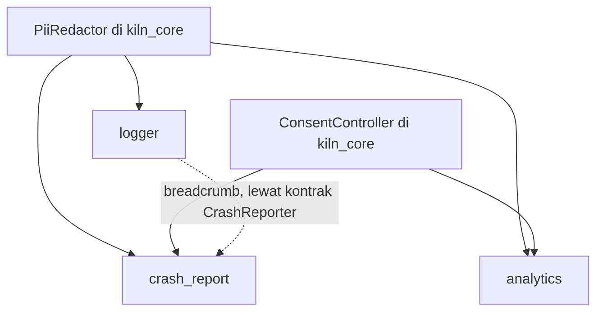
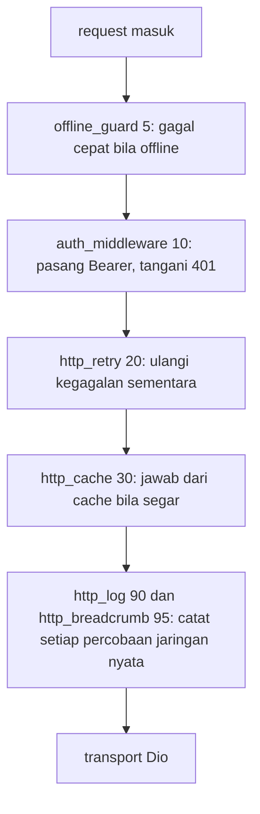

# Struktur Folder Lengkap Kiln

Cetak biru target monorepo Kiln: package, extension, brick, schema, dan proyek hasil generate. Dokumen ini menjadi acuan struktur saat fitur ditambahkan per fase.

## Root monorepo

Root memuat semua yang bukan kode package: CI, dokumentasi, schema YAML,
template proyek, contoh, registry extension, dan skrip rilis. Isi `extensions/`
dan `packages/` diuraikan di bagian berikutnya.

```text
kiln/
├─ .github/                                  # konfigurasi GitHub: workflow CI, template issue dan PR, pemilik kode
│  ├─ ISSUE_TEMPLATE/                        # formulir issue yang bisa dipilih kontributor di GitHub
│  │  ├─ bug_report.yml                      # formulir untuk melaporkan bug di Kiln
│  │  ├─ extension_request.yml               # formulir untuk mengusulkan extension ke katalog Kiln
│  │  └─ config.yml                          # mengatur pilihan formulir issue dan tautan kontak
│  ├─ workflows/                             # workflow GitHub Actions untuk CI, rilis, dan pemeriksaan terjadwal
│  │  ├─ ci.yaml                             # pipeline CI utama: analyze dan test di setiap push dan PR
│  │  ├─ extensions.yaml                     # matrix CI yang hanya menguji extension yang berubah
│  │  ├─ bundles_check.yaml                  # menggagalkan build bila bundles belum di-generate ulang
│  │  ├─ smoke.yaml                          # nightly: create, add semua extension, lalu build apk dan ios
│  │  ├─ drift.yaml                          # nightly: mengecek versi terbaru package pihak ketiga yang dipakai extension
│  │  ├─ docs.yaml                           # membangun dokumentasi dari folder docs/
│  │  └─ release.yaml                        # publish ke pub.dev dan update registry
│  ├─ CODEOWNERS                             # daftar pemilik kode yang otomatis diminta me-review PR
│  ├─ dependabot.yml                         # jadwal update dependensi otomatis oleh Dependabot
│  └─ PULL_REQUEST_TEMPLATE.md               # template deskripsi dan checklist untuk setiap PR
├─ .vscode/                                  # pengaturan VS Code bersama untuk kontributor repo
│  ├─ settings.json                          # memasang schemas/ ke extension.yaml, kiln.yaml, dan kiln.lock.yaml
│  └─ extensions.json                        # rekomendasi ekstensi Dart dan YAML
├─ docs/                                     # dokumentasi untuk pengguna dan kontributor Kiln
│  ├─ architecture.md                        # gambaran arsitektur Kiln dan hubungan antar package
│  ├─ extension-manifest.md                  # spesifikasi lengkap field manifest extension.yaml
│  ├─ roadmap.md                             # rencana fase pengembangan Kiln
│  ├─ folder-structure.md                    # cetak biru struktur folder Kiln (dokumen ini)
│  ├─ getting-started.md                     # panduan memasang Kiln dan membuat aplikasi pertama
│  ├─ concepts/                              # penjelasan konsep inti Kiln
│  │  ├─ contracts-and-capabilities.md       # kontrak di kiln_core dan kapabilitas yang disediakan extension
│  │  ├─ slots.md                            # slot sebagai titik sambung antar extension
│  │  ├─ lockfile-and-ownership.md           # isi kiln.lock.yaml dan kepemilikan file oleh extension
│  │  ├─ transactions-and-rollback.md        # transaksi pemasangan dan cara membalikkannya lewat jurnal
│  │  ├─ native-patches.md                   # patch file native platform oleh extension
│  │  ├─ compatibility.md                    # aturan kompatibilitas versi Kiln, extension, dan package
│  │  └─ security-model.md                   # model keamanan: hook, trust tier, dan checksum
│  ├─ cli/                                   # dokumentasi perintah CLI kiln
│  │  └─ reference.md                        # referensi perintah, flag, dan contoh pemakaian kiln
│  ├─ extensions/                            # dokumentasi extension: katalog, cara menulis, uji, dan terbit
│  │  ├─ catalog.md                          # generate dari semua extension.yaml, jangan diedit
│  │  ├─ writing-an-extension.md             # panduan menulis extension dari manifest sampai brick
│  │  ├─ testing-extensions.md               # cara menguji extension: manifest, render, analyze, dan golden
│  │  ├─ trust-tiers.md                      # tingkat kepercayaan extension dan konsekuensinya bagi user
│  │  └─ publishing.md                       # langkah menerbitkan extension ke registry
│  ├─ guides/                                # panduan langkah demi langkah untuk skenario umum
│  │  ├─ swap-backend.md                     # mengganti backend tanpa mengubah kode aplikasi
│  │  ├─ migrate-bloc-to-riverpod.md         # migrasi state management dari bloc ke riverpod
│  │  ├─ add-offline-support.md              # menambahkan dukungan offline ke aplikasi
│  │  └─ setup-flavors-and-env.md            # menyiapkan flavor dan file env per lingkungan
│  └─ adr/                                   # catatan keputusan arsitektur
│     ├─ 0001-never-edit-user-code.md        # keputusan: Kiln tidak pernah mengedit kode milik user
│     ├─ 0002-capabilities-not-ids.md        # keputusan: extension bergantung pada kapabilitas, bukan id extension
│     ├─ 0003-hooks-and-trust.md             # keputusan: hook dijalankan dengan konfirmasi berdasarkan trust tier
│     ├─ 0004-transactions-and-journal.md    # keputusan: perubahan diterapkan lewat transaksi dengan jurnal
│     └─ 0005-checksums-and-registry.md      # keputusan: checksum arsip dan registry sebagai sumber extension
├─ schemas/                                  # JSON Schema untuk validasi dan autocomplete YAML di IDE
│  ├─ extension.schema.json                  # memvalidasi manifest extension.yaml
│  ├─ kiln.schema.json                       # memvalidasi konfigurasi proyek kiln.yaml
│  ├─ kiln-lock.schema.json                  # memvalidasi lockfile kiln.lock.yaml
│  ├─ migration.schema.json                  # memvalidasi file migration di extensions/<id>/migrations
│  └─ registry-index.schema.json             # memvalidasi registry/index.json
├─ bricks/                                   # template Mason untuk proyek aplikasi dan extension
│  ├─ app_basic/                             # brick proyek aplikasi dasar yang dipakai kiln create
│  │  ├─ brick.yaml                          # metadata brick app_basic dan variabel prompt proyek
│  │  ├─ hooks/                              # hook Mason yang berjalan sebelum dan sesudah generate
│  │  │  ├─ pubspec.yaml                     # dependensi untuk menjalankan hook
│  │  │  ├─ pre_gen.dart                     # memvalidasi nama app, org, dan bentrok folder tujuan
│  │  │  └─ post_gen.dart                    # menjalankan flutter create, menambah kiln_core, pub get, format, dan git init
│  │  └─ __brick__/                          # isi template yang dirender menjadi proyek user
│  │     ├─ README.md                        # petunjuk menjalankan dan mengembangkan proyek hasil generate
│  │     ├─ kiln.yaml                        # konfigurasi proyek Kiln yang dibaca CLI
│  │     ├─ analysis_options.yaml            # aturan analyzer Dart untuk proyek hasil generate
│  │     ├─ .gitignore                       # mengabaikan .kiln/backups, .kiln/journal, .kiln/logs, dan env/*.json kecuali *.example.json
│  │     ├─ lib/                             # kode sumber aplikasi
│  │     │  ├─ main.dart                     # titik masuk aplikasi: menjalankan KilnBootstrap lalu KilnApp
│  │     │  ├─ app/                          # widget root dan kerangka aplikasi
│  │     │  │  ├─ app.dart                   # KilnApp, widget root yang memasang RegistryScope
│  │     │  │  ├─ registry_scope.dart        # RegistryScope: menyediakan Registry ke pohon widget
│  │     │  │  ├─ app_shell.dart             # membangun MaterialApp (theme, locale, router dari Registry bila ada), menerapkan slot app.wrappers
│  │     │  │  ├─ error_screen.dart          # layar yang ditampilkan saat bootstrap gagal
│  │     │  │  ├─ app_wrappers.dart          # slot bawaan app.wrappers, tipe AppWrapper = Widget Function(BuildContext, Widget)
│  │     │  │  └─ app_route.dart             # AppRoute netral (path, name, builder) untuk slot router.routes, tanpa impor go_router
│  │     │  └─ core/                         # komponen inti aplikasi: l10n, theme, dan penanganan error
│  │     │     ├─ l10n/                      # lokalisasi bawaan aplikasi dan titik sambung extension l10n
│  │     │     │  ├─ app_localizations_config.dart  # konfigurasi bertipe: AppLocalizationsConfig, titik sambung extension l10n
│  │     │     │  └─ app_strings.dart        # teks UI bawaan aplikasi bila tidak ada AppLocalizationsConfig di Registry
│  │     │     ├─ theme/                     # theme bawaan aplikasi dan titik sambung extension theme
│  │     │     │  ├─ app_theme_config.dart   # konfigurasi bertipe: AppThemeConfig, titik sambung extension theme
│  │     │     │  └─ app_theme.dart          # theme bawaan aplikasi bila tidak ada AppThemeConfig di Registry
│  │     │     └─ error/                     # penanganan error global dan pesan error untuk user
│  │     │        ├─ global_error_handler.dart  # meneruskan error Flutter dan platform ke Logger, lalu CrashReporter bila terpasang
│  │     │        └─ failure_presenter.dart  # mengubah Failure menjadi pesan ramah user, teks dari FailureMessages l10n bila terpasang
│  │     └─ test/                            # test yang berjalan di aplikasi hasil generate
│  │        └─ app/                          # test untuk kerangka aplikasi di lib/app
│  │           └─ app_smoke_test.dart        # menguji bahwa KilnApp bisa dirender tanpa error
│  └─ extension_template/                    # kerangka extension kosong, dipakai kiln ext new
│     ├─ brick.yaml                          # variabel brick: id, name, category, provides, requires, with_hooks, with_native_patch
│     └─ __brick__/                          # isi template yang dirender menjadi folder extension
│        └─ {{id.snakeCase()}}/              # folder extension hasil render, dinamai dari id dalam snake_case
│           ├─ extension.yaml                # manifest: diisi dari variabel id, name, category, provides, dan requires
│           ├─ README.md                     # penjelasan singkat extension: fungsi, cara pasang, dan opsi
│           ├─ CHANGELOG.md                  # riwayat perubahan per versi extension
│           ├─ docs/                         # dokumentasi tambahan extension
│           │  └─ {{id.paramCase()}}.md      # dokumentasi topik extension, nama file dari id dalam paramCase
│           ├─ test/                         # test tingkat extension, jalan di repo kiln dan bukan di aplikasi user
│           │  ├─ manifest_test.dart         # menguji bahwa extension.yaml valid terhadap extension.schema.json
│           │  ├─ render_test.dart           # menguji bahwa render brick ke folder temp cocok dengan golden
│           │  └─ analyze_test.dart          # menguji bahwa hasil render lolos dart analyze tanpa peringatan
│           └─ brick/                        # brick Mason milik extension, dirender ke proyek user lewat kiln add
│              ├─ brick.yaml                 # metadata brick extension dan variabel prompt-nya
│              ├─ hooks/                     # hook Mason, dibuat bila with_hooks
│              │  ├─ pubspec.yaml            # dependensi untuk menjalankan hook
│              │  ├─ pre_gen.dart            # memvalidasi input sebelum brick dirender
│              │  └─ post_gen.dart           # menjalankan langkah lanjutan setelah brick dirender
│              └─ __brick__/                 # isi brick yang dirender ke proyek user
│                 ├─ lib/extensions/{{id.snakeCase()}}/  # kode extension yang masuk ke lib/ proyek user
│                 │  ├─ {{id.snakeCase()}}.dart          # fasad statis dengan API pendek untuk dipakai kode aplikasi
│                 │  ├─ {{id.snakeCase()}}_module.dart   # mendaftarkan layanan extension ke Registry
│                 │  ├─ {{id.snakeCase()}}_config.dart   # konfigurasi bertipe: nilai yang diisi dari prompt
│                 │  └─ {{id.snakeCase()}}_failure_mapper.dart  # mengubah error package pihak ketiga menjadi Failure
│                 └─ test/extensions/{{id.snakeCase()}}/  # test extension yang masuk ke test/ proyek user
│                    ├─ {{id.snakeCase()}}_module_test.dart          # menguji bahwa module mendaftarkan layanannya ke Registry
│                    └─ {{id.snakeCase()}}_failure_mapper_test.dart  # menguji bahwa error pihak ketiga dipetakan ke Failure yang tepat
├─ extensions/                               # 29 folder extension, diuraikan di bagian Extension
├─ examples/                                 # proyek contoh hasil generate sebagai referensi pemakaian Kiln
│  ├─ minimal/                               # hasil kiln create tanpa extension
│  │  ├─ kiln.yaml                           # konfigurasi proyek tanpa extension
│  │  ├─ kiln.lock.yaml                      # lockfile tanpa extension terpasang
│  │  ├─ pubspec.yaml                        # dependensi proyek minimal tanpa package extension
│  │  ├─ lib/                                # kode aplikasi minimal hasil generate
│  │  └─ test/                               # test bawaan aplikasi minimal
│  ├─ full_stack/                            # memasang bloc, dio, http_retry, rest_auth, secure_storage, go_router, theme, l10n, env, logger
│  │  ├─ kiln.yaml                           # konfigurasi proyek dengan semua extension terpasang
│  │  ├─ kiln.lock.yaml                      # lockfile yang mencatat versi dan file milik tiap extension
│  │  ├─ pubspec.yaml                        # dependensi proyek, termasuk package dari tiap extension
│  │  ├─ lib/                                # kode aplikasi beserta kode extension di lib/extensions
│  │  └─ test/                               # test aplikasi beserta test extension di test/extensions
│  ├─ backend_swap/                          # membuktikan backend bisa diganti tanpa mengubah kode app
│  │  ├─ README.md                           # menjelaskan skenario ganti backend dan cara membandingkan kedua varian
│  │  ├─ with_appwrite/                      # varian proyek dengan backend Appwrite
│  │  └─ with_supabase/                      # varian proyek dengan backend Supabase; hanya kiln.yaml dan lib/extensions yang berbeda
│  └─ custom_extension/                      # hasil kiln ext new: contoh extension komunitas lengkap
├─ registry/                                 # indeks dan metadata versi extension, dihasilkan tool/build_registry.dart
│  ├─ index.json                             # daftar extension: id, versi terbaru, dan tier
│  ├─ README.md                              # penjelasan format registry dan cara memakainya
│  └─ extensions/                            # metadata rilis, satu folder per extension
│     ├─ dio/                                # metadata rilis extension dio, satu json per versi
│     │  ├─ 1.0.0.json                       # metadata rilis 1.0.0: url arsip, sha256, requires, compatibility
│     │  └─ 1.1.0.json                       # metadata rilis 1.1.0 dengan field yang sama
│     └─ <id>/                               # satu folder per extension, berisi satu json per versi
├─ tool/                                     # skrip Dart untuk bundling, registry, pemeriksaan, dan rilis
│  ├─ bundle.dart                            # membundel semua brick dengan mason bundle, flag --check untuk CI
│  ├─ smoke_test.dart                        # menguji alur create dan add semua extension sampai bisa di-build
│  ├─ build_registry.dart                    # menghasilkan registry/index.json dan json versi tiap extension
│  ├─ check_drift.dart                       # membandingkan constraint extension dengan versi terbaru di pub.dev
│  ├─ lint_extensions.dart                   # menjalankan kiln ext validate ke semua extension
│  ├─ gen_catalog_docs.dart                  # menulis docs/extensions/catalog.md dari semua extension.yaml
│  └─ release.dart                           # menaikkan versi, menulis changelog, dan membuat tag
├─ packages/                                 # 6 package Dart, diuraikan per package di bawah
│  ├─ kiln_cli/                              # CLI kiln: perintah create, add, upgrade, rollback, dan doctor
│  ├─ kiln_core/                             # kontrak, model error, runtime modul, state sesi, dan utilitas privasi
│  ├─ kiln_extension_sdk/                    # mesin kiln add: baca manifest, hitung rencana, render brick, terapkan transaksi
│  ├─ kiln_store/                            # klien registry: ambil index, pilih versi, verifikasi checksum, trust policy
│  ├─ kiln_testing/                          # fake per kontrak, suite kontrak, dan harness test
│  └─ kiln_lints/                            # aturan lint custom_lint untuk proyek Kiln, opsional (Fase 6)
├─ CONTRIBUTING.md                           # panduan kontribusi: setup repo, gaya kode, dan alur PR
├─ SECURITY.md                               # kebijakan keamanan dan cara melaporkan kerentanan
├─ CODE_OF_CONDUCT.md                        # aturan perilaku komunitas kontributor
├─ LICENSE                                   # teks lisensi proyek Kiln
├─ .gitignore                                # mengabaikan artefak build dan file lokal di repo
├─ analysis_options.yaml                     # aturan analyzer Dart bersama untuk seluruh monorepo
├─ pubspec.yaml                              # dependensi skrip tool/ dan tooling dev monorepo
├─ pubspec.lock                              # mengunci versi dependensi root monorepo
└─ README.md                                 # pengantar proyek Kiln dan tautan ke dokumentasi
```

## kiln_core

`kiln_core` adalah satu-satunya package yang boleh dikenal kode aplikasi dan
semua extension. Ia memuat kontrak, model error, runtime modul, state sesi, dan
utilitas privasi, tanpa dependensi ke plugin Flutter apa pun.

```text
packages/kiln_core/
├─ lib/                                           # kode sumber package, diekspor lewat barrel kiln_core.dart
│  ├─ kiln_core.dart                              # barrel yang meng-export seluruh API publik package
│  └─ src/                                        # implementasi internal package, tidak diimpor langsung
│     ├─ contracts/                               # kontrak yang dipenuhi extension
│     │  ├─ account_management.dart               # kontrak opsional PasswordRecovery, EmailVerification, ProfileUpdate di samping AuthRepository
│     │  ├─ analytics.dart                        # kontrak Analytics untuk mencatat event pemakaian aplikasi
│     │  ├─ app_flavor.dart                       # AppFlavor: penanda lingkungan build yang sedang berjalan
│     │  ├─ auth.dart                             # kontrak AuthRepository untuk masuk dan keluar akun pengguna
│     │  ├─ connectivity.dart                     # kontrak NetworkMonitor untuk memantau status koneksi jaringan
│     │  ├─ crash_reporter.dart                   # kontrak CrashReporter untuk melaporkan crash dan error
│     │  ├─ deep_links.dart                       # kontrak DeepLinks untuk menerima tautan yang membuka aplikasi
│     │  ├─ env.dart                              # kontrak Env untuk membaca konfigurasi lingkungan
│     │  ├─ file_storage.dart                     # kontrak FileStorage: upload, download, url, dan hapus file di bucket
│     │  ├─ http_client.dart                      # kontrak HttpClient untuk mengirim request HTTP
│     │  ├─ local_db.dart                         # kontrak LocalDatabase untuk data lokal di perangkat
│     │  ├─ logger.dart                           # kontrak AppLogger untuk mencatat log aplikasi
│     │  ├─ media_picker.dart                     # kontrak MediaPicker untuk memilih gambar atau media dari perangkat
│     │  ├─ notifications.dart                    # kontrak Notifications untuk menampilkan dan mengelola notifikasi
│     │  ├─ permissions.dart                      # kontrak Permissions: cek status, minta izin, dan buka pengaturan
│     │  ├─ remote_database.dart                  # kontrak RemoteDatabase: CRUD dokumen, RemoteQuery, dan watch
│     │  ├─ secure_storage.dart                   # kontrak SecureStorage untuk menyimpan data sensitif
│     │  ├─ social_auth.dart                      # kontrak SocialAuth untuk masuk lewat akun penyedia sosial
│     │  └─ storage.dart                          # kontrak Storage untuk penyimpanan key-value
│     ├─ errors/                                  # model error seragam dan hasil operasi bertipe Result
│     │  ├─ failure.dart                          # kelas Failure, model error seragam untuk semua kontrak
│     │  ├─ failure_codes.dart                    # kelas FailureCode: kode stabil, mis. network.timeout dan auth.invalid_credentials
│     │  └─ result.dart                           # tipe Result<T> yang berisi Ok atau Err(Failure)
│     ├─ runtime/                                 # runtime modul: Registry, urutan init, Lifecycle, bootstrap, dan Slot
│     │  ├─ registry.dart                         # kontrak Registry untuk mendaftarkan dan mengambil layanan
│     │  ├─ get_it_registry.dart                  # implementasi Registry berbasis get_it
│     │  ├─ kiln_module.dart                      # kontrak KilnModule: unit yang mendaftarkan layanan ke Registry saat init
│     │  ├─ module_graph.dart                     # menghitung urutan init dari requires dan mendeteksi siklus
│     │  ├─ lifecycle.dart                        # kontrak Lifecycle: onReady, onPause, onResume, dan dispose
│     │  ├─ bootstrap.dart                        # KilnBootstrap.run: init async dengan timeout dan error handler
│     │  └─ slot.dart                             # OrderedSlot<T> untuk http.interceptors dan router.routes
│     ├─ session/                                 # state sesi login: model sesi, controller, dan penyedia token
│     │  ├─ session.dart                          # model AuthSession dengan userId dan expiresAt
│     │  ├─ session_controller.dart               # SessionController: status unknown, authenticated, unauthenticated, plus stream
│     │  └─ token_provider.dart                   # kontrak TokenProvider untuk mengambil dan me-refresh token
│     ├─ privacy/                                 # persetujuan pengguna dan penyamaran data pribadi
│     │  ├─ consent.dart                          # ConsentController untuk persetujuan analytics dan crash report
│     │  └─ pii_redactor.dart                     # PiiRedactor menyamarkan data pribadi untuk logger, analytics, dan crash report
│     └─ util/                                    # Clock yang bisa di-fake, Debouncer, dan Disposable
│        ├─ clock.dart                            # Clock: sumber waktu yang bisa di-fake di test
│        ├─ debouncer.dart                        # Debouncer yang menunda aksi sampai pemanggilan berhenti
│        └─ disposable.dart                       # kontrak Disposable untuk melepas sumber daya
├─ test/                                          # test unit kiln_core: kontrak, error, runtime, sesi, dan privasi
│  ├─ auth_test.dart                              # menguji kontrak AuthRepository dan Failure saat kredensial salah
│  ├─ failure_test.dart                           # menguji konstruksi dan perbandingan nilai Failure
│  ├─ http_client_test.dart                       # menguji kontrak HttpClient dan error jaringan sebagai Failure
│  ├─ registry_test.dart                          # menguji pendaftaran dan pengambilan layanan lewat Registry
│  ├─ runtime_contracts_test.dart                 # menguji kontrak runtime: Registry dan KilnModule bekerja bersama
│  ├─ result_test.dart                            # menguji Result<T> sebagai Ok atau Err(Failure)
│  ├─ failure_codes_test.dart                     # menguji bahwa nilai FailureCode stabil dan unik
│  ├─ module_graph_test.dart                      # menguji urutan init dari requires dan deteksi siklus
│  ├─ slot_test.dart                              # menguji bahwa OrderedSlot<T> menjaga urutan item
│  ├─ lifecycle_test.dart                         # menguji bahwa Lifecycle memanggil onReady, onPause, onResume, dan dispose
│  ├─ bootstrap_test.dart                         # menguji KilnBootstrap.run: init async, timeout, dan error handler
│  ├─ session_controller_test.dart                # menguji transisi status SessionController dan stream-nya
│  ├─ consent_test.dart                           # menguji status persetujuan ConsentController untuk analytics dan crash report
│  ├─ pii_redactor_test.dart                      # menguji bahwa PiiRedactor menyamarkan data pribadi
│  ├─ clock_test.dart                             # menguji bahwa Clock bisa di-fake untuk mengatur waktu
│  └─ debouncer_test.dart                         # menguji bahwa Debouncer hanya menjalankan aksi terakhir
├─ example/                                       # contoh program yang memakai kiln_core
│  └─ main.dart                                   # contoh minimal memakai Registry, KilnModule, dan KilnBootstrap
├─ analysis_options.yaml                          # aturan lint dan analyzer untuk package ini
├─ CHANGELOG.md                                   # riwayat perubahan package per versi
├─ pubspec.yaml                                   # metadata dan dependensi package, tanpa plugin Flutter
└─ README.md                                      # pengantar package dan cara memakai kontraknya
```

## kiln_extension_sdk

SDK adalah mesin di balik `kiln add`: membaca manifest, menghitung rencana,
merender brick, lalu menerapkan perubahan dalam transaksi yang bisa dibalik.
Bagian `installer/` paling besar, dan tiga subfoldernya (`transaction/`,
`ownership/`, `verification/`) membuat `add` dan `remove` aman.

```text
packages/kiln_extension_sdk/
├─ lib/                                                     # kode sumber SDK: manifest, resolver, renderer, installer, migrator
│  ├─ kiln_extension_sdk.dart                               # barrel yang meng-export API publik SDK
│  ├─ testing.dart                                          # ExtensionTestHarness untuk test milik penulis extension
│  └─ src/                                                  # implementasi internal SDK, dipakai lewat barrel
│     ├─ kiln_exception.dart                                # KilnException, exception untuk kegagalan di proses SDK
│     ├─ manifest/                                          # model dan validasi extension.yaml
│     │  ├─ extension_manifest.dart                         # model ExtensionManifest hasil parse extension.yaml
│     │  ├─ platform_setup.dart                             # model blok platform di manifest untuk patch Android, iOS, macOS, dan web
│     │  ├─ slot.dart                                       # model slot yang dibuka sebuah extension di manifest
│     │  ├─ manifest_validator.dart                         # memvalidasi id, semver, siklus requires, dan field platform
│     │  ├─ prompt_spec.dart                                # tipe prompt url, int, enum, secret beserta validasinya
│     │  ├─ compatibility.dart                              # memeriksa rentang versi kiln_core, Dart, Flutter, dan platform
│     │  └─ contribution.dart                               # model contributes ke slot, dengan syarat when berisi capability opsional
│     ├─ resolver/                                          # menghitung rencana instalasi, konflik, dan upgrade
│     │  ├─ extension_resolver.dart                         # menyelesaikan requires dan provides menjadi daftar extension terpasang
│     │  ├─ resolution_plan.dart                            # model rencana hasil resolusi yang diterapkan installer
│     │  ├─ capability_index.dart                           # indeks capability: extension mana menyediakan apa
│     │  ├─ conflict_report.dart                            # menyusun pesan konflik extension yang bisa ditindaklanjuti
│     │  ├─ dependency_graph.dart                           # graf requires untuk perintah kiln graph dan kiln remove
│     │  └─ upgrade_planner.dart                            # merencanakan upgrade extension dari versi terpasang ke versi target
│     ├─ renderer/                                          # merender brick Mason menjadi file di proyek user
│     │  ├─ brick_renderer.dart                             # merender brick Mason ke proyek user dengan variabel template
│     │  ├─ template_vars.dart                              # mengubah jawaban prompt dan kiln.yaml menjadi variabel Mason
│     │  ├─ collision_policy.dart                           # memutuskan skip, overwrite, atau tanya; deteksi file diedit lewat hash
│     │  └─ hook_policy.dart                                # mengizinkan hooks hanya bila brick tepercaya
│     ├─ installer/                                         # menerapkan extension ke proyek: transaksi, kepemilikan, patch native, verifikasi
│     │  ├─ extension_installer.dart                        # mengorkestrasi add dan remove extension di dalam transaksi
│     │  ├─ extensions_codegen.dart                         # menulis extensions.g.dart di proyek user agar sinkron dengan lockfile
│     │  ├─ lockfile.dart                                   # membaca dan menulis kiln.lock.yaml berisi extension terpasang
│     │  ├─ pubspec_reader.dart                             # membaca dependency dan versi dari pubspec.yaml user
│     │  ├─ pubspec_writer.dart                             # menambah dan menghapus dependency di pubspec.yaml lewat yaml_edit
│     │  ├─ transaction/                                    # transaksi yang bisa dibalik: jurnal, snapshot, dan rollback
│     │  │  ├─ transaction.dart                             # menjalankan langkah instalasi dan mencatatnya ke jurnal
│     │  │  ├─ journal.dart                                 # mencatat langkah yang sudah berjalan sebagai bahan rollback
│     │  │  ├─ snapshot.dart                                # membackup file sebelum diubah ke .kiln/backups
│     │  │  └─ rollback.dart                                # mengembalikan proyek ke kondisi awal dari jurnal dan snapshot
│     │  ├─ ownership/                                      # pelacakan pemilik file hasil render dan patch
│     │  │  ├─ file_ownership.dart                          # mencatat hash tiap file hasil render
│     │  │  └─ patch_journal.dart                           # mencatat pemilik tiap patch dengan reference count
│     │  ├─ native/                                         # patch file native Android, iOS, macOS, dan web di proyek user
│     │  │  ├─ native_setup.dart                            # menerapkan semua patch native sesuai blok platform di manifest
│     │  │  ├─ patch.dart                                   # interface Patch dengan describe, apply, dan revert
│     │  │  ├─ android_gradle.dart                          # mengedit build.gradle Android di proyek user untuk setelan build yang dibutuhkan extension
│     │  │  ├─ android_project.dart                         # mengedit AndroidManifest.xml di proyek user: izin seperti INTERNET dan app links
│     │  │  ├─ ios_app_delegate.dart                        # mengedit AppDelegate iOS di proyek user untuk kode native yang dibutuhkan extension
│     │  │  ├─ ios_entitlements.dart                        # mengedit file entitlements iOS di proyek user, mis. associated domains
│     │  │  ├─ ios_plist.dart                               # menambah kunci Info.plist iOS di proyek user, mis. teks alasan izin
│     │  │  ├─ ios_podfile.dart                             # menambah flag PERMISSION_* di Podfile iOS untuk permission_handler
│     │  │  ├─ macos_entitlements.dart                      # mengedit entitlements macOS di proyek user, mis. network.client dan device.camera
│     │  │  └─ web_index_html.dart                          # mengedit web/index.html di proyek user untuk tag yang dibutuhkan extension
│     │  └─ verification/                                   # pemeriksaan hasil apply dan laporan dry run
│     │     ├─ verifier.dart                                # menjalankan pub get dan dart analyze setelah apply
│     │     └─ dry_run_reporter.dart                        # melaporkan diff yang akan terjadi tanpa menulis file
│     └─ migrator/                                          # migrasi extension antarversi
│        ├─ migration.dart                                  # model Migration: langkah perubahan antarversi extension
│        ├─ migration_actions.dart                          # aksi migrasi: rename_file, delete_file, replace_dependency, update_config, message
│        ├─ migration_loader.dart                           # membaca migrasi dari extensions/<id>/migrations
│        └─ migration_runner.dart                           # menjalankan migrasi berurutan saat upgrade extension
├─ test/                                                    # test unit SDK beserta data uji di fixtures
│  ├─ android_deep_links_test.dart                          # menguji patch AndroidManifest.xml untuk app links dan deep link
│  ├─ android_gradle_test.dart                              # menguji patch build.gradle Android
│  ├─ brick_renderer_test.dart                              # menguji render brick ke folder proyek dengan variabel template
│  ├─ installer_test.dart                                   # menguji alur add dan remove ExtensionInstaller pada proyek contoh
│  ├─ ios_entitlements_test.dart                            # menguji penambahan dan penghapusan kunci entitlements iOS
│  ├─ manifest_test.dart                                    # menguji parsing extension.yaml menjadi ExtensionManifest
│  ├─ resolver_test.dart                                    # menguji resolusi requires, provides, dan exclusive oleh ExtensionResolver
│  ├─ transaction_test.dart                                 # menguji bahwa Transaction menjalankan langkah dan mencatat jurnal
│  ├─ rollback_test.dart                                    # menguji bahwa rollback mengembalikan proyek setelah langkah gagal
│  ├─ snapshot_test.dart                                    # menguji backup file ke .kiln/backups dan pemulihannya
│  ├─ file_ownership_test.dart                              # menguji pencatatan hash file hasil render
│  ├─ patch_journal_test.dart                               # menguji reference count patch yang dimiliki beberapa extension
│  ├─ pubspec_writer_test.dart                              # menguji penambahan dan penghapusan dependency lewat yaml_edit
│  ├─ ios_podfile_test.dart                                 # menguji penambahan flag PERMISSION_* di Podfile iOS
│  ├─ macos_entitlements_test.dart                          # menguji patch entitlements macOS
│  ├─ web_index_html_test.dart                              # menguji patch web/index.html
│  ├─ manifest_validator_test.dart                          # menguji validasi id, semver, siklus requires, dan field platform
│  ├─ prompt_spec_test.dart                                 # menguji tipe prompt url, int, enum, secret beserta validasinya
│  ├─ compatibility_test.dart                               # menguji pemeriksaan rentang versi kiln_core, Dart, Flutter, dan platform
│  ├─ contribution_test.dart                                # menguji contributes ke slot dengan syarat when berisi capability
│  ├─ capability_index_test.dart                            # menguji indeks capability: extension mana menyediakan apa
│  ├─ conflict_report_test.dart                             # menguji pesan konflik yang bisa ditindaklanjuti
│  ├─ dependency_graph_test.dart                            # menguji graf requires untuk kiln graph dan kiln remove
│  ├─ upgrade_planner_test.dart                             # menguji rencana upgrade extension antarversi
│  ├─ collision_policy_test.dart                            # menguji keputusan skip, overwrite, dan tanya saat file bentrok
│  ├─ hook_policy_test.dart                                 # menguji bahwa hooks hanya jalan pada brick tepercaya
│  ├─ template_vars_test.dart                               # menguji pembentukan variabel Mason dari prompt dan kiln.yaml
│  ├─ verifier_test.dart                                    # menguji verifikasi pub get dan dart analyze setelah apply
│  ├─ dry_run_reporter_test.dart                            # menguji laporan diff dry run tanpa menulis file
│  ├─ migration_runner_test.dart                            # menguji eksekusi migrasi berurutan oleh MigrationRunner
│  ├─ migration_actions_test.dart                           # menguji aksi migrasi rename_file, delete_file, replace_dependency, update_config
│  └─ fixtures/                                             # data uji: manifest, proyek contoh, dan brick kecil
│     ├─ manifests/                                         # contoh extension.yaml untuk test manifest dan validator
│     │  ├─ valid/                                          # extension.yaml yang harus lolos validasi
│     │  └─ invalid/                                        # extension.yaml cacat yang harus ditolak validator
│     ├─ projects/                                          # proyek Flutter contoh sebagai target instalasi
│     │  ├─ fresh_app/                                      # aplikasi awal tanpa extension, untuk skenario add pertama
│     │  ├─ app_with_dio/                                   # aplikasi dengan dio terpasang, untuk skenario extension yang bergantung pada http_pipeline
│     │  ├─ app_with_edited_files/                          # aplikasi dengan file hasil render yang diedit user, untuk skenario tabrakan file
│     │  └─ app_with_two_owners/                            # aplikasi dengan patch milik dua extension, untuk skenario reference count
│     └─ bricks/                                            # brick Mason kecil untuk test renderer
│        ├─ tiny_brick/                                     # brick minimal untuk skenario render dasar
│        └─ brick_with_hooks/                               # brick dengan hooks, untuk skenario hook_policy dan brick tepercaya
├─ tool/                                                    # skrip pengembangan package SDK
│  └─ generate_schemas.dart                                 # menghasilkan JSON Schema dari model manifest
├─ analysis_options.yaml                                    # aturan lint dan analyzer untuk package ini
├─ CHANGELOG.md                                             # riwayat perubahan package per versi
├─ pubspec.yaml                                             # metadata dan dependensi package SDK
└─ README.md                                                # pengantar SDK dan cara membangun extension
```

## kiln_cli

CLI hanya mengurus interaksi: parsing perintah, prompt, laporan, dan kode
keluar. Semua logika pemasangan ada di `kiln_extension_sdk`, sehingga setiap
command tipis dan mudah dites.

```text
packages/kiln_cli/
├─ bin/  # titik masuk executable kiln
│  └─ kiln.dart  # fungsi main yang menjalankan command runner lalu keluar dengan kodenya
├─ lib/  # kode pustaka CLI yang dipakai bin/kiln.dart dan test/
│  ├─ kiln_cli.dart  # barrel yang mengekspor API publik kiln_cli
│  └─ src/  # implementasi internal CLI: perintah, infra, dan bundle
│     ├─ command_runner.dart  # mendaftarkan semua perintah dan meneruskan argumen ke perintah yang sesuai
│     ├─ project_context.dart  # mendeteksi proyek kiln lalu membaca kiln.yaml dan lockfile
│     ├─ paths.dart  # menyusun path kiln.yaml, lockfile, dan direktori ~/.kiln
│     ├─ version.dart  # konstanta versi CLI untuk perintah version dan update checker
│     ├─ commands/  # implementasi tiap subperintah CLI, satu file per perintah
│     │  ├─ create_command.dart  # perintah create: membuat proyek dari app_basic dengan state management pilihan
│     │  ├─ add_command.dart  # perintah add: memasang extension secara transaksional lewat SDK
│     │  ├─ remove_command.dart  # perintah remove: melepas extension dan hanya menghapus file yang belum diedit
│     │  ├─ list_command.dart  # perintah list: menampilkan extension terpasang atau tersedia
│     │  ├─ doctor_command.dart  # perintah doctor: memeriksa kesehatan proyek, bisa memperbaiki lewat --fix
│     │  ├─ version_command.dart  # perintah version: menampilkan versi CLI dan kiln_core
│     │  ├─ command_helpers.dart  # opsi dan alur bersama antar perintah, misalnya --dry-run dan --yes
│     │  ├─ info_command.dart  # perintah info: menampilkan provides, requires, platform, dan changelog extension
│     │  ├─ upgrade_command.dart  # perintah upgrade: menaikkan versi extension lalu menjalankan migration
│     │  ├─ rollback_command.dart  # perintah rollback: membalikkan operasi terakhir dari jurnal
│     │  ├─ graph_command.dart  # perintah graph: mencetak graf requires dan capability dalam text atau mermaid
│     │  ├─ config_command.dart  # perintah config: mengatur registry, mirror, dan mode offline
│     │  ├─ cache_command.dart  # perintah cache: melihat dan membersihkan cache registry
│     │  ├─ store_command.dart  # perintah store: mencari dan melihat extension di registry
│     │  ├─ completion_command.dart  # perintah completion: mencetak skrip autocomplete bash, zsh, dan fish
│     │  └─ ext/  # subperintah kiln ext: alat untuk penulis extension
│     │     ├─ ext_new_command.dart  # perintah ext new: membuat kerangka extension beserta manifest dan brick
│     │     ├─ ext_validate_command.dart  # perintah ext validate: memeriksa extension.yaml terhadap schema
│     │     ├─ ext_test_command.dart  # perintah ext test: menjalankan test extension, bisa --update-goldens
│     │     ├─ ext_pack_command.dart  # perintah ext pack: mengemas extension menjadi arsip untuk registry
│     │     └─ ext_publish_command.dart  # perintah ext publish: menerbitkan arsip extension ke registry
│     ├─ infra/  # layanan pendukung CLI: log, prompt, laporan, konfigurasi, dan akses sistem
│     │  ├─ kiln_logger.dart  # mencatat log berlevel dan progres, mengikuti --verbose dan --quiet
│     │  ├─ prompter.dart  # menampilkan prompt interaktif, menghormati --yes dan mendeteksi non-TTY
│     │  ├─ exit_codes.dart  # kode keluar tetap untuk tiap hasil perintah, dipakai CI
│     │  ├─ json_reporter.dart  # melaporkan hasil perintah sebagai JSON saat --json aktif
│     │  ├─ error_presenter.dart  # mengubah KilnException menjadi pesan beserta saran perbaikan
│     │  ├─ global_config.dart  # konfigurasi bertipe: registry, mirror, dan mode offline dari ~/.kiln/config.yaml
│     │  ├─ update_checker.dart  # memberi tahu adanya versi CLI lebih tinggi tanpa memblokir perintah
│     │  ├─ process_runner.dart  # menjalankan proses eksternal seperti flutter dan dart dengan keluaran terkontrol
│     │  └─ file_system.dart  # abstraksi file system supaya perintah bisa dites tanpa disk
│     └─ bundles/  # bundle semua extension, generate dari extensions/, jangan diedit
│        ├─ catalog.g.dart  # katalog extension tersedia, generate dari extension.yaml, jangan diedit
│        ├─ app_basic_bundle.dart  # bundle app_basic untuk create, generate dari extensions/app_basic, jangan diedit
│        └─ <id>_bundle.dart  # bundle per extension (29 file), generate dari extensions/<id>, jangan diedit
├─ test/  # test paket kiln_cli: command runner, perintah, infra, fixture, dan golden
│  ├─ command_runner_test.dart  # menguji pemetaan argumen ke perintah dan kode keluar command runner
│  ├─ commands/  # satu file test untuk tiap perintah CLI
│  │  ├─ create_command_test.dart  # menguji create membuat proyek dari app_basic sesuai opsi state dan platform
│  │  ├─ add_command_test.dart  # menguji add memasang extension secara transaksional, termasuk mode dry-run
│  │  ├─ remove_command_test.dart  # menguji remove hanya menghapus file yang belum diedit user
│  │  ├─ list_command_test.dart  # menguji list menampilkan extension terpasang dan tersedia, termasuk --json
│  │  ├─ doctor_command_test.dart  # menguji doctor melaporkan hash berubah, patch hilang, dan sisa jurnal
│  │  ├─ info_command_test.dart  # menguji info menampilkan provides, requires, platform, dan changelog
│  │  ├─ upgrade_command_test.dart  # menguji upgrade menaikkan versi extension lalu menjalankan migration
│  │  ├─ rollback_command_test.dart  # menguji rollback membalikkan operasi terakhir berdasarkan jurnal
│  │  ├─ graph_command_test.dart  # menguji graph mencetak graf requires dalam format text dan mermaid
│  │  ├─ config_command_test.dart  # menguji config mengatur registry, mirror, dan mode offline
│  │  ├─ cache_command_test.dart  # menguji cache menampilkan dan membersihkan cache registry
│  │  ├─ store_command_test.dart  # menguji store mencari dan menampilkan extension dari registry
│  │  └─ ext_commands_test.dart  # menguji subperintah ext: new, validate, test, pack, dan publish
│  ├─ infra/  # test komponen infra: prompter, reporter JSON, error presenter, dan kode keluar
│  │  ├─ prompter_test.dart  # menguji prompt interaktif, mode --yes, dan deteksi non-TTY
│  │  ├─ json_reporter_test.dart  # menguji json_reporter menghasilkan keluaran --json yang stabil
│  │  ├─ error_presenter_test.dart  # menguji KilnException menjadi pesan beserta saran perbaikan
│  │  └─ exit_codes_test.dart  # menguji kode keluar tetap yang dipakai CI tidak berubah
│  ├─ fixtures/  # proyek kecil per skenario sebagai bahan uji perintah
│  │  ├─ fresh_app/  # proyek hasil create tanpa extension tambahan, titik awal skenario
│  │  ├─ app_with_dio/  # proyek dengan extension dio terpasang beserta lockfile
│  │  ├─ app_with_edited_files/  # proyek dengan file render yang sudah diedit user, untuk uji hash dan remove
│  │  ├─ app_with_flavors/  # proyek dengan beberapa AppFlavor, untuk menguji konfigurasi per flavor
│  │  └─ app_without_lock/  # proyek tanpa kiln.lock.yaml, untuk menguji deteksi proyek dan doctor
│  └─ goldens/  # keluaran perintah acuan yang harus tetap sama
│     ├─ add_dry_run.txt  # mengunci keluaran teks add --dry-run: rencana file dan patch
│     ├─ add_dry_run.json  # mengunci keluaran JSON add --dry-run yang dibaca CI
│     ├─ doctor_report.txt  # mengunci laporan teks doctor beserta saran perbaikan
│     ├─ list.json  # mengunci keluaran list --json: extension terpasang dan tersedia
│     └─ info_dio.txt  # mengunci keluaran teks info untuk extension dio
├─ analysis_options.yaml  # aturan lint dan analisis statis untuk paket kiln_cli
├─ CHANGELOG.md  # catatan perubahan tiap rilis kiln_cli
├─ pubspec.yaml  # metadata dan dependensi paket kiln_cli
└─ README.md  # pengantar, instalasi, dan contoh pemakaian CLI
```

### Daftar perintah

| Perintah | Fungsi | Flag penting |
| --- | --- | --- |
| `create` | buat proyek dari `app_basic`, pilih state management | `--state`, `--org`, `--platforms`, `--with` |
| `add` | pasang extension secara transaksional | `--dry-run`, `--yes`, `--no-verify`, `--from` |
| `remove` | lepas extension, hanya hapus file yang belum diedit | `--dry-run`, `--force` |
| `upgrade` | naikkan versi extension lalu jalankan migration | `--dry-run`, `--all` |
| `rollback` | balikkan operasi terakhir dari jurnal | `--list` |
| `list` | extension terpasang atau tersedia | `--installed`, `--available`, `--json` |
| `info` | provides, requires, platform, dan changelog satu extension | `--json` |
| `graph` | graf requires dan capability | `--format text` atau `mermaid` |
| `doctor` | periksa kesehatan proyek | `--fix`, `--json` |
| `config` | atur registry, mirror, dan mode offline | `--global` |
| `cache` | lihat atau bersihkan cache registry | `clean` |
| `store` | cari dan lihat extension di registry | `search`, `info` |
| `completion` | skrip autocomplete shell | `bash`, `zsh`, `fish` |
| `ext` | alat penulis extension: `new`, `validate`, `test`, `pack`, `publish` | `--update-goldens`, `--tier` |
| `version` | versi CLI dan `kiln_core` | tidak ada |

### Yang diperiksa doctor

- Hash file hasil render di lockfile dibandingkan dengan kondisi sebenarnya,
  supaya file yang diedit user ketahuan.
- Patch native yang hilang atau ganda (permission, entitlement,
  intent-filter).
- `extensions.g.dart` yang tidak sinkron dengan lockfile.
- Langkah manual yang belum selesai, misalnya `flutterfire configure` untuk
  Firebase.
- Extension yang tidak mendukung platform proyek, misalnya `biometric` di web.
- Versi Dart, Flutter, dan `kiln_core` terhadap rentang `compatibility` tiap
  extension.
- Extension yang punya versi baru atau migration yang belum dijalankan.
- Sisa jurnal dari operasi yang terhenti di tengah jalan.
## kiln_store, kiln_testing, kiln_lints

Tiga package yang menutup celah kepercayaan dan kualitas: store mengunduh
extension dengan verifikasi, testing membuktikan setiap implementasi kontrak
bisa saling menggantikan, dan lints menjaga aplikasi tetap bergantung pada
kontrak.

### kiln_store

```text
packages/kiln_store/                          # package untuk mengunduh, memverifikasi, dan menerbitkan extension
├─ lib/                                       # kode publik dan implementasi package kiln_store
│  ├─ kiln_store.dart                         # mengekspor API publik kiln_store
│  └─ src/                                    # implementasi internal klien registry, verifikasi, dan publish
│     ├─ registry_client.dart                 # mengambil index.json registry dari repositori Git
│     ├─ registry_index.dart                  # model index registry beserta daftar versi tiap extension
│     ├─ registry_config.dart                 # konfigurasi bertipe: URL, mirror, dan ref (branch atau tag)
│     ├─ version_resolver.dart                # memilih versi extension yang cocok dengan kiln_core proyek
│     ├─ search_index.dart                    # pencarian extension secara lokal dari cache
│     ├─ checksum_verifier.dart               # memverifikasi sha256 arsip sebelum dipasang
│     ├─ trust_policy.dart                    # menetapkan level official, verified, community dan konfirmasi sebelum hook jalan
│     ├─ archive_packer.dart                  # membuat arsip .tgz dari folder extension
│     ├─ archive_unpacker.dart                # mengekstrak arsip dan menolak path traversal (zip-slip)
│     ├─ publisher.dart                       # memvalidasi extension lalu mempublikasikannya ke registry
│     ├─ local_cache.dart                     # menyimpan index dan arsip unduhan di disk lokal
│     └─ offline_mode.dart                    # memakai cache lokal saat jaringan tidak tersedia
├─ test/                                      # test unit package kiln_store
│  ├─ registry_client_test.dart               # menguji pengambilan index.json dari URL utama dan mirror
│  ├─ registry_index_test.dart                # menguji parsing index registry dan daftar versi extension
│  ├─ version_resolver_test.dart              # menguji pemilihan versi yang kompatibel dengan kiln_core proyek
│  ├─ search_index_test.dart                  # menguji pencarian lokal extension dari cache
│  ├─ checksum_verifier_test.dart             # menguji bahwa arsip dengan sha256 tidak cocok ditolak
│  ├─ trust_policy_test.dart                  # menguji level kepercayaan dan konfirmasi sebelum hook jalan
│  ├─ archive_packer_test.dart                # menguji pembuatan arsip .tgz berisi seluruh file extension
│  ├─ archive_unpacker_test.dart              # menguji bahwa arsip dengan path traversal (zip-slip) ditolak
│  ├─ publisher_test.dart                     # menguji bahwa extension divalidasi sebelum dipublikasikan
│  ├─ local_cache_test.dart                   # menguji penyimpanan dan pembacaan index serta arsip dari cache
│  ├─ offline_mode_test.dart                  # menguji bahwa mode offline hanya memakai cache lokal
│  └─ fixtures/registry/                      # berisi index.json contoh, arsip valid, dan arsip berbahaya dengan path traversal
├─ analysis_options.yaml                      # aturan analyzer dan lint untuk package kiln_store
├─ CHANGELOG.md                               # riwayat perubahan kiln_store per rilis
├─ pubspec.yaml                               # metadata dan dependensi package kiln_store
└─ README.md                                  # panduan pemakaian dan arsitektur kiln_store
```

### kiln_testing

Dipakai sebagai `dev_dependency` di aplikasi hasil generate dan di tiap
extension. Suite `contracts/` dijalankan ke setiap implementasi: Appwrite,
Firebase, Supabase, dan `rest_auth` harus lolos `auth_repository_contract`
yang sama, dan itulah bukti bahwa backend bisa diganti.

```text
packages/kiln_testing/                            # package fake, suite kontrak, dan harness untuk test
├─ lib/                                           # kode publik dan implementasi package kiln_testing
│  ├─ kiln_testing.dart                           # mengekspor fake, suite kontrak, dan harness
│  └─ src/                                        # implementasi internal fake, kontrak, dan harness
│     ├─ fakes/                                   # fake dan implementasi in-memory untuk kontrak kiln_core
│     │  ├─ fake_http_client.dart                 # mensimulasikan HttpClient dengan respons terprogram dan merekam request
│     │  ├─ in_memory_storage.dart                # mensimulasikan Storage key-value yang tersimpan di memori
│     │  ├─ in_memory_secure_storage.dart         # mensimulasikan SecureStorage di memori tanpa keychain asli
│     │  ├─ fake_auth_repository.dart             # mensimulasikan AuthRepository: login, logout, dan sesi tanpa backend
│     │  ├─ fake_account_management.dart          # mensimulasikan AccountManagement: reset password, verifikasi email, ubah profil
│     │  ├─ fake_social_auth.dart                 # mensimulasikan SocialAuth dengan hasil login sosial yang bisa diatur
│     │  ├─ fake_connectivity.dart                # mensimulasikan NetworkMonitor dengan status online atau offline yang bisa diubah
│     │  ├─ fake_permissions.dart                 # mensimulasikan Permissions dengan status izin yang bisa diatur
│     │  ├─ fake_notifications.dart               # mensimulasikan Notifications dan merekam notifikasi yang ditampilkan
│     │  ├─ fake_deep_links.dart                  # mensimulasikan DeepLinks dengan tautan masuk yang dipicu dari test
│     │  ├─ fake_media_picker.dart                # mensimulasikan MediaPicker dengan hasil pilihan media yang ditentukan test
│     │  ├─ fake_local_database.dart              # mensimulasikan LocalDatabase yang menyimpan data di memori
│     │  ├─ fake_remote_database.dart             # mensimulasikan RemoteDatabase di memori tanpa jaringan
│     │  ├─ fake_file_storage.dart                # mensimulasikan FileStorage dengan isi file yang disimpan di memori
│     │  ├─ fake_analytics.dart                   # mensimulasikan Analytics dan merekam event yang dikirim
│     │  ├─ fake_crash_reporter.dart              # mensimulasikan CrashReporter dan merekam error yang dilaporkan
│     │  ├─ fake_env.dart                         # mensimulasikan Env dengan nilai konfigurasi yang diisi dari test
│     │  ├─ fake_clock.dart                       # mensimulasikan Clock dengan waktu yang dimajukan manual
│     │  └─ recording_logger.dart                 # AppLogger yang menyimpan entri log agar bisa diperiksa test
│     ├─ contracts/                               # suite test yang dijalankan ke SETIAP implementasi kontrak
│     │  ├─ http_client_contract.dart             # memeriksa HttpClient: metode, header, body, dan pemetaan error ke Failure
│     │  ├─ storage_contract.dart                 # memeriksa Storage: simpan, baca, hapus, dan key yang tidak ada
│     │  ├─ secure_storage_contract.dart          # memeriksa SecureStorage: nilai tersimpan, terbaca ulang, dan terhapus
│     │  ├─ auth_repository_contract.dart         # memeriksa AuthRepository: login, logout, sesi, dan Failure kredensial salah
│     │  ├─ account_management_contract.dart      # memeriksa AccountManagement: reset password, verifikasi email, ubah profil
│     │  ├─ social_auth_contract.dart             # memeriksa SocialAuth: login sosial berhasil, dibatalkan, dan gagal
│     │  ├─ local_database_contract.dart          # memeriksa LocalDatabase: tulis, baca, ubah, dan hapus data
│     │  ├─ remote_database_contract.dart         # memeriksa RemoteDatabase: tulis, baca, ubah, hapus, dan error jaringan
│     │  ├─ file_storage_contract.dart            # memeriksa FileStorage: unggah, unduh, dan hapus file
│     │  ├─ connectivity_contract.dart            # memeriksa NetworkMonitor: status koneksi dan perubahannya lewat stream
│     │  ├─ permissions_contract.dart             # memeriksa Permissions: status izin dan hasil permintaan izin
│     │  ├─ notifications_contract.dart           # memeriksa Notifications: izin, penerimaan, dan penanganan notifikasi
│     │  ├─ deep_links_contract.dart              # memeriksa DeepLinks: tautan awal dan tautan yang masuk saat app berjalan
│     │  ├─ media_picker_contract.dart            # memeriksa MediaPicker: media terpilih dan pembatalan oleh pengguna
│     │  ├─ analytics_contract.dart               # memeriksa Analytics: pengiriman event dan properti pengguna
│     │  ├─ crash_reporter_contract.dart          # memeriksa CrashReporter: pelaporan error dan konteks tambahan
│     │  └─ logger_contract.dart                  # memeriksa AppLogger: level log dan pesan yang sampai ke sink
│     └─ harness/                                 # perangkat penunjang test: Registry, widget, matcher, async, golden
│        ├─ test_registry.dart                    # membuat Registry siap pakai berisi fake untuk test
│        ├─ pump_app.dart                         # merender widget di test dengan Registry fake dan wrapper aplikasi
│        ├─ matchers.dart                         # matcher isFailure, isOk, dan hasCode untuk Result dan Failure
│        ├─ async_helpers.dart                    # pumpUntil dan expectEmitsInOrder untuk menunggu kondisi dan urutan stream
│        └─ golden_helpers.dart                   # membandingkan tampilan widget dengan file golden
├─ test/                                          # test unit package kiln_testing
│  └─ fakes_satisfy_contracts_test.dart           # menguji bahwa setiap fake lolos suite kontraknya sendiri
├─ analysis_options.yaml                          # aturan analyzer dan lint untuk package kiln_testing
├─ CHANGELOG.md                                   # riwayat perubahan kiln_testing per rilis
├─ pubspec.yaml                                   # metadata dan dependensi package kiln_testing
└─ README.md                                      # panduan memakai fake, suite kontrak, dan harness
```

### kiln_lints

```text
packages/kiln_lints/                      # plugin lint opsional (Fase 6) agar aplikasi tetap memakai kontrak
├─ lib/                                   # kode publik dan implementasi package kiln_lints
│  ├─ kiln_lints.dart                     # titik masuk plugin custom_lint yang mendaftarkan semua aturan
│  └─ src/rules/                          # satu file per aturan lint
│     ├─ no_cross_extension_import.dart   # melarang extension mengimpor extension lain
│     ├─ prefer_contract_over_impl.dart   # memperingatkan kode app yang memakai implementasi seperti DioClient, bukan kontrak
│     ├─ no_plugin_in_features.dart       # melarang folder features/ mengimpor plugin langsung
│     ├─ no_edit_generated_files.dart     # memperingatkan bila extensions.g.dart diubah manual
│     └─ require_failure_handling.dart    # memperingatkan Result yang dipakai tanpa menangani Failure
├─ test/                                  # test unit package kiln_lints
│  └─ rules_test.dart                     # menguji tiap aturan lint terhadap kode yang melanggar dan yang patuh
├─ example/                               # proyek contoh kecil yang sengaja memicu setiap aturan lint
├─ analysis_options.yaml                  # aturan analyzer dan lint untuk package kiln_lints
├─ CHANGELOG.md                           # riwayat perubahan kiln_lints per rilis
├─ pubspec.yaml                           # metadata dan dependensi package kiln_lints
└─ README.md                              # panduan memasang plugin dan daftar aturan lint
```

## Extension: state dan jaringan

Lima extension ini membentuk fondasi aplikasi: satu adapter state management
(eksklusif) dan tumpukan HTTP yang dirakit dari `dio`, `http_retry`, dan
`http_cache` lewat slot `http.interceptors`.

### bloc

```text
extensions/bloc/                            # extension state management berbasis Bloc dan Cubit
├─ extension.yaml                           # manifest: category: state · exclusive · provides: state_bloc (riverpod ditolak lewat aturan exclusive)
├─ README.md                                # panduan singkat pemasangan dan pemakaian extension bloc
├─ CHANGELOG.md                             # riwayat perubahan extension bloc per versi
├─ docs/                                    # dokumentasi pemakaian extension bloc
│  ├─ state-with-bloc.md                    # panduan mengelola state aplikasi dengan Cubit dan Bloc
│  └─ bloc-to-riverpod.md                   # panduan migrasi state dari bloc ke riverpod
├─ test/                                    # test tingkat extension, jalan di repo kiln dan bukan di aplikasi user
│  ├─ manifest_test.dart                    # memastikan extension.yaml valid terhadap extension.schema.json
│  ├─ render_test.dart                      # merender brick ke folder temp, hasilnya harus sama dengan golden
│  ├─ analyze_test.dart                     # hasil render harus lolos dart analyze tanpa peringatan
│  └─ goldens/rendered/                     # hasil render acuan untuk render_test, generate lewat kiln ext test --update-goldens
└─ brick/                                   # brick Mason yang di-render ke aplikasi user
   ├─ brick.yaml                            # metadata brick Mason dan daftar variabelnya
   └─ __brick__/                            # isi template yang disalin ke aplikasi hasil generate
      ├─ lib/                               # kode Dart yang disalin ke lib/ aplikasi
      │  ├─ bootstrap.dart                  # menyiapkan Registry dan AppBlocObserver sebelum runApp
      │  ├─ app/                            # komposisi tingkat aplikasi untuk state global
      │  │  └─ bloc_providers.dart          # MultiBlocProvider untuk bloc global
      │  ├─ core/bloc/                      # fondasi Bloc dan Cubit yang dipakai semua fitur
      │  │  ├─ app_bloc_observer.dart       # log transisi dan error ke Logger, PII disamarkan
      │  │  ├─ base_cubit.dart              # safeEmit (cek isClosed), runGuarded menjadi Failure
      │  │  ├─ async_state.dart             # sealed: initial, loading, data, failure
      │  │  ├─ async_cubit.dart             # load, refresh, retry
      │  │  ├─ bloc_transformers.dart       # debounce, throttle, droppable, restartable
      │  │  └─ session_cubit.dart           # membungkus SessionController dari kiln_core
      │  └─ features/                       # fitur contoh yang memakai state Bloc
      │     └─ counter/                     # fitur counter sebagai contoh pemakaian Cubit
      │        ├─ counter_cubit.dart        # Cubit yang menyimpan nilai counter dan mengubahnya
      │        └─ counter_page.dart         # halaman counter yang membaca CounterCubit lewat BlocBuilder
      └─ test/                              # test yang ikut ter-generate ke aplikasi user
         ├─ bootstrap_test.dart             # menguji bahwa bootstrap memasang observer Bloc dan menyiapkan Registry
         ├─ counter_cubit_test.dart         # menguji bahwa CounterCubit mengubah state sesuai aksi
         ├─ counter_page_test.dart          # menguji bahwa CounterPage menampilkan nilai counter dan bereaksi pada tombol
         └─ core/bloc/                      # test untuk fondasi Bloc di core/bloc
            ├─ app_bloc_observer_test.dart  # menguji bahwa observer mencatat transisi dan error dengan PII disamarkan
            ├─ base_cubit_test.dart         # menguji bahwa safeEmit tidak emit saat isClosed dan runGuarded menjadi Failure
            ├─ async_state_test.dart        # menguji varian sealed AsyncState: initial, loading, data, failure
            ├─ async_cubit_test.dart        # menguji bahwa load, refresh, dan retry menghasilkan urutan state yang benar
            ├─ bloc_transformers_test.dart  # menguji perilaku transformer debounce, throttle, droppable, dan restartable
            └─ session_cubit_test.dart      # menguji bahwa SessionCubit meneruskan status SessionController
```

### riverpod

```text
extensions/riverpod/                        # extension state management berbasis Riverpod
├─ extension.yaml                           # manifest: category: state · exclusive · provides: state_riverpod (bloc ditolak lewat aturan exclusive)
├─ README.md                                # panduan singkat pemasangan dan pemakaian extension riverpod
├─ CHANGELOG.md                             # riwayat perubahan extension riverpod per versi
├─ docs/                                    # dokumentasi pemakaian extension riverpod
│  ├─ state-with-riverpod.md                # panduan mengelola state aplikasi dengan provider dan Notifier
│  └─ riverpod-to-bloc.md                   # panduan migrasi state dari riverpod ke bloc
├─ test/                                    # test tingkat extension, jalan di repo kiln dan bukan di aplikasi user
│  ├─ manifest_test.dart                    # memastikan extension.yaml valid terhadap extension.schema.json
│  ├─ render_test.dart                      # merender brick ke folder temp, hasilnya harus sama dengan golden
│  ├─ analyze_test.dart                     # hasil render harus lolos dart analyze tanpa peringatan
│  └─ goldens/rendered/                     # hasil render acuan untuk render_test, generate lewat kiln ext test --update-goldens
└─ brick/                                   # brick Mason yang di-render ke aplikasi user
   ├─ brick.yaml                            # metadata brick Mason dan daftar variabelnya
   └─ __brick__/                            # isi template yang disalin ke aplikasi hasil generate
      ├─ lib/                               # kode Dart yang disalin ke lib/ aplikasi
      │  ├─ bootstrap.dart                  # menyiapkan Registry dan ProviderScope sebelum runApp
      │  ├─ app/                            # komposisi tingkat aplikasi untuk state global
      │  │  └─ provider_root.dart           # ProviderScope dengan override Registry
      │  ├─ core/riverpod/                  # fondasi Riverpod yang dipakai semua fitur
      │  │  ├─ kiln_providers.dart          # registryProvider dan kilnProvider<T>() untuk setiap kontrak
      │  │  ├─ app_provider_observer.dart   # log error provider, PII disamarkan
      │  │  ├─ async_value_x.dart           # ekstensi AsyncValue: guard menjadi Failure dan pemetaan when yang ringkas
      │  │  ├─ provider_overrides.dart      # override siap pakai untuk test
      │  │  └─ session_notifier.dart        # membungkus SessionController dari kiln_core
      │  └─ features/                       # fitur contoh yang memakai state Riverpod
      │     └─ counter/                     # fitur counter sebagai contoh pemakaian provider
      │        ├─ counter_page.dart         # halaman counter yang membaca state dari provider
      │        └─ counter_provider.dart     # provider yang menyimpan nilai counter dan mengubahnya
      └─ test/                              # test yang ikut ter-generate ke aplikasi user
         ├─ bootstrap_test.dart             # menguji bahwa bootstrap menyiapkan ProviderScope dengan Registry
         ├─ counter_page_test.dart          # menguji bahwa CounterPage menampilkan nilai counter dan bereaksi pada tombol
         ├─ counter_provider_test.dart      # menguji bahwa counter provider mengubah state sesuai aksi
         └─ core/riverpod/                  # test untuk fondasi Riverpod di core/riverpod
            ├─ kiln_providers_test.dart     # menguji bahwa registryProvider dan kilnProvider<T>() mengambil kontrak dari Registry
            ├─ app_provider_observer_test.dart  # menguji bahwa observer mencatat error provider dengan PII disamarkan
            ├─ async_value_x_test.dart      # menguji bahwa guard mengubah exception menjadi Failure dan when memetakan state
            ├─ provider_overrides_test.dart  # menguji bahwa override test mengganti kontrak dengan fake
            └─ session_notifier_test.dart   # menguji bahwa SessionNotifier meneruskan status SessionController
```

### dio

```text
extensions/dio/                             # extension HTTP client berbasis dio dan pembuka slot interceptor
├─ extension.yaml                           # manifest: provides: http_client, http_pipeline · membuka slot: http.interceptors · android: INTERNET · macos: network.client
├─ README.md                                # panduan singkat pemasangan dan pemakaian extension dio
├─ CHANGELOG.md                             # riwayat perubahan extension dio per versi
├─ docs/                                    # dokumentasi pemakaian extension dio
│  ├─ http-client.md                        # panduan membuat request dan menangani error lewat HttpClient
│  └─ interceptors.md                       # cara extension lain menempel ke slot http.interceptors
├─ test/                                    # test tingkat extension, jalan di repo kiln dan bukan di aplikasi user
│  ├─ manifest_test.dart                    # memastikan extension.yaml valid terhadap extension.schema.json
│  ├─ render_test.dart                      # merender brick ke folder temp, hasilnya harus sama dengan golden
│  ├─ analyze_test.dart                     # hasil render harus lolos dart analyze tanpa peringatan
│  └─ goldens/rendered/                     # hasil render acuan untuk render_test, generate lewat kiln ext test --update-goldens
└─ brick/                                   # brick Mason yang di-render ke aplikasi user
   ├─ brick.yaml                            # metadata brick Mason dan variabel seperti base_url dan connect_timeout
   ├─ hooks/                                # hook Mason yang jalan saat generate
   │  ├─ pubspec.yaml                       # dependensi yang dibutuhkan skrip hook
   │  └─ pre_gen.dart                       # memvalidasi base_url dan connect_timeout sebelum render
   └─ __brick__/                            # isi template yang disalin ke aplikasi hasil generate
      ├─ lib/extensions/dio/                # kode extension dio di aplikasi hasil generate
      │  ├─ http.dart                       # fasad statis Http.get, post, put, patch, delete
      │  ├─ dio_module.dart                 # mendaftarkan HttpClient dan HttpPipeline ke Registry
      │  ├─ dio_client.dart                 # implementasi kontrak HttpClient di atas Dio dengan HttpPipeline
      │  ├─ dio_config.dart                 # konfigurasi bertipe: base_url, timeout, header default
      │  ├─ dio_failure_mapper.dart         # mengubah error DioException menjadi Failure (timeout, offline, 401, 5xx)
      │  ├─ cancellation.dart               # membatalkan request saat widget dispose
      │  ├─ multipart_helper.dart           # mengunggah file multipart dengan laporan progress
      │  ├─ download_helper.dart            # mengunduh file dengan laporan progress
      │  ├─ dio_test_adapter.dart           # adapter HTTP palsu agar test tidak memakai jaringan
      │  └─ interceptors/                   # interceptor bawaan dan pintu masuk slot
      │     ├─ interceptor_slot.dart        # pintu masuk contributes dari extension lain
      │     ├─ request_id_interceptor.dart  # menambah header X-Request-Id untuk korelasi log
      │     └─ user_agent_interceptor.dart  # menambah header User-Agent berisi versi app dan platform
      └─ test/extensions/dio/               # test yang ikut ter-generate untuk extension dio
         ├─ dio_client_test.dart            # menguji bahwa DioClient mengirim request dan mengembalikan Result
         ├─ dio_module_test.dart            # menguji bahwa modul mendaftarkan HttpClient dan HttpPipeline ke Registry
         ├─ dio_failure_mapper_test.dart    # menguji bahwa DioException dipetakan ke Failure (timeout, offline, 401, 5xx)
         ├─ cancellation_test.dart          # menguji bahwa request dibatalkan saat widget dispose
         ├─ multipart_helper_test.dart      # menguji bahwa unggah multipart mengirim file dan melaporkan progress
         ├─ download_helper_test.dart       # menguji bahwa unduhan menulis file dan melaporkan progress
         ├─ interceptor_slot_test.dart      # menguji bahwa kontribusi slot dipasang sesuai urutan priority
         ├─ request_id_interceptor_test.dart  # menguji bahwa setiap request membawa header X-Request-Id
         ├─ user_agent_interceptor_test.dart  # menguji bahwa header User-Agent memuat versi app dan platform
         └─ http_client_contract_test.dart  # menjalankan suite kontrak HttpClient dari kiln_testing ke implementasi ini
```

### http_retry

```text
extensions/http_retry/                      # extension retry otomatis untuk request HTTP yang gagal sementara
├─ extension.yaml                           # manifest: requires: http_client, http_pipeline · contributes: http.interceptors, priority 20 (ditempelkan ke HttpPipeline)
├─ README.md                                # panduan singkat pemasangan dan pemakaian extension http_retry
├─ CHANGELOG.md                             # riwayat perubahan extension http_retry per versi
├─ docs/                                    # dokumentasi pemakaian extension http_retry
│  └─ retry-policy.md                       # panduan mengatur kebijakan retry, backoff, dan budget
├─ test/                                    # test tingkat extension, jalan di repo kiln dan bukan di aplikasi user
│  ├─ manifest_test.dart                    # memastikan extension.yaml valid terhadap extension.schema.json
│  ├─ render_test.dart                      # merender brick ke folder temp, hasilnya harus sama dengan golden
│  ├─ analyze_test.dart                     # hasil render harus lolos dart analyze tanpa peringatan
│  └─ goldens/rendered/                     # hasil render acuan untuk render_test, generate lewat kiln ext test --update-goldens
└─ brick/                                   # brick Mason yang di-render ke aplikasi user
   ├─ brick.yaml                            # metadata brick Mason dan daftar variabelnya
   └─ __brick__/                            # isi template yang disalin ke aplikasi hasil generate
      ├─ lib/extensions/http_retry/         # kode extension http_retry di aplikasi hasil generate
      │  ├─ http_retry_module.dart          # mendaftarkan RetryMiddleware ke Registry dan HttpPipeline
      │  ├─ retry_middleware.dart           # HttpMiddleware yang mengulang request gagal sesuai kebijakan
      │  ├─ retry_policy.dart               # menentukan kegagalan mana yang layak diulang dan berapa kali
      │  ├─ retry_settings.dart             # pengaturan bertipe: jumlah percobaan, jeda awal, dan batas backoff
      │  ├─ backoff.dart                    # menghitung jeda eksponensial dengan jitter
      │  ├─ retry_budget.dart               # membatasi total retry per jendela waktu, mencegah retry storm
      │  ├─ retry_after_parser.dart         # membaca header Retry-After (detik atau tanggal HTTP)
      │  ├─ idempotency.dart                # hanya mengulang method idempoten atau yang punya Idempotency-Key
      │  └─ retry_events.dart               # memicu callback dan log pada tiap percobaan ulang
      └─ test/extensions/http_retry/        # test yang ikut ter-generate untuk extension http_retry
         ├─ http_retry_test.dart            # menguji bahwa kegagalan sementara diulang sesuai kebijakan
         ├─ backoff_test.dart               # menguji bahwa jeda tumbuh eksponensial dan jitter tetap dalam batas
         ├─ retry_budget_test.dart          # menguji bahwa retry berhenti saat budget jendela waktu habis
         ├─ retry_after_parser_test.dart    # menguji bahwa Retry-After dalam detik maupun tanggal HTTP terbaca benar
         └─ idempotency_test.dart           # menguji bahwa hanya method idempoten atau ber-Idempotency-Key yang diulang
```

### http_cache

```text
extensions/http_cache/                      # extension cache respons HTTP dengan penyimpanan opsional
├─ extension.yaml                           # manifest: requires: http_client, http_pipeline · storage opsional (when: [storage]) · contributes: http.interceptors, priority 30
├─ README.md                                # panduan singkat pemasangan dan pemakaian extension http_cache
├─ CHANGELOG.md                             # riwayat perubahan extension http_cache per versi
├─ docs/                                    # dokumentasi pemakaian extension http_cache
│  └─ caching-strategies.md                 # panduan memilih strategi cache dan invalidasi
├─ test/                                    # test tingkat extension, jalan di repo kiln dan bukan di aplikasi user
│  ├─ manifest_test.dart                    # memastikan extension.yaml valid terhadap extension.schema.json
│  ├─ render_test.dart                      # merender brick ke folder temp, hasilnya harus sama dengan golden
│  ├─ analyze_test.dart                     # hasil render harus lolos dart analyze tanpa peringatan
│  └─ goldens/rendered/                     # hasil render acuan untuk render_test, generate lewat kiln ext test --update-goldens
└─ brick/                                   # brick Mason yang di-render ke aplikasi user
   ├─ brick.yaml                            # metadata brick Mason dan daftar variabelnya
   └─ __brick__/                            # isi template yang disalin ke aplikasi hasil generate
      ├─ lib/extensions/http_cache/         # kode extension http_cache di aplikasi hasil generate
      │  ├─ http_cache_module.dart          # mendaftarkan HttpCache ke Registry dan interceptor ke HttpPipeline
      │  ├─ cache_policy.dart               # menentukan respons mana yang boleh disimpan dan berapa lama
      │  ├─ cache_settings.dart             # pengaturan bertipe: strategi cache, TTL, dan ukuran maksimum
      │  ├─ memory_http_cache.dart          # implementasi HttpCache di memori proses
      │  ├─ cache_store.dart                # interface penyimpanan entri cache yang dipakai implementasi HttpCache
      │  ├─ storage_http_cache.dart         # HttpCache persisten lewat kontrak Storage
      │  ├─ cache_interceptor.dart          # HttpMiddleware cache yang menempel ke slot http.interceptors
      │  ├─ cache_key.dart                  # membuat kunci cache dari URL, query, dan header Vary
      │  ├─ cache_control_parser.dart       # membaca Cache-Control: max-age, no-store, no-cache, stale-while-revalidate
      │  ├─ etag_validator.dart             # memvalidasi ETag lewat If-None-Match dan respons 304
      │  ├─ stale_while_revalidate.dart     # menyajikan cache lama lalu menyegarkan di latar belakang
      │  └─ cache_invalidation.dart         # menghapus entri per prefix atau tag setelah request mutasi
      └─ test/extensions/http_cache/        # test yang ikut ter-generate untuk extension http_cache
         ├─ http_cache_test.dart            # menguji bahwa respons disajikan dari cache sesuai kebijakan
         ├─ cache_key_test.dart             # menguji bahwa kunci cache memuat URL, query, dan header Vary
         ├─ cache_control_parser_test.dart  # menguji bahwa direktif Cache-Control terbaca benar
         ├─ etag_validator_test.dart        # menguji bahwa ETag memicu If-None-Match dan respons 304 memakai cache
         ├─ stale_while_revalidate_test.dart  # menguji bahwa cache lama disajikan lalu disegarkan di latar belakang
         ├─ cache_invalidation_test.dart    # menguji bahwa request mutasi menghapus entri per prefix atau tag
         └─ storage_http_cache_test.dart    # menguji bahwa cache persisten menyimpan dan membaca entri lewat Storage
```

## Extension: storage dan data

Tiga extension penyimpanan lokal, dari yang paling sederhana (key-value) sampai
yang terenkripsi dan yang berbentuk dokumen. Ketiganya tidak saling mengimpor:
`http_cache` dan `rest_auth` memakai `Storage` dan `SecureStorage` lewat
kontrak di `kiln_core`.

### storage

```text
extensions/storage/
├─ extension.yaml  # manifest: provides: storage · category: storage
├─ README.md  # ikhtisar extension: fungsi, cara memasang, dan contoh pemakaian
├─ CHANGELOG.md  # riwayat perubahan extension per versi
├─ docs/  # dokumentasi pemakaian storage dan migrasi key
│  ├─ key-value-storage.md  # panduan membaca dan menulis nilai lewat Prefs dan Storage
│  └─ typed-keys-and-migration.md  # cara memberi nama key dan memigrasi nilai lama
├─ test/                                    # test tingkat extension, jalan di repo kiln dan bukan di aplikasi user
│  ├─ manifest_test.dart                    # memastikan extension.yaml valid terhadap extension.schema.json
│  ├─ render_test.dart                      # merender brick ke folder temp, hasilnya harus sama dengan golden
│  ├─ analyze_test.dart                     # hasil render harus lolos dart analyze tanpa peringatan
│  └─ goldens/rendered/                     # hasil render acuan untuk render_test, generate lewat kiln ext test --update-goldens
└─ brick/  # Mason brick yang dirender menjadi kode extension di aplikasi user
   ├─ brick.yaml  # metadata brick Mason: nama, versi, dan variabel
   └─ __brick__/  # template file yang dirender ke folder aplikasi user
      ├─ lib/extensions/storage/  # kode sumber extension storage yang dirender ke aplikasi user
      │  ├─ prefs.dart  # fasad statis Prefs.read, write, delete, bernama Prefs agar tidak bentrok dengan Storage
      │  ├─ storage_module.dart  # mendaftarkan Storage berbasis SharedPreferences ke Registry
      │  ├─ shared_preferences_storage.dart  # mengimplementasikan Storage key-value di atas shared_preferences
      │  ├─ storage_config.dart  # konfigurasi bertipe: prefix key per app dan flavor
      │  ├─ storage_failure_mapper.dart  # mengubah error plugin dan cast salah menjadi Failure(storage)
      │  ├─ storage_gateway.dart  # membungkus SharedPreferencesAsync agar bisa di-fake di test
      │  ├─ typed_key.dart  # mendefinisikan StorageKey<T> dengan nama, tipe, default, dan serializer
      │  ├─ json_codec.dart  # menyimpan objek lewat jsonEncode dan jsonDecode
      │  ├─ namespaced_storage.dart  # membungkus Storage dengan prefix, dipakai http_cache tanpa menimpa key lain
      │  ├─ ttl_storage.dart  # menyimpan nilai dengan kedaluwarsa, memakai Clock dari kiln_core
      │  └─ storage_migrator.dart  # mengelola versi skema key dan menjalankan langkah migrasi saat start
      └─ test/extensions/storage/  # test extension storage yang dirender ke aplikasi user
         ├─ shared_preferences_storage_test.dart  # menguji bahwa nilai tersimpan, terbaca, dan terhapus lewat gateway palsu
         ├─ storage_module_test.dart  # menguji bahwa module mendaftarkan Storage ke Registry
         ├─ storage_failure_mapper_test.dart  # menguji pemetaan error plugin dan cast salah menjadi Failure(storage)
         ├─ typed_key_test.dart  # menguji nilai default dan serializer pada StorageKey<T>
         ├─ json_codec_test.dart  # menguji bahwa objek tersimpan dan terbaca kembali lewat JSON
         ├─ namespaced_storage_test.dart  # menguji bahwa prefix memisahkan key dan tidak menimpa key lain
         ├─ ttl_storage_test.dart  # menguji bahwa nilai kedaluwarsa sesuai Clock yang dikendalikan test
         ├─ storage_migrator_test.dart  # menguji bahwa langkah migrasi dijalankan saat versi skema key lebih lama
         └─ storage_contract_test.dart  # menjalankan suite kontrak Storage dari kiln_testing ke implementasi ini
```

### secure_storage

```text
extensions/secure_storage/
├─ extension.yaml  # manifest: provides: secure_storage · ios: keychain_sharing · android: allowBackup=false
├─ README.md  # ikhtisar extension: fungsi, cara memasang, dan contoh pemakaian
├─ CHANGELOG.md  # riwayat perubahan extension per versi
├─ docs/  # dokumentasi penyimpanan aman dan perbedaan platform
│  ├─ secure-storage.md  # panduan menyimpan rahasia lewat Vault dan SecureStorage
│  └─ keystore-and-keychain-notes.md  # kehilangan data saat reinstall, backup, dan perbedaan platform
├─ test/                                    # test tingkat extension, jalan di repo kiln dan bukan di aplikasi user
│  ├─ manifest_test.dart                    # memastikan extension.yaml valid terhadap extension.schema.json
│  ├─ render_test.dart                      # merender brick ke folder temp, hasilnya harus sama dengan golden
│  ├─ analyze_test.dart                     # hasil render harus lolos dart analyze tanpa peringatan
│  └─ goldens/rendered/                     # hasil render acuan untuk render_test, generate lewat kiln ext test --update-goldens
└─ brick/  # Mason brick yang dirender menjadi kode extension di aplikasi user
   ├─ brick.yaml  # metadata brick Mason: nama, versi, dan variabel
   └─ __brick__/  # template file yang dirender ke folder aplikasi user
      ├─ lib/extensions/secure_storage/  # kode sumber extension secure_storage yang dirender ke aplikasi user
      │  ├─ vault.dart  # fasad statis Vault.read, write, dan delete untuk data rahasia
      │  ├─ secure_storage_module.dart  # mendaftarkan SecureStorage ke Registry
      │  ├─ keystore_secure_storage.dart  # mengimplementasikan SecureStorage di atas Keychain dan Keystore
      │  ├─ secure_storage_config.dart  # konfigurasi bertipe: opsi Android (encrypted prefs), iOS (accessibility), web
      │  ├─ secure_storage_failure_mapper.dart  # mengubah error plugin menjadi Failure(secure_storage)
      │  ├─ secure_storage_gateway.dart  # membungkus FlutterSecureStorage agar bisa di-fake di test
      │  ├─ secure_token_store.dart  # mengimplementasikan TokenProvider dari kiln_core, dipakai rest_auth
      │  ├─ namespaced_secure_storage.dart  # memberi prefix per extension agar readAll dan clear tidak menyentuh milik lain
      │  ├─ first_run_wipe.dart  # menghapus Keychain sisa instalasi lama pada start pertama iOS
      │  └─ secure_storage_health_check.dart  # menjalankan probe tulis-baca-hapus dan melaporkannya ke doctor dan Logger
      └─ test/extensions/secure_storage/  # test extension secure_storage yang dirender ke aplikasi user
         ├─ secure_storage_test.dart  # menguji bahwa rahasia tersimpan, terbaca, dan terhapus lewat gateway palsu
         ├─ secure_storage_module_test.dart  # menguji bahwa module mendaftarkan SecureStorage ke Registry
         ├─ secure_storage_failure_mapper_test.dart  # menguji pemetaan error plugin menjadi Failure(secure_storage)
         ├─ secure_token_store_test.dart  # menguji bahwa token tersimpan dan terbaca lewat TokenProvider
         ├─ namespaced_secure_storage_test.dart  # menguji bahwa readAll dan clear hanya menyentuh key berprefix sendiri
         ├─ first_run_wipe_test.dart  # menguji bahwa Keychain lama dihapus hanya pada start pertama iOS
         ├─ secure_storage_health_check_test.dart  # menguji bahwa probe tulis-baca-hapus melaporkan hasil ke doctor dan Logger
         └─ secure_storage_contract_test.dart  # menjalankan suite kontrak SecureStorage dari kiln_testing ke implementasi ini
```

### local_db

```text
extensions/local_db/
├─ extension.yaml  # manifest: provides: local_db · category: database · exclusive
├─ README.md  # ikhtisar extension: fungsi, cara memasang, dan contoh pemakaian
├─ CHANGELOG.md  # riwayat perubahan extension per versi
├─ docs/  # dokumentasi database lokal, skema, dan pola offline-first
│  ├─ local-database.md  # panduan memakai LocalDatabase, koleksi, dan query
│  ├─ schema-versioning.md  # cara memakai migrasi dokumen
│  └─ offline-first-pattern.md  # pola offline-first, dipakai guides/add-offline-support.md
├─ test/                                    # test tingkat extension, jalan di repo kiln dan bukan di aplikasi user
│  ├─ manifest_test.dart                    # memastikan extension.yaml valid terhadap extension.schema.json
│  ├─ render_test.dart                      # merender brick ke folder temp, hasilnya harus sama dengan golden
│  ├─ analyze_test.dart                     # hasil render harus lolos dart analyze tanpa peringatan
│  └─ goldens/rendered/                     # hasil render acuan untuk render_test, generate lewat kiln ext test --update-goldens
└─ brick/  # Mason brick yang dirender menjadi kode extension di aplikasi user
   ├─ brick.yaml  # metadata brick Mason: nama, versi, dan variabel
   └─ __brick__/  # template file yang dirender ke folder aplikasi user
      ├─ lib/extensions/local_db/  # kode sumber extension local_db yang dirender ke aplikasi user
      │  ├─ local_db_module.dart  # mendaftarkan LocalDatabase ke Registry
      │  ├─ sembast_local_database.dart  # mengimplementasikan LocalDatabase di atas Sembast
      │  ├─ local_database_opener.dart  # membuka database Sembast, memilih varian IO atau web sesuai platform
      │  ├─ local_database_opener_io.dart  # membuka database Sembast berbasis file di Android, iOS, dan desktop
      │  ├─ local_database_opener_web.dart  # membuka database Sembast berbasis IndexedDB di web
      │  ├─ local_db_config.dart  # konfigurasi bertipe: nama file database, versi skema, path override
      │  ├─ local_db_failure_mapper.dart  # mengubah error Sembast menjadi Failure(database)
      │  ├─ collection_watcher.dart  # menyediakan Stream<List<LocalRecord>> yang diperbarui saat koleksi berubah
      │  ├─ transaction_runner.dart  # menjalankan beberapa operasi dalam satu transaksi atomik
      │  ├─ typed_collection.dart  # membuat LocalCollection bertipe dengan fromJson dan toJson
      │  ├─ query_builder.dart  # menyusun where, orderBy, dan limit menjadi LocalQuery
      │  ├─ schema_migrator.dart  # menjalankan langkah migrasi sesuai versi skema saat database dibuka
      │  ├─ database_encryption.dart  # menyediakan enkripsi opsional lewat kodek Sembast, kunci dari SecureStorage bila ada
      │  ├─ backup_export.dart  # mengekspor dan mengimpor seluruh database sebagai JSON
      │  └─ sync_queue.dart  # menampung antrean perubahan lokal untuk disinkronkan ke RemoteDatabase
      └─ test/extensions/local_db/  # test extension local_db yang dirender ke aplikasi user
         ├─ local_database_test.dart  # menguji bahwa LocalDatabase menyimpan, membaca, dan menghapus dokumen
         ├─ local_db_module_test.dart  # menguji bahwa module mendaftarkan LocalDatabase ke Registry
         ├─ local_db_failure_mapper_test.dart  # menguji pemetaan error Sembast menjadi Failure(database)
         ├─ collection_watcher_test.dart  # menguji bahwa stream koleksi memancarkan data baru saat koleksi berubah
         ├─ transaction_runner_test.dart  # menguji bahwa transaksi bersifat atomik dan dibatalkan saat salah satu operasi gagal
         ├─ typed_collection_test.dart  # menguji konversi fromJson dan toJson pada LocalCollection bertipe
         ├─ query_builder_test.dart  # menguji bahwa where, orderBy, dan limit menjadi LocalQuery yang benar
         ├─ schema_migrator_test.dart  # menguji bahwa langkah migrasi berjalan sesuai versi skema saat open
         ├─ database_encryption_test.dart  # menguji bahwa database terenkripsi hanya terbaca dengan kunci yang sama
         ├─ backup_export_test.dart  # menguji bahwa ekspor lalu impor JSON memulihkan seluruh isi database
         ├─ sync_queue_test.dart  # menguji bahwa antrean menyimpan perubahan lokal untuk disinkronkan
         └─ local_database_contract_test.dart  # menjalankan suite kontrak LocalDatabase dari kiln_testing ke implementasi ini
```

## Extension: backend dan auth

Enam extension untuk identitas dan data jarak jauh. Tiga backend (`appwrite`,
`firebase`, `supabase`) memenuhi tiga kontrak sekaligus: `AuthRepository`,
`RemoteDatabase`, dan `FileStorage`. `rest_auth` memenuhi `AuthRepository`
saja, di atas `http_client`. `social_login` dan `biometric` menambah jalur
masuk tanpa mengubah kontrak auth.

Backend sengaja **tidak** punya fasad statis. Kode aplikasi membaca kontrak dari
Registry, dan aturan lint `prefer_contract_over_impl` menolak impor langsung ke
kelas backend.

Tiap backend memakai pola gateway yang sama, supaya logika sesi dan pemetaan
error bisa dites tanpa akun sungguhan:

```text
kontrak kiln_core  ←  <backend>_auth_repository / _remote_database / _file_storage
                              ↓ memakai
                       <backend>_*_gateway (interface)  ←  Sdk*Gateway (plugin) | Fake (test)
```

### appwrite

```text
extensions/appwrite/
├─ extension.yaml  # manifest: provides: auth, remote_database, file_storage · category: auth · exclusive · prompts: endpoint, project_id, database_id, bucket_id
├─ README.md  # ikhtisar extension: fungsi, cara memasang, dan contoh pemakaian
├─ CHANGELOG.md  # riwayat perubahan extension per versi
├─ docs/  # dokumentasi setup, izin, dan perbedaan perilaku Appwrite
│  ├─ appwrite-setup.md  # buat project, platform, database, dan bucket
│  ├─ collections-and-permissions.md  # izin dokumen dan RemoteQuery yang didukung
│  └─ backend-swap-notes.md  # beda perilaku dibanding firebase dan supabase
├─ test/                                    # test tingkat extension, jalan di repo kiln dan bukan di aplikasi user
│  ├─ manifest_test.dart                    # memastikan extension.yaml valid terhadap extension.schema.json
│  ├─ render_test.dart                      # merender brick ke folder temp, hasilnya harus sama dengan golden
│  ├─ analyze_test.dart                     # hasil render harus lolos dart analyze tanpa peringatan
│  └─ goldens/rendered/                     # hasil render acuan untuk render_test, generate lewat kiln ext test --update-goldens
└─ brick/  # Mason brick yang dirender menjadi kode extension di aplikasi user
   ├─ brick.yaml  # metadata brick Mason: nama, versi, dan variabel
   └─ __brick__/  # template file yang dirender ke folder aplikasi user
      ├─ lib/extensions/appwrite/  # kode sumber extension appwrite yang dirender ke aplikasi user
      │  ├─ appwrite_module.dart  # mendaftarkan AuthRepository, RemoteDatabase, dan FileStorage ke Registry
      │  ├─ appwrite_auth.dart  # mengimplementasikan AuthRepository dengan Account Appwrite
      │  ├─ appwrite_account.dart  # membungkus panggilan layanan Account Appwrite untuk dipakai appwrite_auth
      │  ├─ appwrite_config.dart  # konfigurasi bertipe: endpoint, projectId, databaseId, bucketId
      │  ├─ appwrite_client_factory.dart  # membuat Client dengan setSelfSigned hanya di flavor development
      │  ├─ appwrite_failure_mapper.dart  # mengubah error Appwrite menjadi Failure (401, 404, 409, 429, jaringan)
      │  ├─ appwrite_account_management.dart  # mengimplementasikan AccountManagement: reset password, verifikasi email, ubah profil
      │  ├─ appwrite_session_bridge.dart  # mengisi SessionController dan TokenProvider dari kiln_core
      │  ├─ appwrite_database_gateway.dart  # membungkus Appwrite Databases lewat SdkAppwriteDatabaseGateway agar bisa di-fake di test
      │  ├─ appwrite_remote_database.dart  # mengimplementasikan RemoteDatabase di atas gateway database Appwrite
      │  ├─ appwrite_query_mapper.dart  # mengubah RemoteQuery menjadi Query Appwrite
      │  ├─ appwrite_realtime_gateway.dart  # membungkus langganan Realtime untuk watch() agar bisa di-fake di test
      │  ├─ appwrite_storage_gateway.dart  # membungkus Appwrite Storage lewat SdkAppwriteStorageGateway agar bisa di-fake di test
      │  └─ appwrite_file_storage.dart  # mengimplementasikan FileStorage: upload, download, url, hapus
      └─ test/extensions/appwrite/  # test extension appwrite yang dirender ke aplikasi user
         ├─ appwrite_auth_test.dart  # menguji alur masuk, keluar, dan sesi AuthRepository dengan Account palsu
         ├─ appwrite_module_test.dart  # menguji bahwa module mendaftarkan kontrak Appwrite ke Registry
         ├─ appwrite_config_test.dart  # menguji bahwa konfigurasi terbaca dari endpoint, projectId, databaseId, dan bucketId
         ├─ appwrite_failure_mapper_test.dart  # menguji pemetaan kode 401, 404, 409, 429, dan error jaringan menjadi Failure
         ├─ appwrite_account_management_test.dart  # menguji reset password, verifikasi email, dan ubah profil beserta kegagalannya
         ├─ appwrite_session_bridge_test.dart  # menguji bahwa sesi Appwrite mengisi SessionController dan TokenProvider
         ├─ appwrite_remote_database_test.dart  # menguji operasi RemoteDatabase dengan database gateway palsu
         ├─ appwrite_query_mapper_test.dart  # menguji bahwa RemoteQuery diterjemahkan ke Query Appwrite yang benar
         ├─ appwrite_realtime_gateway_test.dart  # menguji bahwa langganan Realtime ditutup saat dispose
         ├─ appwrite_file_storage_test.dart  # menguji upload, download, url, dan hapus berkas dengan storage gateway palsu
         └─ appwrite_contract_test.dart  # menjalankan suite kontrak auth, remote_database, file_storage dari kiln_testing ke implementasi ini
```

### firebase

```text
extensions/firebase/
├─ extension.yaml  # manifest: provides: auth, social_auth, remote_database, file_storage · category: auth · exclusive · manual_steps: flutterfire configure
├─ README.md  # ikhtisar extension: fungsi, cara memasang, dan contoh pemakaian
├─ CHANGELOG.md  # riwayat perubahan extension per versi
├─ docs/  # dokumentasi setup, emulator, dan aturan keamanan Firebase
│  ├─ firebase-setup.md  # panduan membuat project Firebase dan menyambungkannya ke aplikasi
│  ├─ flutterfire-configure.md  # langkah manual yang dilacak doctor
│  ├─ emulators.md  # flavor development memakai Firebase Emulator Suite
│  └─ security-rules.md  # contoh aturan Firestore dan Storage yang cocok dengan RemoteQuery
├─ test/                                    # test tingkat extension, jalan di repo kiln dan bukan di aplikasi user
│  ├─ manifest_test.dart                    # memastikan extension.yaml valid terhadap extension.schema.json
│  ├─ render_test.dart                      # merender brick ke folder temp, hasilnya harus sama dengan golden
│  ├─ analyze_test.dart                     # hasil render harus lolos dart analyze tanpa peringatan
│  └─ goldens/rendered/                     # hasil render acuan untuk render_test, generate lewat kiln ext test --update-goldens
└─ brick/  # Mason brick yang dirender menjadi kode extension di aplikasi user
   ├─ brick.yaml  # metadata brick Mason: nama, versi, dan variabel
   ├─ hooks/  # hook Mason yang berjalan saat brick di-generate
   │  ├─ pubspec.yaml  # dependensi paket untuk menjalankan hook
   │  └─ pre_gen.dart  # memeriksa flutterfire CLI dan firebase_options.dart, hanya memberi peringatan
   └─ __brick__/  # template file yang dirender ke folder aplikasi user
      ├─ lib/extensions/firebase/  # kode sumber extension firebase yang dirender ke aplikasi user
      │  ├─ firebase_module.dart  # mendaftarkan AuthRepository, SocialAuth, RemoteDatabase, dan FileStorage ke Registry
      │  ├─ firebase_app.dart  # menginisialisasi Firebase sebelum layanan lain dipakai
      │  ├─ firebase_auth_repository.dart  # mengimplementasikan AuthRepository di atas FirebaseAuth lewat gateway
      │  ├─ firebase_gateway.dart  # membungkus FirebaseAuth agar bisa di-fake di test
      │  ├─ firebase_failure_mapper.dart  # mengubah error Firebase menjadi Failure
      │  ├─ firebase_config.dart  # konfigurasi bertipe: sumber options, host emulator, flag emulator
      │  ├─ firebase_emulator.dart  # mengarahkan auth, firestore, dan storage ke emulator di flavor development
      │  ├─ firebase_account_management.dart  # mengimplementasikan AccountManagement: reset password, verifikasi email, ubah profil
      │  ├─ firebase_id_token_provider.dart  # mengimplementasikan TokenProvider dari getIdToken dengan refresh otomatis
      │  ├─ firebase_session_bridge.dart  # meneruskan authStateChanges ke SessionController
      │  ├─ firestore_gateway.dart  # membungkus Firestore lewat SdkFirestoreGateway agar bisa di-fake di test
      │  ├─ firestore_remote_database.dart  # mengimplementasikan RemoteDatabase di atas Firestore
      │  ├─ firestore_query_mapper.dart  # mengubah RemoteQuery menjadi query Firestore, menolak kombinasi tanpa indeks
      │  ├─ firebase_storage_gateway.dart  # membungkus Firebase Storage lewat SdkFirebaseStorageGateway agar bisa di-fake di test
      │  └─ firebase_file_storage.dart  # mengimplementasikan FileStorage dengan progress upload
      └─ test/extensions/firebase/  # test extension firebase yang dirender ke aplikasi user
         ├─ firebase_auth_test.dart  # menguji alur masuk, keluar, dan sesi AuthRepository dengan FirebaseAuth palsu
         ├─ firebase_failure_mapper_test.dart  # menguji pemetaan error Firebase menjadi Failure
         ├─ firebase_module_test.dart  # menguji bahwa module mendaftarkan kontrak Firebase ke Registry
         ├─ firebase_config_test.dart  # menguji bahwa konfigurasi memilih sumber options dan flag emulator
         ├─ firebase_emulator_test.dart  # menguji bahwa auth, firestore, dan storage diarahkan ke emulator di flavor development
         ├─ firebase_account_management_test.dart  # menguji reset password, verifikasi email, dan ubah profil beserta kegagalannya
         ├─ firebase_id_token_provider_test.dart  # menguji bahwa token ID diambil lewat getIdToken dan di-refresh otomatis
         ├─ firebase_session_bridge_test.dart  # menguji bahwa perubahan authStateChanges memperbarui SessionController
         ├─ firestore_remote_database_test.dart  # menguji operasi RemoteDatabase dengan Firestore gateway palsu
         ├─ firestore_query_mapper_test.dart  # menguji bahwa RemoteQuery menjadi query Firestore dan kombinasi tanpa indeks ditolak
         ├─ firebase_file_storage_test.dart  # menguji operasi FileStorage dan progress upload dengan storage gateway palsu
         └─ firebase_contract_test.dart  # menjalankan suite kontrak auth, social_auth, remote_database, file_storage dari kiln_testing ke implementasi ini
```

### supabase

```text
extensions/supabase/
├─ extension.yaml  # manifest: provides: auth, social_auth, remote_database, file_storage · category: auth · exclusive · prompts: url, anon_key (secret), schema · android: url_schemes
├─ README.md  # pengantar extension, cara pasang, dan contoh pemakaian
├─ CHANGELOG.md  # riwayat perubahan extension per versi
├─ docs/  # dokumentasi extension untuk pengembang aplikasi
│  ├─ supabase-setup.md  # langkah menyiapkan project Supabase dan mengisi url serta anon key
│  ├─ row-level-security.md  # contoh policy untuk tabel yang dipakai RemoteDatabase
│  └─ email-confirmation-and-redirects.md  # callback lewat kontrak DeepLinks bila deep_link terpasang
├─ test/                                    # test tingkat extension, jalan di repo kiln dan bukan di aplikasi user
│  ├─ manifest_test.dart                    # memastikan extension.yaml valid terhadap extension.schema.json
│  ├─ render_test.dart                      # merender brick ke folder temp, hasilnya harus sama dengan golden
│  ├─ analyze_test.dart                     # hasil render harus lolos dart analyze tanpa peringatan
│  └─ goldens/rendered/                     # hasil render acuan untuk render_test, generate lewat kiln ext test --update-goldens
└─ brick/  # template Mason yang merender kode extension ke aplikasi user
   ├─ brick.yaml  # metadata brick Mason: nama, versi, dan variabel template
   └─ __brick__/  # isi template yang dirender ke proyek aplikasi user
      ├─ lib/extensions/supabase/  # kode sumber extension supabase di aplikasi hasil generate
      │  ├─ supabase_module.dart  # mendaftarkan auth, social_auth, remote_database, dan file_storage ke Registry
      │  ├─ supabase_auth_repository.dart  # implementasi AuthRepository lewat Supabase Auth
      │  ├─ supabase_client.dart  # menyiapkan klien Supabase dari url dan anon key
      │  ├─ supabase_gateway.dart  # membungkus supabase_flutter agar bisa di-fake di test
      │  ├─ supabase_failure_mapper.dart  # mengubah error Supabase menjadi Failure
      │  ├─ supabase_config.dart  # konfigurasi bertipe: url, anon key, schema, alur PKCE
      │  ├─ supabase_account_management.dart  # implementasi AccountManagement: reset password, verifikasi email, ubah profil
      │  ├─ supabase_token_provider.dart  # menyediakan TokenProvider dari access token sesi
      │  ├─ supabase_session_bridge.dart  # meneruskan onAuthStateChange ke SessionController
      │  ├─ supabase_link_handler.dart  # menerima callback konfirmasi email lewat DeepLinks (readOrNull)
      │  ├─ postgrest_gateway.dart  # membungkus PostgREST agar bisa di-fake: interface dan SdkPostgrestGateway
      │  ├─ supabase_remote_database.dart  # implementasi RemoteDatabase: CRUD dokumen dan query lewat PostgREST
      │  ├─ supabase_query_mapper.dart  # mengubah RemoteQuery menjadi filter PostgREST
      │  ├─ supabase_realtime_gateway.dart  # membungkus saluran realtime Supabase untuk watch() agar bisa di-fake
      │  ├─ supabase_storage_gateway.dart  # membungkus Supabase Storage agar bisa di-fake: interface dan SdkSupabaseStorageGateway
      │  └─ supabase_file_storage.dart  # implementasi FileStorage dengan signed URL lewat Supabase Storage
      └─ test/extensions/supabase/  # test kode extension supabase di aplikasi hasil generate
         ├─ supabase_auth_test.dart  # menguji alur AuthRepository Supabase dengan gateway yang di-fake
         ├─ supabase_failure_mapper_test.dart  # menguji bahwa error Supabase dipetakan ke Failure dan FailureCode yang tepat
         ├─ supabase_module_test.dart  # menguji bahwa module mendaftarkan semua kontrak ke Registry
         ├─ supabase_config_test.dart  # menguji nilai bawaan konfigurasi url, anon key, schema, dan PKCE
         ├─ supabase_account_management_test.dart  # menguji reset password, verifikasi email, dan ubah profil
         ├─ supabase_token_provider_test.dart  # menguji bahwa token diambil dari access token sesi aktif
         ├─ supabase_session_bridge_test.dart  # menguji bahwa perubahan auth state diteruskan ke SessionController
         ├─ supabase_link_handler_test.dart  # menguji penerimaan callback konfirmasi email lewat DeepLinks
         ├─ supabase_remote_database_test.dart  # menguji CRUD dokumen RemoteDatabase terhadap PostgrestGateway palsu
         ├─ supabase_query_mapper_test.dart  # menguji bahwa RemoteQuery diterjemahkan ke filter PostgREST yang benar
         ├─ supabase_file_storage_test.dart  # menguji upload, download, hapus, dan signed URL pada FileStorage
         └─ supabase_contract_test.dart  # menjalankan suite kontrak auth, social_auth, remote_database, file_storage dari kiln_testing
```

### rest_auth

```text
extensions/rest_auth/
├─ extension.yaml  # manifest: provides: auth · requires: http_client, secure_storage · category: auth · exclusive · prompts: base_url, path login, register, refresh, logout, me
├─ README.md  # pengantar extension, cara pasang, dan contoh pemakaian
├─ CHANGELOG.md  # riwayat perubahan extension per versi
├─ docs/  # dokumentasi extension untuk pengembang aplikasi
│  ├─ rest-auth.md  # panduan memasang rest_auth dan mengisi base_url serta path endpoint
│  ├─ server-contract.md  # bentuk JSON permintaan dan respons login, register, refresh, logout, me
│  └─ token-refresh.md  # alur refresh single-flight dan kapan sesi dianggap berakhir
├─ test/                                    # test tingkat extension, jalan di repo kiln dan bukan di aplikasi user
│  ├─ manifest_test.dart                    # memastikan extension.yaml valid terhadap extension.schema.json
│  ├─ render_test.dart                      # merender brick ke folder temp, hasilnya harus sama dengan golden
│  ├─ analyze_test.dart                     # hasil render harus lolos dart analyze tanpa peringatan
│  └─ goldens/rendered/                     # hasil render acuan untuk render_test, generate lewat kiln ext test --update-goldens
└─ brick/  # template Mason yang merender kode extension ke aplikasi user
   ├─ brick.yaml  # metadata brick Mason: nama, versi, dan variabel template
   └─ __brick__/  # isi template yang dirender ke proyek aplikasi user
      ├─ lib/extensions/rest_auth/  # kode sumber extension rest_auth di aplikasi hasil generate
      │  ├─ rest_auth_module.dart  # mendaftarkan RestAuth sebagai AuthRepository ke Registry
      │  ├─ rest_auth.dart  # implementasi AuthRepository (kelas RestAuth) lewat HttpClient dan endpoint REST
      │  ├─ rest_auth_config.dart  # konfigurasi bertipe: base_url dan path login, register, refresh, logout, me
      │  ├─ rest_auth_failure_mapper.dart  # mengubah status HTTP dan badan error server menjadi Failure
      │  ├─ rest_token_store.dart  # menyimpan access dan refresh token lewat SecureStorage
      │  ├─ token_refresher.dart  # menjalankan refresh single-flight, request paralel menunggu satu hasil
      │  ├─ jwt_expiry.dart  # membaca exp JWT tanpa verifikasi untuk refresh sebelum kedaluwarsa
      │  ├─ auth_response_parser.dart  # mengurai respons auth: camelCase atau snake_case, bentuk token bervariasi
      │  ├─ auth_middleware.dart  # menambahkan header Bearer, contributes: http.interceptors (priority 10)
      │  ├─ unauthorized_handler.dart  # menangani 401: refresh, ulang sekali, bila gagal signOut
      │  ├─ rest_account_management.dart  # implementasi AccountManagement: reset password dan verifikasi email lewat endpoint opsional
      │  └─ rest_session_bridge.dart  # mengisi SessionController dan TokenProvider dari sesi RestAuth
      └─ test/extensions/rest_auth/  # test kode extension rest_auth di aplikasi hasil generate
         ├─ rest_auth_test.dart  # menguji RestAuth sebagai AuthRepository terhadap HttpClient palsu
         ├─ rest_auth_module_test.dart  # menguji bahwa module mendaftarkan AuthRepository ke Registry
         ├─ rest_auth_failure_mapper_test.dart  # menguji pemetaan status HTTP dan badan error ke Failure
         ├─ rest_token_store_test.dart  # menguji penyimpanan, pembacaan, dan penghapusan token di SecureStorage
         ├─ token_refresher_test.dart  # menguji bahwa request paralel berbagi satu refresh single-flight
         ├─ jwt_expiry_test.dart  # menguji pembacaan exp JWT dan batas waktu refresh sebelum kedaluwarsa
         ├─ auth_response_parser_test.dart  # menguji penguraian respons camelCase, snake_case, dan bentuk token bervariasi
         ├─ auth_middleware_test.dart  # menguji bahwa header Bearer ditambahkan ke request
         ├─ unauthorized_handler_test.dart  # menguji bahwa 401 memicu refresh, ulang sekali, dan signOut bila gagal
         ├─ rest_account_management_test.dart  # menguji reset password dan verifikasi email lewat endpoint opsional
         ├─ rest_session_bridge_test.dart  # menguji bahwa SessionController dan TokenProvider terisi dari sesi
         └─ rest_auth_contract_test.dart  # menjalankan suite kontrak auth_repository_contract dari kiln_testing ke implementasi ini
```

### social_login

```text
extensions/social_login/
├─ extension.yaml  # manifest: requires: social_auth · category: social · prompts: google_server_client_id, google_ios_client_id, apple_service_id · ios: apple_sign_in
├─ README.md  # pengantar extension, cara pasang, dan contoh pemakaian
├─ CHANGELOG.md  # riwayat perubahan extension per versi
├─ docs/  # dokumentasi extension untuk pengembang aplikasi
│  ├─ social-login.md  # panduan memasang social_login dan mengisi client id Google dan Apple
│  ├─ google-setup.md  # menyiapkan client id Android, iOS, dan server Google serta SHA-1
│  └─ apple-setup.md  # menyiapkan capability, service id, dan Apple di Android atau web
├─ test/                                    # test tingkat extension, jalan di repo kiln dan bukan di aplikasi user
│  ├─ manifest_test.dart                    # memastikan extension.yaml valid terhadap extension.schema.json
│  ├─ render_test.dart                      # merender brick ke folder temp, hasilnya harus sama dengan golden
│  ├─ analyze_test.dart                     # hasil render harus lolos dart analyze tanpa peringatan
│  └─ goldens/rendered/                     # hasil render acuan untuk render_test, generate lewat kiln ext test --update-goldens
└─ brick/  # template Mason yang merender kode extension ke aplikasi user
   ├─ brick.yaml  # metadata brick Mason: nama, versi, dan variabel template
   └─ __brick__/  # isi template yang dirender ke proyek aplikasi user
      ├─ lib/extensions/social_login/  # kode sumber extension social_login di aplikasi hasil generate
      │  ├─ social_login_module.dart  # mendaftarkan SocialLogin ke Registry
      │  ├─ social_login.dart  # implementasi SocialLogin untuk masuk dengan Google dan Apple
      │  ├─ social_credentials.dart  # mengambil credential dari SDK Google dan Apple lewat gateway
      │  ├─ social_login_failure_mapper.dart  # mengubah error SDK Google dan Apple menjadi Failure
      │  ├─ social_login_config.dart  # konfigurasi bertipe: client id dan provider yang diaktifkan
      │  ├─ nonce_generator.dart  # membuat nonce acak aman dan hash SHA-256 untuk Apple
      │  ├─ social_availability.dart  # menentukan provider sosial yang tersedia di platform yang berjalan
      │  ├─ google_credential_gateway.dart  # membungkus google_sign_in agar bisa di-fake: interface dan SdkGoogleCredentialGateway
      │  ├─ apple_credential_gateway.dart  # membungkus sign_in_with_apple agar bisa di-fake: interface dan SdkAppleCredentialGateway
      │  ├─ social_sign_out_listener.dart  # mengeluarkan sesi Google saat AuthRepository.signOut dipanggil
      │  └─ widgets/  # widget siap pakai untuk login sosial
      │     ├─ social_login_buttons.dart  # tombol Google dan Apple sesuai pedoman merek, mengikuti ketersediaan
      │     └─ social_login_panel.dart  # panel siap pakai dengan state loading dan pesan Failure
      └─ test/extensions/social_login/  # test kode extension social_login di aplikasi hasil generate
         ├─ social_login_test.dart  # menguji alur SocialLogin untuk Google dan Apple dengan gateway yang di-fake
         ├─ social_login_failure_mapper_test.dart  # menguji pemetaan error SDK Google dan Apple ke Failure
         ├─ social_login_module_test.dart  # menguji bahwa module mendaftarkan SocialLogin ke Registry
         ├─ social_login_config_test.dart  # menguji nilai konfigurasi client id dan provider yang diaktifkan
         ├─ nonce_generator_test.dart  # menguji keacakan nonce dan kebenaran hash SHA-256
         ├─ social_availability_test.dart  # menguji provider yang tersedia per platform
         ├─ social_sign_out_listener_test.dart  # menguji bahwa signOut AuthRepository memicu keluar dari Google
         ├─ social_login_buttons_test.dart  # menguji bahwa tombol tampil sesuai ketersediaan provider
         ├─ social_login_panel_test.dart  # menguji state loading dan pesan Failure pada panel
         └─ social_auth_contract_test.dart  # menjalankan suite kontrak social_auth dari kiln_testing ke implementasi ini
```

### biometric

```text
extensions/biometric/
├─ extension.yaml  # manifest: provides: biometric · category: security · android: USE_BIOMETRIC, FlutterFragmentActivity · ios: NSFaceIDUsageDescription · platforms: android, ios, macos (bukan web)
├─ README.md  # pengantar extension, cara pasang, dan contoh pemakaian
├─ CHANGELOG.md  # riwayat perubahan extension per versi
├─ docs/  # dokumentasi extension untuk pengembang aplikasi
│  ├─ biometric.md  # panduan memasang extension biometric dan memakai fasad Biometric
│  ├─ app-lock.md  # cara kerja kunci aplikasi setelah app di latar belakang
│  └─ platform-requirements.md  # persyaratan platform: tema AppCompat Android 8 ke bawah dan batas web
├─ test/                                    # test tingkat extension, jalan di repo kiln dan bukan di aplikasi user
│  ├─ manifest_test.dart                    # memastikan extension.yaml valid terhadap extension.schema.json
│  ├─ render_test.dart                      # merender brick ke folder temp, hasilnya harus sama dengan golden
│  ├─ analyze_test.dart                     # hasil render harus lolos dart analyze tanpa peringatan
│  └─ goldens/rendered/                     # hasil render acuan untuk render_test, generate lewat kiln ext test --update-goldens
└─ brick/  # template Mason yang merender kode extension ke aplikasi user
   ├─ brick.yaml  # metadata brick Mason: nama, versi, dan variabel template
   └─ __brick__/  # isi template yang dirender ke proyek aplikasi user
      ├─ lib/extensions/biometric/  # kode sumber extension biometric di aplikasi hasil generate
      │  ├─ biometric.dart  # fasad Biometric: canAuthenticate, availableBiometrics, dan authenticate
      │  ├─ biometric_module.dart  # mendaftarkan fasad Biometric ke Registry
      │  ├─ biometric_config.dart  # konfigurasi bertipe: alasan bawaan, masa tenggang, biometricOnly
      │  ├─ biometric_failure_mapper.dart  # mengubah error plugin menjadi Failure: tabel kode ke FailureCode beserta pesannya
      │  ├─ biometric_gateway.dart  # membungkus LocalAuthentication agar bisa di-fake: interface dan SdkBiometricGateway
      │  ├─ biometric_availability.dart  # menyatakan status ketersediaan: available, notEnrolled, noHardware, unsupportedPlatform
      │  ├─ biometric_gate.dart  # menjaga aksi lewat guard(action): autentikasi dulu, masa tenggang memakai Clock
      │  ├─ app_lock.dart  # mengunci saat onPause lebih lama dari batas, membuka lewat biometrik
      │  ├─ app_lock_scope.dart  # widget penutup layar saat terkunci, contributes: app.wrappers
      │  └─ biometric_protected_storage.dart  # implementasi SecureStorage yang menuntut autentikasi sebelum read (readOrNull)
      └─ test/extensions/biometric/  # test kode extension biometric di aplikasi hasil generate
         ├─ biometric_test.dart  # menguji fasad Biometric: canAuthenticate, availableBiometrics, dan authenticate
         ├─ biometric_module_test.dart  # menguji bahwa module mendaftarkan Biometric ke Registry
         ├─ biometric_config_test.dart  # menguji nilai bawaan alasan, masa tenggang, dan biometricOnly
         ├─ biometric_failure_mapper_test.dart  # menguji pemetaan kode error plugin ke FailureCode dan pesannya
         ├─ biometric_availability_test.dart  # menguji penentuan status available, notEnrolled, noHardware, unsupportedPlatform
         ├─ biometric_gate_test.dart  # menguji guard: autentikasi dulu dan masa tenggang memakai Clock palsu
         ├─ app_lock_test.dart  # menguji bahwa kunci aktif setelah onPause melewati batas
         ├─ app_lock_scope_test.dart  # menguji bahwa layar tertutup saat terkunci dan terbuka setelah autentikasi
         └─ biometric_protected_storage_test.dart  # menguji bahwa read menuntut autentikasi lebih dulu
```

## Extension: navigasi dan UI

Empat extension yang mengubah apa yang dilihat dan dilalui user. Semuanya
menempel ke seam di `app_basic` (`AppThemeConfig`, `AppLocalizationsConfig`,
`RouterConfig`) lewat Registry, jadi `app.dart` tidak perlu diedit.

### go_router

```text
extensions/go_router/                       # extension navigasi: router, guard, dan pemetaan tautan ke route
├─ extension.yaml                           # manifest: provides: navigation · category: navigation · exclusive · slot: router.routes
├─ README.md                                # ringkasan, cara pasang, dan contoh pemakaian extension go_router
├─ CHANGELOG.md                             # riwayat perubahan extension go_router per versi
├─ docs/                                    # dokumentasi go_router untuk developer aplikasi
│  ├─ navigation.md                         # panduan navigasi dan cara menambah route lewat slot router.routes
│  ├─ route-guards.md                       # panduan redirect berdasarkan sesi dan urutan guard
│  └─ deep-links-and-routing.md             # cara tautan dari deep_link menjadi lokasi route
├─ test/                                    # test tingkat extension, jalan di repo kiln dan bukan di aplikasi user
│  ├─ manifest_test.dart                    # memastikan extension.yaml valid terhadap extension.schema.json
│  ├─ render_test.dart                      # merender brick ke folder temp, hasilnya harus sama dengan golden
│  ├─ analyze_test.dart                     # hasil render harus lolos dart analyze tanpa peringatan
│  └─ goldens/rendered/                     # hasil render acuan untuk render_test, generate lewat kiln ext test --update-goldens
└─ brick/                                   # brick Mason yang dirender menjadi kode extension di aplikasi user
   ├─ brick.yaml                            # metadata brick Mason: nama, versi, dan variabel prompt
   └─ __brick__/                            # template file yang dirender ke dalam aplikasi user
      ├─ lib/extensions/go_router/          # kode runtime extension go_router di aplikasi user
      │  ├─ go_router_module.dart            # mendaftarkan router navigasi dan slot router.routes ke Registry
      │  ├─ app_router.dart                  # membangun GoRouter dari rute, guard, dan konfigurasi router
      │  ├─ app_routes.dart                  # konstanta path dan nama route
      │  ├─ router_config.dart               # konfigurasi bertipe: initialLocation, log diagnostik, errorBuilder
      │  ├─ route_slot.dart                  # menerima AppRoute dari slot router.routes dan mengubahnya menjadi GoRoute
      │  ├─ route_guard.dart                 # interface RouteGuard, guard disusun berurutan
      │  ├─ auth_redirect.dart               # redirect sesi: belum masuk ke /sign-in, sudah masuk menjauh dari /sign-in
      │  ├─ session_refresh_listenable.dart  # mengubah SessionController.changes menjadi refreshListenable router
      │  ├─ deep_link_route_mapper.dart      # mengubah Uri dari kontrak DeepLinks menjadi lokasi route (readOrNull)
      │  ├─ notification_route_mapper.dart   # mengubah payload NotificationTap menjadi lokasi route (readOrNull)
      │  ├─ navigation_observer.dart         # mencatat ke AppLogger dan mengirim screen ke Analytics (readOrNull)
      │  ├─ not_found_page.dart              # menampilkan halaman untuk route yang tidak dikenal
      │  ├─ shell_scaffold.dart              # ShellRoute dengan navigasi bawah, berisi contoh tab
      │  └─ route_transitions.dart           # mengatur transisi halaman per platform
      └─ test/extensions/go_router/         # test extension go_router yang ikut di-generate ke aplikasi user
         ├─ app_router_test.dart              # menguji pembangunan GoRouter dari rute, guard, dan konfigurasi
         ├─ go_router_module_test.dart        # menguji bahwa modul mendaftarkan router dan slot router.routes ke Registry
         ├─ app_routes_test.dart              # menguji bahwa path dan nama route tidak ada yang duplikat
         ├─ route_slot_test.dart              # menguji bahwa AppRoute dari slot router.routes diubah menjadi GoRoute
         ├─ route_guard_test.dart             # menguji bahwa guard dijalankan sesuai urutan penyusunan
         ├─ auth_redirect_test.dart           # menguji pengalihan ke /sign-in saat belum masuk dan menjauhinya saat sudah masuk
         ├─ session_refresh_listenable_test.dart  # menguji bahwa perubahan SessionController memicu refreshListenable
         ├─ deep_link_route_mapper_test.dart  # menguji pemetaan Uri dari DeepLinks menjadi lokasi route
         ├─ notification_route_mapper_test.dart  # menguji pemetaan payload NotificationTap menjadi lokasi route
         ├─ navigation_observer_test.dart     # menguji bahwa navigasi tercatat di AppLogger dan screen terkirim ke Analytics
         ├─ not_found_page_test.dart          # menguji bahwa route tidak dikenal menampilkan halaman not found
         └─ shell_scaffold_test.dart          # menguji bahwa ShellRoute menampilkan navigasi bawah dan berpindah tab
```

### deep_link

```text
extensions/deep_link/                       # extension deep link: tautan masuk, validasi, dan pembangun tautan keluar
├─ extension.yaml                           # manifest: provides: deep_links · prompts: scheme, hosts (opsional) · android: url_schemes, app_links · ios: url_schemes, associated_domains
├─ README.md                                # ringkasan, cara pasang, dan konfigurasi extension deep_link
├─ CHANGELOG.md                             # riwayat perubahan extension deep_link per versi
├─ docs/                                    # dokumentasi deep_link untuk developer aplikasi
│  ├─ deep-links.md                         # gambaran cara kerja deep link dan konfigurasinya
│  ├─ universal-links.md                    # panduan assetlinks.json dan apple-app-site-association untuk universal link
│  └─ testing-links.md                      # cara menguji tautan dengan adb shell am start dan xcrun simctl openurl
├─ test/                                    # test tingkat extension, jalan di repo kiln dan bukan di aplikasi user
│  ├─ manifest_test.dart                    # memastikan extension.yaml valid terhadap extension.schema.json
│  ├─ render_test.dart                      # merender brick ke folder temp, hasilnya harus sama dengan golden
│  ├─ analyze_test.dart                     # hasil render harus lolos dart analyze tanpa peringatan
│  └─ goldens/rendered/                     # hasil render acuan untuk render_test, generate lewat kiln ext test --update-goldens
└─ brick/                                   # brick Mason yang dirender menjadi kode extension di aplikasi user
   ├─ brick.yaml                            # metadata brick Mason: nama, versi, dan variabel prompt
   └─ __brick__/                            # template file yang dirender ke dalam aplikasi user
      ├─ lib/extensions/deep_link/          # kode runtime extension deep_link di aplikasi user
      │  ├─ deep_link_module.dart            # mendaftarkan implementasi DeepLinks ke Registry
      │  ├─ device_deep_links.dart           # implementasi DeepLinks yang membaca tautan masuk lewat gateway
      │  ├─ deep_link_gateway.dart           # membungkus plugin tautan lewat antarmuka agar bisa di-fake di test
      │  ├─ app_links_gateway.dart           # implementasi gateway yang membungkus plugin app_links agar bisa di-fake
      │  ├─ deep_link_config.dart            # konfigurasi bertipe: scheme, host yang diizinkan, daftar path yang boleh
      │  ├─ deep_link_failure_mapper.dart    # mengubah error plugin menjadi Failure(deep_link)
      │  ├─ link_allowlist.dart              # menolak scheme dan host tidak dikenal sebelum sampai ke router
      │  ├─ link_normalizer.dart             # menormalkan tautan: huruf kecil, buang parameter pelacak, rapikan path
      │  ├─ link_deduplicator.dart           # mengabaikan tautan sama dalam jendela singkat, waktunya dari Clock
      │  ├─ pending_link_buffer.dart         # menyimpan tautan yang tiba sebelum listener siap, diputar ulang sekali
      │  └─ app_link_builder.dart            # membangun tautan keluar (share, email) dengan scheme proyek
      └─ test/extensions/deep_link/         # test extension deep_link yang ikut di-generate ke aplikasi user
         ├─ device_deep_links_test.dart         # menguji bahwa tautan masuk dari gateway diteruskan lewat DeepLinks
         ├─ deep_link_module_test.dart          # menguji bahwa modul mendaftarkan DeepLinks ke Registry
         ├─ deep_link_config_test.dart          # menguji pembentukan konfigurasi dari scheme, host, dan daftar path
         ├─ deep_link_failure_mapper_test.dart  # menguji bahwa error plugin diubah menjadi Failure(deep_link)
         ├─ link_allowlist_test.dart            # menguji bahwa scheme dan host tidak dikenal ditolak
         ├─ link_normalizer_test.dart           # menguji huruf kecil, pembuangan parameter pelacak, dan perapian path
         ├─ link_deduplicator_test.dart         # menguji bahwa tautan sama diabaikan dalam jendela waktu Clock
         ├─ pending_link_buffer_test.dart       # menguji bahwa tautan sebelum listener siap diputar ulang sekali
         ├─ app_link_builder_test.dart          # menguji pembangunan tautan keluar dengan scheme proyek
         └─ deep_links_contract_test.dart       # menjalankan suite kontrak DeepLinks dari kiln_testing ke implementasi ini
```

### theme

```text
extensions/theme/                           # extension tema aplikasi: warna, tipografi, token desain, dan mode terang atau gelap
├─ extension.yaml                           # manifest: provides: theme · category: theme · exclusive · prompts: seed_color, font_family, corner_radius
├─ README.md                                # ringkasan, cara pasang, dan contoh pemakaian extension theme
├─ CHANGELOG.md                             # riwayat perubahan extension theme per versi
├─ docs/                                    # dokumentasi theme untuk developer aplikasi
│  ├─ theme.md                              # gambaran theme, konfigurasi, dan mode terang atau gelap
│  ├─ design-tokens.md                      # panduan token desain: warna, spasi, radius, dan tipografi
│  └─ rebranding.md                         # cara mengganti seed color tanpa menyentuh fitur
├─ test/                                    # test tingkat extension, jalan di repo kiln dan bukan di aplikasi user
│  ├─ manifest_test.dart                    # memastikan extension.yaml valid terhadap extension.schema.json
│  ├─ render_test.dart                      # merender brick ke folder temp, hasilnya harus sama dengan golden
│  ├─ analyze_test.dart                     # hasil render harus lolos dart analyze tanpa peringatan
│  └─ goldens/rendered/                     # hasil render acuan untuk render_test, generate lewat kiln ext test --update-goldens
└─ brick/                                   # brick Mason yang dirender menjadi kode extension di aplikasi user
   ├─ brick.yaml                            # metadata brick Mason: nama, versi, dan variabel prompt
   └─ __brick__/                            # template file yang dirender ke dalam aplikasi user
      ├─ lib/extensions/theme/              # kode runtime extension theme di aplikasi user
      │  ├─ theme_module.dart                # mendaftarkan AppThemeConfig dan ThemeModeController ke Registry
      │  ├─ brand_theme.dart                 # merakit ThemeData terang dan gelap dari skema warna, teks, dan komponen
      │  ├─ theme_config.dart                # konfigurasi bertipe: seed color, font, radius, kepadatan
      │  ├─ color_schemes.dart               # membuat ColorScheme light dan dark dari seed, termasuk kontras tinggi
      │  ├─ text_styles.dart                 # menyusun skala tipografi aplikasi
      │  ├─ component_themes.dart            # menata tema komponen: AppBar, tombol, input, kartu, dialog, SnackBar, NavigationBar
      │  ├─ design_tokens.dart               # mendefinisikan AppSpacing dan AppRadius sebagai ThemeExtension
      │  ├─ semantic_colors.dart             # mendefinisikan warna success, warning, dan info sebagai ThemeExtension
      │  ├─ system_ui_style.dart             # mengatur gaya status bar dan navigation bar sesuai brightness
      │  ├─ theme_mode_controller.dart       # menyimpan ThemeMode yang dapat diubah dan memberi tahu AppShell
      │  ├─ theme_mode_store.dart            # menyimpan pilihan mode lewat Storage bila terpasang (readOrNull)
      │  ├─ theme_context_x.dart             # akses pintas lewat context.colors, context.spacing, dan context.semantic
      │  └─ widgets/                         # widget siap pakai untuk mengubah tema
      │     └─ theme_mode_switcher.dart      # menampilkan pilihan Sistem, Terang, dan Gelap
      └─ test/extensions/theme/             # test extension theme yang ikut di-generate ke aplikasi user
         ├─ brand_theme_test.dart             # menguji bahwa ThemeData terang dan gelap terbentuk dari konfigurasi
         ├─ theme_module_test.dart            # menguji bahwa modul mendaftarkan konfigurasi tema ke Registry
         ├─ theme_config_test.dart            # menguji nilai seed color, font, radius, dan kepadatan di konfigurasi
         ├─ color_schemes_test.dart           # menguji ColorScheme light, dark, dan kontras tinggi dari seed
         ├─ component_themes_test.dart        # menguji tema AppBar, tombol, input, kartu, dialog, SnackBar, NavigationBar
         ├─ design_tokens_test.dart           # menguji nilai AppSpacing dan AppRadius sebagai ThemeExtension
         ├─ semantic_colors_test.dart         # menguji warna success, warning, dan info sebagai ThemeExtension
         ├─ theme_mode_controller_test.dart   # menguji bahwa mengubah ThemeMode memberi tahu pendengar
         ├─ theme_mode_store_test.dart        # menguji penyimpanan pilihan mode lewat Storage dan perilaku tanpa Storage
         ├─ theme_mode_switcher_test.dart     # menguji bahwa memilih Sistem, Terang, atau Gelap mengubah ThemeMode
         ├─ contrast_test.dart                # menguji rasio kontras teks terhadap latar
         └─ theme_golden_test.dart            # menguji swatch warna light dan dark terhadap golden
```

### l10n

```text
extensions/l10n/                            # extension lokalisasi: locale, pesan, plural, dan format menurut locale
├─ extension.yaml                           # manifest: provides: l10n · category: l10n · exclusive · prompts: locales, fallback_locale · dependency: flutter_localizations (sdk), intl
├─ README.md                                # ringkasan, cara pasang, dan contoh pemakaian extension l10n
├─ CHANGELOG.md                             # riwayat perubahan extension l10n per versi
├─ docs/                                    # dokumentasi l10n untuk developer aplikasi
│  ├─ l10n.md                               # gambaran l10n, pilihan locale, dan cara memakai string
│  ├─ adding-a-language.md                  # langkah menambahkan sebuah bahasa beserta terjemahannya
│  └─ formatting.md                         # panduan format tanggal, angka, mata uang, dan plural
├─ test/                                    # test tingkat extension, jalan di repo kiln dan bukan di aplikasi user
│  ├─ manifest_test.dart                    # memastikan extension.yaml valid terhadap extension.schema.json
│  ├─ render_test.dart                      # merender brick ke folder temp, hasilnya harus sama dengan golden
│  ├─ analyze_test.dart                     # hasil render harus lolos dart analyze tanpa peringatan
│  └─ goldens/rendered/                     # hasil render acuan untuk render_test, generate lewat kiln ext test --update-goldens
└─ brick/                                   # brick Mason yang dirender menjadi kode extension di aplikasi user
   ├─ brick.yaml                            # metadata brick Mason: nama, versi, dan variabel prompt
   └─ __brick__/                            # template file yang dirender ke dalam aplikasi user
      ├─ l10n.yaml                           # konfigurasi flutter gen-l10n: ARB, output, dan locale
      ├─ lib/l10n/                           # sumber terjemahan ARB di aplikasi user
      │  ├─ app_en.arb                       # template ARB berisi key, placeholder, dan plural
      │  └─ app_id.arb                       # terjemahan Indonesia dengan key yang sama
      ├─ lib/extensions/l10n/                # kode runtime extension l10n di aplikasi user
      │  ├─ l10n_module.dart                 # mendaftarkan AppLocalizationsConfig, delegate ARB, dan LocaleController
      │  ├─ l10n_config.dart                 # konfigurasi bertipe: locale yang didukung, locale cadangan
      │  ├─ locale_resolution.dart           # mengubah locale perangkat menjadi locale yang didukung (id_ID menjadi id)
      │  ├─ locale_controller.dart           # menyimpan locale yang dapat diubah, null berarti ikut sistem
      │  ├─ locale_store.dart                # menyimpan pilihan locale lewat Storage bila terpasang (readOrNull)
      │  ├─ locale_formatters.dart           # memformat tanggal, angka, dan mata uang menurut locale
      │  ├─ failure_messages.dart            # memetakan FailureCode ke getter ARB yang ramah
      │  └─ widgets/                         # widget siap pakai untuk memilih bahasa
      │     └─ language_switcher.dart        # menampilkan pilihan bahasa untuk mengubah locale aplikasi
      └─ test/extensions/l10n/              # test extension l10n yang ikut di-generate ke aplikasi user
         ├─ l10n_test.dart                    # menguji delegate ARB, placeholder, dan plural per locale
         ├─ l10n_module_test.dart             # menguji bahwa modul mendaftarkan konfigurasi lokalisasi ke Registry
         ├─ l10n_config_test.dart             # menguji locale yang didukung dan locale cadangan di konfigurasi
         ├─ locale_resolution_test.dart       # menguji locale perangkat menjadi locale yang didukung (id_ID menjadi id)
         ├─ locale_controller_test.dart       # menguji bahwa locale dapat diubah dan null berarti ikut sistem
         ├─ locale_store_test.dart            # menguji penyimpanan pilihan locale lewat Storage dan perilaku tanpa Storage
         ├─ locale_formatters_test.dart       # menguji format tanggal, angka, dan mata uang menurut locale
         ├─ failure_messages_test.dart        # menguji bahwa tiap FailureCode punya pesan ARB yang ramah
         ├─ language_switcher_test.dart       # menguji bahwa memilih bahasa mengubah locale aplikasi
         └─ l10n_coverage_test.dart           # menguji bahwa key dan metadata ARB sama di semua bahasa
```

## Extension: platform

Empat extension yang membungkus kemampuan perangkat. Hampir semuanya punya
`*_gateway.dart`: plugin platform sulit dites, jadi logika (pemetaan status,
stream, penjadwalan) dipisah dari panggilan plugin dan dites dengan fake.

`permission` adalah yang paling banyak menyentuh file native (manifest
Android, plist iOS, flag Podfile), jadi ia mendapat prompt `kinds` supaya hanya
izin yang dipilih yang ditambahkan ke proyek.

### permission

```text
extensions/permission/
├─ extension.yaml                           # manifest: provides: permission · category: platform · exclusive · prompts: kinds (multi-pilih) · patch per kind: android, plist, podfile PERMISSION_*
├─ README.md                                # pengantar extension permission: fungsi, cara pasang, dan contoh pakai
├─ CHANGELOG.md                             # catatan perubahan extension permission per versi
├─ docs/                                    # dokumentasi extension permission untuk pengguna dan kontributor
│  ├─ permissions.md                        # daftar kind izin yang didukung beserta patch native-nya
│  ├─ permission-flow.md                    # menjelaskan alur izin: status, rationale, request, buka settings
│  └─ store-review-notes.md                 # menjelaskan kenapa hanya izin terpilih yang ditambahkan (App Store dan Play)
├─ test/                                    # test tingkat extension, jalan di repo kiln dan bukan di aplikasi user
│  ├─ manifest_test.dart                    # memastikan extension.yaml valid terhadap extension.schema.json
│  ├─ render_test.dart                      # merender brick ke folder temp, hasilnya harus sama dengan golden
│  ├─ analyze_test.dart                     # hasil render harus lolos dart analyze tanpa peringatan
│  └─ goldens/rendered/                     # hasil render acuan untuk render_test, generate lewat kiln ext test --update-goldens
└─ brick/                                   # brick Mason: template yang dirender ke aplikasi user
   ├─ brick.yaml                            # metadata brick Mason: nama, versi, dan variabel template
   └─ __brick__/                            # isi template yang dirender ke proyek aplikasi
      ├─ lib/extensions/permission/                 # kode extension permission yang dirender ke lib aplikasi
      │  ├─ permission_module.dart                  # mendaftarkan implementasi Permissions ke Registry
      │  ├─ device_permissions.dart                 # implementasi kontrak Permissions di atas PermissionGateway
      │  ├─ permission_config.dart                  # konfigurasi bertipe: kind yang aktif, teks rationale bawaan
      │  ├─ permission_gateway.dart                 # membungkus permission_handler (SdkPermissionGateway) agar bisa di-fake di test
      │  ├─ permission_failure_mapper.dart          # mengubah error plugin menjadi Failure(permission atau unavailable)
      │  ├─ permission_kind_guard.dart              # menolak kind yang tidak diaktifkan dengan Failure(configuration), bukan crash native
      │  ├─ permission_flow.dart                    # menjalankan ensure(kind): status, rationale, request, ke settings bila permanen
      │  ├─ permission_group.dart                   # meminta beberapa kind sekaligus, mis. kamera dan mikrofon untuk video
      │  ├─ permission_status_cache.dart            # mengurangi panggilan platform berulang, cache dibatalkan saat onResume
      │  ├─ permission_resume_observer.dart         # mengecek ulang status setelah user kembali dari settings (Lifecycle)
      │  └─ widgets/                                # widget izin siap pakai: gate dan dialog
      │     ├─ permission_gate.dart                 # menampilkan child hanya bila granted, selain itu fallback
      │     ├─ permission_rationale_dialog.dart     # dialog yang menjelaskan alasan izin sebelum permintaan sistem muncul
      │     └─ open_settings_dialog.dart            # dialog yang mengarahkan user ke settings saat izin ditolak permanen
      └─ test/extensions/permission/                # test yang ikut dirender ke aplikasi dan jalan di sana
         ├─ device_permissions_test.dart            # menguji bahwa DevicePermissions meneruskan status dan permintaan ke gateway fake
         ├─ permission_module_test.dart             # menguji bahwa module mendaftarkan Permissions ke Registry
         ├─ permission_config_test.dart             # menguji nilai bawaan kind aktif dan teks rationale
         ├─ permission_failure_mapper_test.dart     # menguji pemetaan error plugin ke Failure permission atau unavailable
         ├─ permission_kind_guard_test.dart         # menguji bahwa kind nonaktif menghasilkan Failure(configuration)
         ├─ permission_flow_test.dart               # menguji alur ensure: status, rationale, request, dan arahan ke settings
         ├─ permission_group_test.dart              # menguji permintaan beberapa kind sekaligus dan penggabungan hasilnya
         ├─ permission_status_cache_test.dart       # menguji bahwa status di-cache dan dibatalkan saat onResume
         ├─ permission_resume_observer_test.dart    # menguji pengecekan ulang status setelah user kembali dari settings
         ├─ permission_gate_test.dart               # menguji bahwa PermissionGate menampilkan child hanya bila granted
         ├─ permission_dialogs_test.dart            # menguji teks dan aksi dialog rationale serta dialog buka settings
         └─ permissions_contract_test.dart          # menjalankan suite kontrak Permissions dari kiln_testing ke implementasi ini
```

### connectivity

```text
extensions/connectivity/
├─ extension.yaml                           # manifest: provides: connectivity · category: connectivity · exclusive · prompts: probe_url (opsional), probe_interval
├─ README.md                                # pengantar extension connectivity: fungsi, cara pasang, dan contoh pakai
├─ CHANGELOG.md                             # catatan perubahan extension connectivity per versi
├─ docs/                                    # dokumentasi extension connectivity untuk pengguna dan kontributor
│  ├─ connectivity.md                       # panduan memakai NetworkMonitor, konfigurasi, dan widget status jaringan
│  └─ offline-handling.md                   # menjelaskan beda online di jaringan dan server terjangkau; kapan memakai probe
├─ test/                                    # test tingkat extension, jalan di repo kiln dan bukan di aplikasi user
│  ├─ manifest_test.dart                    # memastikan extension.yaml valid terhadap extension.schema.json
│  ├─ render_test.dart                      # merender brick ke folder temp, hasilnya harus sama dengan golden
│  ├─ analyze_test.dart                     # hasil render harus lolos dart analyze tanpa peringatan
│  └─ goldens/rendered/                     # hasil render acuan untuk render_test, generate lewat kiln ext test --update-goldens
└─ brick/                                   # brick Mason: template yang dirender ke aplikasi user
   ├─ brick.yaml                            # metadata brick Mason: nama, versi, dan variabel template
   └─ __brick__/                            # isi template yang dirender ke proyek aplikasi
      ├─ lib/extensions/connectivity/               # kode extension connectivity yang dirender ke lib aplikasi
      │  ├─ connectivity_module.dart                # mendaftarkan NetworkMonitor ke Registry
      │  ├─ device_network_monitor.dart             # implementasi kontrak NetworkMonitor di atas ConnectivityGateway
      │  ├─ connectivity_config.dart                # konfigurasi bertipe: URL probe, interval, timeout, jendela debounce
      │  ├─ connectivity_gateway.dart               # membungkus connectivity_plus (SdkConnectivityGateway) agar bisa di-fake di test
      │  ├─ connectivity_failure_mapper.dart        # mengubah error plugin menjadi Failure(unavailable)
      │  ├─ reachability_probe.dart                 # mengirim HEAD ke URL probe lewat kontrak HttpClient (readOrNull), opsional
      │  ├─ status_stabilizer.dart                  # meredam Wi-Fi yang naik turun, memakai Debouncer dari kiln_core
      │  ├─ reconnect_trigger.dart                  # menjalankan aksi tertunda saat status berubah ke online
      │  ├─ offline_guard_middleware.dart           # middleware http.interceptors (when: http_pipeline), gagal cepat Failure(network) saat offline
      │  └─ widgets/                                # widget siap pakai untuk menampilkan status jaringan
      │     ├─ offline_banner.dart                  # menampilkan spanduk saat offline, tidak muncul selama status masih unknown
      │     └─ network_status_builder.dart          # membangun widget sesuai NetworkStatus terkini
      └─ test/extensions/connectivity/              # test yang ikut dirender ke aplikasi dan jalan di sana
         ├─ device_network_monitor_test.dart        # menguji bahwa status dan stream NetworkMonitor mengikuti gateway fake
         ├─ connectivity_module_test.dart           # menguji bahwa module mendaftarkan NetworkMonitor ke Registry
         ├─ connectivity_config_test.dart           # menguji nilai bawaan URL probe, interval, timeout, dan jendela debounce
         ├─ connectivity_failure_mapper_test.dart   # menguji pemetaan error plugin menjadi Failure(unavailable)
         ├─ reachability_probe_test.dart            # menguji probe HEAD: sukses, gagal, dan dilewati bila HttpClient tidak ada
         ├─ status_stabilizer_test.dart             # menguji bahwa Wi-Fi yang naik turun diredam sesuai jendela debounce
         ├─ reconnect_trigger_test.dart             # menguji bahwa aksi tertunda jalan saat status berubah ke online
         ├─ offline_guard_middleware_test.dart      # menguji bahwa request gagal cepat dengan Failure(network) saat offline
         ├─ offline_banner_test.dart                # menguji spanduk muncul saat offline dan tersembunyi saat status unknown
         ├─ network_status_builder_test.dart        # menguji bahwa builder dipanggil sesuai NetworkStatus
         └─ connectivity_contract_test.dart         # menjalankan suite kontrak NetworkMonitor dari kiln_testing ke implementasi ini
```

### notifications

```text
extensions/notifications/
├─ extension.yaml                           # manifest: provides: notifications · category: notifications · exclusive · prompts: default_channel, small_icon, exact_alarms · platform: android, ios
├─ README.md                                # pengantar extension notifications: fungsi, cara pasang, dan contoh pakai
├─ CHANGELOG.md                             # catatan perubahan extension notifications per versi
├─ docs/                                    # dokumentasi extension notifications untuk pengguna dan kontributor
│  ├─ notifications.md                      # panduan memakai Notifications: izin, channel, penjadwalan, dan tap
│  ├─ android-channels.md                   # cara mendefinisikan dan memakai channel notifikasi Android
│  ├─ scheduling-and-timezones.md           # menjelaskan zona waktu perangkat, DST, dan batas penjadwalan
│  └─ troubleshooting-delivery.md           # panduan masalah pengiriman: optimasi baterai Android, delegate iOS, batas web
├─ test/                                    # test tingkat extension, jalan di repo kiln dan bukan di aplikasi user
│  ├─ manifest_test.dart                    # memastikan extension.yaml valid terhadap extension.schema.json
│  ├─ render_test.dart                      # merender brick ke folder temp, hasilnya harus sama dengan golden
│  ├─ analyze_test.dart                     # hasil render harus lolos dart analyze tanpa peringatan
│  └─ goldens/rendered/                     # hasil render acuan untuk render_test, generate lewat kiln ext test --update-goldens
└─ brick/                                   # brick Mason: template yang dirender ke aplikasi user
   ├─ brick.yaml                            # metadata brick Mason: nama, versi, dan variabel template
   └─ __brick__/                            # isi template yang dirender ke proyek aplikasi
      ├─ lib/extensions/notifications/              # kode extension notifications yang dirender ke lib aplikasi
      │  ├─ notifications_module.dart               # mendaftarkan implementasi Notifications ke Registry
      │  ├─ device_notifications.dart               # implementasi kontrak Notifications di atas NotificationGateway
      │  ├─ notification_gateway.dart               # interface yang membungkus plugin notifikasi agar bisa di-fake di test
      │  ├─ plugin_notification_gateway.dart        # implementasi gateway yang memanggil plugin notifikasi di perangkat
      │  ├─ notifications_config.dart               # konfigurasi bertipe: channel bawaan, ikon kecil, suara, kebijakan alarm eksak
      │  ├─ notification_failure_mapper.dart        # mengubah error plugin menjadi Failure(notifications, permission, atau unavailable)
      │  ├─ notification_channels.dart              # mendefinisikan channel Android yang dibuat saat start
      │  ├─ timezone_resolver.dart                  # menentukan tz.local dari zona perangkat, bukan UTC
      │  ├─ notification_payload.dart               # menyandikan payload JSON bertipe (route, argumen) dengan batas ukuran
      │  ├─ notification_id_allocator.dart          # membuat id stabil dari kunci string, mencegah tabrakan id
      │  ├─ notification_tap_hub.dart               # menggabungkan tap foreground, tap latar belakang, dan launchTap
      │  ├─ background_tap_handler.dart             # menerima tap di latar belakang lewat fungsi top-level @pragma('vm:entry-point')
      │  ├─ notification_permission_flow.dart       # meminta izin pada momen yang tepat lewat kontrak Permissions (readOrNull)
      │  └─ reminder_scheduler.dart                 # menjadwalkan ulang pengingat secara idempoten per kunci, aman dipanggil setiap start
      └─ test/extensions/notifications/             # test yang ikut dirender ke aplikasi dan jalan di sana
         ├─ device_notifications_test.dart          # menguji bahwa DeviceNotifications meneruskan perintah ke gateway fake
         ├─ notifications_module_test.dart          # menguji bahwa module mendaftarkan Notifications ke Registry
         ├─ notifications_config_test.dart          # menguji nilai bawaan channel, ikon kecil, suara, dan kebijakan alarm eksak
         ├─ notification_failure_mapper_test.dart   # menguji pemetaan error plugin ke Failure notifications, permission, atau unavailable
         ├─ notification_channels_test.dart         # menguji bahwa channel Android didefinisikan saat start
         ├─ timezone_resolver_test.dart             # menguji bahwa tz.local mengikuti zona perangkat, bukan UTC
         ├─ notification_payload_test.dart          # menguji payload JSON bertipe: round-trip route dan argumen, serta batas ukuran
         ├─ notification_id_allocator_test.dart     # menguji bahwa id stabil per kunci string dan tidak bertabrakan
         ├─ notification_tap_hub_test.dart          # menguji bahwa tap foreground, latar belakang, dan launchTap digabung
         ├─ notification_permission_flow_test.dart  # menguji permintaan izin lewat Permissions, termasuk saat kontrak tidak terdaftar
         ├─ reminder_scheduler_test.dart            # menguji bahwa penjadwalan ulang idempoten per kunci
         └─ notifications_contract_test.dart        # menjalankan suite kontrak Notifications dari kiln_testing ke implementasi ini
```

### image_picker

```text
extensions/image_picker/
├─ extension.yaml                           # manifest: provides: media · category: media · exclusive · prompts: max_bytes, allowed_types · ios: plist · macos: device.camera
├─ README.md                                # pengantar extension image_picker: fungsi, cara pasang, dan contoh pakai
├─ CHANGELOG.md                             # catatan perubahan extension image_picker per versi
├─ docs/                                    # dokumentasi extension image_picker untuk pengguna dan kontributor
│  ├─ image-picker.md                       # panduan memakai MediaPicker untuk memilih gambar dari kamera dan galeri
│  ├─ upload-flow.md                        # menjelaskan alur dari PickedImage ke FileStorage tanpa mengimpor backend
│  └─ platform-notes.md                     # catatan platform: activity dihancurkan di Android, HEIC di iOS, batas web
├─ test/                                    # test tingkat extension, jalan di repo kiln dan bukan di aplikasi user
│  ├─ manifest_test.dart                    # memastikan extension.yaml valid terhadap extension.schema.json
│  ├─ render_test.dart                      # merender brick ke folder temp, hasilnya harus sama dengan golden
│  ├─ analyze_test.dart                     # hasil render harus lolos dart analyze tanpa peringatan
│  └─ goldens/rendered/                     # hasil render acuan untuk render_test, generate lewat kiln ext test --update-goldens
└─ brick/                                   # brick Mason: template yang dirender ke aplikasi user
   ├─ brick.yaml                            # metadata brick Mason: nama, versi, dan variabel template
   └─ __brick__/                            # isi template yang dirender ke proyek aplikasi
      ├─ lib/extensions/image_picker/               # kode extension image_picker yang dirender ke lib aplikasi
      │  ├─ image_picker_module.dart                # mendaftarkan implementasi MediaPicker ke Registry
      │  ├─ device_media_picker.dart                # implementasi kontrak MediaPicker di atas ImagePickerGateway
      │  ├─ image_picker_gateway.dart               # membungkus plugin image_picker agar bisa di-fake di test
      │  ├─ media_picker_config.dart                # konfigurasi bertipe: dimensi dan kualitas bawaan, ukuran maksimum, tipe yang boleh
      │  ├─ media_failure_mapper.dart               # mengubah error PlatformException menjadi Failure(permission, unavailable, atau cancelled)
      │  ├─ mime_sniffer.dart                       # mendeteksi jpeg, png, webp, heic, gif dari byte awal, bukan mimeType plugin
      │  ├─ image_validator.dart                    # memvalidasi ukuran dan tipe gambar, gagal menjadi Failure(validation)
      │  ├─ camera_permission_precheck.dart         # mengecek kontrak Permissions dulu (readOrNull) supaya penolakan jelas
      │  ├─ lost_data_recovery.dart                 # memulihkan hasil pilihan saat activity Android dihancurkan
      │  ├─ picked_image_x.dart                     # tambahan pada PickedImage: toImageProvider dan ukuran terbaca ("1,2 MB")
      │  ├─ picked_image_upload_adapter.dart        # mengubah PickedImage menjadi masukan FileStorage, keduanya tipe dari kiln_core
      │  └─ widgets/                                # widget siap pakai untuk memilih gambar
      │     ├─ image_source_sheet.dart              # bottom sheet untuk memilih sumber gambar, kamera atau galeri
      │     └─ avatar_picker.dart                   # avatar bulat yang bisa diganti, menampilkan Failure dengan ramah
      └─ test/extensions/image_picker/              # test yang ikut dirender ke aplikasi dan jalan di sana
         ├─ device_media_picker_test.dart           # menguji bahwa pilihan gambar dari gateway fake menjadi hasil MediaPicker
         ├─ image_picker_module_test.dart           # menguji bahwa module mendaftarkan MediaPicker ke Registry
         ├─ media_picker_config_test.dart           # menguji nilai bawaan dimensi, kualitas, ukuran maksimum, dan tipe
         ├─ media_failure_mapper_test.dart          # menguji pemetaan PlatformException ke Failure permission, unavailable, atau cancelled
         ├─ mime_sniffer_test.dart                  # menguji deteksi tipe dari byte awal: jpeg, png, webp, heic, gif
         ├─ image_validator_test.dart               # menguji bahwa ukuran atau tipe tidak valid menjadi Failure(validation)
         ├─ camera_permission_precheck_test.dart    # menguji pengecekan izin kamera lewat Permissions sebelum membuka kamera
         ├─ lost_data_recovery_test.dart            # menguji pemulihan hasil pilihan setelah activity Android dihancurkan
         ├─ picked_image_x_test.dart                # menguji toImageProvider dan format ukuran terbaca ("1,2 MB")
         ├─ picked_image_upload_adapter_test.dart   # menguji bahwa PickedImage diubah menjadi masukan FileStorage yang benar
         ├─ image_source_sheet_test.dart            # menguji bottom sheet memilih sumber kamera atau galeri
         ├─ avatar_picker_test.dart                 # menguji bahwa avatar berganti setelah memilih dan Failure tampil ramah
         └─ media_picker_contract_test.dart         # menjalankan suite kontrak MediaPicker dari kiln_testing ke implementasi ini
```

## Extension: tooling

Tujuh extension untuk konfigurasi, observabilitas, dan alur kerja developer.
`env`, `flavors`, dan `ci` terutama merender file proyek; `logger`,
`analytics`, dan `crash_report` adalah satu keluarga yang berbagi
`PiiRedactor` dan `ConsentController` dari `kiln_core`, sehingga data pribadi
disamarkan dan persetujuan user dihormati dengan cara yang sama di ketiganya.



### env

```text
extensions/env/
├─ extension.yaml  # manifest: provides: env · category: config · exclusive · prompts: keys (nama, tipe, wajib atau tidak, rahasia atau tidak)
├─ README.md  # pengantar extension env: tujuan, cara pasang, dan contoh pemakaian
├─ CHANGELOG.md  # riwayat perubahan extension env per versi
├─ docs/  # dokumentasi extension env untuk pengguna
│  ├─ env.md  # panduan utama extension env: key, tipe, dan cara membaca nilai
│  ├─ env-files.md  # menjelaskan --dart-define-from-file dan alasan file asli tidak masuk Git
│  └─ secrets-in-client-apps.md  # mengingatkan nilai --dart-define bisa diekstrak dari binary, jadi jangan simpan rahasia
├─ test/                                    # test tingkat extension, jalan di repo kiln dan bukan di aplikasi user
│  ├─ manifest_test.dart                    # memastikan extension.yaml valid terhadap extension.schema.json
│  ├─ render_test.dart                      # merender brick ke folder temp, hasilnya harus sama dengan golden
│  ├─ analyze_test.dart                     # hasil render harus lolos dart analyze tanpa peringatan
│  └─ goldens/rendered/                     # hasil render acuan untuk render_test, generate lewat kiln ext test --update-goldens
└─ brick/  # brick Mason yang dirender ke proyek user
   ├─ brick.yaml  # metadata brick Mason: nama, versi, dan variabel prompt
   └─ __brick__/  # template yang dirender ke proyek user
      ├─ env/  # file konfigurasi contoh per flavor untuk --dart-define-from-file
      │  ├─ development.example.json  # template flavor development tanpa nilai rahasia, file asli di-ignore Git
      │  ├─ staging.example.json  # template flavor staging tanpa nilai rahasia
      │  └─ production.example.json  # template flavor production tanpa nilai rahasia
      ├─ lib/extensions/env/  # kode Dart extension env di aplikasi user
      │  ├─ env_module.dart  # mendaftarkan implementasi Env ke Registry
      │  ├─ build_env.dart  # implementasi Env yang membaca nilai dari --dart-define saat build
      │  ├─ build_env_values.dart  # generate dari prompt keys, tiap key eksplisit karena String.fromEnvironment butuh konstan
      │  ├─ env_keys.dart  # konstanta key bertipe (EnvKeys.apiBaseUrl), mencegah salah ketik
      │  ├─ env_schema.dart  # mendefinisikan nama, tipe, status wajib, dan status rahasia tiap key
      │  ├─ env_validator.dart  # memeriksa key wajib saat bootstrap, semua kekurangan jadi satu Failure(configuration)
      │  ├─ env_x.dart  # membaca nilai Env sebagai uri(key), duration(key), dan enumValue(key)
      │  ├─ env_describe.dart  # membuat ringkasan Env untuk log dan debug, nilai rahasia disamarkan
      │  └─ widgets/  # widget debug untuk extension env
      │     └─ env_debug_page.dart  # menampilkan halaman debug env hanya untuk flavor non-production
      └─ test/extensions/env/  # test unit dan widget extension env di aplikasi user
         ├─ build_env_test.dart  # menguji bahwa BuildEnv membaca nilai build-time sesuai kontrak Env
         ├─ env_module_test.dart  # menguji bahwa module mendaftarkan Env ke Registry
         ├─ env_schema_test.dart  # menguji bahwa skema memuat nama, tipe, wajib, dan rahasia tiap key
         ├─ env_validator_test.dart  # menguji bahwa key wajib yang kurang dilaporkan sekaligus dalam satu Failure
         ├─ env_x_test.dart  # menguji bahwa uri, duration, dan enumValue mengurai nilai Env dengan benar
         ├─ env_describe_test.dart  # menguji bahwa ringkasan Env menyamarkan nilai rahasia
         ├─ env_debug_page_test.dart  # menguji bahwa halaman debug hanya tampil di flavor non-production
         └─ env_example_files_test.dart  # menguji bahwa setiap key skema ada di semua file contoh
```

### flavors

```text
extensions/flavors/
├─ extension.yaml  # manifest: provides: flavor · category: flavor · exclusive · prompts: flavors (default development, staging, production) · contributes: app.wrappers
├─ README.md  # pengantar extension flavors: tujuan, cara pasang, dan contoh pemakaian
├─ CHANGELOG.md  # riwayat perubahan extension flavors per versi
├─ docs/  # dokumentasi extension flavors untuk pengguna
│  ├─ flavors.md  # panduan utama extension flavors: nilai AppFlavor dan cara memilihnya
│  ├─ run-configurations.md  # menjalankan tiap flavor dari VS Code, IntelliJ, dan terminal
│  └─ native-flavors-not-included.md  # menjelaskan kenapa flavor hanya nilai Dart dan apa yang tidak ditangani
├─ test/                                    # test tingkat extension, jalan di repo kiln dan bukan di aplikasi user
│  ├─ manifest_test.dart                    # memastikan extension.yaml valid terhadap extension.schema.json
│  ├─ render_test.dart                      # merender brick ke folder temp, hasilnya harus sama dengan golden
│  ├─ analyze_test.dart                     # hasil render harus lolos dart analyze tanpa peringatan
│  └─ goldens/rendered/                     # hasil render acuan untuk render_test, generate lewat kiln ext test --update-goldens
└─ brick/  # brick Mason yang dirender ke proyek user
   ├─ brick.yaml  # metadata brick Mason: nama, versi, dan variabel prompt
   └─ __brick__/  # template yang dirender ke proyek user
      ├─ .vscode/  # konfigurasi VS Code untuk menjalankan tiap flavor
      │  └─ launch.json  # satu konfigurasi per flavor (--target, --dart-define-from-file), bentrok diatur collision_policy
      ├─ lib/  # entry point per flavor dan kode extension flavors
      │  ├─ main_development.dart  # entry point yang menjalankan aplikasi dengan flavor development
      │  ├─ main_staging.dart  # entry point yang menjalankan aplikasi dengan flavor staging
      │  ├─ main_production.dart  # entry point yang menjalankan aplikasi dengan flavor production
      │  └─ extensions/flavors/  # kode Dart extension flavors di aplikasi user
      │     ├─ app_flavors.dart  # mendefinisikan daftar flavor aplikasi dari kontrak AppFlavor
      │     ├─ flavors_module.dart  # mendaftarkan FlavorBanner ke slot app.wrappers
      │     ├─ flavor_banner.dart  # menampilkan pita DEV atau STG di pojok layar, tidak di production
      │     ├─ release_guard.dart  # melaporkan build release non-production lewat Logger, assert saat debug
      │     └─ flavor_x.dart  # memilih nilai per flavor lewat flavor.when(development: ..., production: ...)
      └─ test/extensions/flavors/  # test unit dan widget extension flavors di aplikasi user
         ├─ app_flavors_test.dart  # menguji bahwa daftar flavor dan nilainya sesuai kontrak AppFlavor
         ├─ flavors_module_test.dart  # menguji bahwa module mendaftarkan FlavorBanner ke slot app.wrappers
         ├─ flavor_banner_test.dart  # menguji bahwa pita tampil di development dan staging, bukan production
         ├─ release_guard_test.dart  # menguji bahwa build release non-production dilaporkan lewat Logger
         ├─ flavor_x_test.dart  # menguji bahwa flavor.when memilih cabang sesuai flavor
         └─ launch_config_test.dart  # menguji bahwa launch.json valid dan menunjuk file main yang ada
```

### logger

```text
extensions/logger/
├─ extension.yaml  # manifest: provides: logger · category: logging · exclusive · prompts: file_sink, http_logging (bool) · dependency: path_provider (bila file_sink)
├─ README.md  # pengantar extension logger: tujuan, cara pasang, dan contoh pemakaian
├─ CHANGELOG.md  # riwayat perubahan extension logger per versi
├─ docs/  # dokumentasi extension logger untuk pengguna
│  ├─ logging.md  # panduan utama extension logger: level, sink, dan cara memakai AppLogger
│  ├─ sinks.md  # menjelaskan cara menulis sink sendiri dan urutan decorator
│  └─ what-not-to-log.md  # daftar data yang tidak boleh dicatat: token, kata sandi, data pribadi
├─ test/                                    # test tingkat extension, jalan di repo kiln dan bukan di aplikasi user
│  ├─ manifest_test.dart                    # memastikan extension.yaml valid terhadap extension.schema.json
│  ├─ render_test.dart                      # merender brick ke folder temp, hasilnya harus sama dengan golden
│  ├─ analyze_test.dart                     # hasil render harus lolos dart analyze tanpa peringatan
│  └─ goldens/rendered/                     # hasil render acuan untuk render_test, generate lewat kiln ext test --update-goldens
└─ brick/  # brick Mason yang dirender ke proyek user
   ├─ brick.yaml  # metadata brick Mason: nama, versi, dan variabel prompt
   └─ __brick__/  # template yang dirender ke proyek user
      ├─ lib/extensions/logger/  # kode Dart extension logger di aplikasi user
      │  ├─ logger_module.dart  # mendaftarkan AppLogger ke Registry
      │  ├─ console_logger.dart  # mencetak log ke konsol sebagai implementasi AppLogger
      │  ├─ logger_config.dart  # konfigurasi bertipe: level per flavor, sink aktif, redaksi
      │  ├─ log_sink.dart  # kontrak sink dan typedef LogSink
      │  ├─ log_formatter.dart  # memformat LogRecord sebagai teks terbaca manusia atau JSON lines
      │  ├─ sink_pipeline.dart  # mengirim LogRecord ke beberapa sink, satu sink gagal tidak menghentikan yang lain
      │  ├─ redacting_sink.dart  # decorator sink yang menyamarkan data pribadi dengan PiiRedactor dari kiln_core
      │  ├─ memory_log_sink.dart  # buffer cincin berisi N record terakhir, untuk laporan bug dan test
      │  ├─ file_log_sink.dart  # menulis berkas log berputar di folder dokumen aplikasi, tidak untuk web
      │  ├─ breadcrumb_sink.dart  # meneruskan log warning ke atas ke CrashReporter sebagai breadcrumb (readOrNull)
      │  ├─ log_level_controller.dart  # mengubah level log saat berjalan, hanya flavor non-production
      │  ├─ log_exporter.dart  # mengumpulkan memory dan file log yang sudah disamarkan untuk dibagikan
      │  ├─ http_log_middleware.dart  # kontribusi ke http.interceptors (when: [http_pipeline]) yang mencatat metode, URL, status, durasi
      │  └─ widgets/  # widget debug untuk extension logger
      │     └─ debug_log_page.dart  # menampilkan layar log dari MemoryLogSink, hanya flavor non-production
      └─ test/extensions/logger/  # test unit dan widget extension logger di aplikasi user
         ├─ console_logger_test.dart  # menguji bahwa ConsoleLogger mencetak log sesuai level
         ├─ logger_module_test.dart  # menguji bahwa module mendaftarkan AppLogger ke Registry
         ├─ logger_config_test.dart  # menguji bahwa level per flavor, sink aktif, dan redaksi terbaca benar
         ├─ log_formatter_test.dart  # menguji bahwa LogRecord diformat sebagai teks dan JSON lines dengan benar
         ├─ sink_pipeline_test.dart  # menguji bahwa kegagalan satu sink tidak menghentikan sink lain
         ├─ redacting_sink_test.dart  # menguji bahwa data pribadi disamarkan sebelum sampai ke sink
         ├─ memory_log_sink_test.dart  # menguji bahwa buffer hanya menyimpan N record terakhir
         ├─ file_log_sink_test.dart  # menguji bahwa log ditulis ke berkas dan berkas berputar
         ├─ breadcrumb_sink_test.dart  # menguji bahwa warning diteruskan ke CrashReporter sebagai breadcrumb
         ├─ log_level_controller_test.dart  # menguji bahwa level bisa diubah saat berjalan hanya di non-production
         ├─ log_exporter_test.dart  # menguji bahwa log memory dan file diekspor dalam keadaan disamarkan
         ├─ http_log_middleware_test.dart  # menguji bahwa header Authorization disamarkan dan badan tidak dicatat
         ├─ debug_log_page_test.dart  # menguji bahwa halaman menampilkan isi MemoryLogSink di non-production
         └─ logger_contract_test.dart  # menjalankan suite kontrak AppLogger dari kiln_testing ke implementasi ini
```

### analytics

```text
extensions/analytics/
├─ extension.yaml  # manifest: provides: analytics · category: analytics · exclusive · prompts: api_key (secret), host · android: INTERNET
├─ README.md  # pengantar extension analytics: tujuan, cara pasang, dan contoh pemakaian
├─ CHANGELOG.md  # riwayat perubahan extension analytics per versi
├─ docs/  # dokumentasi extension analytics untuk pengguna
│  ├─ analytics.md  # panduan utama extension analytics: konfigurasi dan pemakaian Analytics
│  ├─ event-naming.md  # menjelaskan konvensi nama event dan properti serta event bertipe
│  └─ privacy-and-consent.md  # menjelaskan kapan event dikirim, apa yang disamarkan, dan cara menarik persetujuan
├─ test/                                    # test tingkat extension, jalan di repo kiln dan bukan di aplikasi user
│  ├─ manifest_test.dart                    # memastikan extension.yaml valid terhadap extension.schema.json
│  ├─ render_test.dart                      # merender brick ke folder temp, hasilnya harus sama dengan golden
│  ├─ analyze_test.dart                     # hasil render harus lolos dart analyze tanpa peringatan
│  └─ goldens/rendered/                     # hasil render acuan untuk render_test, generate lewat kiln ext test --update-goldens
└─ brick/  # brick Mason yang dirender ke proyek user
   ├─ brick.yaml  # metadata brick Mason: nama, versi, dan variabel prompt
   └─ __brick__/  # template yang dirender ke proyek user
      ├─ lib/extensions/analytics/  # kode Dart extension analytics di aplikasi user
      │  ├─ analytics_module.dart  # mendaftarkan Analytics ke Registry
      │  ├─ posthog_analytics.dart  # implementasi Analytics yang mengirim event ke PostHog
      │  ├─ analytics_gateway.dart  # membungkus plugin PostHog agar bisa di-fake di test
      │  ├─ analytics_failure_mapper.dart  # mengubah error PostHog menjadi Failure
      │  ├─ analytics_config.dart  # konfigurasi bertipe: api key, host, interval flush, flavor yang mengirim
      │  ├─ analytics_event.dart  # mendefinisikan AnalyticsEvent bertipe (nama + properti) dan Analytics.captureEvent(e)
      │  ├─ property_sanitizer.dart  # mengubah nilai properti ke JSON-like, null dibuang, tak didukung jadi Failure(validation)
      │  ├─ consent_gate_analytics.dart  # decorator yang tidak mengirim apa pun sebelum ConsentController mengizinkan analytics
      │  ├─ pii_scrubbing_analytics.dart  # decorator yang menyamarkan properti dan identitas dengan PiiRedactor
      │  ├─ noop_analytics.dart  # Analytics tanpa aksi, dipakai bila api key kosong atau flavor tidak mengirim
      │  └─ session_identity_listener.dart  # memanggil identify saat masuk dan reset saat keluar, dari SessionController
      └─ test/extensions/analytics/  # test unit dan widget extension analytics di aplikasi user
         ├─ analytics_test.dart  # menguji bahwa implementasi Analytics meneruskan event ke gateway
         ├─ analytics_failure_mapper_test.dart  # menguji bahwa error PostHog diubah menjadi Failure yang tepat
         ├─ analytics_module_test.dart  # menguji bahwa module mendaftarkan Analytics ke Registry
         ├─ analytics_config_test.dart  # menguji bahwa konfigurasi api key, host, dan flush terbaca benar
         ├─ analytics_event_test.dart  # menguji bahwa AnalyticsEvent membawa nama dan properti bertipe
         ├─ property_sanitizer_test.dart  # menguji bahwa null dibuang dan nilai tak didukung menjadi Failure(validation)
         ├─ consent_gate_analytics_test.dart  # menguji bahwa tidak ada event terkirim sebelum persetujuan diberikan
         ├─ pii_scrubbing_analytics_test.dart  # menguji bahwa PiiRedactor menyamarkan properti dan identitas
         ├─ noop_analytics_test.dart  # menguji bahwa Analytics noop tidak mengirim apa pun
         ├─ session_identity_listener_test.dart  # menguji bahwa identify dipanggil saat masuk dan reset saat keluar
         └─ analytics_contract_test.dart  # menjalankan suite kontrak Analytics dari kiln_testing ke implementasi ini
```

### crash_report

Roadmap masih mem-parkir extension ini karena vendor belum dipilih, jadi
gambar ini memakai **Sentry sebagai contoh** di balik `crash_report_gateway.dart`.
Mengganti vendor berarti mengganti satu gateway, bukan lapisan di atasnya.

```text
extensions/crash_report/
├─ extension.yaml                            # manifest: provides: crash_reporter · category: crash_reporting · exclusive · prompts: dsn (secret), sample_rate · android: INTERNET
├─ README.md                                 # pengantar extension: fungsi, cara pasang, dan opsi konfigurasi
├─ CHANGELOG.md                              # riwayat perubahan extension per versi
├─ docs/                                     # dokumentasi crash reporting, pemilihan vendor, simbol, dan privasi
│  ├─ crash-reporting.md                     # gambaran umum crash reporting dan lapisan decorator di atas gateway
│  ├─ choosing-a-vendor.md                   # kriteria memilih vendor dan cara mengganti gateway
│  ├─ symbols-and-obfuscation.md             # cara mengunggah simbol di CI dan memakai --split-debug-info
│  └─ privacy-and-consent.md                 # panduan privasi: izin pengguna lewat ConsentController dan penyaringan PII
├─ test/                                    # test tingkat extension, jalan di repo kiln dan bukan di aplikasi user
│  ├─ manifest_test.dart                    # memastikan extension.yaml valid terhadap extension.schema.json
│  ├─ render_test.dart                      # merender brick ke folder temp, hasilnya harus sama dengan golden
│  ├─ analyze_test.dart                     # hasil render harus lolos dart analyze tanpa peringatan
│  └─ goldens/rendered/                     # hasil render acuan untuk render_test, generate lewat kiln ext test --update-goldens
└─ brick/                                    # brick Mason: template yang dirender ke aplikasi user
   ├─ brick.yaml                             # metadata brick Mason: nama, versi, dan variabel dari prompt
   └─ __brick__/                             # isi template yang disalin ke aplikasi user
      ├─ lib/extensions/crash_report/               # kode runtime extension di aplikasi user
      │  ├─ crash_report_module.dart                # mendaftarkan CrashReporter beserta decorator-nya ke Registry
      │  ├─ crash_report_config.dart                # konfigurasi bertipe: dsn, environment dari AppFlavor, release, sample rate
      │  ├─ crash_report_gateway.dart               # interface vendor yang bisa di-fake di test: captureError, addBreadcrumb, setUser, setContext
      │  ├─ sentry_crash_gateway.dart               # membungkus sentry_flutter sebagai SdkCrashGateway contoh agar bisa di-fake di test
      │  ├─ crash_report_failure_mapper.dart        # mengubah error inisialisasi vendor menjadi Failure(unavailable), app tetap bisa start
      │  ├─ safe_crash_reporter.dart                # decorator: tidak pernah melempar, kegagalan gateway dicatat sekali ke Logger
      │  ├─ consent_gate_crash_reporter.dart        # decorator: laporan sebelum izin ConsentController dibuang atau ditahan sesuai konfigurasi
      │  ├─ pii_scrubbing_crash_reporter.dart       # decorator: menerapkan PiiRedactor pada pesan, breadcrumb, konteks, dan identitas user
      │  ├─ failure_classifier.dart                 # menandai Failure yang diharapkan (network, cancelled, validation) agar tidak dilaporkan
      │  ├─ error_deduplicator.dart                 # membatasi laju error identik yang berulang, memakai Clock
      │  ├─ release_info.dart                       # menyediakan versi dan build number untuk mengelompokkan laporan
      │  ├─ breadcrumb_recorder.dart                # mencatat navigasi, konektivitas, dan sesi sebagai breadcrumb lewat kontrak (readOrNull)
      │  ├─ http_breadcrumb_middleware.dart         # contributes: http.interceptors (when: [http_pipeline]), tanpa badan dan header sensitif
      │  └─ crash_test_trigger.dart                 # tombol uji kirim crash, hanya di flavor non-production
      └─ test/extensions/crash_report/              # test yang berjalan di aplikasi user untuk kode extension ini
         ├─ crash_report_module_test.dart           # menguji bahwa module mendaftarkan CrashReporter berlapis decorator ke Registry
         ├─ crash_report_config_test.dart           # menguji pembacaan dsn, environment dari AppFlavor, release, dan sample rate
         ├─ crash_report_failure_mapper_test.dart   # menguji bahwa error inisialisasi vendor menjadi Failure(unavailable)
         ├─ safe_crash_reporter_test.dart           # menguji bahwa kegagalan gateway tidak dilempar dan dicatat sekali ke Logger
         ├─ consent_gate_crash_reporter_test.dart   # menguji bahwa laporan sebelum izin dibuang atau ditahan sesuai konfigurasi
         ├─ pii_scrubbing_crash_reporter_test.dart  # menguji bahwa PiiRedactor diterapkan pada pesan, breadcrumb, konteks, dan identitas user
         ├─ failure_classifier_test.dart            # menguji bahwa Failure network, cancelled, dan validation tidak dilaporkan sebagai crash
         ├─ error_deduplicator_test.dart            # menguji bahwa error identik berulang dibatasi lajunya dengan Clock fake
         ├─ release_info_test.dart                  # menguji bahwa versi dan build number terbaca untuk pengelompokan laporan
         ├─ breadcrumb_recorder_test.dart           # menguji pencatatan breadcrumb navigasi, konektivitas, dan sesi lewat kontrak
         ├─ http_breadcrumb_middleware_test.dart    # menguji bahwa breadcrumb HTTP tidak memuat badan dan header sensitif
         ├─ crash_test_trigger_test.dart            # menguji bahwa tombol uji crash hanya muncul di flavor non-production
         └─ crash_reporter_contract_test.dart       # menjalankan suite kontrak CrashReporter dari kiln_testing ke implementasi ini
```

### ci

```text
extensions/ci/
├─ extension.yaml                            # manifest: provides: ci · category: ci · exclusive · prompts: flutter_version (default stable), build_artifacts (bool), coverage_threshold
├─ README.md                                 # pengantar extension: fungsi, cara pasang, dan opsi konfigurasi
├─ CHANGELOG.md                              # riwayat perubahan extension per versi
├─ docs/                                     # dokumentasi CI: alur workflow, secret yang dibutuhkan, dan unggah simbol
│  ├─ ci.md                                  # panduan workflow CI: format, analyze, test, dan batas coverage
│  ├─ required-secrets.md                    # nama secret yang dibutuhkan workflow dan cara membuatnya
│  └─ symbols-and-release-notes.md           # langkah unggah simbol crash_report bila dipasang, dan batas extension ini
├─ test/                                    # test tingkat extension, jalan di repo kiln dan bukan di aplikasi user
│  ├─ manifest_test.dart                    # memastikan extension.yaml valid terhadap extension.schema.json
│  ├─ render_test.dart                      # merender brick ke folder temp, hasilnya harus sama dengan golden
│  ├─ analyze_test.dart                     # hasil render harus lolos dart analyze tanpa peringatan
│  └─ goldens/rendered/                     # hasil render acuan untuk render_test, generate lewat kiln ext test --update-goldens
└─ brick/                                    # brick Mason: template yang dirender ke aplikasi user
   ├─ brick.yaml                             # metadata brick Mason: nama, versi, dan variabel dari prompt
   └─ __brick__/                             # isi template yang disalin ke aplikasi user
      ├─ .github/                            # konfigurasi GitHub di aplikasi user: workflow, dependabot, template PR
      │  ├─ workflows/                       # workflow GitHub Actions yang dijalankan di CI
      │  │  ├─ ci.yaml                       # menjalankan format, analyze, dan test dengan batas coverage
      │  │  ├─ build.yaml                    # membangun apk dan web sebagai artifact, ios --no-codesign di runner macOS
      │  │  └─ kiln_doctor.yaml              # menjalankan kiln doctor --json, gagal bila hash, lockfile, atau registrasi tidak sinkron
      │  ├─ dependabot.yml                   # konfigurasi Dependabot untuk pub dan github-actions, mingguan
      │  └─ PULL_REQUEST_TEMPLATE.md         # templat deskripsi pull request yang diisi kontributor
      └─ test/extensions/ci/                 # test yang memeriksa workflow dan konfigurasi CI hasil render di aplikasi user
         ├─ ci_workflow_test.dart            # menguji bahwa ci.yaml menjalankan format, analyze, dan test dengan batas coverage
         ├─ build_workflow_test.dart         # menguji bahwa build.yaml membangun apk dan web, serta ios tanpa codesign
         ├─ kiln_doctor_workflow_test.dart   # menguji bahwa kiln_doctor.yaml menjalankan kiln doctor --json dan gagal bila tidak sinkron
         └─ dependabot_config_test.dart      # menguji bahwa dependabot.yml memantau pub dan github-actions setiap minggu
```

### codegen

Extension ini satu-satunya yang butuh hook sebagai bagian inti alurnya
(menjalankan `build_runner`). Roadmap mem-parkirnya sampai kontrak kode
generate-nya jelas; gambar ini mengusulkan `json_serializable` dan `freezed`
sebagai pilihan awal.

```text
extensions/codegen/
├─ extension.yaml                            # manifest: provides: codegen · category: codegen · exclusive · prompts: generators (multi-pilih) · deps: json_annotation, freezed_annotation
├─ README.md                                 # pengantar extension: fungsi, cara pasang, dan opsi konfigurasi
├─ CHANGELOG.md                              # riwayat perubahan extension per versi
├─ docs/                                     # dokumentasi codegen: alur build_runner, model JSON, dan pemecahan masalah
│  ├─ codegen.md                             # gambaran umum codegen dan cara memakai generator terpilih
│  ├─ build-runner-workflow.md               # cara build sekali, mode watch, dan apa saja yang di-commit
│  ├─ json-models.md                         # cara menulis model JSON dengan json_serializable dan freezed
│  └─ troubleshooting.md                     # mengatasi konflik output dan masalah versi analyzer
├─ test/                                    # test tingkat extension, jalan di repo kiln dan bukan di aplikasi user
│  ├─ manifest_test.dart                    # memastikan extension.yaml valid terhadap extension.schema.json
│  ├─ render_test.dart                      # merender brick ke folder temp, hasilnya harus sama dengan golden
│  ├─ analyze_test.dart                     # hasil render harus lolos dart analyze tanpa peringatan
│  └─ goldens/rendered/                     # hasil render acuan untuk render_test, generate lewat kiln ext test --update-goldens
└─ brick/                                    # brick Mason: template yang dirender ke aplikasi user
   ├─ brick.yaml                             # metadata brick Mason: nama, versi, dan variabel dari prompt
   ├─ hooks/                                 # hook Mason yang berjalan sebelum dan sesudah render
   │  ├─ pubspec.yaml                        # dependensi paket hook pre_gen dan post_gen
   │  ├─ pre_gen.dart                        # memeriksa build.yaml milik user di folder tujuan sebelum render
   │  └─ post_gen.dart                       # menjalankan build_runner build --delete-conflicting-outputs, gagal hanya memberi peringatan
   └─ __brick__/                             # isi template yang disalin ke aplikasi user
      ├─ build.yaml                          # mengatur opsi json_serializable: explicit_to_json dan field_rename snake
      ├─ lib/extensions/codegen/             # kode extension di aplikasi user: converter dan model contoh
      │  ├─ json_converters.dart             # mengonversi DateTime epoch, Uri, dan Duration lewat @JsonKey
      │  └─ example/                         # model contoh beserta hasil generate-nya
      │     ├─ example_model.dart            # mendefinisikan model contoh dengan @freezed dan @JsonSerializable
      │     ├─ example_model.g.dart          # generate oleh build_runner, jangan diedit
      │     └─ example_model.freezed.dart    # generate oleh build_runner, jangan diedit
      └─ test/extensions/codegen/            # test yang memeriksa converter dan model contoh di aplikasi user
         ├─ json_converters_test.dart        # menguji konversi DateTime epoch, Uri, dan Duration ke dan dari JSON
         └─ example_model_test.dart          # menguji round trip JSON pada model contoh
```


## Slot: siapa membuka, siapa menempel

Slot adalah satu-satunya jalan extension memengaruhi extension lain tanpa saling
mengimpor. Pembuka slot menentukan **tipe item** dan urutannya; penempel hanya
menyumbang item lewat `contributes`. Angka priority lebih kecil berjalan lebih
dulu, dan di `HttpPipeline` middleware pertama menerima request pertama dan
response terakhir.

| Slot | Dibuka oleh | Tipe item | Penempel (priority) |
| --- | --- | --- | --- |
| `registry` | bawaan SDK | `KilnModule` | semua extension yang punya `*_module.dart` |
| `http.interceptors` | `dio` | `HttpMiddleware` dari `kiln_core` | `connectivity` offline_guard (5), `rest_auth` auth_middleware (10), `http_retry` (20), `http_cache` (30), `logger` http_log (90), `crash_report` http_breadcrumb (95) |
| `router.routes` | `go_router` | `AppRoute` netral dari `app_basic` | belum ada penempel bawaan; terbuka untuk extension komunitas |
| `app.wrappers` | bawaan `app_basic` | `AppWrapper` dari `app_basic` | `flavors` FlavorBanner, `biometric` AppLockScope |

Urutan di `http.interceptors` dipilih dengan alasan berikut:



- `offline_guard` paling luar supaya tidak ada retry, cache, atau log yang
  terbuang saat jelas offline.
- `auth_middleware` di luar `http_retry`, sehingga retry memakai token yang
  sudah diperbarui dan tidak menggandakan logika refresh.
- `http_cache` di dalam `http_retry`: hit cache tidak pernah di-retry, dan retry
  hanya terjadi untuk miss yang benar-benar mencapai jaringan.
- Logging paling dalam, jadi tiap percobaan ulang tercatat sebagai satu
  baris dengan durasinya sendiri. Konsekuensinya, hit cache tidak muncul sebagai
  request jaringan.

## Proyek hasil generate

Struktur `my_app` setelah `kiln create my_app --state bloc` dan `kiln add` untuk
set yang sama dengan `examples/full_stack`: `dio`, `http_retry`, `rest_auth`,
`secure_storage`, `go_router`, `theme`, `l10n`, `env`, `logger`. Folder
`lib/extensions/<id>/` berisi persis isi `brick/__brick__/lib/extensions/<id>/`
di extension terkait, jadi tidak diulang di sini.

```text
my_app/
├─ .github/                                  # hanya bila extension ci dipasang
├─ .kiln/                                    # di-ignore Git
│  ├─ backups/                               # salinan file sebelum setiap operasi, dipakai rollback
│  ├─ journal/                               # operasi yang sedang berjalan; ada isi berarti operasi terhenti
│  └─ logs/
├─ android/                                  # diubah kiln lewat patch native (INTERNET, dan seterusnya)
├─ ios/
├─ web/
├─ env/                                      # dari extension env
│  ├─ development.example.json               # masuk Git
│  ├─ staging.example.json
│  ├─ production.example.json
│  └─ development.json                       # dibuat user, di-ignore Git
├─ lib/
│  ├─ main.dart
│  ├─ bootstrap.dart                         # dari bloc: runKilnApp, KilnBootstrap, error handler
│  ├─ app/
│  │  ├─ app.dart
│  │  ├─ registry_scope.dart
│  │  ├─ app_shell.dart
│  │  ├─ error_screen.dart
│  │  ├─ app_wrappers.dart
│  │  ├─ app_route.dart
│  │  └─ bloc_providers.dart                 # dari bloc
│  ├─ core/
│  │  ├─ l10n/                               # seam bawaan app_basic, diisi l10n
│  │  ├─ theme/                              # seam bawaan app_basic, diisi theme
│  │  ├─ error/                              # global_error_handler, failure_presenter
│  │  └─ bloc/                               # dari bloc: observer, base_cubit, async_state, async_cubit, transformers, session_cubit
│  ├─ features/
│  │  └─ counter/                            # contoh dari bloc; ganti dengan fitur milikmu
│  └─ extensions/
│     ├─ extensions.g.dart                   # generate, satu-satunya file aplikasi yang dimiliki kiln
│     ├─ dio/
│     ├─ http_retry/
│     ├─ rest_auth/
│     ├─ secure_storage/
│     ├─ go_router/
│     ├─ theme/
│     ├─ l10n/
│     ├─ env/
│     └─ logger/
├─ test/
│  ├─ app/
│  │  └─ app_smoke_test.dart
│  ├─ core/bloc/                             # test dari bloc
│  ├─ features/counter/
│  └─ extensions/                            # satu folder per extension terpasang, termasuk *_contract_test.dart
├─ .gitignore                                # .kiln/backups, .kiln/journal, .kiln/logs, env/*.json (kecuali *.example.json)
├─ analysis_options.yaml
├─ kiln.yaml                                 # konfigurasi proyek dan jawaban prompt; boleh diedit
├─ kiln.lock.yaml                            # catatan kiln; jangan diedit
├─ pubspec.yaml                              # dependency extension ditambah dan dihapus kiln lewat yaml_edit
└─ README.md
```

### Contoh `kiln.yaml`

Skema ini masih draf dan akan ditetapkan oleh `schemas/kiln.schema.json`.
Jawaban prompt bertipe `secret` **tidak** ditulis di sini karena file ini masuk
Git; yang tercatat hanya nama key di `env/`.

```yaml
# Konfigurasi proyek kiln. Boleh diedit; kiln tidak menimpanya.
kiln: ">=0.2.0 <0.3.0"          # rentang CLI yang cocok dengan proyek ini
core: ^0.1.0
project:
  name: my_app
  org: com.example
  platforms: [android, ios, web]
state: bloc
extensions:                        # jawaban prompt per extension
  dio:
    base_url: https://api.example.com/v1
    connect_timeout: 15            # detik
  rest_auth:
    base_url: https://api.example.com/v1
    login_path: /auth/login
  env:
    keys:
      - {name: API_BASE_URL, type: url, required: true}
      - {name: ENABLE_LOGGING, type: bool, required: false}
  analytics:                       # contoh prompt secret bila analytics dipasang
    api_key: env:POSTHOG_API_KEY   # hanya referensi, nilainya ada di env/*.json
verify:
  after_add: [pub_get, analyze]    # mengatur apa yang dijalankan Verifier setelah add
registry:
  offline: false
```

### Contoh `kiln.lock.yaml`

Bentuk ini mengubah lockfile yang sekarang (daftar path) menjadi peta path ke
hash, ditambah patch dan langkah manual. Lihat keputusan 5 di bawah.

```yaml
# Generated by kiln. Do not edit by hand.
lock_version: 2
core: 0.1.0
extensions:
  dio:
    version: 0.2.0
    source: bundled                 # bundled atau store
    dependencies: [dio]
    files:
      lib/extensions/dio/dio_module.dart: sha256:3f2a9c0e…
      lib/extensions/dio/dio_client.dart: sha256:9b71d4a2…
    patches:
      - android.permission.INTERNET
    manual_steps: []
  rest_auth:
    version: 0.2.0
    source: bundled
    dependencies: []
    files:
      lib/extensions/rest_auth/rest_auth.dart: sha256:c4e810b7…
    patches: []
    manual_steps: []
```

## Keputusan desain yang muncul dari struktur ini

Dokumen ini menggabungkan rencana Phase 6 dengan daftar handler per extension.
Beberapa hal di dalamnya belum diputuskan, dan beberapa lagi saya ubah dari
rancangan awal. Bagian ini mencatat keduanya supaya tidak terbawa diam-diam ke
implementasi.

### A. Perlu diputuskan sebelum implementasi

1. **`http.interceptors` versus `HttpPipeline.use` yang sekarang.** Hari ini
   `HttpRetryModule` dan `HttpCacheModule` memanggil
   `registry.read<HttpPipeline>().use(...)` dari `register()`. Slot akan
   menggantikan atau melengkapi itu? Saran: slot membawa `HttpMiddleware` dari
   `kiln_core`, bukan `Interceptor` milik Dio, karena kalau tidak `http_retry`
   dan `http_cache` terkunci ke Dio dan klaim "transport bisa diganti" gugur.
   Karena itu nama `interceptors` agak menyesatkan; `http.middleware` lebih jujur.
   Folder `dio/interceptors/` juga sebaiknya berisi `HttpMiddleware`.
2. **Satu category `auth` yang eksklusif untuk backend yang kini menyediakan
   tiga kapabilitas.** `appwrite`, `firebase`, dan `supabase` sekarang
   menyediakan `auth`, `remote_database`, dan `file_storage` sekaligus. Akibatnya
   Firebase untuk auth dengan Supabase untuk database tidak mungkin, dan
   `rest_auth` (auth saja) tidak bisa dipasangkan dengan database backend mana pun.
   Saran tahap pertama: biarkan sebagai paket utuh, sederhana, dan sesuai contoh
   `backend_swap`; catat batasannya. Pemisahan (`kiln add supabase --only
   remote_database`) butuh aturan exclusive per kapabilitas dan sebaiknya
   menunggu ada kebutuhan nyata.
3. **Fasad statis melawan prinsip yang sudah tertulis.** Komentar di
   `app/app.dart` menyatakan registry dioper eksplisit "so features never reach
   for a global dependency container". `Http.get(...)`, `Prefs.read(...)`, dan
   `Vault.read(...)` hanya bisa statis bila menyimpan registry global. Pilihan:
   (a) fasad menerima `Registry` atau `BuildContext`; (b) satu `Kiln.registry`
   global yang diisi bootstrap, terdokumentasi sebagai kenyamanan untuk kode
   non-widget; (c) hapus fasad dan pakai kontrak. Saran: (a) atau (c). Sampai
   diputuskan, fasad di gambar ini adalah usulan, bukan kewajiban pola.
4. **Kontrak dan seam baru di luar daftar awal.** Saya menambahkan
   `account_management.dart` ke `kiln_core` karena semua backend punya handler
   reset password dan verifikasi email; tanpa kontrak, fitur itu hanya bisa
   dipakai lewat tipe konkret dan merusak penggantian backend. Dua seam di
   `app_basic` (`app_wrappers.dart`, `app_route.dart`) ditambahkan supaya
   `flavors`, `biometric`, dan penyumbang route tidak perlu mengedit `app.dart`
   dan tidak perlu mengimpor `go_router`. Seam `FailureMessages` milik `l10n`
   dipakai `failure_presenter.dart`.
5. **Format lockfile berubah.** Lockfile sekarang menyimpan `files` sebagai
   daftar path; desain ini butuh peta path ke hash. Perlu `lock_version`, pembaca
   yang menerima kedua bentuk, dan migrasi. Hati-hati dengan
   `kiln doctor --fix`: menghitung hash dari file yang ada sekarang menjadikan
   kondisi saat ini sebagai baseline, sehingga edit user sebelum migrasi tidak
   lagi terdeteksi. Migrasi sebaiknya menandai file tanpa hash asli sebagai
   "asal tidak diketahui" dan `remove` memperlakukannya sebagai sudah diedit.
6. **Field manifest yang dipakai gambar ini tetapi belum ada di
   `docs/extension-manifest.md`.** Semua harus masuk `extension.schema.json`,
   `manifest_validator.dart`, dan dokumen sebelum dipakai:

   | Field | Dipakai oleh | Catatan |
   | --- | --- | --- |
   | `prompts` dengan tipe `url`, `int`, `enum`, `secret`, `bool`, **multi-pilih** | hampir semua | tipe multi-pilih belum ada di `prompt_spec.dart` (dipakai `permission`, `codegen`, `env`) |
   | `dev_dependencies` | `codegen` | sekarang hanya `dependencies` |
   | `manual_steps` | `firebase` | dilacak `doctor`, diselesaikan user |
   | `platforms` | `biometric`, `permission` | batasan platform; `doctor` menandai web |
   | `android.app_links`, `ios.associated_domains` | `deep_link` | universal link; butuh patch entitlement baru |
   | `ios.podfile_permissions` | `permission` | flag `PERMISSION_*`, lewat `ios_podfile.dart` |
   | `macos.*` | `dio`, `image_picker` | lewat `macos_entitlements.dart` |
   | `android.allow_backup` | `secure_storage` | opsional, hanya bila diputuskan |
   | `contributes[].when` | `connectivity`, `logger`, `crash_report` | middleware hanya aktif bila `http_pipeline` ada |
   | `slots` tipe baru (`app.wrappers`, `router.routes`) | `flavors`, `biometric`, `go_router` | tipe item perlu aturan pemeriksaan |

7. **Hook versus validasi deklaratif.** `dio/hooks/pre_gen.dart` memvalidasi
   `base_url` dan `connect_timeout`, tetapi `prompt_spec.dart` sudah memvalidasi
   tipe `url` dan `int` tanpa menjalankan kode apa pun. Dari tiga hook
   extension di gambar ini (`dio`, `firebase`, `codegen`), hanya `codegen` yang
   tidak bisa digantikan secara deklaratif: ia harus menjalankan `build_runner`.
   Hook `firebase` hanya memeriksa keberadaan `flutterfire`, yang bisa menjadi
   `manual_steps` plus pemeriksaan `doctor`. Saran: pertahankan hook hanya di
   `codegen`, dan hapus dua lainnya untuk memperkecil permukaan kepercayaan.
8. **Nama dobel untuk pemeta error.** Pola `<id>_failure_mapper.dart` bentrok
   dengan file yang sudah ada: `firebase_failures.dart`, `supabase_failures.dart`,
   `social_failures.dart`, dan `analytics_failures.dart`. Saya tidak mengganti
   nama file lama, karena lockfile proyek yang sudah ada mencatat path-nya.
   Pilihannya: ubah pola dokumen menjadi `*_failures.dart`, atau ganti nama
   keempat file lewat migration `rename_file` pada rilis berikutnya. Opsi kedua
   sekaligus menjadi kasus pakai pertama untuk `migration_actions.dart`.
9. **`Result<T>` dan `Failure` yang dilempar.** Seluruh kontrak yang ada
   mendokumentasikan `throws Failure`. Menambah `Result<T>` bersama lint
   `require_failure_handling` menimbulkan dua gaya penanganan error. Saran:
   kontrak tetap melempar `Failure`; `Result<T>` hanya pembantu untuk kode
   fitur (`Result.guard(...)`) dan dipakai `runGuarded` di `base_cubit` serta
   `AsyncValue.guard`. Lint sebaiknya memeriksa `Result` yang tidak dikonsumsi,
   bukan `Failure` yang tidak ditangkap.
10. **Privasi bawaan.** `ConsentController` perlu status awal yang jelas:
    opt-in (tidak ada yang dikirim sampai user setuju) atau opt-out. Saran:
    opt-in. Untuk `crash_report`, crash yang terjadi sebelum persetujuan harus
    dibuang atau ditahan di memori; tentukan salah satunya sebagai bawaan.
11. **Prompt `secret`.** Kunci seperti `api_key` atau `dsn` tidak boleh masuk
    `kiln.yaml` (masuk Git) maupun source. Usulan: nilai dibaca lewat
    `String.fromEnvironment` di `<id>_config.dart`, dan nama key ditambahkan ke
    `env/*.example.json`. Perlu dicatat bahwa nilai `--dart-define` tetap bisa
    diekstrak dari binary aplikasi, jadi ini bukan penyimpanan rahasia yang aman
    untuk kunci server.

### B. Perubahan saya dari teks awal

Supaya mudah ditinjau, ini semua yang saya ubah dari tree dan komentar yang kamu
tulis, selain menambah isi per extension:

- Fasad penyimpanan `Storage` menjadi `Prefs`, dan `secure_storage` memakai
  `Vault`, karena `Storage` dan `SecureStorage` sudah menjadi nama kontrak di
  `kiln_core` (lihat A3).
- Komentar `bloc` dan `riverpod`: `category: state_management` dan
  `conflicts: riverpod/bloc` diganti sesuai manifest asli (`category: state`,
  `exclusive: true`, `provides: state_bloc` atau `state_riverpod`).
- `dio` provides `http_client, http_pipeline`; `http_retry` dan `http_cache`
  requires `http_client, http_pipeline`, sesuai manifest yang ada.
- `http_cache`: `requires: storage` menjadi opsional (`when: [storage]`).
  Memaksa `storage` berarti setiap proyek dengan cache ikut menarik
  `shared_preferences`, padahal `memory_http_cache.dart` tidak membutuhkannya.
  Kembalikan menjadi `requires` bila kamu memang ingin cache selalu persisten.
- Backend (`appwrite`, `firebase`, `supabase`) kini menyediakan
  `remote_database` dan `file_storage` agar dua kontrak baru di `kiln_core`
  punya implementasi nyata.
- Ditambahkan: bagian [Slot](#slot-siapa-membuka-siapa-menempel), kontrak
  `account_management`, seam `app_wrappers` dan `app_route`, dan catatan di
  bagian atas bahwa dokumen ini adalah desain target.
- `flavors` kini punya `flavors_module.dart` supaya bisa menempel ke
  `app.wrappers`; sebelumnya brick itu hanya merender file.
- `app_basic/app_shell.dart` (baru) tumpang tindih dengan `app.dart` yang sudah
  membangun `MaterialApp`. Pisahkan tanggung jawabnya: `app.dart` untuk `KilnApp`
  dan `RegistryScope`, `app_shell.dart` untuk `MaterialApp`.
- `.gitignore` di `app_basic` hanya menyebut `.kiln/backups` dan `.kiln/logs`;
  roadmap juga menyebut `journal/`, dan saya menambahkannya di contoh proyek.

### C. Masih diparkir di roadmap

Gambar ini menunjukkan bentuk akhir, bukan keputusan. Tiga hal berikut masih
ditandai "jangan mulai tanpa keputusan baru" di `roadmap.md`:

- **`crash_report`**: vendor belum dipilih. Sentry dipakai hanya sebagai contoh
  di balik gateway.
- **`codegen`**: kontrak kode generate-nya belum konkret. `json_serializable` dan
  `freezed` adalah usulan awal.
- **`kiln_store`** dan `registry/`: butuh paket yang sudah dipublikasikan, dan
  model distribusi (URL Git, registry, atau keduanya) belum diputuskan. Angka
  "29 extension" bergantung pada dua extension pertama ikut dibuka.

### D. Urutan pengerjaan yang disarankan

Tidak semua handler di dokumen ini perlu hadir sekaligus. Mengikuti urutan
Phase 6 di roadmap:

1. `kiln_core`: `Clock`, `Result`, `slot`, `session`, `privacy`, kontrak baru.
2. `kiln_extension_sdk`: transaksi, `FileOwnership`, `PatchJournal`, `Verifier`.
3. `kiln_testing` dengan suite kontrak untuk `http_client`, `storage`,
   `auth_repository`; jalankan ke `dio`, `appwrite`, `firebase`, `supabase`.
4. Scaffold per extension (README, CHANGELOG, `test/`) lewat
   `extension_template`, dimulai dari `dio`.
5. Handler per extension, mulai dari yang dipakai paling banyak: `dio`,
   `rest_auth`, `bloc`/`riverpod`, lalu sisanya.
6. Item yang diparkir, setelah keputusan baru.

Biaya CI perlu dipertimbangkan sejak awal: `analyze_test` per extension butuh
proyek Flutter dan `pub get`. Pakai satu proyek fixture bersama dengan cache
pub, dan biarkan `smoke.yaml` nightly menutup kombinasi antar extension.
